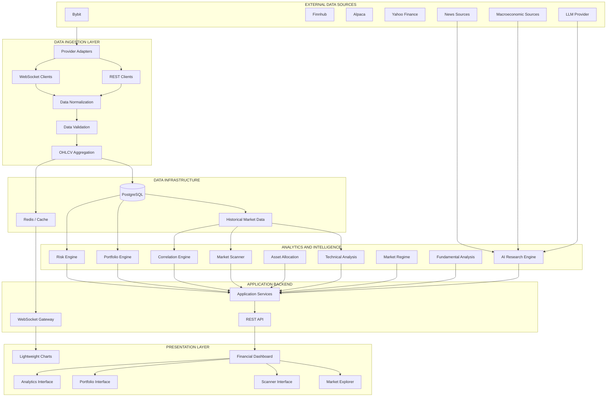

# SYSTEM ARCHITECTURE
# Personal Investment Management System (PIMS)

| Metadata | Value |
|---|---|
| Project | Personal Investment Management System |
| Document | System Architecture |
| Version | 1.0 |
| Status | Initial Architecture Baseline |
| Architecture Pattern | Monorepo + Modular Monolith |
| Frontend | Next.js + React + TypeScript |
| Backend | Python + FastAPI |
| Database | PostgreSQL |
| Chart Library | TradingView Lightweight Charts |

---

# 1. PURPOSE AND SCOPE

## 1.1 Purpose

Dokumen ini menjelaskan arsitektur teknis keseluruhan Personal Investment Management System (PIMS).

Dokumen digunakan sebagai referensi utama bagi OpenCode dalam mengimplementasikan aplikasi agar seluruh komponen memiliki struktur, hubungan, dan tanggung jawab yang konsisten.

System Architecture menentukan:

- Struktur aplikasi.
- Komponen utama sistem.
- Hubungan antar-komponen.
- Alur komunikasi.
- Arsitektur pengolahan data.
- Arsitektur analytics engines.
- Infrastruktur penyimpanan.
- Integrasi external providers.
- Mekanisme real-time communication.
- Prinsip keamanan dan skalabilitas.

Dokumen ini tidak menggantikan spesifikasi implementasi setiap modul.

## 1.2 System Objectives

PIMS dikembangkan untuk menyediakan sistem pengelolaan investasi yang memiliki kemampuan:

1. Mengelola beberapa portofolio secara terpisah.
2. Mengakses data pasar dari berbagai kelas aset.
3. Menampilkan grafik harga dengan pembaruan data real-time apabila tersedia.
4. Melakukan analisis teknikal dan fundamental.
5. Memindai instrumen pasar menggunakan Market Scanner.
6. Mengukur performa dan risiko portofolio.
7. Menganalisis korelasi dan alokasi aset.
8. Mengintegrasikan AI untuk membantu penelitian dan interpretasi pasar.

## 1.3 Initial Market Coverage

| Market | Provider | Integration |
|---|---|---|
| Cryptocurrency | Bybit | REST + WebSocket |
| US Stocks | Finnhub | REST + WebSocket sesuai paket |
| US Stocks | Alpaca | REST + WebSocket sesuai paket |
| Indonesian Stocks | Yahoo Finance | Melalui adapter, ketersediaan dan batasan harus diverifikasi |

Provider dapat ditambahkan di masa mendatang tanpa mengubah business logic utama.

---

# 2. ARCHITECTURAL STYLE

PIMS menggunakan pendekatan:

**Monorepo + Modular Monolith Architecture**

## 2.1 Monorepo

Seluruh komponen aplikasi disimpan dalam satu repository.

```text
personal-investment-management-system/
│
├── docs/
├── specifications/
├── frontend/
├── backend/
├── infrastructure/
├── tests/
└── scripts/
```

Keuntungan:

- Satu pusat pengelolaan source code.
- Dokumentasi dan implementasi berada dalam satu repository.
- Memudahkan koordinasi antara frontend dan backend.
- Mempermudah pengujian integrasi.
- Mempermudah pengembangan oleh satu developer.

## 2.2 Modular Monolith

Backend dibangun sebagai satu aplikasi utama dengan modul internal yang terpisah berdasarkan tanggung jawab.

Contoh:

```text
Backend Application
│
├── Market Data Module
├── Technical Analysis Module
├── Market Scanner Module
├── Portfolio Module
├── Risk Analysis Module
├── Allocation Module
├── Correlation Module
├── AI Research Module
└── API Module
```

Setiap modul memiliki tanggung jawab tersendiri, tetapi tidak harus dijalankan sebagai server terpisah.

### Architectural Rules

1. Hindari microservices pada tahap awal.
2. Pisahkan setiap domain berdasarkan tanggung jawab.
3. Hindari circular dependencies.
4. Gunakan interface yang jelas antar-modul.
5. Pisahkan data access dan business logic.
6. Modul harus dapat diuji secara independen.
7. Pertimbangkan pemisahan service hanya ketika kebutuhan teknis benar-benar muncul.

---

# 3. HIGH-LEVEL SYSTEM ARCHITECTURE

PIMS terdiri dari enam lapisan utama:

1. External Data Sources.
2. Data Ingestion Layer.
3. Data Infrastructure Layer.
4. Analytics and Intelligence Layer.
5. Application Backend Layer.
6. Presentation Layer.

## 3.1 System Architecture Diagram



Diagram tersebut merupakan gambaran logis. Hubungan aktual antar-modul dan penyimpanan harus mengikuti kontrak masing-masing spesifikasi.

---

# 4. PRESENTATION LAYER

## 4.1 Technology

- Next.js
- React
- TypeScript
- Tailwind CSS
- TradingView Lightweight Charts

## 4.2 Responsibilities

Presentation Layer bertanggung jawab atas:

- Dashboard rendering.
- User interactions.
- Chart visualization.
- Portfolio visualization.
- Scanner interface.
- Market monitoring.
- Analytics visualization.
- Research interface.
- Settings management.

Frontend tidak boleh menjadi sumber utama perhitungan finansial.

## 4.3 Main Application Sections

```text
Dashboard
│
├── Overview
│
├── Markets
│   ├── Market Explorer
│   ├── Asset Details
│   └── Chart
│
├── Market Scanner
│   ├── Technical Scanner
│   ├── Momentum Scanner
│   ├── Volume Scanner
│   └── Custom Filters
│
├── Portfolios
│   ├── Portfolio Overview
│   ├── Holdings
│   ├── Transactions
│   └── Performance
│
├── Analytics
│   ├── Technical Analysis
│   ├── Fundamental Analysis
│   ├── Correlation
│   └── Asset Allocation
│
├── Risk Management
│
├── Research
│
└── Settings
```

## 4.4 Frontend Communication

Frontend berkomunikasi dengan backend menggunakan:

- REST API untuk request-response.
- WebSocket untuk streaming updates.

Jangan menghubungkan frontend secara langsung ke API provider menggunakan API secrets.

---

# 5. APPLICATION BACKEND LAYER

## 5.1 Technology

- Python.
- FastAPI.
- Pydantic.
- SQLAlchemy atau pendekatan ORM yang disetujui.
- WebSocket support.

## 5.2 Responsibilities

Backend merupakan pusat pemrosesan aplikasi.

Tanggung jawab:

1. Menerima request dari frontend.
2. Memvalidasi input.
3. Mengakses database.
4. Mengelola market data.
5. Menjalankan analytics engines.
6. Mengelola portfolio.
7. Menyediakan REST API.
8. Menyediakan WebSocket streams.
9. Mengatur AI research requests.
10. Menangani authentication dan authorization.

## 5.3 Backend Internal Architecture

```text
backend/app/
│
├── api/
│   ├── rest/
│   └── websocket/
│
├── core/
│
├── data/
│
├── engines/
│
├── ai/
│
├── database/
│
└── schemas/
```

### Separation of Responsibilities

| Component | Responsibility |
|---|---|
| API | Request handling |
| Services | Application orchestration |
| Engines | Business and analytical calculations |
| Data | Provider integration and processing |
| Database | Data persistence |
| Core | Shared infrastructure |
| AI | LLM orchestration |

Route handlers tidak boleh menampung perhitungan finansial yang kompleks.

---

# 6. DATA INGESTION ARCHITECTURE

Data Ingestion Layer bertugas mengambil data dari penyedia eksternal dan mengubahnya menjadi format internal PIMS.

## 6.1 Provider Adapter Pattern

Setiap provider harus memiliki adapter tersendiri.

```text
External Providers
       |
       v
Provider Adapters
       |
       v
Raw Data
       |
       v
Normalization
       |
       v
Validation
       |
       v
Aggregation
       |
       v
Internal Market Data
```

## 6.2 Provider Isolation

Contoh:

```text
providers/
│
├── base.py
│
├── crypto/
│   └── bybit.py
│
├── us_stocks/
│   ├── finnhub.py
│   └── alpaca.py
│
└── indonesia/
    └── yahoo_finance.py
```

Setiap adapter harus mengimplementasikan kontrak internal yang konsisten.

Contoh kemampuan adapter:

- Connect.
- Disconnect.
- Fetch historical candles.
- Subscribe to market updates.
- Unsubscribe.
- Normalize provider response.
- Handle provider errors.

Kemampuan aktual setiap adapter bergantung pada fitur dan batasan provider.

## 6.3 Normalization

Semua data harus dinormalisasi sebelum digunakan oleh analytics engines.

Data internal minimal memperhatikan:

| Field | Description |
|---|---|
| Symbol | Instrument identifier |
| Asset Class | Crypto, equity, dan lainnya |
| Exchange | Trading venue |
| Provider | Data source |
| Timestamp | Event or candle time |
| Timeframe | Candle interval |
| Open | Opening price |
| High | Highest price |
| Low | Lowest price |
| Close | Closing price |
| Volume | Trading volume |
| Currency | Quote currency |
| Data Status | Freshness and availability |

Timestamp harus memiliki standar yang konsisten, disarankan UTC untuk penyimpanan internal.

## 6.4 OHLCV Aggregation

Jika provider menyediakan trade atau tick data, backend dapat mengagregasikannya menjadi candle.

```text
Incoming Trades
      |
      v
Timeframe Aggregator
      |
      v
OHLCV Candle
      |
      v
Storage + Distribution
```

Formula:

- Open = harga transaksi pertama.
- High = harga tertinggi.
- Low = harga terendah.
- Close = harga transaksi terakhir.
- Volume = total volume transaksi.

Jika provider sudah menyediakan candle, jangan melakukan agregasi ulang tanpa alasan.

---

# 7. REAL-TIME MARKET DATA ARCHITECTURE

Real-time data merupakan komponen utama PIMS.

## 7.1 Data Flow

```text
Bybit / Finnhub / Alpaca
          |
          v
Provider WebSocket
          |
          v
Backend Data Ingestion
          |
          v
Normalization
          |
          v
Market Data Processing
          |
          +------------------+
          |                  |
          v                  v
    PostgreSQL          Redis / Cache
                             |
                             v
                      WebSocket Gateway
                             |
                             v
                       Frontend Client
                             |
                             v
                   Lightweight Charts
```

## 7.2 Historical Data

Historical data diminta menggunakan REST API backend.

Contoh:

```text
GET /api/v1/markets/{symbol}/candles
```

Backend mengambil data dari penyimpanan internal atau provider sesuai ketersediaan data.

## 7.3 Live Updates

Live data didistribusikan melalui WebSocket backend.

Contoh logical event:

```json
{
  "event": "candle.update",
  "symbol": "BTCUSDT",
  "timeframe": "1m",
  "timestamp": "2026-11-16T10:30:00Z",
  "data": {
    "open": 95000,
    "high": 95100,
    "low": 94950,
    "close": 95080,
    "volume": 12.5
  }
}
```

Payload tersebut hanya contoh format konseptual, bukan nilai pasar aktual.

## 7.4 Connection Management

Sistem harus menggunakan pengelolaan subscription terpusat.

Ketentuan:

- Hindari koneksi provider duplikat.
- Gunakan subscription manager.
- Kelola reconnect.
- Monitor feed health.
- Kelola client subscriptions.
- Bersihkan subscription yang tidak digunakan.
- Tangani provider rate limits.

Satu koneksi provider dapat mendistribusikan data kepada beberapa client yang membutuhkan instrumen sama, selama diizinkan provider.

## 7.5 Data Freshness

Setiap feed harus dapat dibedakan berdasarkan:

- Real-time.
- Delayed.
- Stale.
- Disconnected.
- Unavailable.

PIMS tidak boleh menampilkan data delayed sebagai data real-time.

---

# 8. DATA INFRASTRUCTURE

## 8.1 PostgreSQL

PostgreSQL menjadi database utama.

Data yang disimpan meliputi:

- User configuration.
- Portfolios.
- Portfolio transactions.
- Holdings.
- Market instruments.
- Historical market data.
- Analytics results jika diperlukan.
- Scanner configurations.
- Research records.

## 8.2 Redis

Redis bersifat opsional pada tahap awal.

Potensi penggunaan:

- Latest market prices.
- Live candle cache.
- WebSocket event distribution.
- Temporary computation results.
- Frequently accessed market metadata.

Jangan menjadikan Redis sebagai satu-satunya penyimpanan data penting.

## 8.3 Historical Market Data

Data historis harus disimpan dan dikelola dengan mempertimbangkan:

- Instrument.
- Provider.
- Timeframe.
- Timestamp.
- Data completeness.
- Data source.
- Data correction.

TimescaleDB dapat dievaluasi pada tahap selanjutnya jika volume time-series dan kebutuhan query membutuhkannya.

---

# 9. ANALYTICS AND INTELLIGENCE LAYER

Analytics Layer bertanggung jawab atas analisis pasar dan portofolio.

Setiap engine memiliki domain masing-masing.

## 9.1 Technical Analysis Engine

Tanggung jawab:

- RSI.
- MACD.
- SMA.
- EMA.
- Bollinger Bands.
- ATR.
- Volume indicators.
- Technical conditions.

Engine menerima market data yang telah dinormalisasi.

## 9.2 Market Scanner Engine

Tanggung jawab:

- Market universe management.
- Instrument filtering.
- Technical scanning.
- Momentum scanning.
- Volume scanning.
- Volatility scanning.
- Ranking.

Market Scanner harus mampu memindai instrumen di luar portofolio yang dimiliki.

## 9.3 Portfolio Engine

Tanggung jawab:

- Portfolio management.
- Holdings.
- Transactions.
- Cost basis.
- Realized P&L.
- Unrealized P&L.
- Portfolio valuation.
- Performance.

Setiap portofolio harus memiliki identitas dan data yang terpisah.

## 9.4 Risk Engine

Tanggung jawab:

- Volatility.
- Maximum drawdown.
- Value at Risk.
- Sharpe Ratio.
- Concentration risk.
- Portfolio exposure.

Formula dan asumsi harus terdokumentasi.

## 9.5 Asset Allocation Engine

Tanggung jawab:

- Asset allocation.
- Sector allocation.
- Instrument allocation.
- Portfolio distribution.
- Allocation comparison.

## 9.6 Correlation Engine

Tanggung jawab:

- Correlation matrix.
- Rolling correlation.
- Diversification analysis.
- Asset relationship analysis.

## 9.7 Market Regime Engine

Tanggung jawab:

- Bullish regime.
- Bearish regime.
- Sideways regime.
- Volatility regime.

Metode klasifikasi harus ditentukan dalam spesifikasi engine.

## 9.8 Fundamental Analysis Engine

Tanggung jawab:

- Financial statements.
- Valuation metrics.
- Growth metrics.
- Profitability metrics.
- Financial health indicators.

Ketersediaan data bergantung pada provider dan lisensinya.

## 9.9 AI Research Engine

Tanggung jawab:

- Research summarization.
- News interpretation.
- Analytics explanation.
- Research report generation.
- Multi-source context analysis.

AI harus menerima informasi terstruktur dari analytics engines dan sumber eksternal yang relevan.

AI tidak menjadi sumber utama perhitungan numerik.

---

# 10. MARKET SCANNER ARCHITECTURE

Market Scanner dirancang sebagai engine terpisah.

## 10.1 Scanner Workflow

```text
Market Universe
      |
      v
Data Availability Check
      |
      v
Scanner Data Processor
      |
      v
Scanner Rules
      |
      v
Filtering
      |
      v
Ranking
      |
      v
Scanner Results
      |
      v
Frontend
```

## 10.2 Scanner Categories

- Technical Scanner.
- Momentum Scanner.
- Volume Scanner.
- Volatility Scanner.
- Fundamental Scanner.
- Market Trend Scanner.
- Anomaly Scanner.
- Correlation Scanner.

## 10.3 Processing Strategy

Tidak semua scanner membutuhkan pemrosesan setiap detik.

Strategi awal:

| Scanner | Processing Strategy |
|---|---|
| Technical | Candle update / candle close |
| Momentum | Periodic |
| Volume | Event-driven / periodic |
| Volatility | Periodic |
| Fundamental | Scheduled |
| Market Trend | Periodic |
| Anomaly | Event-driven |
| Correlation | Periodic |

Interval aktual harus ditentukan berdasarkan kebutuhan analisis, batas provider, dan kapasitas sistem.

## 10.4 Performance Considerations

- Gunakan shared market data.
- Hindari duplicate calculations.
- Gunakan cached intermediate results apabila sesuai.
- Batasi jumlah instrumen berdasarkan universe yang tersedia.
- Gunakan batch processing.
- Jangan membuka satu chart atau koneksi provider untuk setiap instrumen.

---

# 11. PORTFOLIO AND RISK ARCHITECTURE

Portfolio dan Risk Engine harus menggunakan data portofolio dan market data yang konsisten.

```text
Portfolio Transactions
        |
        v
Holdings Calculation
        |
        v
Portfolio Valuation
        |
        v
Performance Engine
        |
        v
Risk Engine
        |
        +----------------+
        |                |
        v                v
Allocation Engine   Correlation Engine
        |                |
        +----------------+
                 |
                 v
          Analytics API
```

## 11.1 Multiple Portfolio Support

Setiap portfolio harus memiliki:

- Unique portfolio ID.
- Name.
- Base currency.
- Transactions.
- Holdings.
- Performance records.
- Configuration.

Data antar-portofolio tidak boleh tercampur.

## 11.2 Calculation Integrity

Perhitungan harus memperhatikan:

- Transaction history.
- Fees.
- Currency conversion.
- Corporate actions jika didukung.
- Missing market prices.
- Time boundaries.
- Valuation timestamps.

Rumus final dan metode akuntansi portofolio ditetapkan dalam spesifikasi tersendiri.

---

# 12. AI RESEARCH ARCHITECTURE

AI Research Engine menggunakan pendekatan orchestration.

```text
User Research Request
        |
        v
Research Service
        |
        v
Context Builder
        |
        +-------------------+
        |                   |
        v                   v
Analytics Results     External Information
        |                   |
        +-------------------+
                  |
                  v
             LLM Provider
                  |
                  v
          Response Validation
                  |
                  v
           Research Output
```

## 12.1 AI Responsibilities

AI dapat membantu:

- Menjelaskan hasil analisis.
- Membandingkan instrumen.
- Merangkum berita.
- Menyusun laporan.
- Menjelaskan risiko.
- Menyusun skenario berdasarkan input.

## 12.2 AI Restrictions

- Jangan mengarang data pasar.
- Jangan menganggap interpretasi AI sebagai fakta.
- Pisahkan fakta, asumsi, dan opini.
- Sertakan referensi sumber apabila tersedia.
- Jangan melakukan transaksi otomatis.
- Jangan mengubah data portofolio tanpa persetujuan pengguna.

---

# 13. APPLICATION COMMUNICATION ARCHITECTURE

Frontend dan backend menggunakan dua jalur komunikasi.

## 13.1 REST API

Digunakan untuk:

- Portfolio management.
- Historical candles.
- Scanner results.
- Analytics.
- Settings.
- Research requests.
- Reports.

Contoh logical endpoint:

```text
/api/v1/markets
/api/v1/markets/{symbol}
/api/v1/markets/{symbol}/candles

/api/v1/scanner
/api/v1/scanner/results

/api/v1/portfolios
/api/v1/portfolios/{id}
/api/v1/portfolios/{id}/holdings

/api/v1/analytics
/api/v1/risk

/api/v1/research
```

Endpoint tersebut merupakan rancangan awal. Kontrak final akan ditetapkan dalam `specifications/backend/api-spec.md`.

## 13.2 WebSocket

Digunakan untuk:

- Live market prices.
- Candle updates.
- Scanner notifications.
- Portfolio updates jika dibutuhkan.
- Connection status.

Contoh logical event:

```text
market.price
market.candle
scanner.result
portfolio.update
connection.status
```

Format event dan subscription protocol ditentukan dalam spesifikasi WebSocket.

---

# 14. SECURITY ARCHITECTURE

Keamanan menjadi bagian dari desain sistem sejak awal.

Prinsip:

1. Environment-based secrets.
2. Authentication.
3. Authorization.
4. Input validation.
5. API rate limiting.
6. Secure WebSocket authentication.
7. Database access control.
8. Centralized logging.
9. Dependency security.
10. Sensitive data protection.

API keys milik market data provider hanya boleh diakses melalui backend.

Jangan menyimpan credentials dalam frontend bundle atau repository.

---

# 15. DEPLOYMENT ARCHITECTURE

Pada tahap awal, PIMS dirancang agar dapat dijalankan menggunakan Docker Compose.

Logical deployment:

```text
User Browser
     |
     v
Frontend Container
     |
     v
Backend Container
     |
     +----------+
     |          |
     v          v
PostgreSQL    Redis
     |
     v
Persistent Storage

Backend
   |
   v
External Market Providers
```

Redis dapat dihilangkan dari deployment awal jika belum diperlukan.

Komponen awal:

- Frontend application.
- Backend application.
- PostgreSQL.
- Optional Redis.

Gunakan persistent volumes untuk database.

---

# 16. SCALABILITY STRATEGY

PIMS menggunakan pendekatan scale incrementally.

## Stage 1 — Single Application

- Satu frontend application.
- Satu backend application.
- Satu PostgreSQL database.
- Provider connections terpusat.
- Tanpa microservices.

## Stage 2 — Performance Optimization

- Redis caching.
- Query optimization.
- Batch processing.
- Background jobs.
- Efficient WebSocket distribution.
- Historical data optimization.

## Stage 3 — Workload Separation

Jika beban sistem meningkat, pertimbangkan:

- Dedicated market data worker.
- Background analytics worker.
- Dedicated scanner worker.
- Separate reporting worker.

Pemisahan service tidak dilakukan sebelum terdapat kebutuhan yang terukur.

---

# 17. ARCHITECTURAL CONSTRAINTS

Ketentuan yang wajib dipertahankan selama implementasi:

1. Backend merupakan sumber utama perhitungan finansial.
2. Frontend tidak terhubung langsung ke provider menggunakan secret credentials.
3. Semua provider harus melalui adapter.
4. Semua market data harus dinormalisasi.
5. Analytics engines harus independen dari provider.
6. Market Scanner merupakan engine tersendiri.
7. Lightweight Charts hanya menangani visualisasi.
8. WebSocket provider dikelola secara terpusat.
9. PostgreSQL menjadi penyimpanan utama.
10. Redis bersifat opsional pada tahap awal.
11. Backend menggunakan Modular Monolith.
12. Setiap modul harus memiliki tanggung jawab yang jelas.
13. Data real-time dan delayed harus dibedakan.
14. AI tidak menggantikan perhitungan deterministik.
15. Perubahan arsitektur inti membutuhkan persetujuan.

---

# 18. IMPLEMENTATION ROADMAP

Urutan implementasi arsitektur:

| Phase | Component | Priority |
|---|---|---|
| 1 | Project Foundation | Critical |
| 2 | Database Foundation | Critical |
| 3 | Market Data Architecture | Critical |
| 4 | Bybit Integration | High |
| 5 | WebSocket Infrastructure | High |
| 6 | Lightweight Charts | High |
| 7 | Portfolio Management | High |
| 8 | Technical Analysis | High |
| 9 | Risk and Allocation | High |
| 10 | Market Scanner | High |
| 11 | Additional Providers | Medium |
| 12 | AI Research | Medium |
| 13 | Advanced Analytics | Medium |

Urutan ini merupakan baseline dan dapat disesuaikan melalui persetujuan Project Owner.

---

# 19. ARCHITECTURE VALIDATION

Sebelum implementasi dinyatakan sesuai arsitektur, OpenCode harus memverifikasi:

- [ ] Frontend dan backend memiliki pemisahan tanggung jawab.
- [ ] Provider menggunakan adapter.
- [ ] Normalization berjalan sebelum analytics processing.
- [ ] Historical data dapat diakses.
- [ ] WebSocket backend dapat mendistribusikan updates.
- [ ] Lightweight Charts menerima data dari backend.
- [ ] Analytics engines tidak bergantung langsung pada provider.
- [ ] Multiple portfolios memiliki isolasi data.
- [ ] Market Scanner dapat memproses market universe.
- [ ] Financial calculations dapat diuji.
- [ ] Secrets tidak terekspos.
- [ ] Dokumentasi dan implementasi tetap konsisten.

---

# 20. FINAL ARCHITECTURAL PRINCIPLE

PIMS harus dikembangkan sebagai sistem finansial modular dengan fokus utama pada kualitas data, akurasi perhitungan, konsistensi arsitektur, dan kemampuan pengembangan jangka panjang.

Urutan prioritas:

1. Data correctness.
2. Calculation correctness.
3. Architectural consistency.
4. System reliability.
5. Performance.
6. User experience.
7. Advanced intelligence.

Jangan mengorbankan akurasi data dan perhitungan demi menambahkan fitur lebih cepat.

**Build a reliable financial system first, then expand its intelligence and capabilities.**

---

**END OF SYSTEM ARCHITECTURE DOCUMENT**