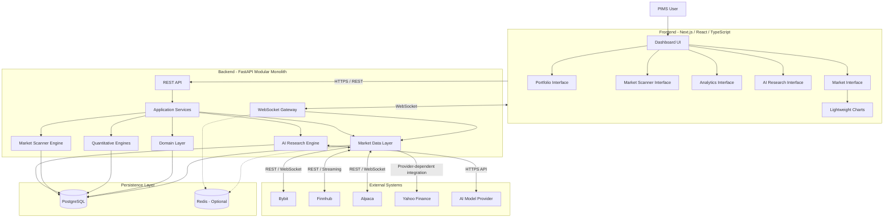

# Component Diagram
## Personal Investment Management System (PIMS)

**Document Version:** 1.0  
**Status:** Architecture Specification  
**Diagram Type:** C4 Container and Component View  
**Last Updated:** November 2026

---

# 1. Purpose

Dokumen ini menjelaskan struktur komponen internal Personal Investment Management System (PIMS) dan hubungan komunikasi antar-komponen.

Berbeda dengan System Context Diagram yang menjelaskan hubungan PIMS dengan sistem eksternal, Component Diagram berfokus pada struktur internal aplikasi.

Tujuan utama:

- Menjelaskan pembagian komponen frontend dan backend.
- Menjelaskan tanggung jawab setiap modul.
- Memperlihatkan hubungan antar-engine.
- Menjelaskan integrasi market data providers.
- Menjelaskan komunikasi REST API dan WebSocket.
- Menentukan batas tanggung jawab setiap komponen.
- Menjadi referensi implementasi bagi OpenCode.

# 2. Architectural Overview

PIMS menggunakan arsitektur **Monorepo dengan Modular Monolith**.

Sistem dibagi menjadi beberapa bagian utama:

1. Presentation Layer.
2. API and Application Layer.
3. Domain Layer.
4. Market Data Layer.
5. Analytics and Intelligence Layer.
6. Persistence Layer.
7. External Integration Layer.

Setiap layer memiliki tanggung jawab berbeda dan berkomunikasi melalui interface yang telah ditentukan.

# 3. High-Level Component Diagram

Diagram berikut menggambarkan hubungan komponen utama PIMS.



**Catatan:** Diagram ini menunjukkan hubungan konseptual, bukan urutan pemanggilan setiap fungsi. Redis bersifat opsional dan tidak wajib digunakan pada MVP.

# 4. Frontend Components

Frontend bertanggung jawab terhadap presentasi informasi dan interaksi pengguna.

Teknologi utama:

- Next.js.
- React.
- TypeScript.
- Tailwind CSS.
- TradingView Lightweight Charts.

## 4.1 Dashboard Component

Tanggung jawab:

- Menampilkan ringkasan kondisi portofolio.
- Menampilkan market overview.
- Menampilkan informasi performa.
- Menampilkan watchlist.
- Menampilkan ringkasan analytics.
- Menggabungkan data dari beberapa fitur.

Dashboard tidak melakukan perhitungan finansial secara langsung.

## 4.2 Portfolio Interface

Tanggung jawab:

- Menampilkan daftar portofolio.
- Menampilkan holdings.
- Menampilkan transaksi.
- Menampilkan cash balance.
- Menampilkan portfolio performance.
- Menyediakan interface pencatatan transaksi.

Seluruh perubahan data dikirim melalui backend API.

## 4.3 Market Interface

Tanggung jawab:

- Menampilkan informasi instrumen.
- Menampilkan harga terbaru.
- Menampilkan historical market data.
- Menampilkan market overview.
- Menampilkan market status.
- Menampilkan data freshness.

## 4.4 Chart Component

Menggunakan TradingView Lightweight Charts.

Tanggung jawab:

- Candlestick visualization.
- Line charts.
- Area charts.
- Volume visualization.
- Crosshair.
- Time range selection.
- Real-time chart updates.

Chart hanya bertanggung jawab pada visualisasi.

Historical data diperoleh melalui REST API, sedangkan update terbaru diperoleh melalui WebSocket.

## 4.5 Market Scanner Interface

Tanggung jawab:

- Menampilkan scanner categories.
- Menampilkan filter konfigurasi.
- Menampilkan hasil screening.
- Menampilkan ranking.
- Menampilkan metrik instrumen.
- Mengarahkan pengguna ke halaman analisis instrumen.

Proses screening dan ranking dilakukan oleh backend.

## 4.6 Analytics Interface

Tanggung jawab:

- Menampilkan performance analytics.
- Menampilkan risk metrics.
- Menampilkan asset allocation.
- Menampilkan correlation analysis.
- Menampilkan market regime.

Frontend hanya mengonsumsi dan memvisualisasikan hasil perhitungan backend.

## 4.7 AI Research Interface

Tanggung jawab:

- Menerima research requests.
- Menampilkan research reports.
- Menampilkan sumber informasi.
- Menampilkan analytical explanations.
- Menampilkan status pemrosesan.

Frontend tidak boleh mengirim credential AI provider secara langsung.

# 5. Backend Components

Backend menggunakan FastAPI dengan pendekatan Modular Monolith.

Backend dibagi berdasarkan tanggung jawab aplikasi dan domain bisnis.

## 5.1 API Layer

API Layer merupakan pintu komunikasi antara frontend dan backend.

### REST API

Menangani:

- Portfolio requests.
- Transaction requests.
- Historical market data.
- Analytics requests.
- Scanner requests.
- Research requests.
- Application settings.

### WebSocket Gateway

Menangani:

- Market price updates.
- Candle updates.
- Scanner notifications.
- Realtime dashboard events.

WebSocket Gateway harus menggunakan mekanisme subscription agar setiap client hanya menerima informasi yang diperlukan.

## 5.2 Application Layer

Application Layer mengatur proses bisnis dan use cases.

Contoh application services:

- CreatePortfolioService.
- RecordTransactionService.
- GetPortfolioOverviewService.
- GetHistoricalMarketDataService.
- RunAnalyticsService.
- RunScannerService.
- GenerateResearchReportService.

Application Layer mengatur koordinasi antara domain, data, dan engines.

Application Layer tidak boleh menjadi tempat menumpuk seluruh perhitungan finansial.

## 5.3 Domain Layer

Domain Layer menyimpan business rules dan entitas utama.

Modul konseptual:

- Portfolio.
- Asset.
- Holding.
- Transaction.
- Cash.
- Market.

Tanggung jawab:

- Menjaga aturan bisnis.
- Menjaga konsistensi transaksi.
- Mengatur aturan portofolio.
- Memvalidasi operasi domain.
- Menjaga batas antar-domain.

Domain Layer tidak boleh bergantung pada framework API atau provider eksternal.

# 6. Market Data Components

Market Data Layer bertanggung jawab terhadap seluruh proses pengambilan, normalisasi, validasi, dan distribusi data pasar.

## 6.1 Provider Adapters

Setiap provider memiliki adapter tersendiri.

Contoh:

```text
data/providers/
├── crypto/
│   └── bybit/
├── us_stocks/
│   ├── finnhub/
│   └── alpaca/
└── indonesia/
    └── yahoo_finance/
```

Tanggung jawab:

- Menghubungkan aplikasi dengan provider.
- Mengelola REST requests.
- Mengelola WebSocket connections.
- Mengelola subscription.
- Menangani provider-specific errors.
- Mengubah respons provider menjadi internal input model.

Provider adapter tidak boleh menjalankan perhitungan portfolio analytics.

## 6.2 Market Data Ingestion

Tanggung jawab:

- Mengambil historical data.
- Menerima streaming updates.
- Mengatur ingestion scheduling.
- Mengelola reconnect.
- Mengatur subscription lifecycle.
- Mengirim data ke normalization pipeline.

## 6.3 Normalization Component

Mengubah format data eksternal menjadi internal market data model.

Informasi yang harus dinormalisasi:

- Asset identity.
- Provider identity.
- Symbol.
- Currency.
- Timestamp.
- Timeframe.
- OHLCV.
- Market session.
- Data source metadata.

## 6.4 Validation Component

Memastikan data memenuhi aturan kualitas.

Validasi mencakup:

- Missing fields.
- Invalid prices.
- Invalid timestamps.
- Duplicate records.
- Inconsistent OHLC values.
- Unexpected volume values.
- Stale data.

Data yang gagal validasi harus ditangani berdasarkan aturan error dan data quality policy.

## 6.5 Aggregation Component

Digunakan untuk membangun candle dari trade atau tick apabila provider tidak menyediakan candle yang dibutuhkan.

Aturan dasar OHLCV:

- Open: harga transaksi pertama.
- High: harga tertinggi.
- Low: harga terendah.
- Close: harga transaksi terakhir.
- Volume: total volume transaksi.

Jika provider telah menyediakan candle sesuai timeframe, sistem tidak perlu melakukan agregasi ulang tanpa alasan.

## 6.6 Market Data Service

Menjadi internal service yang menyediakan data pasar kepada komponen lain.

Tanggung jawab:

- Historical data retrieval.
- Latest market data retrieval.
- Data source selection.
- Data freshness tracking.
- Internal market data distribution.

Komponen ini menjadi interface utama bagi engine yang membutuhkan market data.

# 7. Quantitative Engine Components

Quantitative engines merupakan modul yang melakukan perhitungan matematis dan analisis finansial.

Seluruh perhitungan dilakukan di backend.

## 7.1 Portfolio Performance Engine

Input:

- Transactions.
- Holdings.
- Cash ledger.
- Market prices.
- FX rates jika diperlukan.

Output:

- Portfolio value.
- Total return.
- Daily return.
- Realized P&L.
- Unrealized P&L.
- CAGR.
- Benchmark comparison.

## 7.2 Risk Analysis Engine

Input:

- Portfolio returns.
- Asset returns.
- Holdings.
- Market data.

Output:

- Volatility.
- Maximum drawdown.
- Sharpe ratio.
- Sortino ratio.
- VaR.
- CVaR.
- Beta.
- Concentration risk.

## 7.3 Asset Allocation Engine

Input:

- Portfolio holdings.
- Asset classifications.
- Market prices.
- FX rates.

Output:

- Asset allocation.
- Sector allocation.
- Market allocation.
- Currency exposure.
- Concentration distribution.

## 7.4 Technical Analysis Engine

Input:

- Historical OHLCV.

Output:

- SMA.
- EMA.
- RSI.
- MACD.
- Bollinger Bands.
- ATR.
- Stochastic.
- VWAP.

## 7.5 Correlation Analysis Engine

Input:

- Historical asset returns.

Output:

- Pairwise correlation.
- Correlation matrix.
- Rolling correlation.
- Diversification analysis.

## 7.6 Market Regime Engine

Input:

- Market prices.
- Returns.
- Volatility.
- Technical metrics.

Output:

- Bullish regime.
- Bearish regime.
- Sideways regime.
- High-volatility regime.
- Low-volatility regime.

Hasil engine merupakan klasifikasi berdasarkan metode yang digunakan dan bukan prediksi yang dijamin benar.

# 8. Market Scanner Components

Market Scanner merupakan modul terpisah yang melakukan screening terhadap market universe.

Komponen:

```text
scanner/
├── universe/
├── eligibility/
├── filters/
├── processors/
├── ranking/
├── results/
└── scheduler/
```

Tanggung jawab:

| Component | Responsibility |
|---|---|
| Universe | Menentukan instrumen yang akan dipindai |
| Eligibility | Memeriksa ketersediaan dan kelayakan data |
| Filters | Menerapkan kondisi screening |
| Processors | Menghitung metrik yang dibutuhkan |
| Ranking | Mengurutkan hasil berdasarkan aturan |
| Results | Menyimpan dan menyediakan hasil |
| Scheduler | Mengatur waktu eksekusi |

Scanner categories:

- Technical.
- Momentum.
- Volume.
- Volatility.
- Fundamental.
- Market Trend.
- Anomaly.
- Correlation.

Scanner tidak boleh dibatasi hanya pada aset yang dimiliki dalam portofolio.

# 9. AI Research Components

AI Research Layer mengelola proses interpretasi dan pembuatan laporan.

Struktur konseptual:

```text
ai/
├── providers/
├── research/
├── context_builder/
└── report_generator/
```

## 9.1 Context Builder

Mengumpulkan informasi terstruktur dari:

- Market Data Service.
- Technical Analysis Engine.
- Fundamental Analysis Engine.
- Risk Analysis Engine.
- Portfolio Performance Engine.
- Research Sources.

Context Builder harus memastikan data yang diberikan kepada AI memiliki timestamp dan sumber yang jelas.

## 9.2 AI Orchestration

Mengatur:

- Research requests.
- Model selection.
- Prompt construction.
- Context submission.
- Response handling.
- Error handling.

## 9.3 AI Provider Adapter

Menjadi abstraction layer antara aplikasi dan layanan model AI.

Tujuannya adalah mengurangi ketergantungan pada satu model provider.

## 9.4 Report Generator

Mengubah respons AI menjadi research report yang terstruktur.

Laporan harus menyimpan:

- Model provider.
- Model name.
- Prompt version.
- Data context.
- Research sources.
- Generated timestamp.

AI hanya bertugas melakukan interpretasi dan penyusunan informasi. Perhitungan finansial tetap dilakukan oleh quantitative engines.

# 10. Persistence Components

PostgreSQL menjadi database utama.

Komponen database:

```text
database/
├── models/
├── repositories/
└── migrations/
```

## 10.1 Models

Mendefinisikan struktur dan relasi database.

## 10.2 Repositories

Mengatur operasi pengambilan dan penyimpanan data.

Repository menjadi interface antara application/domain logic dan database.

## 10.3 Migrations

Mengelola perubahan struktur database secara terkontrol menggunakan migration system yang telah disetujui.

## 10.4 Redis

Redis dapat digunakan sebagai komponen tambahan apabila diperlukan untuk:

- Caching.
- Latest market data.
- WebSocket distribution.
- Temporary state.
- Background job coordination.

Redis bukan database utama dan bukan sumber kebenaran transaksi.

# 11. Component Dependency Rules

Aturan dependency harus dijaga agar tidak terjadi circular dependency.

Arah dependency konseptual:

```text
Frontend
   │
   ▼
API Layer
   │
   ▼
Application Layer
   │
   ├── Domain Layer
   ├── Market Data Services
   ├── Quantitative Engines
   ├── Market Scanner
   └── AI Research

Infrastructure
   │
   ├── External Providers
   ├── PostgreSQL
   └── Optional Redis
```

Aturan:

1. Frontend tidak boleh mengakses database secara langsung.
2. Frontend tidak boleh mengakses provider credentials.
3. API Layer tidak boleh menjadi tempat perhitungan bisnis utama.
4. Domain Layer tidak boleh bergantung pada HTTP framework.
5. Engines harus menerima input melalui kontrak yang jelas.
6. Engine tidak boleh mengakses tabel database secara sembarangan.
7. Provider adapters tidak boleh mengandung business logic portofolio.
8. AI Research tidak boleh menggantikan quantitative engines.
9. Komponen persistence harus diakses melalui mekanisme yang terkontrol.
10. Hindari circular dependencies antar-modul.

# 12. Communication Patterns

| Communication | Pattern | Purpose |
|---|---|---|
| Frontend → Backend | REST | Request dan response |
| Frontend ↔ Backend | WebSocket | Real-time updates |
| Application → Domain | Direct module call | Business rules |
| Application → Engines | Defined interfaces | Analytics execution |
| Market Data → Providers | REST / WebSocket | Data ingestion |
| Engines → Market Data | Internal service interface | Market data retrieval |
| Application → Database | Repository | Persistence |
| AI Research → AI Provider | HTTPS API | Model inference |

Komunikasi internal Modular Monolith sebaiknya menggunakan pemanggilan fungsi atau service interface secara langsung. Message broker tidak wajib digunakan pada MVP.

# 13. Failure Handling

Setiap komponen harus menangani kegagalan secara terpisah.

| Component | Potential Failure | Expected Handling |
|---|---|---|
| Provider Adapter | API unavailable | Retry and report error |
| WebSocket | Connection lost | Reconnect and resubscribe |
| Normalization | Invalid format | Reject or quarantine data |
| Validation | Invalid market data | Mark data quality status |
| Database | Connection failure | Controlled error and recovery |
| Analytics Engine | Insufficient input | Return explicit calculation status |
| Scanner | Partial processing failure | Track run status |
| AI Provider | Request failure | Return research failure status |
| Frontend | WebSocket disconnected | Display connection status |

Kegagalan satu provider tidak boleh membuat seluruh aplikasi berhenti apabila komponen lain masih dapat berjalan.

# 14. Implementation Boundaries

OpenCode harus menggunakan diagram ini sebagai panduan pembagian tanggung jawab komponen.

Ketentuan:

- Implementasikan komponen berdasarkan kebutuhan MVP.
- Jangan membuat seluruh modul masa depan sekaligus.
- Jangan membuat microservices dari komponen yang telah digambarkan.
- Jangan membuat service terpisah untuk setiap engine.
- Gunakan internal interfaces untuk menjaga modularitas.
- Pisahkan provider integration dari business logic.
- Pisahkan visualisasi frontend dari perhitungan backend.
- Dokumentasikan perubahan dependency antar-komponen.

Diagram ini adalah rancangan target arsitektur. Struktur folder dan implementasi final harus tetap diselaraskan dengan `application-architecture.md` dan `AGENTS.md`.

# 15. Related Documents

- `AGENTS.md`
- `docs/architecture/system-architecture.md`
- `docs/architecture/application-architecture.md`
- `docs/architecture/data-flow.md`
- `docs/architecture/engine-architecture.md`
- `docs/database/database-design.md`
- `docs/decisions/technical-decisions.md`
- `docs/diagrams/system-context.md`

---

# Final Principle

Setiap komponen PIMS harus memiliki tanggung jawab yang jelas dan batas komunikasi yang terdefinisi.

Frontend bertanggung jawab terhadap presentasi, backend bertanggung jawab terhadap business logic dan analisis, market data layer bertanggung jawab terhadap integrasi data eksternal, sedangkan persistence layer bertanggung jawab terhadap penyimpanan data.

Seluruh komponen harus tetap berada dalam satu Modular Monolith pada tahap awal pengembangan.