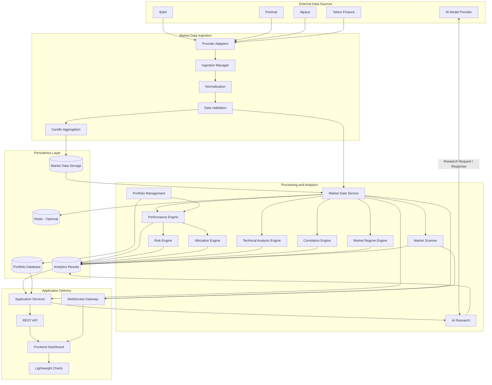
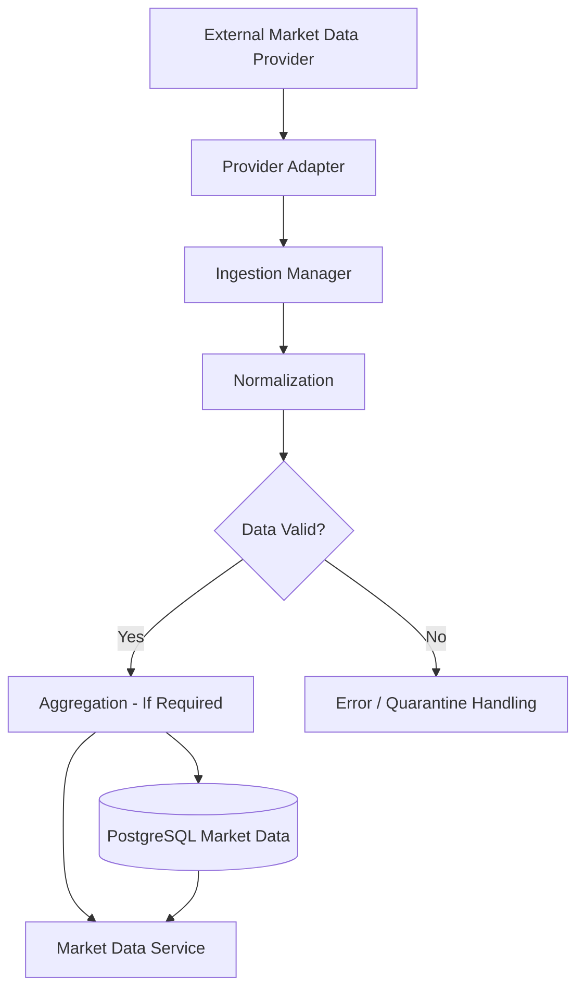
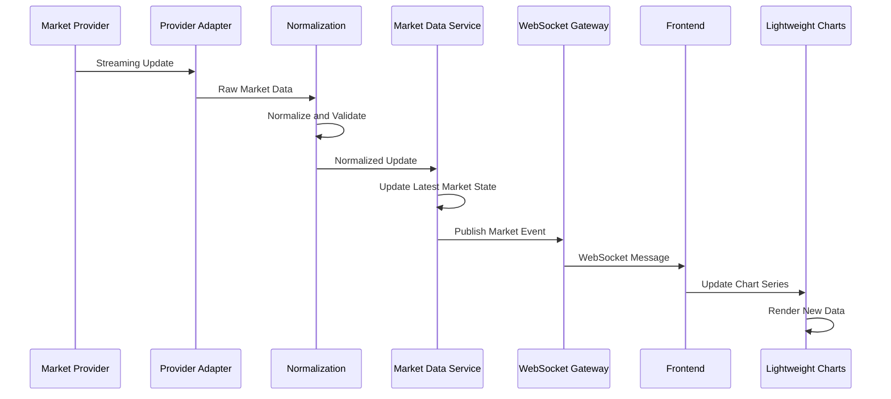
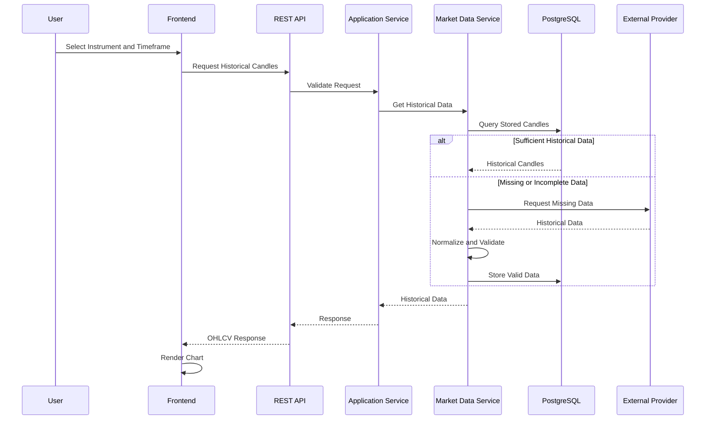
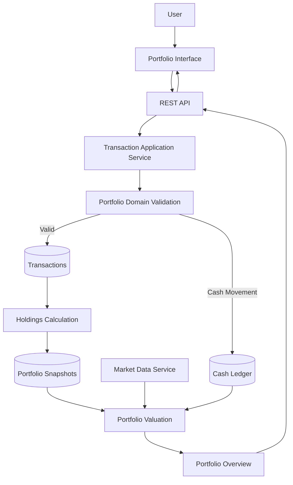
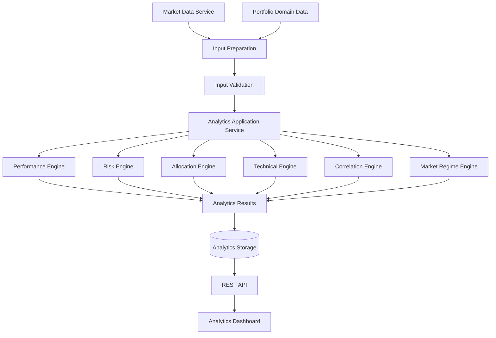
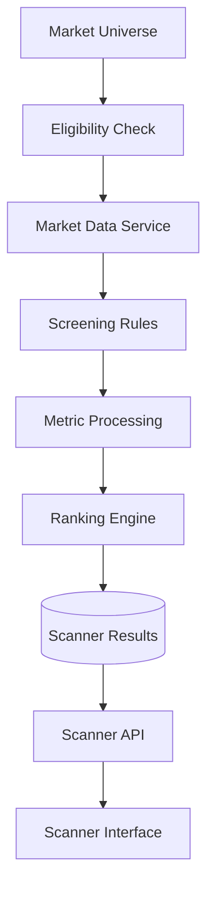
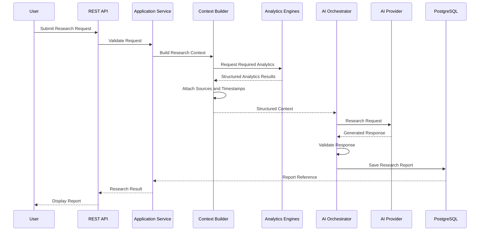
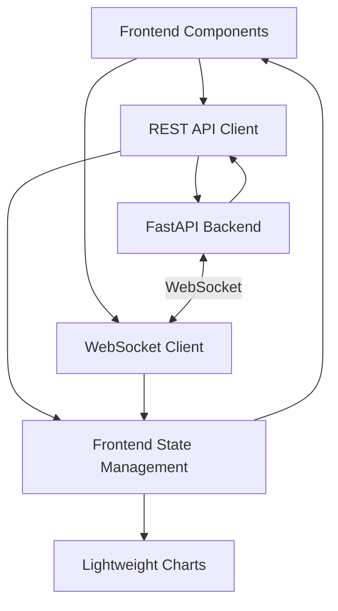
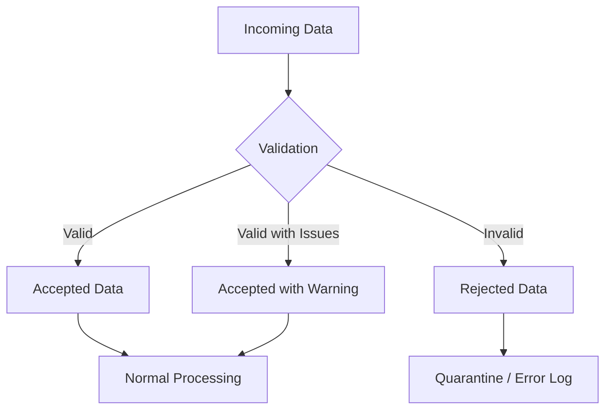

# Data Flow Diagram
## Personal Investment Management System (PIMS)

**Document Version:** 1.0  
**Status:** Architecture Specification  
**Diagram Type:** Data Flow Diagram  
**Last Updated:** November 2026

---

# 1. Purpose

Dokumen ini menjelaskan bagaimana data mengalir di dalam Personal Investment Management System (PIMS), mulai dari pengambilan data eksternal hingga diproses, disimpan, dianalisis, dan ditampilkan kepada pengguna.

Tujuan utama:

- Menggambarkan aliran market data.
- Menggambarkan aliran real-time market updates.
- Menggambarkan aliran data portofolio.
- Menggambarkan aliran quantitative analytics.
- Menggambarkan aliran Market Scanner.
- Menggambarkan aliran AI Research.
- Menentukan proses penyimpanan dan distribusi data.
- Menjadi referensi implementasi bagi OpenCode.

# 2. Data Flow Architecture Overview

PIMS memiliki beberapa kategori aliran data utama:

1. Market Data Flow.
2. Real-Time Data Flow.
3. Portfolio Data Flow.
4. Quantitative Analytics Flow.
5. Market Scanner Flow.
6. AI Research Flow.
7. Frontend Data Delivery Flow.

Secara umum, aliran data mengikuti pola:

**External Sources → Ingestion → Normalization → Validation → Processing → Storage → Analytics → API / WebSocket → Frontend**

Tidak semua jenis data harus melalui seluruh tahapan tersebut. Setiap pipeline mengikuti kebutuhan dan karakteristik datanya.

# 3. High-Level Data Flow Diagram

Diagram berikut menggambarkan aliran data utama dalam PIMS.



**Catatan:** Diagram bersifat konseptual. Tidak semua hasil engine harus disimpan secara permanen. Penyimpanan bergantung pada kebutuhan audit, reproducibility, performa, dan kebijakan retensi.

# 4. Market Data Flow

Market Data Flow merupakan proses pengambilan data dari provider eksternal dan mengubahnya menjadi format internal yang dapat digunakan oleh seluruh sistem.

## 4.1 Data Sources

Sumber data awal:

| Provider | Market | Integration |
|---|---|---|
| Bybit | Cryptocurrency | REST / WebSocket |
| Finnhub | US Stocks | REST / Streaming |
| Alpaca | US Stocks | REST / WebSocket |
| Yahoo Finance | Indonesian Stocks (initial source) | Provider-dependent |

Setiap provider memiliki format data, batas akses, frekuensi update, dan ketentuan lisensi yang berbeda.

## 4.2 Ingestion Process

Proses:

1. Ingestion Manager meminta atau menerima data dari provider.
2. Provider Adapter menangani komunikasi dengan provider.
3. Data diteruskan ke Normalization Component.
4. Validation Component memeriksa kualitas data.
5. Aggregation Component membentuk candle jika diperlukan.
6. Data yang valid diteruskan ke Market Data Service dan storage sesuai jenis data.

## 4.3 Market Data Flow Diagram



## 4.4 Normalized Market Data

Seluruh data pasar harus mengikuti internal data contract.

Informasi utama:

- Internal asset identifier.
- Provider identifier.
- Provider instrument identifier.
- Symbol.
- Market.
- Currency.
- Timestamp.
- Timeframe.
- Open.
- High.
- Low.
- Close.
- Volume.
- Data freshness.
- Source metadata.

Identitas instrumen internal harus dipisahkan dari simbol provider karena satu instrumen dapat memiliki simbol berbeda di beberapa sumber.

# 5. Real-Time Data Flow

Real-time flow digunakan untuk menyampaikan perubahan harga dan candle kepada pengguna tanpa melakukan reload halaman.

Arsitektur menggunakan centralized market data connections.

Artinya, backend mengelola koneksi ke provider dan mendistribusikan update kepada banyak client. Frontend tidak membuat koneksi langsung ke provider untuk setiap chart.

## 5.1 Real-Time Process

1. Backend membuat koneksi ke provider.
2. Provider mengirim trade, tick, quote, atau candle updates.
3. Provider Adapter menerima data.
4. Data dinormalisasi dan divalidasi.
5. Candle dibentuk apabila diperlukan.
6. Market Data Service memperbarui latest market state.
7. WebSocket Gateway mendistribusikan update kepada client yang berlangganan.
8. Frontend memperbarui chart dan market widgets.

## 5.2 Real-Time Diagram



## 5.3 Historical and Streaming Data

Chart menggunakan dua jalur data:

**Historical Data**
- Diminta melalui REST API.
- Digunakan untuk mengisi candle sebelumnya.
- Dapat berasal dari database atau provider berdasarkan kebijakan data.

**Streaming Data**
- Dikirim melalui WebSocket.
- Digunakan untuk memperbarui harga atau candle terbaru.
- Harus menggunakan timestamp dan urutan data yang benar.

Frontend harus menangani kemungkinan data terlambat, duplikat, atau datang tidak berurutan.

## 5.4 Data Freshness

Setiap data pasar harus memiliki status freshness.

| Status | Meaning |
|---|---|
| LIVE | Data memenuhi kriteria real-time provider |
| DELAYED | Data mengalami keterlambatan yang diketahui |
| STALE | Data tidak diperbarui sesuai batas yang ditentukan |
| HISTORICAL | Data historis |
| UNAVAILABLE | Data tidak tersedia |
| UNKNOWN | Status freshness belum dapat dipastikan |

Sistem tidak boleh menyatakan data sebagai LIVE hanya karena data baru saja diterima oleh backend.

Status harus mempertimbangkan timestamp sumber, karakteristik feed, dan keterlambatan provider.

# 6. Historical Market Data Flow

Historical data digunakan oleh:

- Chart.
- Technical Analysis Engine.
- Correlation Engine.
- Market Regime Engine.
- Risk Analysis Engine.
- Backtesting Engine pada tahap berikutnya.

Diagram:



Backend harus menentukan kapan data dari provider perlu diminta berdasarkan ketersediaan, freshness, dan kebijakan provider.

# 7. Portfolio Data Flow

Portfolio Data Flow mengatur proses pencatatan transaksi dan pembentukan informasi portofolio.

Transaksi merupakan sumber utama data kepemilikan.

Holdings dapat dihitung dari transaksi dan disimpan sebagai snapshot atau materialized result untuk meningkatkan performa.

## 7.1 Transaction Process

1. User membuat transaksi.
2. Frontend mengirim transaction request.
3. Backend melakukan validasi.
4. Domain Layer menerapkan business rules.
5. Transaction disimpan.
6. Cash ledger diperbarui.
7. Holdings dihitung ulang atau diperbarui.
8. Portfolio snapshot diperbarui sesuai kebutuhan.
9. Portfolio overview tersedia melalui API.

## 7.2 Portfolio Flow Diagram



## 7.3 Portfolio Data Rules

- Transaksi tidak boleh diubah tanpa aturan audit yang jelas.
- Setiap transaksi harus memiliki portfolio dan asset reference.
- Perubahan transaksi harus memicu proses rekalkulasi terkait.
- Holdings harus dapat direkonstruksi dari transaksi.
- Harga pasar harus memiliki sumber dan timestamp.
- Currency conversion harus menggunakan FX data yang sesuai.
- Perhitungan performa harus menggunakan metodologi yang terdokumentasi.

# 8. Quantitative Analytics Flow

Quantitative Analytics Flow memproses data portofolio dan market data menjadi informasi analitis.

Setiap engine menerima input terstruktur dan menghasilkan output yang memiliki metadata.

## 8.1 Analytics Pipeline



## 8.2 Engine Input and Output

| Engine | Main Input | Main Output |
|---|---|---|
| Performance | Transactions, holdings, prices | Return and P&L |
| Risk | Returns, holdings | Risk metrics |
| Allocation | Holdings, classifications | Exposure distribution |
| Technical | OHLCV | Indicators |
| Correlation | Asset returns | Correlation matrix |
| Market Regime | Market data and metrics | Regime classification |

## 8.3 Calculation Metadata

Setiap analytics result sebaiknya menyimpan metadata:

- Engine name.
- Engine version.
- Calculation timestamp.
- Input period.
- Input asset identifiers.
- Data source references.
- Calculation parameters.
- Result status.
- Warnings.

Hal ini diperlukan untuk reproducibility dan audit.

# 9. Market Scanner Flow

Market Scanner memproses market universe dan mencari instrumen berdasarkan kriteria tertentu.

Scanner berjalan secara independen dari portfolio holdings.

## 9.1 Scanner Pipeline



## 9.2 Scanner Process

1. Scheduler memulai scanner run.
2. Scanner mengambil market universe.
3. Eligibility Component memeriksa kelayakan instrumen.
4. Market Data Service menyediakan data yang dibutuhkan.
5. Screening Rules melakukan penyaringan.
6. Processor menghitung metrik.
7. Ranking Engine mengurutkan hasil.
8. Scanner Results menyimpan hasil pemindaian.
9. Frontend menerima hasil melalui REST API.
10. Notifikasi dapat didistribusikan melalui WebSocket.

## 9.3 Scanner Execution

Scanner dapat menggunakan beberapa mode:

- Scheduled execution.
- Candle-close execution.
- On-demand execution.
- Event-driven execution jika diperlukan.

Setiap hasil scanner harus memiliki timestamp dan referensi scanner run.

# 10. AI Research Flow

AI Research Flow menggabungkan hasil quantitative engines, informasi pasar, dan sumber riset untuk menghasilkan laporan terstruktur.

AI tidak mengambil alih perhitungan matematis.

## 10.1 Research Process

1. User mengirim research request.
2. Backend memvalidasi request.
3. Context Builder mengambil informasi relevan.
4. Data context diberi metadata sumber dan timestamp.
5. AI Orchestrator menyusun permintaan.
6. AI Provider menerima context.
7. AI menghasilkan respons.
8. Response Validator memeriksa format dan kelengkapan.
9. Report Generator menyusun research report.
10. Hasil disimpan dan dikirim ke frontend.

## 10.2 AI Research Diagram



## 10.3 AI Data Rules

- AI hanya menerima data yang diperlukan untuk research request.
- Setiap data harus memiliki sumber dan timestamp.
- AI tidak boleh mengarang harga, rasio, atau hasil perhitungan.
- Jika data tidak tersedia, AI harus menyatakan keterbatasannya.
- Research report harus menyimpan model dan prompt version.
- AI-generated conclusions harus dibedakan dari fakta dan hasil perhitungan.

# 11. Frontend Data Delivery Flow

Frontend menerima data dari backend melalui REST API dan WebSocket.

## 11.1 REST API

Digunakan untuk:

- Portfolio overview.
- Transaction history.
- Historical market data.
- Analytics results.
- Scanner results.
- Research reports.
- Settings.

REST digunakan untuk request-response operations dan data yang tidak memerlukan streaming berkelanjutan.

## 11.2 WebSocket

Digunakan untuk:

- Live market prices.
- Candle updates.
- Realtime market events.
- Scanner notifications.
- Connection status.

## 11.3 Frontend Flow Diagram



Frontend harus menangani:

- Loading state.
- Empty state.
- Error state.
- Connection state.
- Data freshness state.
- Partial data availability.

# 12. Data Storage Flow

Tidak semua data memiliki kebutuhan penyimpanan yang sama.

| Data Category | Storage | Purpose |
|---|---|---|
| Assets and instruments | PostgreSQL | Internal identity |
| Portfolios | PostgreSQL | Portfolio records |
| Transactions | PostgreSQL | Source of truth |
| Cash ledger | PostgreSQL | Cash movements |
| Holdings snapshots | PostgreSQL | Portfolio state |
| Historical candles | PostgreSQL | Historical market data |
| Latest quotes | Optional persistence/cache | Latest market state |
| Analytics results | PostgreSQL | Reusable results and audit |
| Scanner results | PostgreSQL | Screening history |
| Research reports | PostgreSQL | Research history |
| Logs | PostgreSQL or application logging | Operational monitoring |

Redis dapat digunakan sebagai cache atau distribusi event apabila diperlukan.

Redis tidak boleh menjadi satu-satunya tempat penyimpanan transaksi atau data penting yang harus tahan lama.

# 13. Data Quality and Error Flow

Data quality merupakan bagian dari setiap pipeline.

Setiap proses harus dapat mengidentifikasi:

- Missing data.
- Invalid data.
- Delayed data.
- Stale data.
- Duplicate data.
- Provider failure.
- Calculation failure.
- Partial processing.

Diagram:



Data dengan warning hanya boleh diproses jika aturan kualitas untuk use case tersebut mengizinkan.

Hasil perhitungan yang menggunakan data tidak lengkap harus menyertakan warning atau status yang sesuai.

# 14. Data Lifecycle

Siklus hidup data secara umum:

```text
External Data
     │
     ▼
Acquisition
     │
     ▼
Normalization
     │
     ▼
Validation
     │
     ▼
Processing
     │
     ▼
Storage
     │
     ▼
Analytics
     │
     ▼
API / WebSocket
     │
     ▼
Frontend Visualization
```

Beberapa data dapat melewati jalur berbeda.

Contohnya:

- Streaming quote dapat langsung diperbarui pada latest market state tanpa harus disimpan setiap tick.
- Historical candles dapat disimpan untuk analisis berikutnya.
- Transaction records harus disimpan secara persisten.
- Analytics results dapat dihitung ulang jika input atau parameter berubah.
- AI research reports dapat disimpan sebagai dokumen historis.

# 15. Data Flow Constraints

OpenCode wajib mengikuti aturan berikut:

1. Semua market data harus melalui provider adapter.
2. Semua market data harus dinormalisasi sebelum digunakan oleh internal engines.
3. Validasi data harus dilakukan sebelum data digunakan.
4. Backend menjadi pusat pengelolaan market data.
5. Frontend tidak boleh terhubung langsung ke provider menggunakan API credentials.
6. Historical data menggunakan REST API.
7. Real-time updates menggunakan WebSocket.
8. Transaksi merupakan sumber utama data portofolio.
9. Holdings harus dapat direkonstruksi dari transaksi.
10. Quantitative calculations dilakukan di backend.
11. Market Scanner harus dapat bekerja di luar portfolio holdings.
12. AI hanya menginterpretasikan data dan hasil perhitungan terstruktur.
13. Data freshness harus dapat diketahui oleh pengguna.
14. Setiap analytics result harus memiliki metadata perhitungan.
15. Kegagalan satu provider tidak boleh otomatis menghentikan seluruh sistem.

# 16. Implementation Priorities

Data flow harus dibangun secara bertahap.

| Phase | Data Flow | Priority |
|---|---|---|
| 1 | Database and internal data models | Critical |
| 2 | Bybit historical market data | Critical |
| 3 | Bybit real-time market data | Critical |
| 4 | Normalization and validation | Critical |
| 5 | Historical chart delivery | High |
| 6 | WebSocket chart updates | High |
| 7 | Portfolio transactions and holdings | High |
| 8 | Performance and risk analytics | High |
| 9 | Technical analysis | High |
| 10 | Market Scanner | High |
| 11 | Correlation and market regime | Medium |
| 12 | AI Research | Medium |
| 13 | Additional market providers | Medium |

Prioritas dapat berubah berdasarkan hasil validasi teknis dan kebutuhan MVP yang telah disetujui.

# 17. Related Documents

- `AGENTS.md`
- `docs/architecture/system-architecture.md`
- `docs/architecture/application-architecture.md`
- `docs/architecture/data-flow.md`
- `docs/architecture/engine-architecture.md`
- `docs/database/database-design.md`
- `docs/decisions/technical-decisions.md`
- `docs/diagrams/system-context.md`
- `docs/diagrams/component-diagram.md`

---

# Final Principle

Data Flow Architecture harus memastikan setiap data memiliki sumber yang jelas, format yang konsisten, proses validasi yang tepat, dan jalur distribusi yang terkontrol.

PIMS harus menjaga integritas data portofolio, kualitas market data, reproducibility analytics, serta transparansi informasi yang ditampilkan kepada pengguna.

**Data yang ditampilkan harus dapat ditelusuri asal-usulnya, diketahui waktu pembaruannya, dan dipahami keterbatasannya.**