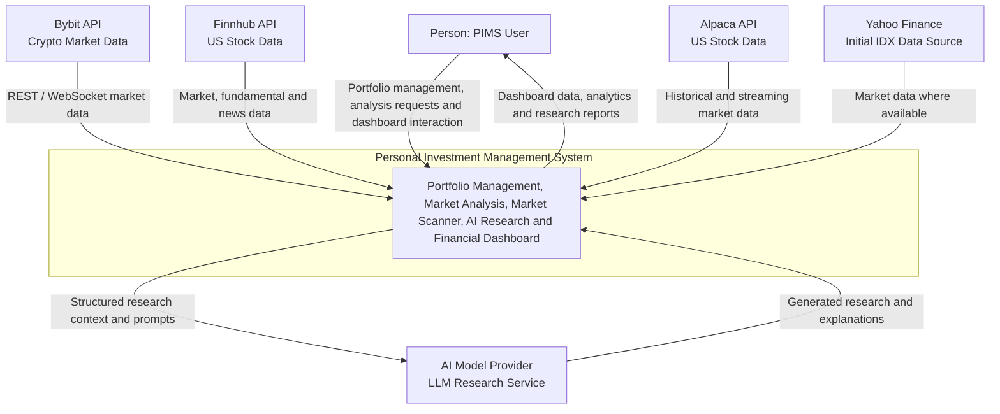

# System Context Diagram
## Personal Investment Management System (PIMS)

**Document Version:** 1.0  
**Status:** Architecture Specification  
**Diagram Type:** C4 Level 1 — System Context  
**Last Updated:** November 2026

---

# 1. Purpose

Dokumen ini menjelaskan posisi Personal Investment Management System (PIMS) dalam lingkungan sistem secara keseluruhan.

System Context Diagram menggambarkan:

- Siapa yang menggunakan PIMS.
- Sistem utama yang menjadi pusat pengelolaan.
- Penyedia data eksternal yang terhubung.
- Layanan AI yang digunakan.
- Hubungan komunikasi antara PIMS dan sistem eksternal.

Diagram ini memberikan gambaran tingkat tinggi tanpa menjelaskan detail internal komponen aplikasi.

# 2. System Overview

Personal Investment Management System merupakan aplikasi pengelolaan dan analisis portofolio investasi yang mengintegrasikan data dari berbagai pasar.

Sistem digunakan oleh pengguna untuk:

- Mengelola beberapa portofolio.
- Memantau aset dan pergerakan pasar.
- Melihat chart harga.
- Melakukan analisis kuantitatif.
- Menjalankan Market Scanner.
- Melakukan riset menggunakan AI Research Assistant.
- Memantau performa dan risiko portofolio.

PIMS bertindak sebagai pusat pengolahan data dan analisis, sedangkan penyedia eksternal bertanggung jawab menyediakan data pasar atau layanan model AI.

# 3. External Actors and Systems

## 3.1 Primary User

**Type:** Person

Pengguna utama yang berinteraksi dengan PIMS melalui dashboard.

Aktivitas:

- Membuat dan mengelola portofolio.
- Mencatat transaksi secara manual.
- Melihat informasi pasar.
- Menggunakan Market Scanner.
- Mengakses quantitative analytics.
- Meminta laporan riset dari AI.

PIMS pada tahap awal berfungsi sebagai sistem pengelolaan dan analisis, bukan platform untuk mengeksekusi transaksi perdagangan secara otomatis.

## 3.2 Bybit

**Type:** External Market Data Provider

Menyediakan data pasar cryptocurrency.

Integrasi yang direncanakan:

- REST API.
- WebSocket.
- Historical market data.
- Real-time market updates.
- OHLCV data.
- Market ticker data.

Ketersediaan data bergantung pada instrumen, endpoint, dan ketentuan provider.

## 3.3 Finnhub

**Type:** External Market Data Provider

Digunakan sebagai salah satu sumber data untuk pasar saham Amerika Serikat.

Integrasi yang direncanakan:

- Stock market data.
- Historical prices.
- Company information.
- Fundamental information.
- News data.
- Streaming data apabila tersedia pada paket yang digunakan.

## 3.4 Alpaca

**Type:** External Market Data Provider

Menjadi alternatif atau sumber tambahan data saham Amerika Serikat.

Integrasi yang direncanakan:

- Historical stock data.
- Real-time market data sesuai entitlement.
- Market quotes.
- Trade data.
- Streaming market updates.

Ketersediaan feed dan cakupan bursa harus mengikuti paket serta lisensi akun.

## 3.5 Yahoo Finance

**Type:** External Market Data Source

Digunakan sebagai sumber awal untuk eksplorasi dan integrasi data pasar saham Indonesia.

Penggunaannya harus memperhatikan:

- Ketersediaan instrumen.
- Historical data.
- Data freshness.
- Reliability.
- Ketentuan penggunaan dan redistribusi.

Yahoo Finance tidak boleh diasumsikan sebagai sumber resmi real-time IDX.

## 3.6 AI Model Provider

**Type:** External AI Service

Menyediakan kemampuan Large Language Model untuk AI Research Engine.

Fungsi:

- Interpretasi hasil quantitative analysis.
- Research report generation.
- Summarization.
- Context-based market analysis.
- Explanation of analytical results.

AI Model Provider tidak menjadi sumber utama data harga dan tidak bertanggung jawab atas perhitungan matematis finansial.

# 4. System Context Diagram

# 5. System Relationships

| Source | Destination | Communication | Purpose |
|---|---|---|---|
| User | PIMS | HTTPS | Dashboard interaction |
| PIMS | User | HTTPS / WebSocket | Analytics and market updates |
| Bybit | PIMS | REST / WebSocket | Crypto market data |
| Finnhub | PIMS | REST / Streaming | US stock information |
| Alpaca | PIMS | REST / WebSocket | US stock market data |
| Yahoo Finance | PIMS | Provider-dependent | Initial IDX data |
| PIMS | AI Provider | HTTPS API | Research requests |
| AI Provider | PIMS | HTTPS API response | Research output |

# 6. System Boundaries

## 6.1 Inside PIMS

PIMS is responsible for:

- User interface.
- Portfolio management.
- Transaction records.
- Market data ingestion.
- Data normalization.
- Data validation.
- Historical data storage.
- Real-time data distribution.
- Quantitative analytics.
- Market Scanner.
- AI research orchestration.
- Analytical report management.

## 6.2 Outside PIMS

External systems are responsible for:

- Providing market data.
- Providing external AI model inference.
- Maintaining their own infrastructure.
- Defining API availability and usage limitations.
- Defining data licensing and entitlement conditions.

PIMS must not assume control over the availability or accuracy of external services.

# 7. Important Architectural Boundaries

## 7.1 Market Data Ownership

Market data providers are external sources.

PIMS is responsible for:

- Retrieving data.
- Normalizing data.
- Validating data.
- Tracking data freshness.
- Storing permitted data.
- Distributing data internally.

All market data should pass through the provider adapter and normalization architecture before being consumed by internal engines.

## 7.2 AI Responsibility

AI is an external intelligence service.

PIMS remains responsible for:

- Preparing analytical context.
- Validating model requests.
- Managing AI responses.
- Tracking research sources.
- Presenting results.

AI must not replace deterministic calculations.

## 7.3 Portfolio Data Ownership

Portfolio information is owned and managed within PIMS.

External market providers do not determine:

- Portfolio holdings.
- User transaction records.
- Portfolio allocation.
- Portfolio performance.
- Internal risk calculations.

These are computed or maintained by PIMS.

# 8. External Dependency Considerations

PIMS must be designed to remain operational when an external provider becomes unavailable.

Required behavior:

- Detect provider connection failures.
- Track provider availability.
- Display data freshness.
- Preserve previously stored historical data.
- Avoid presenting stale data as live.
- Support provider fallback when a compatible source is available.
- Record ingestion errors.
- Avoid making analytics claims based on missing data.

Provider fallback must not silently combine incompatible data sources.

# 9. Future External Integrations

The following integrations may be considered in future development:

| Integration | Potential Purpose | Status |
|---|---|---|
| Additional crypto providers | Market data redundancy | Future |
| Additional US stock providers | Broader market coverage | Future |
| Official IDX data provider | More reliable Indonesian market data | Future |
| Economic data providers | Macro analysis | Future |
| Benchmark data providers | Benchmark comparison | Future |
| Financial statement providers | Fundamental analysis | Future |
| News providers | Sentiment and research | Future |

These integrations are not part of the initial implementation unless explicitly approved.

# 10. Implementation Guidelines

OpenCode must use this diagram as the high-level system boundary reference.

Implementation requirements:

1. Keep external providers separated from internal business logic.
2. Use provider adapters for market data integrations.
3. Keep AI integration behind an abstraction layer.
4. Do not allow frontend components to access external provider credentials.
5. Keep portfolio records under PIMS control.
6. Handle external service failures.
7. Respect API rate limits and data licensing.
8. Do not assume every provider offers real-time data.
9. Preserve the distinction between external data and internally calculated analytics.

# 11. Related Documents

- `README.md`
- `AGENTS.md`
- `docs/architecture/system-architecture.md`
- `docs/architecture/application-architecture.md`
- `docs/architecture/data-flow.md`
- `docs/architecture/engine-architecture.md`
- `docs/database/database-design.md`
- `docs/decisions/technical-decisions.md`

---

**Final Principle**

PIMS is the central system responsible for portfolio management, market data processing, quantitative analysis, and research orchestration.

External providers act as data and intelligence sources. Their responsibilities must remain clearly separated from PIMS internal business logic.