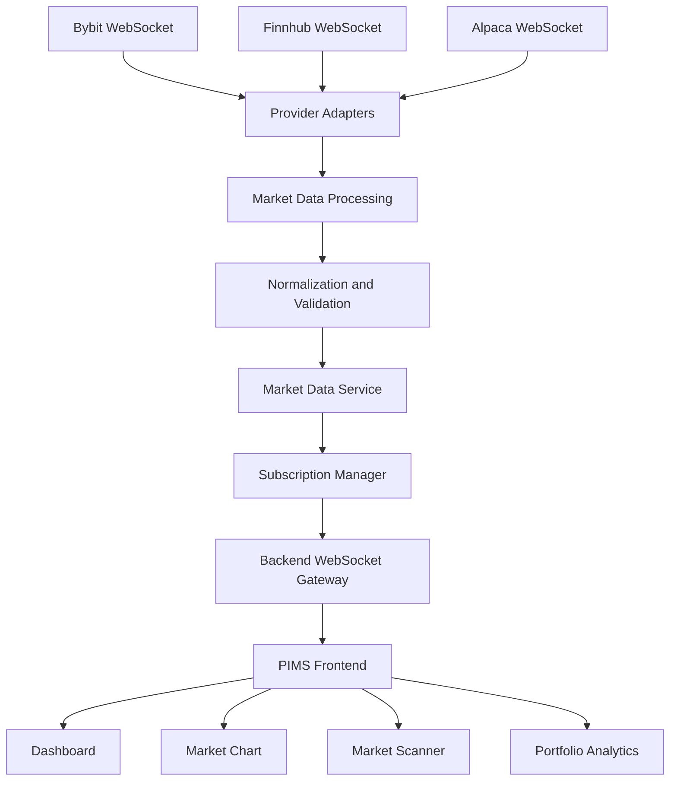
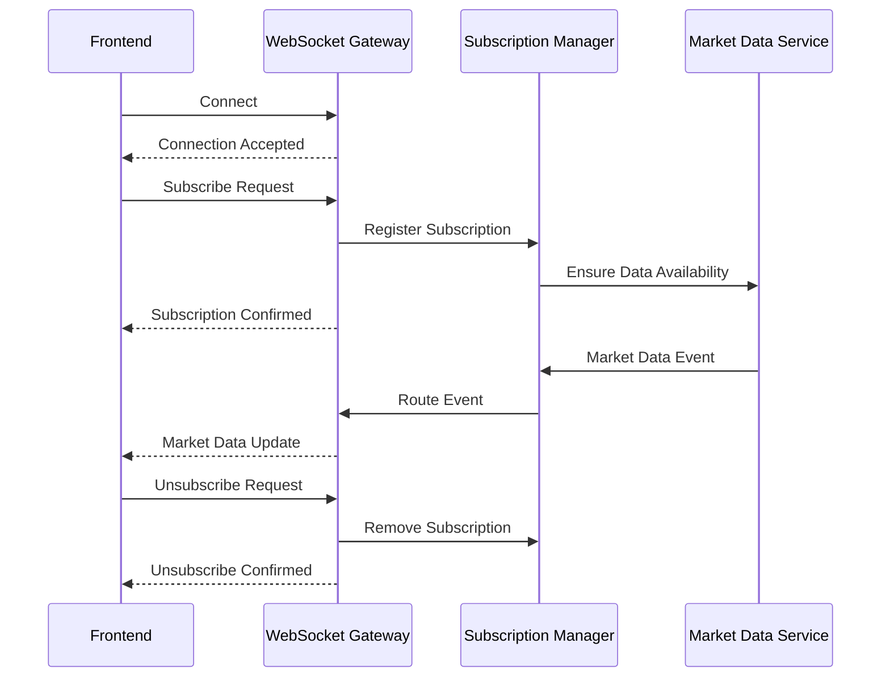
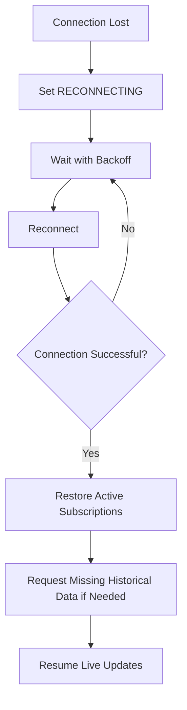

# WebSocket Specification
## Personal Investment Management System (PIMS)

**Document Version:** 1.0  
**Project Status:** Planning  
**Document Type:** Backend WebSocket Specification  
**Last Updated:** November 2026

---

# 1. Purpose

Dokumen ini mendefinisikan arsitektur, protokol komunikasi, event structure, subscription management, dan data distribution melalui WebSocket pada Personal Investment Management System (PIMS).

WebSocket digunakan untuk mengirimkan pembaruan data secara realtime atau near-realtime dari backend ke frontend tanpa harus melakukan HTTP request berulang kali.

Tujuan utama:

- Menyediakan market price updates.
- Mengirimkan candle updates ke chart.
- Menyediakan market data status.
- Mengirimkan portfolio valuation updates.
- Mengirimkan Market Scanner notifications.
- Mengatur subscription dan unsubscription.
- Menangani koneksi terputus dan reconnect.
- Mengoptimalkan penggunaan koneksi provider.
- Menjaga konsistensi data antara backend dan frontend.

Dokumen ini menjadi acuan implementasi WebSocket oleh OpenCode.

# 2. WebSocket Architecture

PIMS menggunakan centralized WebSocket architecture.

Backend bertanggung jawab untuk mengelola koneksi ke external market data providers, memproses data, kemudian mendistribusikannya kepada frontend.

## 2.1 High-Level Architecture



Yahoo Finance sebagai sumber awal IDX tidak boleh diasumsikan menyediakan official WebSocket feed. Jika tidak tersedia, backend dapat menggunakan polling atau mekanisme lain yang sesuai dengan kemampuan dan ketentuan sumber data tersebut.

## 2.2 Architecture Principles

- Centralized provider connections.
- Backend-controlled subscriptions.
- Normalized event payloads.
- Explicit data freshness.
- Controlled message frequency.
- Efficient connection management.
- Graceful reconnect.
- No direct provider connections from frontend.
- Separation between provider protocol and internal protocol.

Frontend hanya berkomunikasi menggunakan internal PIMS WebSocket protocol.

# 3. WebSocket Responsibilities

## 3.1 Backend Responsibilities

Backend bertanggung jawab untuk:

- Membuat dan mengelola provider connections.
- Mengelola internal client connections.
- Mengatur subscription.
- Menormalisasi incoming events.
- Memvalidasi market data.
- Mengirimkan data sesuai subscription.
- Mengelola reconnect provider.
- Menangani stale data.
- Mengatur message frequency.
- Mengirimkan connection status.
- Mencatat error dan connection events.

## 3.2 Frontend Responsibilities

Frontend bertanggung jawab untuk:

- Membuat koneksi ke PIMS WebSocket.
- Melakukan subscription.
- Melakukan unsubscription.
- Memproses incoming events.
- Memperbarui UI.
- Memperbarui chart.
- Menangani reconnect.
- Menampilkan connection status.
- Menghindari duplicate subscriptions.
- Membersihkan subscriptions ketika komponen tidak lagi digunakan.

Frontend tidak boleh menghitung ulang authoritative financial metrics dari raw market events.

# 4. WebSocket Endpoint

## 4.1 Development

```text
ws://localhost:8000/ws/v1
```

## 4.2 Production

```text
wss://api.example.com/ws/v1
```

Production harus menggunakan secure WebSocket melalui TLS.

## 4.3 Protocol

- Transport: WebSocket.
- Payload: JSON.
- Encoding: UTF-8.
- Internal protocol version: `1`.

WebSocket protocol version harus dikelola secara terpisah dari REST API versioning.

# 5. Connection Lifecycle

Siklus koneksi terdiri dari:

1. Client connection.
2. Connection validation.
3. Client registration.
4. Subscription requests.
5. Event distribution.
6. Unsubscription.
7. Connection closure.

## 5.1 Connection Flow



## 5.2 Connection States

| State | Description |
|---|---|
| CONNECTING | Connection is being established |
| CONNECTED | Connection established |
| AUTHENTICATING | Authentication is being validated, if enabled |
| READY | Connection can process subscriptions |
| RECONNECTING | Client is attempting reconnection |
| DISCONNECTED | Connection is closed |
| ERROR | Connection encountered an error |

`CONNECTED` dan `READY` harus dibedakan. Koneksi yang berhasil dibuka belum tentu sudah selesai melewati validasi yang diperlukan.

# 6. Message Envelope

Semua internal WebSocket messages harus menggunakan struktur envelope yang konsisten.

## 6.1 Standard Event Structure

```json
{
  "protocol_version": "1",
  "event": "market.quote",
  "event_id": "event-uuid",
  "timestamp": "2026-11-17T00:30:00Z",
  "data": {}
}
```

## 6.2 Envelope Fields

| Field | Description |
|---|---|
| protocol_version | Internal protocol version |
| event | Event name |
| event_id | Unique event identifier |
| timestamp | Event creation timestamp |
| data | Event payload |

Untuk message yang berasal dari provider, payload juga harus menyimpan source timestamp jika tersedia.

## 6.3 Timestamp Rules

Pisahkan:

- Event timestamp: waktu event dibuat atau dikirim backend.
- Source timestamp: waktu data berasal dari provider.
- Processing timestamp: waktu data selesai diproses backend.

Jangan menggunakan event timestamp sebagai pengganti source timestamp.

# 7. Client Commands

Frontend dapat mengirimkan command kepada WebSocket Gateway.

Command awal:

- `subscribe`
- `unsubscribe`
- `ping`

## 7.1 Subscribe Command

Contoh:

```json
{
  "action": "subscribe",
  "request_id": "request-uuid",
  "channel": "market.quote",
  "params": {
    "asset_id": "asset-uuid"
  }
}
```

## 7.2 Subscribe Confirmation

```json
{
  "protocol_version": "1",
  "event": "subscription.confirmed",
  "event_id": "event-uuid",
  "timestamp": "2026-11-17T00:30:00Z",
  "data": {
    "request_id": "request-uuid",
    "subscription_id": "subscription-uuid",
    "channel": "market.quote",
    "status": "ACTIVE"
  }
}
```

## 7.3 Unsubscribe Command

```json
{
  "action": "unsubscribe",
  "request_id": "request-uuid",
  "subscription_id": "subscription-uuid"
}
```

## 7.4 Ping Command

```json
{
  "action": "ping",
  "request_id": "request-uuid"
}
```

Backend harus memberikan response pong agar client dapat mendeteksi koneksi yang masih aktif.

# 8. Subscription Channels

PIMS menggunakan channel-based subscription.

Setiap channel memiliki tanggung jawab dan payload tersendiri.

## 8.1 Initial Channels

| Channel | Responsibility |
|---|---|
| `market.quote` | Latest price updates |
| `market.candle` | Candle updates |
| `market.status` | Market data and provider status |
| `portfolio.valuation` | Portfolio valuation updates |
| `scanner.alert` | Scanner notifications |
| `system.notification` | Application notifications |

Channel yang belum dibutuhkan pada MVP tidak harus langsung diimplementasikan.

# 9. Market Quote Events

Channel:

`market.quote`

Digunakan untuk mengirimkan perubahan harga instrumen.

## 9.1 Subscription Parameters

```json
{
  "asset_id": "asset-uuid"
}
```

Subscription dapat diperluas untuk beberapa asset jika diperlukan dan jika batas jumlah subscription telah ditentukan.

## 9.2 Quote Event

```json
{
  "protocol_version": "1",
  "event": "market.quote",
  "event_id": "event-uuid",
  "timestamp": "2026-11-17T00:30:01Z",
  "data": {
    "asset_id": "asset-uuid",
    "symbol": "BTCUSDT",
    "last_price": "95000.00",
    "bid": "94999.50",
    "ask": "95000.50",
    "currency": "USDT",
    "provider": "BYBIT",
    "source_timestamp": "2026-11-17T00:30:00Z",
    "freshness": "LIVE"
  }
}
```

## 9.3 Quote Rules

- Quote harus memiliki asset ID.
- Provider harus dapat diidentifikasi.
- Price menggunakan decimal-safe representation.
- Source timestamp harus disertakan jika tersedia.
- Bid dan ask bersifat optional.
- Data stale harus ditandai.
- Backend tidak boleh mengirimkan data lama seolah-olah merupakan harga terbaru.

# 10. Market Candle Events

Channel:

`market.candle`

Digunakan untuk memperbarui chart secara incremental.

## 10.1 Subscription Parameters

```json
{
  "asset_id": "asset-uuid",
  "timeframe": "1m"
}
```

## 10.2 Candle Event

```json
{
  "protocol_version": "1",
  "event": "market.candle",
  "event_id": "event-uuid",
  "timestamp": "2026-11-17T00:30:01Z",
  "data": {
    "asset_id": "asset-uuid",
    "symbol": "BTCUSDT",
    "timeframe": "1m",
    "candle": {
      "time": 1794875400,
      "open": "95000.00",
      "high": "95050.00",
      "low": "94980.00",
      "close": "95020.00",
      "volume": "12.50"
    },
    "provider": "BYBIT",
    "freshness": "LIVE",
    "is_closed": false
  }
}
```

## 10.3 Candle Update Rules

Backend harus memastikan:

- Candle menggunakan interval yang benar.
- Candle memiliki timestamp interval yang konsisten.
- Candle yang sama diperbarui, bukan ditambahkan sebagai candle baru pada setiap tick.
- Candle final ditandai dengan `is_closed: true`.
- Candle historical tidak tertukar dengan candle realtime.
- Duplicate events dapat ditangani frontend.

## 10.4 Chart Integration

Frontend menggunakan historical REST response untuk initial chart loading.

Setelah itu, WebSocket mengirimkan incremental updates.

Konsep alur:

```text
Historical REST Data
        |
        v
Lightweight Charts setData()
        |
        v
WebSocket Candle Events
        |
        v
Lightweight Charts update()
```

Backend harus menjaga agar candle realtime mengikuti format dan timestamp yang sama dengan historical candle data.

# 11. Market Status Events

Channel:

`market.status`

Digunakan untuk menginformasikan kondisi market data.

## 11.1 Status Types

Freshness states:

- `LIVE`
- `DELAYED`
- `STALE`
- `HISTORICAL`
- `UNAVAILABLE`
- `UNKNOWN`

Connection states:

- `CONNECTED`
- `DISCONNECTED`
- `RECONNECTING`
- `ERROR`

Kedua status tersebut tidak boleh digabungkan karena memiliki arti berbeda.

## 11.2 Example Event

```json
{
  "protocol_version": "1",
  "event": "market.status",
  "event_id": "event-uuid",
  "timestamp": "2026-11-17T00:30:01Z",
  "data": {
    "provider": "BYBIT",
    "market": "CRYPTO",
    "connection_status": "CONNECTED",
    "freshness": "LIVE",
    "last_received_at": "2026-11-17T00:30:00Z"
  }
}
```

## 11.3 Status Rules

- Provider connection status harus berasal dari backend.
- Data freshness harus berdasarkan data timestamp dan freshness policy.
- Provider disconnected tidak selalu berarti seluruh market data unavailable karena data historis mungkin masih tersedia.
- Frontend harus menampilkan status secara jelas.

# 12. Portfolio Valuation Events

Channel:

`portfolio.valuation`

Digunakan untuk mengirimkan perubahan nilai portofolio berdasarkan pembaruan harga pasar.

## 12.1 Subscription Parameters

```json
{
  "portfolio_id": "portfolio-uuid"
}
```

## 12.2 Example Event

```json
{
  "protocol_version": "1",
  "event": "portfolio.valuation",
  "event_id": "event-uuid",
  "timestamp": "2026-11-17T00:30:01Z",
  "data": {
    "portfolio_id": "portfolio-uuid",
    "total_market_value": "25000.00",
    "currency": "USD",
    "daily_pnl": "125.00",
    "valuation_timestamp": "2026-11-17T00:30:00Z",
    "freshness": "LIVE"
  }
}
```

## 12.3 Portfolio Rules

- Backend melakukan valuation calculation.
- Frontend hanya menampilkan hasil.
- Valuation harus mempertimbangkan currency conversion jika diperlukan.
- Missing prices harus ditangani secara eksplisit.
- Event tidak boleh dikirim sebagai nilai lengkap jika hanya sebagian holdings yang berhasil dinilai tanpa menandai kondisi tersebut.

Portfolio valuation updates tidak harus dikirim pada setiap tick. Backend dapat menggunakan batching atau throttling untuk mengurangi beban komputasi dan jaringan.

# 13. Market Scanner Events

Channel:

`scanner.alert`

Digunakan untuk mengirimkan notifikasi ketika scanner menemukan kondisi yang sesuai dengan konfigurasi.

## 13.1 Example Event

```json
{
  "protocol_version": "1",
  "event": "scanner.alert",
  "event_id": "event-uuid",
  "timestamp": "2026-11-17T00:30:01Z",
  "data": {
    "run_id": "scanner-run-uuid",
    "asset_id": "asset-uuid",
    "symbol": "BTCUSDT",
    "category": "MOMENTUM",
    "matched_conditions": [
      "MOMENTUM_THRESHOLD"
    ],
    "detected_at": "2026-11-17T00:30:00Z",
    "freshness": "LIVE"
  }
}
```

## 13.2 Scanner Rules

- Alert harus berasal dari scanner result yang valid.
- Duplicate alerts harus dikendalikan.
- Alert harus memiliki timestamp.
- Alert harus dapat ditelusuri ke scanner run.
- Alert tidak boleh dianggap sebagai instruksi transaksi.

# 14. System Notification Events

Channel:

`system.notification`

Digunakan untuk menyampaikan notifikasi aplikasi.

Contoh penggunaan:

- Provider connection failure.
- Market data unavailable.
- Scanner job completed.
- Research generation completed.
- Background processing failure.

Contoh:

```json
{
  "protocol_version": "1",
  "event": "system.notification",
  "event_id": "event-uuid",
  "timestamp": "2026-11-17T00:30:01Z",
  "data": {
    "severity": "WARNING",
    "code": "PROVIDER_DISCONNECTED",
    "message": "Market data provider connection lost."
  }
}
```

Jangan mengirimkan stack traces, credentials, atau informasi internal sensitif melalui notification events.

# 15. Subscription Manager

Subscription Manager bertanggung jawab mengatur hubungan antara frontend subscriptions dan backend data streams.

## 15.1 Responsibilities

- Register subscriptions.
- Remove subscriptions.
- Validate channel permissions.
- Track active subscriptions.
- Map subscriptions to market data streams.
- Route incoming events.
- Prevent unnecessary duplicate provider subscriptions.
- Clean up disconnected clients.

## 15.2 Shared Subscription Model

Jika beberapa frontend clients berlangganan instrumen yang sama, backend sebaiknya menggunakan satu shared upstream data subscription jika provider mendukung pola tersebut.

Contoh:

```text
Client A ----\
              \
Client B ------> Subscription Manager
              /          |
Client C ----/           |
                         v
                  Shared Market Feed
                         |
                         v
                    Data Router
                         |
             +-----------+-----------+
             |           |           |
           Client A    Client B    Client C
```

Backend tidak boleh membuat satu provider connection baru untuk setiap browser client.

## 15.3 Subscription Lifecycle

Subscription harus memiliki:

- Subscription ID.
- Client connection ID.
- Channel.
- Parameters.
- Creation timestamp.
- Status.

Subscription harus dihapus ketika client disconnect atau ketika user melakukan unsubscribe.

# 16. Reconnection Strategy

Koneksi WebSocket dapat terputus karena network issues, server restart, provider failure, atau browser lifecycle.

Sistem harus mampu memulihkan koneksi dengan aman.

## 16.1 Reconnect Policy

Frontend menggunakan exponential backoff dengan jitter.

Contoh strategi:

- Initial retry: 1 second.
- Next retry: 2 seconds.
- Next retry: 4 seconds.
- Next retry: 8 seconds.
- Maximum delay: 30 seconds.

Nilai tersebut merupakan initial configuration dan dapat disesuaikan melalui testing.

## 16.2 Reconnect Flow



## 16.3 Reconnect Rules

- Jangan membuat retry loop tanpa batas frekuensi.
- Restore active subscriptions setelah koneksi pulih.
- Validasi kembali subscription.
- Ambil historical data jika terdapat gap yang signifikan.
- Jangan menganggap data yang diterima setelah reconnect otomatis lengkap.
- Tampilkan reconnect status pada UI.

# 17. Heartbeat

Heartbeat digunakan untuk mendeteksi koneksi yang tidak lagi aktif.

## 17.1 Heartbeat Mechanism

Client dan server dapat menggunakan ping/pong mechanism.

Contoh:

```json
{
  "action": "ping",
  "request_id": "request-uuid"
}
```

Response:

```json
{
  "protocol_version": "1",
  "event": "pong",
  "event_id": "event-uuid",
  "timestamp": "2026-11-17T00:30:01Z",
  "data": {
    "request_id": "request-uuid"
  }
}
```

Interval heartbeat dan timeout harus ditentukan berdasarkan deployment environment.

Jika platform mendukung WebSocket protocol-level ping/pong, gunakan mekanisme tersebut secara konsisten dan hindari heartbeat ganda yang tidak diperlukan.

# 18. Message Frequency and Throttling

Market data dapat menghasilkan event dengan frekuensi tinggi.

Backend harus mengatur distribusi event agar tidak membebani server maupun frontend.

## 18.1 Frequency Policy

| Event | Strategy |
|---|---|
| Market Quote | Controlled streaming |
| Market Candle | Update when candle changes |
| Market Status | On state change |
| Portfolio Valuation | Batched/throttled |
| Scanner Alert | Event-driven |
| System Notification | Event-driven |

## 18.2 Throttling Rules

- Jangan mengirim event yang tidak mengalami perubahan relevan.
- Hindari duplicate updates.
- Gunakan batching apabila diperlukan.
- Jangan menghilangkan candle finalization events.
- Prioritaskan data yang dibutuhkan oleh active subscriptions.
- Pastikan throttling tidak mengubah makna data.

Throttling untuk quote updates tidak boleh menyebabkan historical OHLCV menjadi tidak akurat.

# 19. Data Ordering and Consistency

WebSocket events dapat diterima dengan keterlambatan atau urutan yang berbeda.

Backend dan frontend harus memperhatikan:

- Event timestamp.
- Source timestamp.
- Event ID.
- Asset ID.
- Timeframe.
- Candle timestamp.
- Provider.
- Sequence information jika disediakan provider.

Untuk candle updates, frontend harus memastikan update diterapkan pada candle yang sesuai.

Jika provider menyediakan sequence number, backend harus mempertahankannya apabila diperlukan untuk mendeteksi missing atau out-of-order messages.

Jangan menganggap event arrival order selalu sama dengan source event order.

# 20. Data Recovery

WebSocket tidak boleh menjadi satu-satunya sumber pemulihan data.

REST API tetap menjadi sumber untuk mengambil historical data dan memperbaiki missing data.

Contoh:

```text
WebSocket Disconnect
        |
        v
Reconnect Successful
        |
        v
Check Latest Candle Timestamp
        |
        v
Detect Missing Interval
        |
        v
Fetch Historical REST Data
        |
        v
Reconcile Candle Data
        |
        v
Resume WebSocket Updates
```

Data recovery harus menghindari duplicate candles dan menjaga konsistensi antara historical dan live data.

# 21. Error Handling

WebSocket error messages menggunakan struktur yang konsisten.

## 21.1 Error Event

```json
{
  "protocol_version": "1",
  "event": "error",
  "event_id": "event-uuid",
  "timestamp": "2026-11-17T00:30:01Z",
  "data": {
    "request_id": "request-uuid",
    "code": "INVALID_SUBSCRIPTION",
    "message": "Requested subscription is invalid."
  }
}
```

## 21.2 Error Categories

| Code | Description |
|---|---|
| INVALID_MESSAGE | Invalid message structure |
| INVALID_SUBSCRIPTION | Invalid subscription request |
| UNKNOWN_CHANNEL | Unsupported channel |
| ASSET_NOT_FOUND | Unknown asset |
| SUBSCRIPTION_LIMIT | Subscription limit exceeded |
| UNAUTHORIZED | Authentication required |
| RATE_LIMITED | Message rate exceeded |
| PROVIDER_UNAVAILABLE | Data provider unavailable |
| INTERNAL_ERROR | Internal server error |

Error messages harus memberikan informasi yang cukup untuk frontend tanpa mengekspos internal implementation details.

# 22. Security

WebSocket harus mengikuti security requirements yang sama dengan REST API.

Ketentuan:

- Use WSS in production.
- Validate origin.
- Apply connection limits.
- Validate incoming message payloads.
- Limit message size.
- Apply subscription limits.
- Protect sensitive channels.
- Avoid exposing provider credentials.
- Avoid exposing internal stack traces.
- Validate resource access jika authentication diterapkan.

Jika authentication diaktifkan, mekanisme autentikasi WebSocket harus mengikuti security design yang disetujui.

Jangan mengasumsikan bahwa koneksi WebSocket otomatis aman hanya karena menggunakan WSS.

# 23. Performance and Scalability

WebSocket architecture harus dirancang agar dapat menangani beberapa client connections dan data streams secara efisien.

## 23.1 Performance Requirements

- Reuse upstream provider connections.
- Avoid unnecessary subscriptions.
- Efficient event routing.
- Control message frequency.
- Limit message size.
- Clean up inactive connections.
- Avoid blocking event loops.
- Monitor connection health.

## 23.2 Backend Architecture

Pada tahap awal, WebSocket Gateway berada dalam backend Modular Monolith.

Tidak perlu membuat WebSocket microservice terpisah untuk MVP.

Jika jumlah client dan kebutuhan throughput berkembang, distribusi internal antar-instance dapat dievaluasi menggunakan message broker atau mekanisme lain.

Redis tetap berstatus deferred dan tidak menjadi dependency wajib MVP.

# 24. Monitoring and Logging

Backend harus mencatat informasi operasional WebSocket.

Metrics yang direkomendasikan:

- Active client connections.
- Active subscriptions.
- Provider connection status.
- Reconnection count.
- Messages received.
- Messages sent.
- Message processing latency.
- Subscription errors.
- Dropped events.
- Stale data frequency.

Log tidak boleh menyimpan credentials atau informasi sensitif.

Monitoring harus dapat membedakan:

- Frontend connection failure.
- Backend gateway failure.
- Provider connection failure.
- Data processing failure.
- Subscription routing failure.

# 25. Testing Requirements

## 25.1 Connection Tests

- Successful connection.
- Invalid connection.
- Connection closure.
- Heartbeat response.
- Reconnection.

## 25.2 Subscription Tests

- Subscribe valid channel.
- Subscribe invalid channel.
- Unsubscribe active subscription.
- Duplicate subscription handling.
- Subscription cleanup after disconnect.

## 25.3 Market Data Tests

- Quote event delivery.
- Candle event delivery.
- Candle update consistency.
- Provider status events.
- Stale data handling.
- Missing event recovery.

## 25.4 Performance Tests

- Multiple simultaneous clients.
- Multiple asset subscriptions.
- High-frequency quote updates.
- Reconnection under load.
- Subscription cleanup.

## 25.5 Integration Tests

Pastikan REST historical data dan WebSocket live updates dapat bekerja bersama tanpa menghasilkan duplicate atau inconsistent chart data.

# 26. Implementation Priority

| Phase | Component | Priority |
|---|---|---|
| 1 | WebSocket Gateway | Critical |
| 2 | Connection Lifecycle | Critical |
| 3 | Subscription Manager | Critical |
| 4 | Market Quote Channel | High |
| 5 | Market Candle Channel | High |
| 6 | Market Status Channel | High |
| 7 | Reconnection and Recovery | High |
| 8 | Portfolio Valuation Channel | Medium |
| 9 | Scanner Alert Channel | Medium |
| 10 | System Notification Channel | Medium |

Implementasi mengikuti ketersediaan provider market data dan kebutuhan frontend.

# 27. Acceptance Criteria

WebSocket implementation dinyatakan memenuhi spesifikasi apabila:

- Frontend dapat membuat koneksi ke PIMS WebSocket.
- Backend dapat mengelola client connections.
- Subscription dan unsubscription berfungsi.
- Subscription Manager dapat menggunakan shared upstream data streams.
- Quote updates dapat diterima frontend.
- Candle updates dapat memperbarui Lightweight Charts.
- Market status dapat ditampilkan.
- Freshness status tersedia.
- Reconnection dapat memulihkan subscription.
- Missing historical data dapat dipulihkan melalui REST.
- Duplicate candle updates dapat ditangani.
- Error messages konsisten.
- Connection cleanup berfungsi.
- Basic monitoring tersedia.
- Automated WebSocket tests berjalan.

# 28. Related Documents

- `AGENTS.md`
- `specifications/backend/backend-spec.md`
- `specifications/backend/api-spec.md`
- `specifications/frontend/frontend-spec.md`
- `specifications/frontend/dashboard-spec.md`
- `specifications/frontend/chart-engine-spec.md`
- `specifications/data/market-data-spec.md`
- `specifications/data/provider-integration-spec.md`
- `specifications/data/normalization-spec.md`
- `specifications/engines/market-scanner-spec.md`
- `docs/architecture/system-architecture.md`
- `docs/architecture/application-architecture.md`
- `docs/architecture/data-flow.md`
- `docs/architecture/engine-architecture.md`
- `docs/decisions/technical-decisions.md`

---

# Final Principle

WebSocket PIMS merupakan infrastruktur komunikasi realtime yang menghubungkan backend dengan frontend.

Backend menjadi pusat pengelolaan provider connections, data processing, subscription management, dan event distribution.

Frontend hanya menerima dan menampilkan data yang telah diproses oleh backend.

Tujuan utamanya bukan sekadar membuat data bergerak secara realtime, tetapi memastikan data yang diterima tetap konsisten, dapat ditelusuri sumbernya, memiliki status freshness yang jelas, dan dapat dipulihkan ketika koneksi terputus.