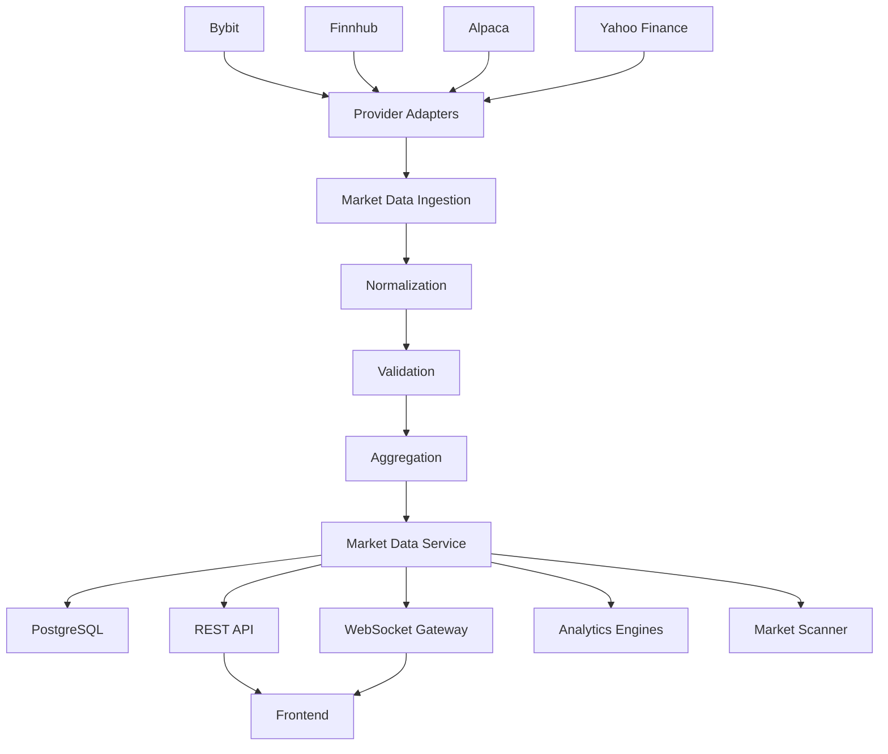

# Market Data Specification
## Personal Investment Management System (PIMS)

**Document Version:** 1.0  
**Project Status:** Planning  
**Document Type:** Market Data Specification  
**Last Updated:** November 2026

---

# 1. Purpose

Dokumen ini mendefinisikan arsitektur, pengelolaan, pemrosesan, penyimpanan, dan distribusi market data dalam Personal Investment Management System (PIMS).

Market data merupakan salah satu fondasi utama PIMS karena hampir seluruh fitur analisis bergantung pada data pasar yang akurat dan konsisten.

Sistem harus mampu memperoleh data dari beberapa market data providers, menormalisasikannya ke dalam internal data model, kemudian menyediakan data tersebut kepada frontend dan analytical engines.

Tujuan dokumen ini:

- Mendefinisikan market data architecture.
- Menentukan kategori data pasar.
- Menentukan sumber data awal.
- Mengatur historical dan realtime data.
- Menentukan normalization dan validation requirements.
- Mengatur candle aggregation.
- Menentukan data freshness.
- Mengatur market data storage.
- Menetapkan distribusi data ke frontend.
- Menjaga konsistensi data antar-engine.

Dokumen ini menjadi acuan OpenCode dalam membangun market data infrastructure.

# 2. Market Data Architecture

PIMS menggunakan centralized market data architecture.

Semua external market data harus melewati satu jalur pemrosesan sebelum digunakan oleh aplikasi.

## 2.1 High-Level Architecture



## 2.2 Architecture Principles

- Centralized data ingestion.
- Provider-independent internal models.
- Explicit data provenance.
- Historical and realtime separation.
- Consistent timestamps.
- Data validation before distribution.
- Shared data streams.
- Controlled storage.
- Transparent data freshness.
- No direct provider connections from frontend.

Market data infrastructure harus menjadi sumber data bersama bagi seluruh modul PIMS.

# 3. Supported Markets

PIMS dirancang untuk mendukung tiga kategori pasar utama.

## 3.1 Cryptocurrency

Initial provider:

**Bybit**

Data yang direncanakan:

- Latest price.
- Bid and ask.
- Trade data jika tersedia dan diperlukan.
- Historical OHLCV.
- Realtime market updates.
- Trading volume.
- Instrument metadata.

Bybit menjadi prioritas integrasi awal karena menyediakan REST API dan WebSocket untuk market data.

## 3.2 United States Stocks

Initial providers:

- Finnhub.
- Alpaca.

Data yang direncanakan:

- Stock quotes.
- Historical OHLCV.
- Latest available prices.
- Trading volume.
- Instrument metadata.
- Market session information.

Ketersediaan data realtime, cakupan exchange, dan hak penggunaan bergantung pada paket serta ketentuan provider.

Sistem tidak boleh mengasumsikan seluruh data US stocks tersedia secara gratis atau merupakan consolidated market feed.

## 3.3 Indonesia Stocks

Initial source:

**Yahoo Finance**

Data yang direncanakan:

- Historical prices.
- OHLCV jika tersedia.
- Instrument metadata.
- Latest available market information.

Yahoo Finance digunakan sebagai sumber awal yang masih perlu dievaluasi dari sisi reliability, data coverage, freshness, dan ketentuan penggunaan.

Sistem tidak boleh mengklaim bahwa data IDX dari sumber tersebut merupakan official realtime exchange feed.

Integrasi IDX yang lebih andal dapat ditentukan kemudian setelah kebutuhan lisensi dan provider dievaluasi.

# 4. Market Data Categories

Market data dibagi menjadi beberapa kategori.

| Category | Description | Usage |
|---|---|---|
| Quote Data | Latest available price information | Dashboard |
| OHLCV Data | Open, High, Low, Close, Volume | Charts and analysis |
| Trade Data | Individual executed trades | Market processing |
| Order Book Data | Bid and ask depth | Future liquidity analysis |
| Instrument Metadata | Asset and exchange information | Asset management |
| Market Status | Trading session information | Market overview |
| Corporate Actions | Dividends and stock splits | Future portfolio accounting |
| FX Data | Currency exchange rates | Portfolio valuation |

Tidak semua kategori harus diimplementasikan pada MVP.

Initial priority:

1. Quote Data.
2. OHLCV Data.
3. Instrument Metadata.
4. Market Status.
5. FX Data jika diperlukan untuk multi-currency valuation.

# 5. Provider Integration

Setiap external provider harus diakses melalui provider adapter.

## 5.1 Initial Provider Mapping

| Market | Provider | Integration |
|---|---|---|
| Crypto | Bybit | REST + WebSocket |
| US Stocks | Finnhub | REST + WebSocket, sesuai entitlement |
| US Stocks | Alpaca | REST + WebSocket, sesuai entitlement |
| Indonesia Stocks | Yahoo Finance | Initial historical/polling source |

## 5.2 Provider Adapter Responsibilities

Setiap adapter bertanggung jawab untuk:

- Establish provider connections.
- Retrieve historical data.
- Receive streaming data.
- Parse provider responses.
- Map provider symbols.
- Convert provider payloads into internal models.
- Handle provider-specific errors.
- Apply provider rate limits.
- Preserve source timestamps.
- Report connection status.

Adapter tidak boleh mengandung business logic milik portfolio atau analytical engines.

## 5.3 Provider Independence

Internal services tidak boleh bergantung pada provider-specific response structures.

Contoh:

Technical Analysis Engine harus menerima normalized OHLCV, bukan payload asli Bybit atau Finnhub.

Dengan demikian, provider dapat diganti tanpa mengubah seluruh analytical engines.

# 6. Instrument Identity and Mapping

PIMS harus memiliki internal asset identity yang terpisah dari symbol milik provider.

## 6.1 Internal Asset Identity

Setiap instrumen memiliki:

- Internal asset ID.
- Symbol.
- Instrument name.
- Market.
- Asset type.
- Exchange.
- Quote currency.
- Base currency jika relevan.
- Trading status.

## 6.2 Provider Instrument Mapping

Satu internal asset dapat memiliki beberapa provider mappings.

Contoh konseptual:

| Internal Asset | Provider | Provider Symbol |
|---|---|---|
| Bitcoin | Bybit | BTCUSDT |
| Apple | Finnhub | AAPL |
| Apple | Alpaca | AAPL |
| BBCA | Yahoo Finance | BBCA.JK |

Mapping harus disimpan secara eksplisit.

Jangan mengasumsikan symbol yang sama pada dua provider selalu mengacu pada instrumen atau market yang sama.

# 7. Historical Market Data

Historical market data digunakan untuk charting dan perhitungan analytics.

## 7.1 Historical Data Sources

Historical data diperoleh melalui provider REST API atau sumber lain yang diizinkan.

Alur:

```text
Frontend Request
       |
       v
REST API
       |
       v
Market Data Service
       |
       v
Check Historical Storage
       |
       v
Provider Adapter if Needed
       |
       v
Normalize and Validate
       |
       v
Store and Return Data
```

## 7.2 Supported Timeframes

Initial timeframe:

| Timeframe | Interval |
|---|---|
| 1m | 1 minute |
| 5m | 5 minutes |
| 15m | 15 minutes |
| 30m | 30 minutes |
| 1h | 1 hour |
| 4h | 4 hours |
| 1D | 1 day |
| 1W | 1 week |
| 1M | 1 month |

Provider tidak selalu mendukung seluruh timeframe.

Jika timeframe tidak tersedia secara langsung, backend dapat membentuk timeframe yang lebih besar dari data dasar apabila sumber data dan intervalnya mendukung proses tersebut.

## 7.3 Historical Data Rules

- Candles harus terurut berdasarkan timestamp.
- Candle harus memiliki OHLCV fields yang valid.
- Duplicate candles harus ditangani.
- Missing intervals harus dapat dideteksi.
- Provider source harus dapat ditelusuri.
- Timezone harus konsisten.
- Historical data tidak boleh dilabeli sebagai realtime.
- Data yang tidak tersedia harus ditandai.

# 8. Real-Time Market Data

Realtime market data digunakan untuk memperbarui dashboard, chart, dan monitoring instrumen.

## 8.1 Real-Time Data Flow

```text
Provider WebSocket
        |
        v
Provider Adapter
        |
        v
Ingestion Pipeline
        |
        v
Normalization
        |
        v
Validation
        |
        v
Aggregation if Required
        |
        v
Market Data Service
        |
        +------> Storage
        |
        +------> WebSocket Gateway
        |
        +------> Analytics Consumers
```

## 8.2 Centralized Connections

Backend harus menggunakan centralized provider connections.

Contoh:

- Satu shared Bybit connection dapat melayani beberapa client subscriptions.
- Beberapa frontend clients yang meminta BTCUSDT tidak boleh membuat provider connections terpisah.
- Internal subscription manager mengatur distribusi data.
- Provider subscription hanya dibuat ketika diperlukan dan sesuai batas provider.

Connection pooling dan subscription management harus dilakukan di backend.

## 8.3 Real-Time Processing

Jika provider mengirimkan trade events, backend dapat menggunakannya untuk memperbarui quote atau membentuk candle.

Jika provider telah mengirimkan candle updates, backend sebaiknya menggunakan candle tersebut setelah normalization dan validation.

Jangan melakukan aggregation ulang tanpa alasan teknis.

# 9. OHLCV Aggregation

OHLCV merupakan format utama untuk historical chart dan technical analysis.

## 9.1 OHLCV Definition

| Field | Description |
|---|---|
| Open | First valid trade price |
| High | Highest price in interval |
| Low | Lowest price in interval |
| Close | Last valid trade price |
| Volume | Total traded volume |

## 9.2 Aggregation Rules

Jika provider mengirimkan trade-level data:

- Open menggunakan harga trade pertama.
- High menggunakan harga tertinggi.
- Low menggunakan harga terendah.
- Close menggunakan harga trade terakhir.
- Volume merupakan akumulasi volume trade.

Jika provider mengirimkan candle-level data, gunakan data candle tersebut sesuai validasi provider.

## 9.3 Candle Lifecycle

Candle memiliki status:

- OPEN.
- CLOSED.

Candle OPEN masih dapat berubah ketika data baru diterima.

Candle CLOSED dianggap final untuk interval tersebut, tetapi sistem tetap harus dapat menangani koreksi historical data jika provider memperbarui data sebelumnya.

## 9.4 Candle Timestamp

Timestamp candle merepresentasikan awal interval candle dalam standar waktu yang telah ditentukan.

Semua timeframe harus mengikuti boundary rules yang konsisten.

Perhatikan perbedaan timezone dan market trading session, terutama pada saham US dan IDX.

# 10. Data Normalization

Semua provider data harus dikonversi ke internal normalized models.

## 10.1 Normalization Fields

Minimal normalized market data memiliki:

- Internal asset ID.
- Symbol.
- Market.
- Exchange.
- Provider.
- Currency.
- Source timestamp.
- Received timestamp.
- Processing timestamp.
- Freshness status.

Untuk candle data ditambahkan:

- Timeframe.
- Open.
- High.
- Low.
- Close.
- Volume.
- Candle status.

## 10.2 Normalization Rules

- Standardize field names.
- Standardize timestamp representation.
- Standardize currency identifiers.
- Map provider symbols.
- Preserve source information.
- Preserve source precision.
- Normalize numerical representation.
- Handle optional fields explicitly.

Internal normalized data harus tetap mempertahankan informasi asal data.

# 11. Data Validation

Market data harus melewati validation sebelum digunakan oleh internal services.

## 11.1 Validation Categories

**Structural Validation**

- Required fields exist.
- Correct data types.
- Valid timestamp format.
- Valid provider mapping.

**Numerical Validation**

- Prices are valid.
- OHLC relationship is valid.
- Volume is non-negative.
- Decimal precision is supported.

**Temporal Validation**

- Timestamp is valid.
- Candle intervals are consistent.
- Out-of-order events are detected.
- Duplicate events are handled.

**Source Validation**

- Provider is recognized.
- Instrument mapping is valid.
- Source timestamp is available or explicitly unknown.

## 11.2 Invalid Data Handling

Data invalid tidak boleh langsung didistribusikan sebagai data valid.

Sistem dapat:

- Reject invalid records.
- Quarantine suspicious records.
- Log validation errors.
- Mark affected data as unavailable or stale.
- Request replacement historical data jika diperlukan.

Jangan mengubah nilai yang tidak valid secara otomatis hanya agar data terlihat normal.

# 12. Data Freshness

Setiap market data harus memiliki freshness status.

## 12.1 Freshness States

| Status | Description |
|---|---|
| LIVE | Data memenuhi realtime freshness policy |
| DELAYED | Data diterima dengan keterlambatan yang diketahui |
| STALE | Data melewati freshness threshold |
| HISTORICAL | Data merupakan historical dataset |
| UNAVAILABLE | Data tidak tersedia |
| UNKNOWN | Freshness tidak dapat dipastikan |

## 12.2 Freshness Calculation

Freshness ditentukan berdasarkan:

- Provider type.
- Market type.
- Data category.
- Source timestamp.
- Last received timestamp.
- Expected update frequency.
- Provider-reported delay jika tersedia.

Threshold tidak boleh menggunakan satu angka universal untuk seluruh market.

Sebagai contoh, crypto yang aktif diperdagangkan dan saham yang sedang berada di luar trading session memiliki pola update berbeda.

## 12.3 Freshness Rules

- Jangan menyatakan data LIVE hanya karena koneksi provider CONNECTED.
- Jangan menyatakan data DELAYED tanpa dasar keterlambatan yang diketahui.
- Data lama harus berubah menjadi STALE jika melewati policy threshold.
- Historical data harus tetap berstatus HISTORICAL.
- UNKNOWN digunakan ketika freshness tidak dapat diverifikasi.

Freshness dan provider connection status harus disimpan sebagai dua informasi terpisah.

# 13. Market Session Management

Setiap market memiliki trading schedule yang berbeda.

PIMS harus mendukung market session information.

## 13.1 Market Session States

Contoh status:

- PRE_MARKET.
- OPEN.
- CLOSED.
- AFTER_HOURS.
- HOLIDAY.
- UNKNOWN.

Status ini terutama penting untuk US stocks dan IDX.

Crypto market umumnya beroperasi sepanjang waktu, tetapi provider maintenance dan trading interruptions tetap dapat terjadi.

## 13.2 Session Requirements

- Market timezone harus didefinisikan.
- Trading calendar harus dapat diperbarui.
- Holiday harus dapat ditangani.
- Daylight Saving Time untuk US markets harus diperhitungkan.
- Market session tidak boleh disamakan dengan provider connection status.

# 14. Currency and FX Data

PIMS mendukung multiple portfolios dengan kemungkinan base currency yang berbeda.

Market data infrastructure harus mendukung currency information secara eksplisit.

## 14.1 Currency Requirements

Setiap quote dan valuation harus memiliki currency.

Contoh:

- BTCUSDT menggunakan USDT.
- AAPL menggunakan USD.
- BBCA.JK menggunakan IDR.

## 14.2 FX Conversion

FX data digunakan untuk melakukan portfolio valuation lintas mata uang.

Sistem harus mempertahankan:

- Base currency.
- Quote currency.
- FX pair.
- Exchange rate.
- Provider.
- Timestamp.
- Freshness.

Backend bertanggung jawab melakukan currency conversion.

Jika FX rate tidak tersedia atau stale, sistem harus menandai hasil valuation dengan kondisi yang sesuai.

Jangan menjumlahkan nominal dari currency berbeda tanpa conversion methodology yang valid.

# 15. Market Data Storage

PostgreSQL menjadi primary storage untuk market data pada tahap awal.

## 15.1 Data Categories

Storage dapat mencakup:

- Instrument metadata.
- Provider mappings.
- Historical candles.
- Latest quotes.
- FX rates.
- Market session metadata.
- Ingestion logs.

## 15.2 Storage Rules

- Gunakan timestamp-aware columns.
- Gunakan numeric precision yang sesuai.
- Simpan provider provenance.
- Terapkan unique constraints untuk candle identity.
- Buat indexes berdasarkan asset, timeframe, dan timestamp.
- Hindari penyimpanan duplicate records.
- Tentukan retention policy berdasarkan kebutuhan.

TimescaleDB tetap optional dan dapat dievaluasi ketika volume time-series data meningkat.

Redis juga tetap optional dan bukan dependency wajib MVP.

## 15.3 Data Retention

Retention policy harus mempertimbangkan:

- Historical coverage.
- Database storage capacity.
- Provider licensing.
- Data usage restrictions.
- Analytics requirements.

Jangan menyimpan atau mendistribusikan data melebihi hak penggunaan provider.

# 16. Market Data Service

Market Data Service menjadi internal interface untuk seluruh modul yang membutuhkan market data.

## 16.1 Responsibilities

- Retrieve historical candles.
- Retrieve latest quotes.
- Manage market subscriptions.
- Provide normalized data.
- Provide freshness metadata.
- Coordinate provider adapters.
- Coordinate storage access.
- Distribute market data events.

## 16.2 Consumers

Market Data Service digunakan oleh:

- Frontend REST API.
- WebSocket Gateway.
- Chart Engine.
- Technical Analysis Engine.
- Market Scanner.
- Portfolio Performance Engine.
- Risk Analysis Engine.
- Allocation Engine.
- Correlation Analysis Engine.
- Market Regime Engine.

Consumers tidak boleh membuat provider connection sendiri.

# 17. Data Distribution

Market data didistribusikan melalui dua mekanisme utama.

## 17.1 REST API

REST digunakan untuk:

- Historical candles.
- Latest available quote snapshots.
- Instrument metadata.
- Market status.
- Historical data recovery.

Contoh:

```text
GET /api/v1/market-data/instruments/{asset_id}/candles
```

## 17.2 WebSocket

WebSocket digunakan untuk:

- Quote updates.
- Candle updates.
- Provider status updates.
- Market data notifications.

Contoh channel:

```text
market.quote
market.candle
market.status
```

## 17.3 Distribution Rules

- REST menjadi jalur initial historical loading.
- WebSocket menjadi jalur incremental updates.
- Kedua jalur harus menggunakan normalized data contracts.
- Reconnect harus diikuti recovery jika terdapat missing data.
- Frontend tidak boleh menghubungi external providers secara langsung.

# 18. Provider Reliability and Failover

Market data provider dapat mengalami downtime, rate limiting, atau data interruptions.

Sistem harus mampu mengelola kondisi tersebut.

## 18.1 Failure Categories

- Connection failure.
- Request timeout.
- Rate limit exceeded.
- Invalid provider response.
- Missing market data.
- Provider maintenance.
- Authentication failure.
- Data delay.

## 18.2 Failure Handling

Backend harus:

- Record provider errors.
- Apply retry policy yang sesuai.
- Prevent excessive retry loops.
- Preserve last known valid data.
- Mark stale data correctly.
- Notify internal consumers of availability changes.

## 18.3 Provider Failover

Failover dapat digunakan jika provider alternatif tersedia dan memiliki instrument mapping yang sesuai.

Namun, provider failover tidak boleh dilakukan secara sembarangan.

Perbedaan berikut harus diperhatikan:

- Exchange coverage.
- Quote currency.
- Trading session.
- Timestamp.
- Price source.
- Data entitlement.
- Historical coverage.

Data dari provider berbeda tidak boleh digabungkan tanpa memastikan kompatibilitasnya.

# 19. Rate Limit Management

Setiap provider memiliki rate limit dan subscription limits sendiri.

Adapter harus mengelola batas tersebut.

Ketentuan:

- Track provider request usage.
- Respect API rate limits.
- Control WebSocket subscriptions.
- Batch requests jika didukung.
- Cache data jika sesuai.
- Prioritize active market data requirements.
- Handle HTTP 429 dan provider-specific errors.
- Avoid unnecessary repeated historical requests.

Rate limits harus ditentukan berdasarkan dokumentasi resmi provider dan paket yang digunakan.

# 20. Data Quality and Provenance

PIMS harus dapat menelusuri asal data dan kualitasnya.

Minimal informasi provenance:

- Provider.
- Provider instrument symbol.
- Source timestamp.
- Received timestamp.
- Processing timestamp.
- Data category.
- Freshness status.
- Validation status.

Jika data dikoreksi oleh provider, sistem harus dapat menangani pembaruan historical records sesuai kebijakan storage.

Data quality tidak boleh hanya dinilai berdasarkan keberhasilan menerima response.

# 21. Integration with Analytical Engines

Market data merupakan input utama bagi beberapa analytical engines.

| Engine | Required Data |
|---|---|
| Technical Analysis | OHLCV |
| Market Scanner | Quotes, OHLCV, instrument metadata |
| Portfolio Performance | Quotes, FX rates |
| Risk Analysis | Historical prices and portfolio returns |
| Allocation | Holdings valuation and asset metadata |
| Correlation | Aligned historical price series |
| Market Regime | Historical OHLCV and derived indicators |

## 21.1 Engine Data Rules

- Engine harus menerima normalized internal models.
- Engine tidak boleh mengambil data langsung dari provider.
- Missing observations harus ditangani secara eksplisit.
- Calculation timestamps harus tersedia.
- Data source harus dapat ditelusuri.
- Engine tidak boleh menganggap seluruh data memiliki freshness yang sama.

# 22. Integration with Lightweight Charts

Lightweight Charts digunakan sebagai chart rendering library.

Market Data Service menyediakan data yang akan divisualisasikan.

## 22.1 Historical Loading

Frontend meminta historical candles melalui REST API.

Backend mengembalikan data dalam normalized OHLCV format.

Frontend kemudian mengirimkan dataset tersebut ke chart series.

## 22.2 Realtime Updates

Setelah historical data dimuat:

- Frontend melakukan WebSocket subscription.
- Backend mengirimkan candle updates.
- Frontend memperbarui candle yang sedang aktif.
- Candle baru ditambahkan ketika interval berubah.
- Candle final ditandai sesuai status backend.

## 22.3 Chart Data Requirements

- Consistent candle timestamps.
- Consistent OHLCV format.
- No duplicate candle points.
- Correct timeframe.
- Clear provider metadata.
- Explicit freshness status.

# 23. Security and Licensing

Market data memiliki batasan penggunaan yang berbeda berdasarkan provider.

PIMS harus memperhatikan:

- API credentials.
- Provider terms of service.
- Market data licensing.
- Data redistribution restrictions.
- Rate limits.
- Storage permissions.
- Commercial usage restrictions.

Data yang dapat diakses melalui API tidak otomatis boleh digunakan untuk redistribusi atau penggunaan komersial.

Sebelum provider digunakan pada produk komersial, hak penggunaan data harus diverifikasi.

Credentials harus disimpan di backend environment configuration dan tidak boleh dikirimkan ke frontend.

# 24. Testing Requirements

## 24.1 Provider Adapter Tests

- Successful REST requests.
- Successful WebSocket connection.
- Invalid provider response.
- Provider timeout.
- Rate limit handling.
- Reconnection.
- Symbol mapping.

## 24.2 Normalization Tests

- Timestamp conversion.
- Currency mapping.
- Symbol mapping.
- Decimal precision.
- OHLCV normalization.
- Optional field handling.

## 24.3 Validation Tests

- Invalid OHLCV.
- Duplicate candles.
- Out-of-order events.
- Missing timestamps.
- Invalid prices.
- Invalid instrument mappings.

## 24.4 Integration Tests

- Historical data retrieval.
- Realtime quote distribution.
- Realtime candle updates.
- Data storage.
- Market data recovery.
- Freshness calculation.
- Provider failure handling.

## 24.5 Data Consistency Tests

Pastikan historical REST candles dan realtime WebSocket candles menggunakan contract yang sama.

Pastikan data yang masuk ke analytical engines sesuai dengan normalized market data.

# 25. Implementation Roadmap

## Phase 1 — Market Data Foundation

- Internal asset model.
- Provider instrument mapping.
- Normalized data contracts.
- Market Data Service.
- Validation foundation.

## Phase 2 — Bybit Integration

- Bybit REST adapter.
- Bybit WebSocket adapter.
- Historical candles.
- Quote updates.
- Realtime candle processing.

## Phase 3 — Storage and Distribution

- PostgreSQL integration.
- Historical data storage.
- REST market data endpoints.
- WebSocket market data channels.
- Freshness management.

## Phase 4 — Chart Integration

- Historical chart loading.
- Realtime candle updates.
- Reconnection recovery.
- Provider metadata display.

## Phase 5 — Additional Providers

- Finnhub.
- Alpaca.
- Indonesia market data source evaluation.
- FX data integration.

## Phase 6 — Advanced Data Infrastructure

- Advanced caching.
- Improved ingestion monitoring.
- Provider failover.
- Storage optimization.
- Advanced historical coverage.

# 26. Acceptance Criteria

Market data infrastructure dinyatakan memenuhi spesifikasi apabila:

- Provider adapters terpisah dari internal services.
- Internal asset identity tersedia.
- Provider instrument mapping berfungsi.
- Normalized market data models tersedia.
- Historical OHLCV dapat diperoleh.
- Realtime quote updates dapat diproses.
- Realtime candle updates dapat diproses.
- Data validation berjalan.
- Freshness status tersedia.
- Provider status dapat dipantau.
- Market data dapat disimpan di PostgreSQL.
- REST dan WebSocket menggunakan normalized contracts.
- Frontend tidak memiliki direct provider connections.
- Analytical engines menggunakan Market Data Service.
- Provider failures ditangani dengan aman.
- Data provenance dapat ditelusuri.
- Testing tersedia untuk data pipeline.

# 27. Related Documents

- `AGENTS.md`
- `specifications/backend/backend-spec.md`
- `specifications/backend/api-spec.md`
- `specifications/backend/websocket-spec.md`
- `specifications/data/provider-integration-spec.md`
- `specifications/data/normalization-spec.md`
- `specifications/frontend/chart-engine-spec.md`
- `specifications/frontend/dashboard-spec.md`
- `specifications/engines/technical-analysis-spec.md`
- `specifications/engines/market-scanner-spec.md`
- `specifications/engines/portfolio-engine-spec.md`
- `docs/architecture/system-architecture.md`
- `docs/architecture/data-flow.md`
- `docs/architecture/engine-architecture.md`
- `docs/database/database-design.md`
- `docs/decisions/technical-decisions.md`

---

# Final Principle

Market Data Infrastructure merupakan fondasi utama PIMS.

Seluruh market data harus melewati centralized ingestion, normalization, validation, dan distribution pipeline sebelum digunakan oleh frontend maupun analytical engines.

Sistem harus mengutamakan data integrity, source transparency, freshness awareness, dan provider independence.

Tujuan akhirnya adalah membangun satu sumber market data internal yang konsisten sehingga seluruh modul PIMS dapat menggunakan data dengan format dan standar yang sama.