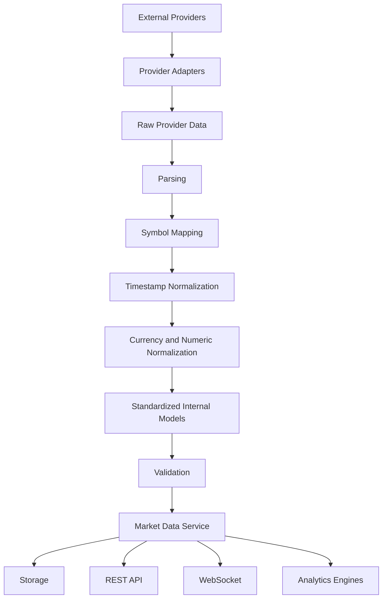

# Data Normalization Specification
## Personal Investment Management System (PIMS)

**Document Version:** 1.0  
**Project Status:** Planning  
**Document Type:** Data Normalization Specification  
**Last Updated:** November 2026

---

# 1. Purpose

Dokumen ini mendefinisikan standar normalisasi data dalam Personal Investment Management System (PIMS).

PIMS menggunakan beberapa external market data providers yang memiliki struktur payload, format timestamp, symbol, currency, precision, dan data conventions berbeda.

Data tersebut harus dikonversi menjadi internal standardized data models sebelum digunakan oleh sistem.

Tujuan dokumen ini:

- Menentukan standar internal data format.
- Menyeragamkan market data dari berbagai providers.
- Menetapkan instrument identity dan symbol mapping.
- Menstandarkan timestamp dan timezone.
- Menentukan numeric precision.
- Menstandarkan OHLCV data.
- Menetapkan quote dan trade data structures.
- Mengatur data provenance.
- Menetapkan validation dan normalization rules.
- Menjamin konsistensi data untuk analytical engines.

Dokumen ini menjadi acuan OpenCode dalam mengimplementasikan normalization pipeline.

# 2. Normalization Architecture

Normalization merupakan bagian dari centralized market data processing pipeline.

Seluruh provider data harus melewati tahap normalization sebelum dikonsumsi internal services.

## 2.1 Data Processing Flow



## 2.2 Architecture Principles

- Provider-independent data models.
- Consistent internal naming.
- Explicit instrument identity.
- UTC timestamp standardization.
- Decimal-safe financial values.
- Explicit currency representation.
- Source provenance preservation.
- Validation before distribution.
- No silent data correction.
- Consistent data contracts across REST and WebSocket.

# 3. Normalization Responsibilities

Normalization pipeline bertanggung jawab untuk:

1. Parse provider payloads.
2. Resolve provider symbols.
3. Map provider instruments to internal assets.
4. Normalize timestamps.
5. Normalize currencies.
6. Normalize numerical representation.
7. Convert provider-specific field names.
8. Preserve source metadata.
9. Prepare standardized internal models.

Normalization tidak bertanggung jawab untuk:

- Menghitung portfolio performance.
- Menghitung risk metrics.
- Menghitung technical indicators.
- Menghitung scanner ranking.
- Menghasilkan AI research.
- Mengubah data menjadi rekomendasi investasi.

# 4. Internal Data Standards

Seluruh internal data models harus mengikuti standar yang sama.

## 4.1 Naming Convention

Gunakan `snake_case` untuk field names.

Contoh:

```json
{
  "asset_id": "asset-uuid",
  "provider": "BYBIT",
  "source_timestamp": "2026-11-17T00:30:00Z",
  "last_price": "95000.00"
}
```

## 4.2 Identifier Standards

Gunakan internal identifiers untuk mengidentifikasi resource.

Identifier utama:

- `asset_id`
- `provider_id`
- `exchange_id`
- `market_id`

External provider symbols tidak boleh digunakan sebagai pengganti internal asset ID.

## 4.3 Enum Standards

Enum values harus menggunakan uppercase snake case.

Contoh:

- `CRYPTO`
- `US_STOCK`
- `INDONESIA_STOCK`
- `LIVE`
- `DELAYED`
- `STALE`
- `UNAVAILABLE`

Enum harus didefinisikan secara terpusat agar tidak terjadi perbedaan antara frontend dan backend.

# 5. Instrument Identity Normalization

Setiap instrumen harus memiliki internal identity yang konsisten.

## 5.1 Internal Asset Model

Informasi minimum:

| Field | Description |
|---|---|
| asset_id | Internal unique identifier |
| symbol | Internal symbol |
| name | Instrument name |
| market | Market category |
| asset_type | Instrument classification |
| exchange | Exchange identifier |
| base_currency | Base currency if applicable |
| quote_currency | Quote currency if applicable |
| status | Instrument status |

## 5.2 Provider Symbol Mapping

Satu internal asset dapat memiliki beberapa provider mappings.

Contoh:

| Internal Asset | Provider | Provider Symbol |
|---|---|---|
| Bitcoin | Bybit | BTCUSDT |
| Apple | Finnhub | AAPL |
| Apple | Alpaca | AAPL |
| BBCA | Yahoo Finance | BBCA.JK |

Mapping harus dilakukan melalui centralized instrument mapping service.

## 5.3 Mapping Rules

- Internal asset ID menjadi identifier utama.
- Provider symbol harus disimpan terpisah.
- Exchange harus diidentifikasi.
- Market category harus sesuai.
- Currency harus diverifikasi.
- Mapping yang ambigu harus ditolak atau ditandai untuk review.

Jangan menganggap dua symbol yang sama selalu merepresentasikan instrumen yang sama.

# 6. Timestamp Normalization

Seluruh internal timestamps harus menggunakan UTC.

## 6.1 Timestamp Format

Gunakan ISO 8601 dengan timezone UTC.

Contoh:

```text
2026-11-17T00:30:00Z
```

## 6.2 Timestamp Categories

PIMS harus membedakan:

| Field | Description |
|---|---|
| source_timestamp | Timestamp dari provider |
| received_at | Waktu backend menerima data |
| processed_at | Waktu data selesai diproses |
| event_timestamp | Waktu internal event dibuat |
| candle_time | Awal interval candle |

## 6.3 Timestamp Rules

- Convert provider timestamps to UTC.
- Preserve source timestamp.
- Do not discard timezone information.
- Detect invalid timestamps.
- Detect timestamps outside expected ranges.
- Do not replace missing source timestamps with fabricated values.

Jika provider tidak menyediakan source timestamp, field harus ditandai unavailable atau null sesuai schema.

## 6.4 Candle Time Standard

Candle timestamp merepresentasikan awal interval candle.

Contoh:

```text
Timeframe: 1m
Candle Start: 2026-11-17T00:30:00Z
Candle End: 2026-11-17T00:31:00Z
```

Candle boundary harus konsisten dengan timeframe dan provider semantics.

Untuk saham, session-aware candle alignment harus mempertimbangkan trading calendar dan exchange timezone.

# 7. Numeric Normalization

Seluruh nilai finansial harus mempertahankan precision yang sesuai dengan instrumen dan sumber data.

## 7.1 Numeric Types

Gunakan decimal-safe representation untuk:

- Price.
- Quantity.
- Volume.
- Market value.
- Fees.
- FX rates.
- Financial metrics yang membutuhkan precision.

Floating-point arithmetic tidak boleh digunakan sebagai representasi authoritative untuk nominal transaksi atau ledger balances.

## 7.2 JSON Representation

Nilai presisi tinggi direkomendasikan dikirim sebagai numeric strings.

Contoh:

```json
{
  "price": "95000.123456",
  "quantity": "0.25000000",
  "volume": "125.500000"
}
```

## 7.3 Precision Rules

- Preserve provider precision where possible.
- Do not round values prematurely.
- Use appropriate database precision.
- Apply display rounding only at presentation layer.
- Record instrument-specific precision constraints where available.

# 8. Currency Normalization

Currency harus menggunakan standardized currency identifiers.

## 8.1 Currency Standards

Gunakan ISO 4217 codes jika berlaku.

Contoh:

- USD
- IDR
- EUR
- JPY

Crypto assets dan settlement tokens harus menggunakan explicit internal currency or asset identifiers ketika tidak sesuai dengan asumsi currency fiat.

Contoh:

- USDT
- USDC
- BTC

Jangan menganggap seluruh crypto quote assets setara dengan USD.

## 8.2 Currency Rules

- Every price must have a currency context.
- Every market value must identify its currency.
- FX conversion must be explicit.
- Currency conversion timestamps must be preserved.
- Missing FX rates must be marked unavailable.

# 9. Quote Data Normalization

Quote data merepresentasikan latest available price information.

## 9.1 Standard Quote Model

Field minimum:

| Field | Description |
|---|---|
| asset_id | Internal asset ID |
| symbol | Internal symbol |
| last_price | Latest available price |
| bid_price | Best bid if available |
| ask_price | Best ask if available |
| currency | Quote currency |
| provider | Data source |
| source_timestamp | Provider timestamp |
| received_at | Backend receive time |
| freshness | Freshness status |

## 9.2 Quote Example

```json
{
  "asset_id": "asset-uuid",
  "symbol": "BTCUSDT",
  "last_price": "95000.00",
  "bid_price": "94999.50",
  "ask_price": "95000.50",
  "currency": "USDT",
  "provider": "BYBIT",
  "source_timestamp": "2026-11-17T00:30:00Z",
  "received_at": "2026-11-17T00:30:01Z",
  "freshness": "LIVE"
}
```

## 9.3 Quote Rules

- Quote must reference a valid asset.
- Currency must be explicit.
- Missing bid and ask must remain null.
- Source timestamp must be preserved.
- Provider must be identified.
- Freshness must be evaluated independently.

# 10. OHLCV Normalization

OHLCV menjadi standardized candle model untuk charting dan quantitative analysis.

## 10.1 Standard Candle Model

| Field | Description |
|---|---|
| asset_id | Internal asset ID |
| timeframe | Candle interval |
| time | Candle start timestamp |
| open | Opening price |
| high | Highest price |
| low | Lowest price |
| close | Closing or latest price |
| volume | Traded volume |
| currency | Quote currency |
| provider | Data source |
| is_closed | Candle completion status |

## 10.2 Candle Example

```json
{
  "asset_id": "asset-uuid",
  "symbol": "BTCUSDT",
  "timeframe": "1m",
  "time": "2026-11-17T00:30:00Z",
  "open": "95000.00",
  "high": "95050.00",
  "low": "94980.00",
  "close": "95020.00",
  "volume": "12.50",
  "currency": "USDT",
  "provider": "BYBIT",
  "is_closed": false
}
```

## 10.3 OHLC Validation

Setiap candle harus memenuhi:

\[
High \geq Open
\]

\[
High \geq Close
\]

\[
Low \leq Open
\]

\[
Low \leq Close
\]

\[
High \geq Low
\]

Volume tidak boleh negatif.

Invalid candles tidak boleh diteruskan sebagai data valid.

## 10.4 Candle Identity

Candle identity ditentukan oleh kombinasi:

- Asset ID.
- Timeframe.
- Candle start timestamp.
- Source atau feed identity jika diperlukan oleh data model.

Sistem harus mencegah duplicate candles.

# 11. Trade Data Normalization

Trade data digunakan jika provider menyediakan individual executed trades.

## 11.1 Standard Trade Model

Field:

- trade_id.
- asset_id.
- price.
- quantity.
- side jika tersedia.
- currency.
- source_timestamp.
- provider.
- exchange.

## 11.2 Trade Rules

- Provider trade ID harus dipertahankan jika tersedia.
- Duplicate trade events harus dapat dideteksi.
- Missing side harus tetap null.
- Trade ordering harus mengikuti timestamp dan sequence information jika tersedia.
- Trade data harus dibedakan dari quote data.

Trade data dapat digunakan untuk internal candle aggregation jika provider tidak menyediakan candle updates yang sesuai.

# 12. Volume Normalization

Volume memiliki semantics yang dapat berbeda antar-instrumen dan provider.

## 12.1 Volume Types

- Base asset volume.
- Quote asset volume.
- Share volume.
- Contract volume.

## 12.2 Volume Rules

Volume harus memiliki unit atau volume type yang jelas.

Contoh:

```json
{
  "volume": "125.50",
  "volume_type": "BASE_ASSET",
  "volume_currency": "BTC"
}
```

Untuk saham:

```json
{
  "volume": "150000",
  "volume_type": "SHARES",
  "volume_currency": null
}
```

Jangan menggabungkan volume dengan unit berbeda tanpa conversion methodology yang benar.

# 13. Market Metadata Normalization

Market metadata digunakan untuk mendeskripsikan kondisi instrumen dan market.

## 13.1 Standard Metadata

- market_id.
- exchange_id.
- market_type.
- trading_status.
- market_timezone.
- session_status.
- quote_currency.
- trading_hours jika tersedia.

## 13.2 Session States

- PRE_MARKET.
- OPEN.
- CLOSED.
- AFTER_HOURS.
- HOLIDAY.
- UNKNOWN.

## 13.3 Metadata Rules

- Exchange timezone harus eksplisit.
- Trading calendar harus dapat diperbarui.
- Provider availability tidak boleh dianggap sebagai market OPEN.
- Session status tidak boleh digunakan untuk menyimpulkan data freshness.

# 14. Data Provenance

Setiap normalized record harus dapat ditelusuri ke sumber data.

## 14.1 Provenance Fields

- provider.
- provider_symbol.
- provider_feed jika relevan.
- source_timestamp.
- received_at.
- processed_at.
- validation_status.

## 14.2 Provenance Rules

- Jangan menghilangkan provider identity.
- Jangan mencampurkan data dari provider berbeda tanpa source attribution.
- Provider failover harus menghasilkan provenance yang baru.
- Data correction harus dapat ditelusuri.
- Historical records harus memiliki source information sesuai kemampuan provider.

# 15. Data Freshness Normalization

Freshness harus mengikuti standard status PIMS.

## 15.1 Freshness States

| State | Description |
|---|---|
| LIVE | Meets realtime freshness policy |
| DELAYED | Known data delay |
| STALE | Exceeds expected freshness threshold |
| HISTORICAL | Historical dataset |
| UNAVAILABLE | Data unavailable |
| UNKNOWN | Freshness cannot be determined |

## 15.2 Normalization Rules

Freshness dihitung oleh internal market data services, bukan diterima begitu saja dari provider.

Perhitungan mempertimbangkan:

- Source timestamp.
- Received timestamp.
- Expected update frequency.
- Market session.
- Provider-reported delay.
- Data category.

Freshness policy harus dapat dibedakan antara crypto, US stocks, dan IDX.

# 16. Data Validation and Rejection

Normalization dan validation merupakan dua tahap berbeda.

Normalization mengubah format data.

Validation memeriksa apakah data memenuhi aturan internal.

## 16.1 Validation Categories

- Schema validation.
- Instrument validation.
- Timestamp validation.
- Numeric validation.
- Currency validation.
- OHLCV validation.
- Provenance validation.
- Duplicate detection.

## 16.2 Validation Status

Status internal:

- VALID.
- INVALID.
- WARNING.
- PENDING.

## 16.3 Invalid Data Handling

Data invalid harus:

- Ditolak dari jalur distribusi normal.
- Dicatat untuk troubleshooting.
- Dapat dikarantina jika diperlukan.
- Tidak digunakan sebagai authoritative analytics input.

Warning dapat digunakan untuk kondisi yang tidak ideal tetapi masih dapat diproses sesuai policy.

Jangan melakukan silent correction pada data invalid.

# 17. Normalization Pipeline Behavior

Pipeline harus memiliki urutan pemrosesan yang konsisten.

## 17.1 Processing Stages

1. Receive raw provider payload.
2. Parse payload.
3. Identify provider.
4. Resolve provider instrument mapping.
5. Normalize fields.
6. Normalize timestamp.
7. Normalize currency and numeric values.
8. Attach provenance.
9. Validate normalized data.
10. Send to Market Data Service.
11. Persist or distribute according to data policy.

## 17.2 Failure Isolation

Kegagalan normalisasi satu provider tidak boleh menghentikan seluruh market data infrastructure.

Setiap adapter dan processing task harus memiliki error boundaries yang jelas.

# 18. Internal Data Contracts

Normalized models harus menjadi shared contracts antar-modul.

## 18.1 Shared Consumers

| Consumer | Data Contract |
|---|---|
| REST API | Quote, Candle, Metadata |
| WebSocket | Quote Event, Candle Event |
| Chart Engine | OHLCV |
| Technical Engine | OHLCV |
| Market Scanner | Quote, OHLCV, Metadata |
| Portfolio Engine | Quote, FX |
| Risk Engine | Historical prices |
| Correlation Engine | Aligned price series |

## 18.2 Contract Rules

- Gunakan shared schemas.
- Hindari duplicate model definitions.
- Perubahan contract harus diuji.
- Frontend dan backend harus mengikuti field definitions yang sama.
- Provider-specific fields harus dipisahkan dari core normalized fields.

# 19. Storage Compatibility

Normalized data harus kompatibel dengan PostgreSQL data models.

## 19.1 Storage Requirements

- Use appropriate NUMERIC precision.
- Use timezone-aware timestamps.
- Maintain provider references.
- Apply unique constraints.
- Index asset and time dimensions.
- Avoid duplicate records.
- Preserve historical source information.

## 19.2 Storage Identity

Historical candle uniqueness harus mengikuti definisi candle identity pada database design.

Jangan menggunakan provider symbol sebagai satu-satunya unique key.

# 20. Frontend Compatibility

Frontend hanya menerima normalized data melalui REST dan WebSocket contracts.

Frontend tidak boleh mengetahui detail parsing provider payload.

## 20.1 Display Requirements

Frontend dapat menampilkan:

- Price.
- Currency.
- Volume.
- Timestamp.
- Provider.
- Freshness.
- Market session.
- Connection status.

## 20.2 Financial Formatting

Frontend bertanggung jawab terhadap formatting tampilan.

Contoh:

- USD currency formatting.
- IDR currency formatting.
- Decimal display.
- Percentage formatting.
- Volume formatting.
- Timestamp localization.

Formatting tidak boleh mengubah authoritative backend values.

# 21. Testing Requirements

## 21.1 Unit Tests

- Symbol mapping.
- Timestamp conversion.
- Currency mapping.
- Numeric precision.
- Quote normalization.
- Candle normalization.
- Trade normalization.
- Volume normalization.

## 21.2 Validation Tests

- Invalid OHLCV.
- Invalid timestamps.
- Missing fields.
- Unknown assets.
- Invalid currencies.
- Duplicate records.
- Out-of-order events.

## 21.3 Integration Tests

- Bybit payload normalization.
- Finnhub payload normalization.
- Alpaca payload normalization.
- Yahoo Finance payload normalization.
- Historical and realtime contract compatibility.

## 21.4 Regression Tests

Recorded provider fixtures harus digunakan untuk memastikan perubahan adapter tidak merusak normalized output.

Test fixtures harus bebas dari credentials dan data yang tidak boleh disimpan.

# 22. Implementation Roadmap

## Phase 1 — Core Normalized Models

- Asset identity.
- Provider mapping.
- Quote model.
- Candle model.
- Currency model.
- Timestamp conventions.
- Provenance fields.

## Phase 2 — Bybit Normalization

- Historical candle normalization.
- Realtime ticker normalization.
- Realtime candle normalization.
- Validation.
- Integration tests.

## Phase 3 — Internal Data Contracts

- REST response schemas.
- WebSocket event schemas.
- PostgreSQL compatibility.
- Chart compatibility.

## Phase 4 — Additional Providers

- Finnhub normalization.
- Alpaca normalization.
- Yahoo Finance normalization.

## Phase 5 — Advanced Data Quality

- Advanced validation.
- Data reconciliation.
- Duplicate event detection.
- Historical correction handling.
- Improved provenance tracking.

# 23. Acceptance Criteria

Normalization implementation dinyatakan memenuhi spesifikasi apabila:

- Internal data contracts tersedia.
- Provider symbol mapping berfungsi.
- Timestamp menggunakan UTC.
- Numeric values mempertahankan precision.
- Currency memiliki identifier yang jelas.
- Quote data memiliki normalized structure.
- OHLCV memiliki normalized structure.
- Volume memiliki unit yang jelas.
- Provenance dipertahankan.
- Freshness dihitung secara internal.
- Validation berjalan sebelum distribusi.
- Invalid records ditangani.
- REST dan WebSocket menggunakan contract yang konsisten.
- PostgreSQL dapat menyimpan normalized data.
- Automated tests tersedia.

# 24. Related Documents

- `AGENTS.md`
- `specifications/data/market-data-spec.md`
- `specifications/data/provider-integration-spec.md`
- `specifications/backend/backend-spec.md`
- `specifications/backend/api-spec.md`
- `specifications/backend/websocket-spec.md`
- `specifications/frontend/chart-engine-spec.md`
- `specifications/engines/technical-analysis-spec.md`
- `specifications/engines/market-scanner-spec.md`
- `docs/architecture/data-flow.md`
- `docs/architecture/engine-architecture.md`
- `docs/database/database-design.md`
- `docs/decisions/technical-decisions.md`

---

# Final Principle

Data normalization memastikan seluruh external market data memiliki standar internal yang sama.

Setiap provider harus mengikuti internal data contracts sebelum datanya digunakan oleh frontend, storage, maupun analytical engines.

Dengan normalisasi yang konsisten, PIMS dapat mengintegrasikan berbagai market data providers tanpa membuat ketergantungan pada struktur API masing-masing provider.