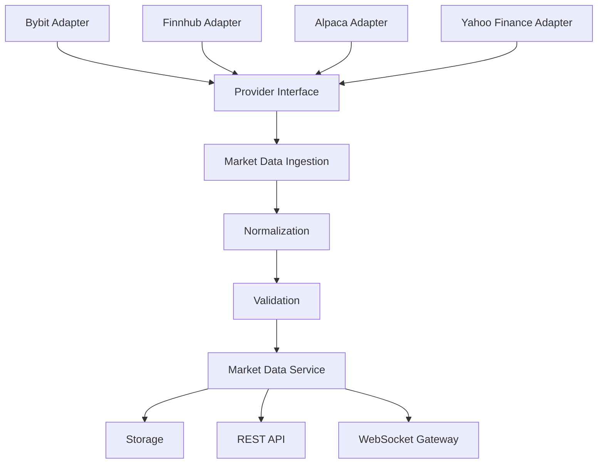
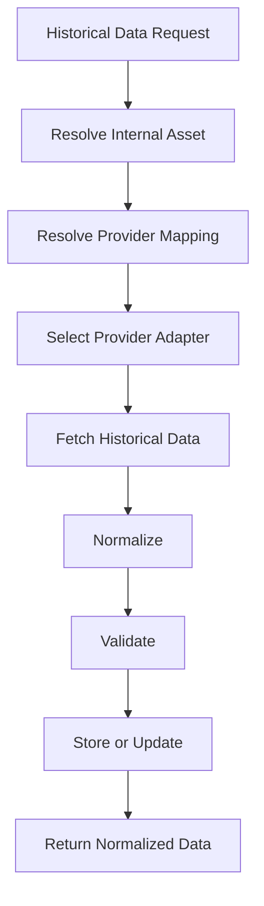
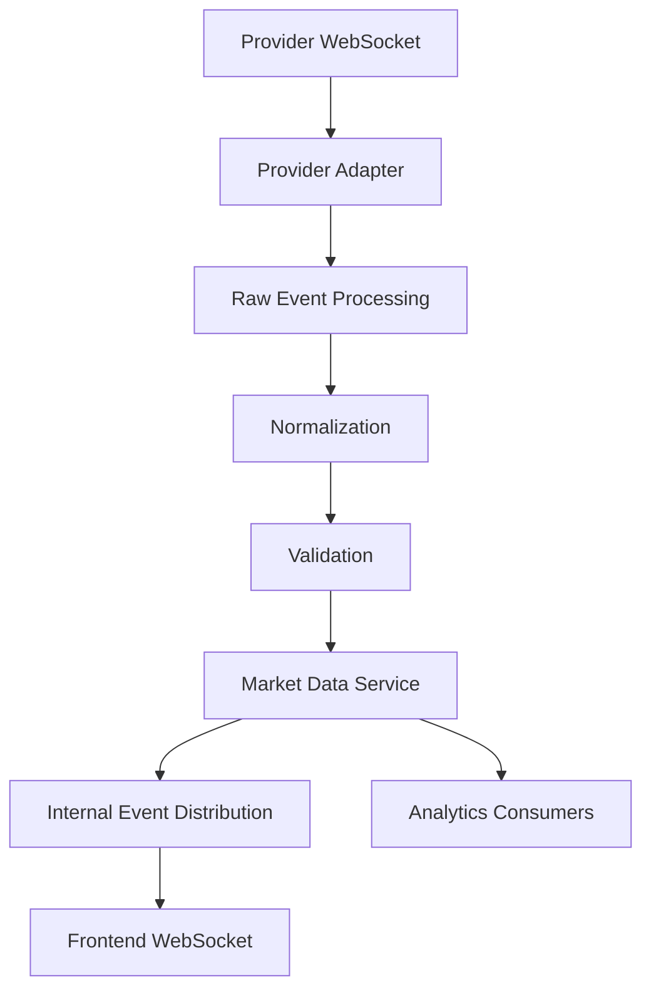

# Provider Integration Specification
## Personal Investment Management System (PIMS)

**Document Version:** 1.0  
**Project Status:** Planning  
**Document Type:** Data Provider Integration Specification  
**Last Updated:** November 2026

---

# 1. Purpose

Dokumen ini mendefinisikan standar integrasi external market data providers ke dalam Personal Investment Management System (PIMS).

PIMS menggunakan beberapa provider untuk memperoleh data pasar dari cryptocurrency, US stocks, dan Indonesia stocks.

Setiap provider memiliki API structure, authentication method, rate limits, data coverage, WebSocket protocol, dan licensing requirements yang berbeda.

Oleh karena itu, PIMS harus menggunakan Provider Adapter Architecture agar seluruh provider dapat diintegrasikan tanpa menciptakan ketergantungan langsung antara external APIs dan internal application modules.

Tujuan dokumen ini:

- Mendefinisikan provider integration architecture.
- Menentukan tanggung jawab provider adapters.
- Menetapkan initial provider integrations.
- Mengatur REST dan WebSocket connections.
- Menentukan authentication dan configuration requirements.
- Mengatur symbol mapping.
- Menangani provider rate limits.
- Menetapkan error handling dan retry policies.
- Mengatur provider health monitoring.
- Menjaga data provenance dan licensing compliance.

Dokumen ini menjadi acuan OpenCode dalam mengimplementasikan external data integrations.

# 2. Supported Providers

PIMS menggunakan provider berdasarkan kategori market.

## 2.1 Initial Provider Matrix

| Market | Provider | API Type | Priority |
|---|---|---|---|
| Cryptocurrency | Bybit | REST + WebSocket | MVP |
| US Stocks | Finnhub | REST + WebSocket | Post-MVP |
| US Stocks | Alpaca | REST + WebSocket | Post-MVP |
| Indonesia Stocks | Yahoo Finance | Historical / polling, subject to availability | Post-MVP |

## 2.2 Provider Selection Principles

Pemilihan provider mempertimbangkan:

- Data coverage.
- Historical data availability.
- Realtime availability.
- API reliability.
- API documentation quality.
- Rate limits.
- Data latency.
- Pricing.
- Licensing.
- Commercial usage permissions.
- Integration complexity.

Provider tidak boleh dipilih hanya karena API dapat diakses secara gratis.

# 3. Provider Adapter Architecture

Setiap provider harus diintegrasikan melalui adapter tersendiri.

## 3.1 Architecture



## 3.2 Adapter Responsibilities

Setiap adapter bertanggung jawab untuk:

1. Mengelola koneksi provider.
2. Melakukan authentication.
3. Mengirim REST requests.
4. Menerima WebSocket events jika didukung.
5. Mengubah provider response menjadi internal raw models.
6. Memetakan provider symbols.
7. Mengelola rate limits.
8. Menangani provider errors.
9. Mengelola connection lifecycle.
10. Menyediakan provider health information.

Adapter tidak bertanggung jawab untuk:

- Menghitung portfolio performance.
- Menghitung risk metrics.
- Menghitung technical indicators.
- Menentukan scanner ranking.
- Menghasilkan AI research.
- Melakukan financial decision-making.

Tanggung jawab tersebut berada pada internal domain services dan analytical engines.

# 4. Provider Interface Contract

Semua adapter harus mengikuti internal provider contract.

Contract ini bersifat konseptual dan menjadi acuan desain implementasi.

## 4.1 Required Capabilities

Provider adapter dapat mendukung kemampuan berikut:

| Capability | Description |
|---|---|
| Historical Candles | Retrieve OHLCV history |
| Latest Quote | Retrieve latest available quote |
| Realtime Quotes | Stream quote updates |
| Realtime Trades | Stream trade events |
| Instrument Search | Search instruments |
| Instrument Metadata | Retrieve instrument information |
| Market Status | Retrieve trading status |

Tidak semua provider wajib mendukung seluruh capability.

## 4.2 Capability Declaration

Setiap adapter harus mendeklarasikan capability yang benar-benar didukung.

Contoh konseptual:

```json
{
  "provider": "BYBIT",
  "capabilities": {
    "historical_candles": true,
    "latest_quote": true,
    "realtime_quotes": true,
    "realtime_trades": true,
    "instrument_metadata": true,
    "market_status": true
  }
}
```

Capability harus berdasarkan dokumentasi resmi dan hasil pengujian, bukan asumsi.

## 4.3 Provider Independence

Internal services harus menggunakan provider-neutral interfaces.

Provider-specific request parameters dan response payloads harus tetap berada di dalam adapter.

# 5. Bybit Integration

<badge color="success">MVP Priority</badge>

<text weight="medium" color="secondary" size="sm">Primary cryptocurrency market data provider</text>

## 5.1 Overview

<text weight="medium"><Entity value="Bybit" category="company" disambig="Cryptocurrency exchange and market data API provider"/></text> digunakan sebagai initial cryptocurrency data provider.

Dokumentasi resmi:

- <Link url="https://bybit-exchange.github.io/docs/v5/intro" title="Bybit V5 API Documentation"/>
- <Link url="https://bybit-exchange.github.io/docs/v5/websocket/public/intro" title="Bybit Public WebSocket Documentation"/>

Integrasi awal difokuskan pada public market data.

Private trading API tidak diperlukan untuk MVP.

## 5.2 API Types

| API | Usage |
|---|---|
| REST API | Historical candles and market information |
| Public WebSocket | Realtime market updates |

## 5.3 Initial Data Requirements

- Instrument metadata.
- Latest available prices.
- Historical OHLCV.
- Realtime ticker updates.
- Realtime candle updates.
- Trading volume.
- Provider connection status.

## 5.4 Market Categories

Integrasi awal dapat dimulai dari kategori spot.

Kategori tambahan seperti linear derivatives hanya boleh diaktifkan setelah instrument model dan product-specific semantics mendukungnya.

Jangan mencampurkan spot, linear, inverse, dan option instruments tanpa identifikasi kategori yang jelas.

## 5.5 Historical Data Integration

Backend menggunakan REST API untuk mengambil historical candles.

Ketentuan:

- Symbol harus melalui provider instrument mapping.
- Interval harus sesuai dengan internal timeframe mapping.
- Pagination dan maximum result limits harus mengikuti ketentuan provider.
- Timestamp harus dikonversi ke internal timestamp standard.
- OHLCV harus dinormalisasi.
- Historical records harus divalidasi sebelum disimpan.

## 5.6 Realtime Integration

Backend menggunakan public WebSocket untuk menerima market updates.

Initial subscriptions:

- Ticker.
- Kline.

Trade stream dapat ditambahkan jika dibutuhkan untuk internal aggregation atau advanced analytics.

Jika Bybit telah menyediakan candle updates, gunakan data tersebut setelah normalization dan validation tanpa melakukan aggregation ulang yang tidak diperlukan.

## 5.7 Authentication

Public market data tidak boleh mengharuskan penggunaan private trading credentials jika provider menyediakan akses publik.

Jika authentication diperlukan untuk capability tertentu, credentials harus disimpan di backend environment configuration.

## 5.8 Failure Handling

Adapter harus menangani:

- Connection failure.
- WebSocket disconnect.
- REST timeout.
- Rate limit.
- Invalid response.
- Invalid symbol.
- Provider maintenance.
- Subscription errors.

Reconnect harus menggunakan controlled retry dan backoff.

# 6. Finnhub Integration

<badge color="info">Post-MVP</badge>

<text weight="medium" color="secondary" size="sm">US stock market data provider</text>

## 6.1 Overview

<text weight="medium"><Entity value="Finnhub" category="company" disambig="Financial market data API provider"/></text> menjadi salah satu kandidat provider untuk US stocks.

Dokumentasi resmi:

- <Link url="https://finnhub.io/docs/api" title="Finnhub API Documentation"/>
- <Link url="https://finnhub.io/docs/api/websocket-trades" title="Finnhub WebSocket Documentation"/>

## 6.2 API Types

| API | Usage |
|---|---|
| REST API | Historical candles, quotes, and metadata |
| WebSocket | Realtime trade updates, subject to plan |

## 6.3 Initial Data Requirements

- US stock quotes.
- Historical OHLCV.
- Realtime trade updates.
- Instrument metadata.
- Market-related information.

## 6.4 Historical Integration

Historical candles harus diperoleh melalui endpoint yang didukung Finnhub.

Adapter harus memperhatikan:

- Resolution mapping.
- Time range parameters.
- Exchange and symbol mapping.
- Data availability.
- API plan limitations.
- Request rate limits.

## 6.5 Realtime Integration

Jika realtime trade stream tersedia pada subscription yang digunakan:

1. Backend membuat provider connection.
2. Adapter melakukan subscription pada instrument.
3. Incoming trades dinormalisasi.
4. Data diteruskan ke internal market data pipeline.
5. Candle aggregation dilakukan jika diperlukan.

## 6.6 Entitlement Requirements

Sebelum implementasi, verifikasi:

- Realtime data availability.
- Exchange coverage.
- Historical coverage.
- Subscription limits.
- Commercial usage.
- Redistribution permissions.

Jangan mengasumsikan seluruh US stock market data tersedia melalui paket gratis.

# 7. Alpaca Integration

<badge color="info">Post-MVP</badge>

<text weight="medium" color="secondary" size="sm">Alternative US stock market data provider</text>

## 7.1 Overview

<text weight="medium"><Entity value="Alpaca" category="company" disambig="Financial technology company providing brokerage and market data APIs"/></text> menjadi kandidat provider tambahan untuk US stocks.

Dokumentasi resmi:

- <Link url="https://docs.alpaca.markets/" title="Alpaca API Documentation"/>
- <Link url="https://docs.alpaca.markets/docs/real-time-stock-pricing-data" title="Alpaca Real-Time Stock Pricing Data"/>

## 7.2 API Types

| API | Usage |
|---|---|
| REST API | Historical bars and latest quotes |
| WebSocket | Realtime market data |

## 7.3 Initial Data Requirements

- Historical stock bars.
- Latest quotes.
- Realtime trades.
- Realtime bars.
- Instrument metadata.

## 7.4 Feed Selection

Alpaca dapat menyediakan pilihan feed dengan cakupan berbeda.

Sistem harus memisahkan feed identity dari provider identity.

Contoh:

```text
Provider: ALPACA
Feed: IEX
```

atau:

```text
Provider: ALPACA
Feed: SIP
```

Feed yang digunakan harus disimpan sebagai metadata agar frontend dapat mengetahui asal data.

Jangan mengklaim data IEX sebagai consolidated US market data.

## 7.5 Realtime Integration

Jika feed yang digunakan mendukung streaming:

- Establish WebSocket connection.
- Authenticate.
- Subscribe to instruments.
- Normalize incoming messages.
- Validate timestamps.
- Process market updates.
- Distribute to internal consumers.

## 7.6 Provider Entitlements

Sebelum implementasi, verifikasi:

- Feed availability.
- IEX versus SIP coverage.
- Historical data access.
- Subscription limits.
- Data licensing.
- Commercial usage permissions.

# 8. Yahoo Finance Integration

<badge color="warning">Requires Verification</badge>

<text weight="medium" color="secondary" size="sm">Initial Indonesia market data source</text>

## 8.1 Overview

<text weight="medium"><Entity value="Yahoo Finance" category="software" disambig="Financial market information and historical data platform"/></text> digunakan sebagai kandidat sumber awal untuk historical Indonesia stock data.

Official website:

- <Link url="https://finance.yahoo.com/" title="Yahoo Finance"/>

Integrasi harus dilakukan dengan memperhatikan ketentuan penggunaan dan ketersediaan data.

Yahoo Finance tidak boleh dianggap sebagai guaranteed official realtime IDX API.

## 8.2 Initial Data Requirements

- Historical stock prices.
- OHLCV jika tersedia.
- Instrument metadata.
- Latest available market information jika tersedia.

## 8.3 Integration Method

Integrasi awal difokuskan pada historical retrieval atau polling yang diperbolehkan.

Tidak boleh mengasumsikan adanya official WebSocket market data feed.

Jika adapter menggunakan library pihak ketiga, implementasinya harus mempertimbangkan:

- Library maintenance.
- API compatibility.
- Data reliability.
- Terms of service.
- Data redistribution rights.
- Failure handling.

## 8.4 Indonesia Symbol Mapping

Symbol saham IDX harus dipetakan secara eksplisit.

Contoh konseptual:

```text
Internal Symbol: BBCA
Provider Symbol: BBCA.JK
Market: INDONESIA_STOCK
Currency: IDR
```

Format symbol tersebut harus diverifikasi terhadap sumber data yang digunakan.

## 8.5 Data Limitations

Sistem harus dapat menampilkan:

- Last available timestamp.
- Historical data availability.
- Freshness status.
- Provider identity.
- Missing data status.

Jika data tidak tersedia, jangan membuat harga sintetis atau menganggap harga terakhir sebagai realtime.

# 9. Provider Configuration

Setiap provider harus memiliki configuration sendiri.

## 9.1 Configuration Requirements

Configuration dapat mencakup:

- Provider name.
- Enabled status.
- Base URL.
- API credentials reference.
- Connection settings.
- Rate limit configuration.
- Timeout configuration.
- Retry configuration.
- Supported markets.
- Supported capabilities.

## 9.2 Environment Variables

Contoh struktur environment variables:

```text
BYBIT_API_BASE_URL=
BYBIT_WS_URL=

FINNHUB_API_KEY=

ALPACA_API_KEY=
ALPACA_API_SECRET=
ALPACA_DATA_FEED=

YAHOO_FINANCE_ENABLED=
```

Nilai aktual harus disimpan di environment configuration, bukan source code.

File `.env.example` hanya berisi nama variabel dan placeholder.

## 9.3 Credential Rules

- Credentials hanya boleh digunakan backend.
- Jangan mengirim credentials ke frontend.
- Jangan menyimpan credentials dalam database sebagai plain text.
- Jangan menulis credentials ke logs.
- Gunakan environment variables atau secret management yang disetujui.

# 10. Provider Symbol Mapping

Setiap provider dapat menggunakan format symbol yang berbeda.

Backend harus menyediakan centralized instrument mapping.

## 10.1 Mapping Requirements

Mapping minimal:

- Internal asset ID.
- Provider ID.
- Provider symbol.
- Exchange.
- Market.
- Instrument category.
- Active status.

## 10.2 Mapping Rules

- Satu internal asset dapat memiliki beberapa provider mappings.
- Provider symbols tidak boleh diasumsikan identik.
- Mapping harus divalidasi.
- Invalid mapping harus menghasilkan error yang jelas.
- Mapping tidak boleh dibuat hanya berdasarkan kesamaan nama instrumen.

# 11. Historical Data Integration Contract

Semua adapter harus menyediakan normalized historical data melalui internal contract.

## 11.1 Requirements

Historical retrieval harus mendukung:

- Asset identification.
- Timeframe.
- Start time.
- End time.
- Maximum result count.
- Provider selection jika diperlukan.

## 11.2 Processing Flow



## 11.3 Data Rules

- Historical data harus memiliki source provenance.
- Data harus melalui validation.
- Duplicate records harus ditangani.
- Provider limitations harus dipatuhi.
- Missing intervals harus dapat dideteksi.
- Provider errors tidak boleh disamarkan sebagai empty successful responses.

# 12. Realtime Data Integration Contract

Provider yang mendukung WebSocket harus diintegrasikan melalui centralized streaming infrastructure.

## 12.1 Requirements

- Connection lifecycle management.
- Authentication if required.
- Subscription management.
- Event normalization.
- Reconnection.
- Heartbeat handling.
- Error handling.
- Provider health monitoring.

## 12.2 Streaming Flow



## 12.3 Shared Connection Policy

Provider connections harus dikelola secara terpusat.

Frontend subscriptions tidak boleh menghasilkan provider connection baru untuk setiap client.

Provider-specific subscription limits harus dikelola oleh adapter.

# 13. Rate Limit Management

Setiap adapter harus mengelola rate limits secara independen.

## 13.1 Requirements

- Request tracking.
- Rate limit awareness.
- Request throttling.
- Backoff.
- Retry control.
- Subscription limit tracking.
- Error reporting.

## 13.2 HTTP Rate Limit Handling

Jika provider mengembalikan rate limit error:

1. Adapter mendeteksi response.
2. Adapter membaca retry information jika tersedia.
3. Request berikutnya dijadwalkan sesuai policy.
4. Internal service menerima status kegagalan atau keterlambatan.
5. Data tidak boleh diklaim fresh selama tidak tersedia pembaruan yang valid.

Jangan menggunakan retry agresif yang dapat memperburuk provider throttling.

# 14. Error Handling

Provider adapter harus mengubah provider-specific errors menjadi internal error categories.

## 14.1 Internal Error Categories

| Category | Description |
|---|---|
| CONNECTION_ERROR | Connection failure |
| AUTHENTICATION_ERROR | Invalid credentials |
| RATE_LIMIT_ERROR | Provider rate limit |
| TIMEOUT_ERROR | Request timeout |
| INVALID_SYMBOL | Unsupported instrument |
| INVALID_RESPONSE | Malformed provider response |
| DATA_UNAVAILABLE | Requested data unavailable |
| PROVIDER_MAINTENANCE | Provider maintenance |
| SUBSCRIPTION_ERROR | Streaming subscription failure |

## 14.2 Error Handling Rules

- Preserve provider error context internally.
- Avoid exposing raw credentials.
- Log request identifiers.
- Apply controlled retries.
- Mark affected data correctly.
- Do not silently switch data providers.
- Do not replace invalid data with fabricated values.

# 15. Provider Health Monitoring

Setiap adapter harus menyediakan health status.

## 15.1 Provider States

- DISCONNECTED.
- CONNECTING.
- CONNECTED.
- DEGRADED.
- ERROR.

## 15.2 Health Metrics

- Connection uptime.
- Last successful request.
- Last received event.
- Request latency.
- WebSocket reconnect count.
- Error count.
- Rate limit events.
- Data freshness.
- Active subscriptions.

## 15.3 Provider Health Rules

Provider CONNECTED tidak berarti seluruh data yang diterima valid atau fresh.

Health status dan data freshness harus dihitung secara terpisah.

# 16. Provider Selection and Data Source Policy

Jika satu instrumen tersedia dari beberapa provider, PIMS harus memiliki aturan pemilihan sumber data.

## 16.1 Provider Selection Factors

- Market coverage.
- Exchange coverage.
- Feed entitlement.
- Data freshness.
- Historical coverage.
- Reliability.
- Currency compatibility.
- Data licensing.

## 16.2 Source Selection

Pemilihan provider harus dilakukan melalui configuration atau internal selection policy.

Jangan menggunakan fallback otomatis tanpa memastikan bahwa sumber alternatif menyediakan jenis data yang kompatibel.

## 16.3 Source Transparency

Setiap data yang digunakan harus dapat menunjukkan:

- Provider.
- Provider feed jika relevan.
- Source timestamp.
- Received timestamp.
- Freshness.
- Data category.

# 17. Security and Licensing

Integrasi provider harus memenuhi persyaratan keamanan dan penggunaan data.

Ketentuan:

- Backend-only credentials.
- Secure transport.
- No credential logging.
- Provider terms compliance.
- Respect rate limits.
- Respect market data licensing.
- No unauthorized redistribution.
- No exposure of provider-specific secrets.

Sebelum integrasi digunakan dalam produk komersial, hak penggunaan dan redistribusi data harus diverifikasi secara terpisah.

# 18. Testing Requirements

## 18.1 Adapter Unit Tests

- Request construction.
- Response parsing.
- Authentication handling.
- Symbol mapping.
- Error mapping.
- Rate limit handling.
- Timestamp conversion.

## 18.2 Integration Tests

- Historical data retrieval.
- Latest quote retrieval.
- WebSocket connection.
- Subscription management.
- Reconnection.
- Invalid symbols.
- Provider unavailable.

## 18.3 Normalization Tests

- Provider-specific payload conversion.
- OHLCV conversion.
- Currency mapping.
- Timestamp consistency.
- Missing field handling.
- Numerical precision.

## 18.4 Reliability Tests

- Connection interruption.
- Timeout.
- Rate limiting.
- Invalid response.
- Duplicate events.
- Out-of-order events.

## 18.5 Testing Restrictions

Automated tests tidak boleh bergantung sepenuhnya pada external provider availability.

Gunakan mocked responses dan recorded fixtures untuk deterministic tests.

Live integration tests dapat dijalankan secara terpisah dengan API credentials yang valid dan sesuai ketentuan provider.

# 19. Implementation Roadmap

## Phase 1 — Provider Architecture

- Define provider contract.
- Define adapter structure.
- Implement configuration management.
- Implement provider error model.
- Implement health status.

## Phase 2 — Bybit Integration

- Implement Bybit REST adapter.
- Implement historical candles.
- Implement quote retrieval.
- Implement WebSocket adapter.
- Implement realtime ticker updates.
- Implement realtime candle updates.
- Integrate with Market Data Service.

## Phase 3 — Provider Reliability

- Rate limit management.
- Reconnection policy.
- Error handling.
- Health monitoring.
- Integration tests.

## Phase 4 — Finnhub Integration

- Verify API entitlement.
- Implement historical candles.
- Implement quote retrieval.
- Implement streaming if available.
- Normalize US stock data.

## Phase 5 — Alpaca Integration

- Verify feed availability.
- Implement historical data.
- Implement quote retrieval.
- Implement WebSocket streams.
- Normalize feed metadata.

## Phase 6 — Indonesia Data Integration

- Evaluate Yahoo Finance availability and permitted usage.
- Implement historical retrieval if permitted.
- Validate IDX symbol mapping.
- Evaluate alternative official data providers.
- Establish data freshness policy.

# 20. Acceptance Criteria

Provider integration dinyatakan memenuhi spesifikasi apabila:

- Provider adapter architecture tersedia.
- Provider-specific logic terisolasi.
- Internal provider contract konsisten.
- Configuration dikelola melalui environment.
- Credentials tidak terekspos ke frontend.
- Symbol mapping tersedia.
- Historical data dapat dinormalisasi.
- Realtime data dapat diproses untuk provider yang mendukungnya.
- Rate limits ditangani.
- Provider errors dinormalisasi.
- Connection lifecycle dikelola.
- Health status tersedia.
- Data provenance dipertahankan.
- Licensing limitations terdokumentasi.
- Unit dan integration tests tersedia.

# 21. Related Documents

- `AGENTS.md`
- `specifications/data/market-data-spec.md`
- `specifications/data/normalization-spec.md`
- `specifications/backend/backend-spec.md`
- `specifications/backend/api-spec.md`
- `specifications/backend/websocket-spec.md`
- `specifications/frontend/chart-engine-spec.md`
- `docs/architecture/application-architecture.md`
- `docs/architecture/data-flow.md`
- `docs/architecture/engine-architecture.md`
- `docs/database/database-design.md`
- `docs/decisions/technical-decisions.md`

---

# Final Principle

Provider integration harus dibangun dengan prinsip abstraction, reliability, data provenance, dan provider independence.

Setiap external provider hanya bertanggung jawab menyediakan data melalui adapter yang sesuai. Seluruh data kemudian diproses oleh centralized market data infrastructure sebelum digunakan oleh modul PIMS.

Dengan arsitektur ini, PIMS dapat menambah, mengganti, atau mengembangkan provider tanpa harus mengubah seluruh sistem.