# Database Schema Specification
## Personal Investment Management System (PIMS)

**Document Version:** 1.0  
**Project Status:** Planning  
**Document Type:** Database Schema Specification  
**Last Updated:** November 2026

---

# 1. Purpose

Dokumen ini mendefinisikan spesifikasi database schema untuk Personal Investment Management System (PIMS).

Database schema menjadi acuan utama dalam pengembangan struktur penyimpanan data, relational models, database migrations, dan data access layer.

Spesifikasi ini dirancang berdasarkan arsitektur PostgreSQL dan Modular Monolith yang telah ditetapkan dalam project architecture.

Tujuan utama:

- Mendefinisikan struktur tabel dan atribut.
- Menentukan primary key dan foreign key.
- Menentukan relasi antar-entitas.
- Menjaga integritas data.
- Mendukung multiple portfolios.
- Mendukung berbagai asset classes dan markets.
- Menyimpan historical market data.
- Mendukung quantitative analytics.
- Mendukung Market Scanner.
- Menyimpan AI Research reports.
- Menyediakan data provenance.
- Mendukung pengembangan schema secara bertahap.

Dokumen ini merupakan logical dan implementation-oriented schema specification. OpenCode harus menerjemahkannya menjadi database models dan migrations tanpa mengubah keputusan bisnis yang masih berstatus pending.

# 2. Database Technology

## 2.1 Primary Database

| Component | Technology | Status |
|---|---|---|
| Relational Database | PostgreSQL | APPROVED |
| ORM | SQLAlchemy | PROPOSED |
| Migration Tool | Alembic | PROPOSED |
| Time-Series Extension | TimescaleDB | DEFERRED |
| Cache | Redis | DEFERRED |

PostgreSQL menjadi primary database untuk seluruh persistent application data.

TimescaleDB dan Redis tidak wajib digunakan pada tahap awal.

## 2.2 Schema Organization

Secara konseptual, database dibagi berdasarkan domain:

| Domain | Responsibility |
|---|---|
| Core | Assets, markets, providers |
| Portfolio | Portfolios, transactions, cash ledger |
| Market Data | Quotes, candles, trades, FX |
| Analytics | Engine outputs and calculation history |
| Scanner | Scanner configurations and results |
| Research | AI research reports and sources |
| System | Audit logs and execution records |

Untuk MVP, seluruh domain dapat menggunakan satu PostgreSQL database.

Pemisahan domain dilakukan melalui table naming, model organization, dan repository boundaries. Penggunaan PostgreSQL schemas yang berbeda belum diwajibkan.

# 3. Global Database Conventions

## 3.1 Primary Keys

Gunakan UUID sebagai default primary key untuk entitas utama.

Contoh:

```sql
id UUID PRIMARY KEY
```

Untuk data yang memiliki composite identity alami, composite unique constraints dapat digunakan tanpa harus mengganti primary key utama.

## 3.2 Naming Convention

Gunakan:

- Lowercase table names.
- Snake_case column names.
- Singular atau plural table naming secara konsisten; spesifikasi ini menggunakan plural.
- `id` untuk primary key.
- `{entity}_id` untuk foreign key.
- `created_at` dan `updated_at` untuk timestamps.
- UTC untuk penyimpanan waktu.

Contoh:

```text
portfolio_id
asset_id
provider_id
created_at
updated_at
```

## 3.3 Timestamp Convention

Gunakan:

```sql
TIMESTAMPTZ
```

Timestamp harus disimpan dalam UTC.

Frontend bertanggung jawab menampilkan timestamp sesuai timezone pengguna.

## 3.4 Financial Numeric Precision

Nilai finansial tidak boleh disimpan menggunakan floating-point types seperti `REAL` atau `DOUBLE PRECISION` untuk perhitungan akuntansi.

Gunakan:

```sql
NUMERIC(precision, scale)
```

Contoh:

| Data | Suggested Type |
|---|---|
| Price | NUMERIC(30, 12) |
| Quantity | NUMERIC(30, 12) |
| Amount | NUMERIC(30, 12) |
| Fee | NUMERIC(30, 12) |
| Percentage | NUMERIC(20, 10) |
| Exchange Rate | NUMERIC(30, 12) |

Precision dan scale akhir harus disesuaikan dengan karakteristik asset dan kebutuhan perhitungan.

## 3.5 Boolean and Status Fields

Gunakan `BOOLEAN` untuk kondisi true/false.

Gunakan constrained text atau database enum untuk status yang memiliki daftar nilai tetap.

OpenCode harus menghindari penggunaan string bebas untuk status yang seharusnya memiliki nilai terbatas.

## 3.6 JSONB

JSONB dapat digunakan untuk:

- Provider-specific metadata.
- Configurable scanner rules.
- Indicator parameters.
- Research report content.
- Flexible calculation metadata.

JSONB tidak boleh digunakan untuk menggantikan relational columns yang memiliki fungsi utama dalam filtering, joins, dan integrity constraints.

# 4. Core Domain Schema

Core domain menyimpan identitas asset, market, dan data providers.

## 4.1 assets

Menyimpan identitas internal setiap instrumen atau aset.

| Column | Type | Constraint | Description |
|---|---|---|---|
| id | UUID | PK | Asset identifier |
| symbol | VARCHAR(100) | NOT NULL | Internal symbol |
| name | VARCHAR(255) | NOT NULL | Asset name |
| asset_type | VARCHAR(50) | NOT NULL | Asset classification |
| market_id | UUID | FK, NULLABLE | Primary market reference if applicable |
| base_currency | VARCHAR(10) | NULLABLE | Base currency |
| quote_currency | VARCHAR(10) | NULLABLE | Quote currency |
| is_active | BOOLEAN | NOT NULL | Asset availability |
| metadata | JSONB | NULLABLE | Additional asset metadata |
| created_at | TIMESTAMPTZ | NOT NULL | Creation timestamp |
| updated_at | TIMESTAMPTZ | NOT NULL | Last update |

Suggested asset types:

- CRYPTO.
- STOCK.
- ETF.
- INDEX.
- CURRENCY.
- COMMODITY.
- OTHER.

Constraints:

- Asset identity must be unique according to the approved identity strategy.
- Provider symbols must not be used as the sole internal asset identity.
- Asset type must use an approved value.

## 4.2 markets

Menyimpan informasi market atau exchange.

| Column | Type | Constraint | Description |
|---|---|---|---|
| id | UUID | PK | Market identifier |
| code | VARCHAR(50) | UNIQUE, NOT NULL | Market code |
| name | VARCHAR(255) | NOT NULL | Market name |
| market_type | VARCHAR(50) | NOT NULL | Market classification |
| country_code | VARCHAR(2) | NULLABLE | Country code |
| timezone | VARCHAR(100) | NULLABLE | Market timezone |
| is_active | BOOLEAN | NOT NULL | Availability |
| metadata | JSONB | NULLABLE | Additional information |
| created_at | TIMESTAMPTZ | NOT NULL | Creation timestamp |
| updated_at | TIMESTAMPTZ | NOT NULL | Last update |

Suggested market types:

- CRYPTO.
- US_EQUITY.
- INDONESIA_EQUITY.
- FOREX.
- OTHER.

## 4.3 data_providers

Menyimpan identitas external data providers.

| Column | Type | Constraint | Description |
|---|---|---|---|
| id | UUID | PK | Provider identifier |
| code | VARCHAR(50) | UNIQUE, NOT NULL | Provider code |
| name | VARCHAR(255) | NOT NULL | Provider name |
| provider_type | VARCHAR(50) | NOT NULL | Provider category |
| is_active | BOOLEAN | NOT NULL | Provider status |
| configuration | JSONB | NULLABLE | Non-secret configuration |
| created_at | TIMESTAMPTZ | NOT NULL | Creation timestamp |
| updated_at | TIMESTAMPTZ | NOT NULL | Last update |

Initial providers:

- BYBIT.
- FINNHUB.
- ALPACA.
- YAHOO_FINANCE.

Provider credentials must remain in secure backend configuration, not in this table as plaintext values.

## 4.4 provider_instruments

Menghubungkan internal assets dengan external provider symbols.

| Column | Type | Constraint | Description |
|---|---|---|---|
| id | UUID | PK | Mapping identifier |
| asset_id | UUID | FK, NOT NULL | Internal asset |
| provider_id | UUID | FK, NOT NULL | Data provider |
| provider_symbol | VARCHAR(150) | NOT NULL | External symbol |
| provider_instrument_id | VARCHAR(150) | NULLABLE | Provider instrument identifier |
| market_id | UUID | FK, NULLABLE | Provider market reference |
| feed_type | VARCHAR(50) | NULLABLE | Feed identity |
| is_active | BOOLEAN | NOT NULL | Mapping status |
| metadata | JSONB | NULLABLE | Provider-specific information |
| created_at | TIMESTAMPTZ | NOT NULL | Creation timestamp |
| updated_at | TIMESTAMPTZ | NOT NULL | Last update |

Constraints:

- Each mapping must reference a valid asset and provider.
- Provider symbol uniqueness must be enforced within the appropriate provider, market, and feed scope.
- Feed identity must distinguish different data entitlements when applicable.

Example feed identities:

- IEX.
- SIP.
- SPOT.
- DERIVATIVES.

Actual supported feed values must follow provider capabilities.

# 5. Portfolio Domain Schema

Portfolio domain menyimpan portfolio records, transactions, cash movements, holdings, dan historical portfolio snapshots.

## 5.1 portfolios

Menyimpan portfolio yang dibuat pengguna.

| Column | Type | Constraint | Description |
|---|---|---|---|
| id | UUID | PK | Portfolio identifier |
| name | VARCHAR(150) | NOT NULL | Portfolio name |
| description | TEXT | NULLABLE | Portfolio description |
| reporting_currency | VARCHAR(10) | NOT NULL | Portfolio reporting currency |
| status | VARCHAR(30) | NOT NULL | Portfolio status |
| settings | JSONB | NULLABLE | Portfolio-specific settings |
| created_at | TIMESTAMPTZ | NOT NULL | Creation timestamp |
| updated_at | TIMESTAMPTZ | NOT NULL | Last update |

Suggested statuses:

- ACTIVE.
- ARCHIVED.

Setiap portfolio harus memiliki reporting currency yang jelas.

## 5.2 transactions

Menyimpan seluruh financial transactions.

Tabel ini merupakan source of truth untuk perhitungan holdings dan portfolio history.

| Column | Type | Constraint | Description |
|---|---|---|---|
| id | UUID | PK | Transaction identifier |
| portfolio_id | UUID | FK, NOT NULL | Related portfolio |
| asset_id | UUID | FK, NULLABLE | Related asset |
| transaction_type | VARCHAR(30) | NOT NULL | Transaction classification |
| transaction_date | TIMESTAMPTZ | NOT NULL | Transaction execution time |
| quantity | NUMERIC(30,12) | NULLABLE | Asset quantity |
| price | NUMERIC(30,12) | NULLABLE | Execution price |
| gross_amount | NUMERIC(30,12) | NOT NULL | Gross transaction amount |
| fee_amount | NUMERIC(30,12) | NOT NULL | Transaction fee |
| currency | VARCHAR(10) | NOT NULL | Transaction currency |
| exchange_rate | NUMERIC(30,12) | NULLABLE | Conversion rate if applicable |
| external_reference | VARCHAR(255) | NULLABLE | External transaction reference |
| idempotency_key | VARCHAR(255) | NULLABLE | Duplicate request protection |
| notes | TEXT | NULLABLE | Additional notes |
| metadata | JSONB | NULLABLE | Additional transaction details |
| created_at | TIMESTAMPTZ | NOT NULL | Creation timestamp |
| updated_at | TIMESTAMPTZ | NOT NULL | Last update |

Suggested transaction types:

- BUY.
- SELL.
- DEPOSIT.
- WITHDRAWAL.
- FEE.
- DIVIDEND.
- INTEREST.

Transfer transactions require an explicitly defined two-sided accounting model.

Constraints:

- Every transaction must belong to a valid portfolio.
- Asset reference is required for asset-related transactions.
- Quantity and price must follow transaction-type validation rules.
- Amounts must not be accepted as invalid negative values without an explicitly defined transaction convention.
- Idempotency keys must be unique within the relevant portfolio or request scope.
- Transaction currency must be explicit.
- Historical transactions must preserve their original execution timestamps.

**Important:** Cost basis methodology, fee treatment, dividend treatment, and performance methodology remain subject to approval. OpenCode must not silently choose FIFO, Weighted Average, or another accounting policy.

## 5.3 cash_ledger

Menyimpan cash movements dalam setiap portfolio.

| Column | Type | Constraint | Description |
|---|---|---|---|
| id | UUID | PK | Ledger entry identifier |
| portfolio_id | UUID | FK, NOT NULL | Related portfolio |
| transaction_id | UUID | FK, NULLABLE | Related transaction |
| entry_type | VARCHAR(30) | NOT NULL | Cash movement type |
| amount | NUMERIC(30,12) | NOT NULL | Cash amount |
| currency | VARCHAR(10) | NOT NULL | Currency |
| effective_at | TIMESTAMPTZ | NOT NULL | Effective timestamp |
| description | TEXT | NULLABLE | Entry description |
| metadata | JSONB | NULLABLE | Additional information |
| created_at | TIMESTAMPTZ | NOT NULL | Creation timestamp |

Ledger entries must be traceable to their source transactions or an explicitly supported adjustment workflow.

The same financial movement must not be counted twice.

## 5.4 holdings

Menyimpan derived current holdings.

| Column | Type | Constraint | Description |
|---|---|---|---|
| id | UUID | PK | Holding identifier |
| portfolio_id | UUID | FK, NOT NULL | Related portfolio |
| asset_id | UUID | FK, NOT NULL | Related asset |
| quantity | NUMERIC(30,12) | NOT NULL | Current quantity |
| average_cost | NUMERIC(30,12) | NULLABLE | Average cost if methodology is defined |
| cost_basis | NUMERIC(30,12) | NULLABLE | Cost basis if available |
| cost_currency | VARCHAR(10) | NULLABLE | Cost currency |
| last_calculated_at | TIMESTAMPTZ | NOT NULL | Calculation timestamp |
| calculation_status | VARCHAR(30) | NOT NULL | Calculation status |
| updated_at | TIMESTAMPTZ | NOT NULL | Last update |

Constraints:

- Unique combination of portfolio and asset.
- Holdings must be reproducible from transaction history.
- Holdings are derived data, not the primary financial source of truth.
- Cost-related fields must not be treated as authoritative until accounting methodology is approved.

Suggested calculation statuses:

- VALID.
- PARTIAL.
- INVALID.
- PENDING.

## 5.5 portfolio_snapshots

Menyimpan historical portfolio state.

| Column | Type | Constraint | Description |
|---|---|---|---|
| id | UUID | PK | Snapshot identifier |
| portfolio_id | UUID | FK, NOT NULL | Related portfolio |
| snapshot_at | TIMESTAMPTZ | NOT NULL | Snapshot timestamp |
| total_value | NUMERIC(30,12) | NULLABLE | Portfolio value |
| cash_value | NUMERIC(30,12) | NULLABLE | Cash value |
| invested_value | NUMERIC(30,12) | NULLABLE | Invested value |
| reporting_currency | VARCHAR(10) | NOT NULL | Reporting currency |
| valuation_status | VARCHAR(30) | NOT NULL | Valuation status |
| metadata | JSONB | NULLABLE | Additional snapshot data |
| created_at | TIMESTAMPTZ | NOT NULL | Creation timestamp |

Snapshot requirements:

- Snapshot values must use the same reporting currency.
- Missing asset prices must be reflected in valuation status.
- Historical snapshots must retain calculation timestamps.
- Snapshot records must not replace transaction history.

# 6. Market Data Domain Schema

Market Data domain menyimpan historical and current market information.

## 6.1 market_quotes

Menyimpan normalized market quotes.

| Column | Type | Constraint | Description |
|---|---|---|---|
| id | UUID | PK | Quote identifier |
| asset_id | UUID | FK, NOT NULL | Related asset |
| provider_id | UUID | FK, NOT NULL | Data provider |
| provider_instrument_id | UUID | FK, NULLABLE | Provider mapping |
| feed_type | VARCHAR(50) | NULLABLE | Feed identity |
| bid_price | NUMERIC(30,12) | NULLABLE | Bid price |
| ask_price | NUMERIC(30,12) | NULLABLE | Ask price |
| last_price | NUMERIC(30,12) | NULLABLE | Last traded price |
| currency | VARCHAR(10) | NOT NULL | Quote currency |
| source_timestamp | TIMESTAMPTZ | NULLABLE | Provider timestamp |
| received_at | TIMESTAMPTZ | NOT NULL | Backend receive timestamp |
| freshness_status | VARCHAR(30) | NOT NULL | Data freshness |
| metadata | JSONB | NULLABLE | Additional provider data |

Quote records must preserve provider provenance and timestamps.

A quote must not be labelled LIVE solely because the provider connection is active.

## 6.2 market_candles

Menyimpan normalized OHLCV historical candles.

| Column | Type | Constraint | Description |
|---|---|---|---|
| id | UUID | PK | Candle identifier |
| asset_id | UUID | FK, NOT NULL | Related asset |
| provider_id | UUID | FK, NOT NULL | Data provider |
| provider_instrument_id | UUID | FK, NULLABLE | Provider mapping |
| feed_type | VARCHAR(50) | NULLABLE | Feed identity |
| timeframe | VARCHAR(20) | NOT NULL | Candle timeframe |
| open_time | TIMESTAMPTZ | NOT NULL | Candle opening time |
| close_time | TIMESTAMPTZ | NULLABLE | Candle closing time |
| open_price | NUMERIC(30,12) | NOT NULL | Open |
| high_price | NUMERIC(30,12) | NOT NULL | High |
| low_price | NUMERIC(30,12) | NOT NULL | Low |
| close_price | NUMERIC(30,12) | NOT NULL | Close |
| volume | NUMERIC(30,12) | NULLABLE | Volume |
| quote_volume | NUMERIC(30,12) | NULLABLE | Quote volume |
| currency | VARCHAR(10) | NOT NULL | Quote currency |
| candle_status | VARCHAR(20) | NOT NULL | OPEN or CLOSED |
| source_timestamp | TIMESTAMPTZ | NULLABLE | Provider timestamp |
| received_at | TIMESTAMPTZ | NOT NULL | Backend receive time |
| created_at | TIMESTAMPTZ | NOT NULL | Record creation |

Constraints:

- High price must be greater than or equal to open, close, and low.
- Low price must be less than or equal to open, close, and high.
- Volume must not be negative.
- Unique candle identity must include asset, provider/feed scope, timeframe, and open time.
- Candle timestamps must follow the selected timeframe convention.

Historical data corrections must be traceable.

## 6.3 market_trades

Optional table for normalized individual trades.

| Column | Type | Constraint | Description |
|---|---|---|---|
| id | UUID | PK | Trade identifier |
| asset_id | UUID | FK, NOT NULL | Related asset |
| provider_id | UUID | FK, NOT NULL | Data provider |
| provider_trade_id | VARCHAR(150) | NULLABLE | Provider trade ID |
| price | NUMERIC(30,12) | NOT NULL | Trade price |
| quantity | NUMERIC(30,12) | NOT NULL | Trade quantity |
| side | VARCHAR(20) | NULLABLE | Trade side |
| currency | VARCHAR(10) | NOT NULL | Trade currency |
| source_timestamp | TIMESTAMPTZ | NOT NULL | Trade timestamp |
| received_at | TIMESTAMPTZ | NOT NULL | Backend receive time |

This table is optional for the initial MVP.

## 6.4 fx_rates

Menyimpan exchange rates untuk multi-currency portfolio valuation.

| Column | Type | Constraint | Description |
|---|---|---|---|
| id | UUID | PK | FX record identifier |
| base_currency | VARCHAR(10) | NOT NULL | Base currency |
| quote_currency | VARCHAR(10) | NOT NULL | Quote currency |
| rate | NUMERIC(30,12) | NOT NULL | Exchange rate |
| provider_id | UUID | FK, NOT NULL | Data provider |
| source_timestamp | TIMESTAMPTZ | NOT NULL | Source timestamp |
| received_at | TIMESTAMPTZ | NOT NULL | Backend receive timestamp |
| freshness_status | VARCHAR(30) | NOT NULL | Data freshness |

Constraints:

- Rate must be positive.
- Base and quote currencies must be different.
- Currency pair and timestamp must have a defined uniqueness strategy.
- Inverse rates must not be assumed without an explicit conversion policy.

# 7. Analytics Domain Schema

Analytics domain menyimpan calculation metadata dan historical analytical results.

Analytics results must be reproducible and traceable to their inputs.

## 7.1 analytics_runs

Menyimpan metadata setiap engine execution.

| Column | Type | Constraint | Description |
|---|---|---|---|
| id | UUID | PK | Analytics run identifier |
| engine_type | VARCHAR(50) | NOT NULL | Engine classification |
| asset_id | UUID | FK, NULLABLE | Related asset |
| portfolio_id | UUID | FK, NULLABLE | Related portfolio |
| timeframe | VARCHAR(20) | NULLABLE | Analysis timeframe |
| observation_start | TIMESTAMPTZ | NULLABLE | Start of analysis period |
| observation_end | TIMESTAMPTZ | NULLABLE | End of analysis period |
| calculation_version | VARCHAR(50) | NOT NULL | Calculation version |
| input_metadata | JSONB | NULLABLE | Input references and metadata |
| execution_status | VARCHAR(30) | NOT NULL | Execution status |
| started_at | TIMESTAMPTZ | NOT NULL | Start timestamp |
| completed_at | TIMESTAMPTZ | NULLABLE | Completion timestamp |
| error_message | TEXT | NULLABLE | Error information |

Suggested engine types:

- PERFORMANCE.
- RISK.
- ALLOCATION.
- TECHNICAL.
- CORRELATION.
- MARKET_REGIME.

Suggested execution statuses:

- QUEUED.
- RUNNING.
- COMPLETED.
- FAILED.
- CANCELLED.

## 7.2 performance_results

Menyimpan portfolio performance outputs.

| Column | Type | Constraint | Description |
|---|---|---|---|
| id | UUID | PK | Result identifier |
| analytics_run_id | UUID | FK, NOT NULL | Related analytics run |
| portfolio_id | UUID | FK, NOT NULL | Related portfolio |
| period_start | TIMESTAMPTZ | NOT NULL | Period start |
| period_end | TIMESTAMPTZ | NOT NULL | Period end |
| total_return | NUMERIC(20,10) | NULLABLE | Total return |
| daily_return | NUMERIC(20,10) | NULLABLE | Daily return |
| realized_pnl | NUMERIC(30,12) | NULLABLE | Realized P&L |
| unrealized_pnl | NUMERIC(30,12) | NULLABLE | Unrealized P&L |
| cagr | NUMERIC(20,10) | NULLABLE | CAGR if valid |
| reporting_currency | VARCHAR(10) | NOT NULL | Reporting currency |
| methodology | VARCHAR(50) | NULLABLE | Calculation methodology |
| result_metadata | JSONB | NULLABLE | Additional output |

Performance methodology must be explicitly recorded.

## 7.3 risk_results

Menyimpan risk analysis outputs.

| Column | Type | Constraint | Description |
|---|---|---|---|
| id | UUID | PK | Result identifier |
| analytics_run_id | UUID | FK, NOT NULL | Related analytics run |
| portfolio_id | UUID | FK, NOT NULL | Related portfolio |
| observation_period | VARCHAR(30) | NULLABLE | Analysis period |
| volatility | NUMERIC(20,10) | NULLABLE | Volatility |
| max_drawdown | NUMERIC(20,10) | NULLABLE | Maximum drawdown |
| sharpe_ratio | NUMERIC(20,10) | NULLABLE | Sharpe ratio |
| sortino_ratio | NUMERIC(20,10) | NULLABLE | Sortino ratio |
| beta | NUMERIC(20,10) | NULLABLE | Beta |
| var_value | NUMERIC(30,12) | NULLABLE | Value at Risk |
| cvar_value | NUMERIC(30,12) | NULLABLE | Conditional VaR |
| confidence_level | NUMERIC(10,8) | NULLABLE | VaR confidence level |
| result_metadata | JSONB | NULLABLE | Additional output |

Risk results must retain sufficient methodology metadata to interpret their values.

## 7.4 allocation_results

Menyimpan portfolio allocation outputs.

| Column | Type | Constraint | Description |
|---|---|---|---|
| id | UUID | PK | Result identifier |
| analytics_run_id | UUID | FK, NOT NULL | Related analytics run |
| portfolio_id | UUID | FK, NOT NULL | Related portfolio |
| allocation_type | VARCHAR(50) | NOT NULL | Allocation dimension |
| allocation_key | VARCHAR(150) | NOT NULL | Category or asset identifier |
| market_value | NUMERIC(30,12) | NULLABLE | Market value |
| allocation_percentage | NUMERIC(20,10) | NULLABLE | Allocation percentage |
| reporting_currency | VARCHAR(10) | NOT NULL | Reporting currency |
| result_metadata | JSONB | NULLABLE | Additional output |

Allocation types may include:

- ASSET_CLASS.
- MARKET.
- SECTOR.
- ASSET.
- CURRENCY.

## 7.5 correlation_results

Menyimpan correlation outputs.

| Column | Type | Constraint | Description |
|---|---|---|---|
| id | UUID | PK | Result identifier |
| analytics_run_id | UUID | FK, NOT NULL | Related analytics run |
| asset_a_id | UUID | FK, NOT NULL | First asset |
| asset_b_id | UUID | FK, NOT NULL | Second asset |
| correlation_value | NUMERIC(20,10) | NOT NULL | Correlation coefficient |
| observation_count | INTEGER | NULLABLE | Number of observations |
| observation_period | VARCHAR(30) | NULLABLE | Analysis period |
| calculation_method | VARCHAR(50) | NULLABLE | Correlation method |
| result_metadata | JSONB | NULLABLE | Additional output |

Constraints:

- Correlation value must be within -1 and +1.
- Asset pairs must have a consistent ordering strategy.
- Assets must be different unless self-correlation is explicitly required.

## 7.6 technical_results

Menyimpan technical indicator outputs.

| Column | Type | Constraint | Description |
|---|---|---|---|
| id | UUID | PK | Result identifier |
| analytics_run_id | UUID | FK, NOT NULL | Related analytics run |
| asset_id | UUID | FK, NOT NULL | Related asset |
| timeframe | VARCHAR(20) | NOT NULL | Analysis timeframe |
| indicator_name | VARCHAR(50) | NOT NULL | Indicator name |
| indicator_parameters | JSONB | NULLABLE | Indicator configuration |
| observation_time | TIMESTAMPTZ | NOT NULL | Indicator timestamp |
| indicator_values | JSONB | NOT NULL | Indicator output values |
| calculation_status | VARCHAR(30) | NOT NULL | Calculation status |

Indicator parameters and values must be versioned or otherwise traceable to their calculation configuration.

For high-volume time-series output, schema and indexing should be evaluated before persisting every indicator observation.

## 7.7 market_regime_results

Menyimpan market regime classifications.

| Column | Type | Constraint | Description |
|---|---|---|---|
| id | UUID | PK | Result identifier |
| analytics_run_id | UUID | FK, NOT NULL | Related analytics run |
| asset_id | UUID | FK, NULLABLE | Related asset |
| market_id | UUID | FK, NULLABLE | Related market |
| timeframe | VARCHAR(20) | NOT NULL | Analysis timeframe |
| trend_regime | VARCHAR(30) | NOT NULL | Trend classification |
| volatility_regime | VARCHAR(30) | NOT NULL | Volatility classification |
| momentum_regime | VARCHAR(30) | NOT NULL | Momentum classification |
| confidence_score | NUMERIC(6,2) | NULLABLE | Confidence score |
| observation_time | TIMESTAMPTZ | NOT NULL | Classification timestamp |
| result_metadata | JSONB | NULLABLE | Additional information |

Confidence score, if present, must be within 0–100.

An output must identify whether it represents an asset-level or market-level classification.

# 8. Market Scanner Domain Schema

Market Scanner stores user configurations, execution history, and screening results.

## 8.1 scanner_configurations

| Column | Type | Constraint | Description |
|---|---|---|---|
| id | UUID | PK | Configuration identifier |
| name | VARCHAR(150) | NOT NULL | Scanner name |
| description | TEXT | NULLABLE | Description |
| category | VARCHAR(50) | NOT NULL | Scanner category |
| universe_config | JSONB | NOT NULL | Market universe definition |
| filter_config | JSONB | NOT NULL | Filter rules |
| ranking_config | JSONB | NULLABLE | Ranking configuration |
| timeframe | VARCHAR(20) | NULLABLE | Selected timeframe |
| is_active | BOOLEAN | NOT NULL | Configuration status |
| created_at | TIMESTAMPTZ | NOT NULL | Creation timestamp |
| updated_at | TIMESTAMPTZ | NOT NULL | Last update |

## 8.2 scanner_runs

| Column | Type | Constraint | Description |
|---|---|---|---|
| id | UUID | PK | Scanner run identifier |
| configuration_id | UUID | FK, NULLABLE | Related configuration |
| execution_mode | VARCHAR(30) | NOT NULL | Execution mode |
| execution_status | VARCHAR(30) | NOT NULL | Run status |
| universe_size | INTEGER | NULLABLE | Number of evaluated instruments |
| eligible_count | INTEGER | NULLABLE | Eligible instruments |
| result_count | INTEGER | NULLABLE | Number of results |
| started_at | TIMESTAMPTZ | NOT NULL | Start timestamp |
| completed_at | TIMESTAMPTZ | NULLABLE | Completion timestamp |
| error_message | TEXT | NULLABLE | Error information |
| execution_metadata | JSONB | NULLABLE | Additional metadata |

## 8.3 scanner_results

| Column | Type | Constraint | Description |
|---|---|---|---|
| id | UUID | PK | Scanner result identifier |
| scanner_run_id | UUID | FK, NOT NULL | Related scanner run |
| asset_id | UUID | FK, NOT NULL | Related asset |
| rank | INTEGER | NULLABLE | Ranking position |
| score | NUMERIC(20,10) | NULLABLE | Ranking score |
| matched_rules | JSONB | NULLABLE | Matched conditions |
| metric_snapshot | JSONB | NULLABLE | Metrics used |
| result_status | VARCHAR(30) | NOT NULL | Result status |
| created_at | TIMESTAMPTZ | NOT NULL | Creation timestamp |

Scanner results must be traceable to their configuration, execution run, and underlying data context.

# 9. AI Research Domain Schema

AI Research domain stores research requests, generated reports, and source references.

## 9.1 research_sessions

| Column | Type | Constraint | Description |
|---|---|---|---|
| id | UUID | PK | Session identifier |
| title | VARCHAR(255) | NULLABLE | Session title |
| status | VARCHAR(30) | NOT NULL | Session status |
| created_at | TIMESTAMPTZ | NOT NULL | Creation timestamp |
| updated_at | TIMESTAMPTZ | NOT NULL | Last update |

## 9.2 research_reports

| Column | Type | Constraint | Description |
|---|---|---|---|
| id | UUID | PK | Report identifier |
| session_id | UUID | FK, NULLABLE | Related session |
| request_id | UUID | NOT NULL | Research request identifier |
| research_type | VARCHAR(50) | NOT NULL | Research category |
| title | VARCHAR(255) | NULLABLE | Report title |
| request_summary | TEXT | NULLABLE | Research objective |
| report_content | JSONB | NOT NULL | Structured report |
| ai_provider | VARCHAR(100) | NOT NULL | LLM provider |
| model_identifier | VARCHAR(150) | NOT NULL | Model identifier |
| execution_status | VARCHAR(30) | NOT NULL | Report status |
| observation_start | TIMESTAMPTZ | NULLABLE | Data period start |
| observation_end | TIMESTAMPTZ | NULLABLE | Data period end |
| generated_at | TIMESTAMPTZ | NULLABLE | Generation timestamp |
| created_at | TIMESTAMPTZ | NOT NULL | Creation timestamp |

Report content should support structured sections such as:

- Executive summary.
- Research objective.
- Market context.
- Quantitative analysis.
- Fundamental and news context.
- Key findings.
- Risks and limitations.
- Sources.
- Research metadata.

## 9.3 research_sources

| Column | Type | Constraint | Description |
|---|---|---|---|
| id | UUID | PK | Source identifier |
| report_id | UUID | FK, NOT NULL | Related report |
| source_type | VARCHAR(50) | NOT NULL | Source category |
| source_name | VARCHAR(255) | NOT NULL | Source name |
| title | VARCHAR(500) | NULLABLE | Article or document title |
| url | TEXT | NULLABLE | Source URL |
| publisher | VARCHAR(255) | NULLABLE | Publisher |
| published_at | TIMESTAMPTZ | NULLABLE | Publication timestamp |
| retrieved_at | TIMESTAMPTZ | NULLABLE | Retrieval timestamp |
| source_metadata | JSONB | NULLABLE | Additional metadata |

Source records must preserve original provenance.

A source URL must not be fabricated when the original URL is unavailable.

# 10. System Operations Schema

System Operations domain stores audit and execution information.

## 10.1 audit_logs

| Column | Type | Constraint | Description |
|---|---|---|---|
| id | UUID | PK | Audit identifier |
| entity_type | VARCHAR(100) | NOT NULL | Entity category |
| entity_id | UUID | NULLABLE | Related entity |
| action | VARCHAR(50) | NOT NULL | Action performed |
| actor_type | VARCHAR(30) | NOT NULL | Actor classification |
| actor_reference | VARCHAR(150) | NULLABLE | Actor reference |
| before_state | JSONB | NULLABLE | Previous state |
| after_state | JSONB | NULLABLE | New state |
| created_at | TIMESTAMPTZ | NOT NULL | Event timestamp |

Audit logs should not store secrets, API keys, or unnecessary sensitive personal information.

## 10.2 job_execution_logs

| Column | Type | Constraint | Description |
|---|---|---|---|
| id | UUID | PK | Job identifier |
| job_type | VARCHAR(100) | NOT NULL | Job classification |
| job_reference | VARCHAR(150) | NULLABLE | Related execution reference |
| execution_status | VARCHAR(30) | NOT NULL | Execution status |
| started_at | TIMESTAMPTZ | NULLABLE | Start timestamp |
| completed_at | TIMESTAMPTZ | NULLABLE | Completion timestamp |
| error_message | TEXT | NULLABLE | Error information |
| execution_metadata | JSONB | NULLABLE | Additional metadata |
| created_at | TIMESTAMPTZ | NOT NULL | Record creation |

# 11. Entity Relationship Overview

The following diagram represents the main conceptual relationships.

```mermaid id="k2wq4d"
erDiagram
    MARKETS ||--o{ ASSETS : contains
    ASSETS ||--o{ PROVIDER_INSTRUMENTS : mapped_to
    DATA_PROVIDERS ||--o{ PROVIDER_INSTRUMENTS : supplies

    PORTFOLIOS ||--o{ TRANSACTIONS : contains
    ASSETS ||--o{ TRANSACTIONS : references
    PORTFOLIOS ||--o{ CASH_LEDGER : contains
    TRANSACTIONS ||--o{ CASH_LEDGER : generates
    PORTFOLIOS ||--o{ HOLDINGS : contains
    ASSETS ||--o{ HOLDINGS : identifies
    PORTFOLIOS ||--o{ PORTFOLIO_SNAPSHOTS : snapshots

    ASSETS ||--o{ MARKET_QUOTES : has
    ASSETS ||--o{ MARKET_CANDLES : has
    DATA_PROVIDERS ||--o{ MARKET_QUOTES : supplies
    DATA_PROVIDERS ||--o{ MARKET_CANDLES : supplies

    ANALYTICS_RUNS ||--o{ PERFORMANCE_RESULTS : generates
    ANALYTICS_RUNS ||--o{ RISK_RESULTS : generates
    ANALYTICS_RUNS ||--o{ ALLOCATION_RESULTS : generates
    ANALYTICS_RUNS ||--o{ CORRELATION_RESULTS : generates
    ANALYTICS_RUNS ||--o{ TECHNICAL_RESULTS : generates
    ANALYTICS_RUNS ||--o{ MARKET_REGIME_RESULTS : generates

    SCANNER_CONFIGURATIONS ||--o{ SCANNER_RUNS : configures
    SCANNER_RUNS ||--o{ SCANNER_RESULTS : generates
    ASSETS ||--o{ SCANNER_RESULTS : identifies

    RESEARCH_SESSIONS ||--o{ RESEARCH_REPORTS : contains
    RESEARCH_REPORTS ||--o{ RESEARCH_SOURCES : references
```



The diagram is a conceptual overview. OpenCode must implement all foreign keys and constraints according to the detailed table specifications.

# 12. Relationship and Integrity Rules

## 12.1 Portfolio Integrity

- Transactions must reference valid portfolios.
- Holdings must reference valid portfolios and assets.
- Portfolio snapshots must reference valid portfolios.
- Cash ledger entries must reference valid portfolios.
- A portfolio's reporting currency must be explicit.

## 12.2 Asset Integrity

- Provider mappings must reference valid internal assets.
- Market data must reference valid assets.
- Analytics outputs must reference valid assets when asset-level analysis is performed.
- External provider symbols must not replace internal asset identity.

## 12.3 Analytics Integrity

- Every persisted analytical result must reference its calculation run.
- Calculation version must be recorded.
- Observation period must be recorded where applicable.
- Invalid or incomplete outputs must carry an explicit status.
- Results must be traceable to their input data and methodology.

## 12.4 Scanner Integrity

- Scanner results must reference their execution run.
- Each result must reference a valid asset.
- Ranking and score must belong to the corresponding run.
- Results from different runs must not be mixed.

## 12.5 Research Integrity

- Research sources must reference the corresponding report.
- Reports must retain provider and model metadata.
- Source timestamps must be preserved when available.
- Research output must distinguish external facts from AI interpretation.

# 13. Indexing Strategy

Indexes must be selected based on expected query patterns.

Initial recommended indexes:

| Table | Index |
|---|---|
| assets | symbol, asset_type |
| markets | code |
| provider_instruments | provider_id, provider_symbol |
| transactions | portfolio_id, transaction_date |
| transactions | asset_id, transaction_date |
| cash_ledger | portfolio_id, effective_at |
| holdings | portfolio_id, asset_id UNIQUE |
| portfolio_snapshots | portfolio_id, snapshot_at |
| market_quotes | asset_id, received_at |
| market_candles | asset_id, timeframe, open_time |
| market_trades | asset_id, source_timestamp |
| fx_rates | base_currency, quote_currency, source_timestamp |
| analytics_runs | engine_type, started_at |
| performance_results | portfolio_id, period_start, period_end |
| risk_results | portfolio_id |
| correlation_results | asset_a_id, asset_b_id |
| technical_results | asset_id, timeframe, observation_time |
| market_regime_results | asset_id, timeframe, observation_time |
| scanner_runs | configuration_id, started_at |
| scanner_results | scanner_run_id, rank |
| research_reports | session_id, generated_at |
| research_sources | report_id |

Additional indexes should be based on actual query performance measurements.

Avoid creating excessive indexes on high-volume market data tables.

# 14. Data Retention and Historical Data

Different data categories require different retention strategies.

| Data Category | Retention Consideration |
|---|---|
| Portfolio transactions | Long-term, preserve financial history |
| Cash ledger | Long-term |
| Holdings | Rebuildable derived state |
| Portfolio snapshots | Historical analysis |
| Market candles | Historical market analysis |
| Market quotes | Configurable retention |
| Market trades | Optional, volume-dependent |
| FX rates | Historical valuation |
| Analytics results | Configurable by engine |
| Scanner results | Configurable historical retention |
| Research reports | Configurable retention |
| Audit logs | Retain according to security requirements |

Transaction history must not be deleted as a normal consequence of portfolio archival.

Historical market data retention must consider storage requirements and provider licensing.

# 15. Data Integrity and Transaction Management

## 15.1 Financial Transactions

Financial transaction writes must be atomic.

A transaction that affects both transaction history and cash ledger must not leave one updated without the other.

Use database transactions to ensure consistency.

## 15.2 Idempotency

Financial write operations must support idempotency.

Duplicate requests using the same valid idempotency key must not create duplicate financial records.

## 15.3 Derived Data

Holdings, portfolio snapshots, and analytics results may be recalculated from authoritative source data where applicable.

Derived data must not silently overwrite source transaction history.

## 15.4 Referential Integrity

Use foreign keys for relationships that require strict referential integrity.

Deletion behavior must be explicitly defined.

Recommended default:

- Restrict deletion of referenced financial records.
- Use archival or soft-delete policies where appropriate.
- Avoid cascading deletion across financial transaction history.
- Permit cleanup of disposable derived data only through controlled workflows.

# 16. Database Migration Requirements

All schema changes must be handled through version-controlled migrations.

## 16.1 Migration Rules

- Every migration must have a clear purpose.
- Migrations must be ordered.
- Existing data must be preserved.
- Destructive migrations require explicit approval.
- Migration rollback behavior must be considered.
- Schema changes must be tested.
- Development and production schema must remain consistent.

## 16.2 Model and Migration Consistency

If SQLAlchemy and Alembic are approved:

- ORM models must match the intended schema.
- Alembic migrations must represent schema changes.
- Database constraints must be implemented in the database, not only application validation.
- Model relationships must reflect actual foreign keys.
- Migration history must remain version-controlled.

The use of SQLAlchemy and Alembic remains subject to the status in `technical-decisions.md`.

# 17. Security Requirements

- Database credentials must be stored in secure environment configuration.
- Secrets must not be committed to Git.
- External provider API keys must not be stored as plaintext database values.
- Database access must be restricted to backend services.
- Financial records must not be exposed through unrestricted queries.
- Audit logs must avoid unnecessary sensitive data.
- Backups must be protected.
- Production database connections must use appropriate transport security.
- Database access patterns must be reviewed for unauthorized data exposure.

# 18. Performance and Scalability

The initial schema should prioritize correctness and maintainability.

Potential future optimizations:

- Partitioning high-volume market data tables.
- TimescaleDB for time-series workloads.
- Redis for frequently accessed data.
- Materialized views for selected analytics.
- Precomputed portfolio snapshots.
- Background analytics jobs.
- Query optimization and execution-plan analysis.

These optimizations must be introduced only when actual workload requirements justify them.

# 19. Implementation Priority

OpenCode must implement the database schema incrementally.

## Phase 1 — Core Foundation

- assets
- markets
- data_providers
- provider_instruments

## Phase 2 — Portfolio Foundation

- portfolios
- transactions
- cash_ledger
- holdings
- portfolio_snapshots

## Phase 3 — Market Data

- market_quotes
- market_candles
- fx_rates

`market_trades` may be deferred.

## Phase 4 — Analytics

- analytics_runs
- performance_results
- risk_results
- allocation_results
- correlation_results
- technical_results
- market_regime_results

## Phase 5 — Market Scanner

- scanner_configurations
- scanner_runs
- scanner_results

## Phase 6 — AI Research

- research_sessions
- research_reports
- research_sources

## Phase 7 — System Operations

- audit_logs
- job_execution_logs

Only implement tables needed by the active development phase. Do not create large numbers of unused tables simply because they appear in this specification.

# 20. Decisions Requiring Approval

The following decisions remain open and must not be silently finalized by OpenCode.

| Decision | Current Status |
|---|---|
| SQLAlchemy | APPROVED (2026-11-17, Project Owner; technical-decisions.md §3.5) |
| Alembic | APPROVED (2026-11-17, Project Owner; technical-decisions.md §3.5) |
| TimescaleDB | DEFERRED |
| Redis | DEFERRED |
| Portfolio cost basis methodology | APPROVED — Weighted Average Cost (2026-11-17, Project Owner; technical-decisions.md §7.4). FIFO/Specific-ID deferred |
| Performance calculation methodology | Requires approval |
| Fee and dividend treatment | APPROVED for BUY/SELL fees (fee-in-cost-basis for BUY, fee-reduces-proceeds for SELL; portfolio-engine-spec §4.3–§4.4). Dividend treatment still requires approval |
| Corporate actions schema | DEFERRED |
| Tax schema | DEFERRED |
| User authentication schema | Requires approval |
| Market quote retention policy | Requires approval |
| Market trade storage | DEFERRED |
| Analytics result retention | Requires approval |
| Multi-user ownership model | Requires approval |
| PostgreSQL schema separation | Deferred |

Approved additive deviations (2026-11-17, Project Owner; details in technical-decisions.md §7.5):

- `scanner_results` additional columns: `timeframe`, `freshness_status`, `data_timestamp`.
- `risk_results` used with asset scope in the current slice; portfolio-scope fields to be added when portfolio risk lands.

# 21. Acceptance Criteria

Database schema implementation is accepted when:

- Core entities are represented.
- Portfolio relationships are correctly defined.
- Transaction history is preserved.
- Holdings are derived from transactions.
- Financial values use appropriate decimal precision.
- Market data includes provider provenance.
- Timestamps use consistent UTC handling.
- Multi-currency data is explicitly identified.
- Analytics results reference calculation runs.
- Scanner results reference scanner runs.
- Research sources reference research reports.
- Foreign keys and unique constraints are implemented.
- Query indexes cover expected access patterns.
- Migrations are version-controlled.
- Database migrations can be tested.
- Sensitive credentials are not stored as plaintext.
- No unresolved accounting methodology has been silently assumed.

# 22. Related Documents

- `AGENTS.md`
- `docs/architecture/system-architecture.md`
- `docs/architecture/application-architecture.md`
- `docs/architecture/data-flow.md`
- `docs/architecture/engine-architecture.md`
- `docs/database/database-design.md`
- `docs/decisions/technical-decisions.md`
- `specifications/backend/backend-spec.md`
- `specifications/backend/api-spec.md`
- `specifications/data/market-data-spec.md`
- `specifications/data/provider-integration-spec.md`
- `specifications/data/normalization-spec.md`
- `specifications/engines/portfolio-engine-spec.md`
- `specifications/engines/risk-engine-spec.md`
- `specifications/engines/allocation-engine-spec.md`
- `specifications/engines/correlation-engine-spec.md`
- `specifications/engines/technical-analysis-spec.md`
- `specifications/engines/market-regime-spec.md`
- `specifications/engines/market-scanner-spec.md`
- `specifications/engines/ai-research-spec.md`

---

# Final Principle

Database schema PIMS harus dirancang untuk menjaga integritas data, mendukung historical analysis, dan memungkinkan pengembangan sistem secara bertahap.

Portfolio transactions merupakan sumber kebenaran untuk financial history, sedangkan holdings, snapshots, dan analytical results merupakan data turunan yang harus dapat ditelusuri dan direkonstruksi sesuai metodologi yang berlaku.

OpenCode harus memprioritaskan correctness, data consistency, dan traceability sebelum melakukan optimasi performa atau menambahkan kompleksitas database.