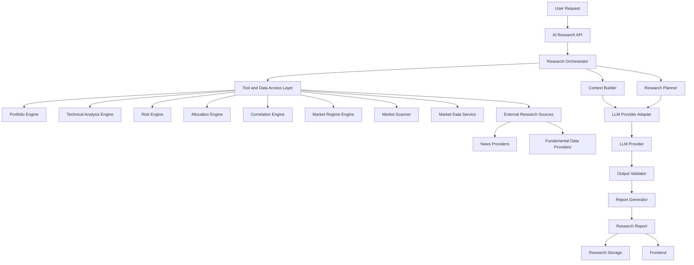
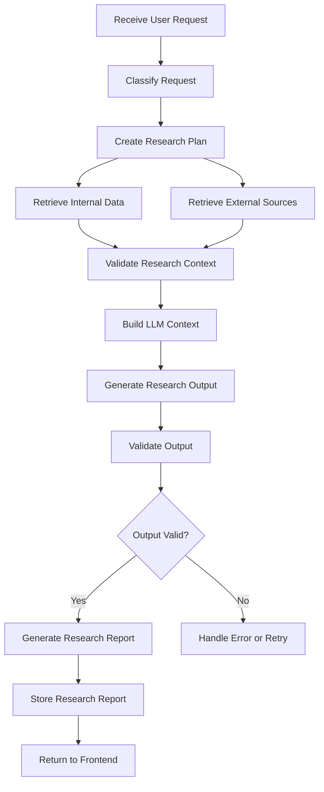

# AI Research Engine Specification
## Personal Investment Management System (PIMS)

**Document Version:** 1.0  
**Project Status:** Planning  
**Document Type:** Engine Specification  
**Last Updated:** November 2026

---

# 1. Purpose

Dokumen ini mendefinisikan spesifikasi AI Research Engine dalam Personal Investment Management System (PIMS).

AI Research Engine merupakan intelligence layer yang menggunakan Large Language Models (LLMs) untuk membantu pengguna memahami kondisi pasar, menganalisis informasi finansial, menginterpretasikan hasil quantitative engines, dan menghasilkan research reports.

Engine ini menggabungkan structured financial data dengan external research information untuk menghasilkan penjelasan yang kontekstual dan dapat ditelusuri.

Tujuan pengembangan:

- Menginterpretasikan hasil quantitative analysis.
- Menyusun market research reports.
- Menganalisis portfolio conditions.
- Merangkum financial news.
- Membantu fundamental research.
- Menjelaskan technical analysis results.
- Mengidentifikasi perubahan market conditions.
- Menghasilkan asset research reports.
- Menyediakan conversational financial research interface.
- Menghubungkan berbagai analytical engines.
- Menyertakan sumber informasi dan timestamp.
- Menyediakan research history.

AI Research Engine tidak boleh menggantikan deterministic calculations dari analytical engines dan tidak boleh melakukan autonomous trading atau financial transactions.

# 2. Core Architecture

AI Research Engine merupakan independent intelligence module dalam backend Modular Monolith.

Engine menggunakan structured outputs dari internal analytical engines dan external research information sebagai konteks untuk LLM.

## 2.1 Architecture Diagram



## 2.2 Core Components

### A. Research Orchestrator

Mengatur keseluruhan research workflow mulai dari menerima request hingga menghasilkan research report.

### B. Context Builder

Mengumpulkan structured data dari internal engines dan menyusunnya menjadi research context.

### C. Research Planner

Menentukan data dan analytical modules yang diperlukan berdasarkan jenis research request.

### D. Tool and Data Access Layer

Menyediakan akses terkontrol terhadap internal services dan external research sources.

### E. LLM Provider Adapter

Menghubungkan sistem dengan berbagai LLM providers melalui standardized interface.

### F. Output Validator

Memvalidasi struktur, referensi, dan konsistensi hasil yang dihasilkan LLM.

### G. Report Generator

Menyusun hasil research menjadi standardized report.

# 3. AI Research Capabilities

AI Research Engine harus mendukung beberapa jenis research workflows.

## 3.1 Portfolio Research

Menganalisis kondisi portfolio berdasarkan data yang tersedia.

Contoh kemampuan:

- Menjelaskan portfolio performance.
- Menginterpretasikan risk metrics.
- Menjelaskan asset allocation.
- Mengidentifikasi concentration exposure.
- Menjelaskan perubahan portfolio composition.
- Membandingkan kondisi beberapa portfolio.

AI harus menggunakan portfolio metrics yang disediakan Portfolio Engine, Risk Engine, dan Allocation Engine.

## 3.2 Asset Research

Membantu melakukan research terhadap individual assets.

Contoh kemampuan:

- Asset overview.
- Technical analysis interpretation.
- Fundamental analysis summary.
- Historical performance overview.
- Volatility analysis.
- Market context.
- Relevant news summary.

Research hanya boleh menggunakan data yang tersedia dan memiliki sumber yang jelas.

## 3.3 Market Research

Menganalisis kondisi pasar secara keseluruhan.

Contoh kemampuan:

- Market trend summary.
- Market regime interpretation.
- Market volatility overview.
- Cross-market comparison.
- Market Scanner results interpretation.
- Relevant macroeconomic context.

## 3.4 Technical Research

Menginterpretasikan output Technical Analysis Engine.

Contoh:

- RSI conditions.
- MACD conditions.
- Moving average structure.
- Trend strength.
- Support and resistance data jika tersedia.
- Indicator convergence and divergence.

AI tidak boleh menghitung ulang indikator secara manual dan menggantikan hasil Technical Analysis Engine.

## 3.5 Fundamental Research

Menginterpretasikan data fundamental jika provider tersedia.

Contoh:

- Revenue growth.
- Earnings growth.
- Profit margins.
- Debt levels.
- Cash flow.
- Valuation ratios.
- Financial statement trends.

Jika fundamental data tidak tersedia, AI harus menyatakan keterbatasannya.

## 3.6 News Research

Mengumpulkan dan merangkum informasi dari news providers.

Kemampuan:

- News summarization.
- Event identification.
- Company-related news.
- Market-related news.
- News sentiment context.
- Source comparison.
- Publication timestamp analysis.

AI harus membedakan fakta yang diberitakan dari interpretasi model.

# 4. Research Request Classification

Research Orchestrator harus mengidentifikasi jenis permintaan pengguna sebelum mengambil data.

## 4.1 Initial Request Types

| Request Type | Purpose |
|---|---|
| PORTFOLIO_RESEARCH | Research portfolio |
| ASSET_RESEARCH | Research individual asset |
| MARKET_RESEARCH | Research market conditions |
| TECHNICAL_RESEARCH | Interpret technical indicators |
| FUNDAMENTAL_RESEARCH | Interpret financial fundamentals |
| NEWS_RESEARCH | Summarize relevant news |
| COMPARISON_RESEARCH | Compare assets or portfolios |
| GENERAL_RESEARCH | General financial research |

## 4.2 Request Routing

Setiap request harus diarahkan ke data sources yang relevan.

Contoh:

Portfolio research dapat membutuhkan:

- Portfolio Engine.
- Risk Engine.
- Allocation Engine.
- Correlation Engine.
- Market Regime Engine.

Technical research dapat membutuhkan:

- Market Data Service.
- Technical Analysis Engine.
- Market Regime Engine.

News research dapat membutuhkan:

- News provider.
- Asset metadata.
- Relevant market data.
- LLM interpretation.

Tidak semua request harus memanggil seluruh engines.

# 5. Context Builder

Context Builder merupakan komponen penting untuk menjaga agar AI menggunakan data yang relevan dan aktual.

## 5.1 Context Sources

Internal sources:

- Portfolio Engine.
- Technical Analysis Engine.
- Risk Engine.
- Allocation Engine.
- Correlation Engine.
- Market Regime Engine.
- Market Scanner.
- Market Data Service.

External sources:

- News providers.
- Fundamental data providers.
- Macroeconomic data providers.
- Other approved research sources.

## 5.2 Context Structure

Setiap research context harus memiliki:

- Request ID.
- Research type.
- Asset identifiers.
- Portfolio identifiers jika relevan.
- Requested observation period.
- Structured analytical outputs.
- Data source metadata.
- Data timestamps.
- Data freshness.
- Calculation methodology.
- Known limitations.

## 5.3 Context Validation

Sebelum dikirim ke LLM:

- Pastikan data berasal dari internal service yang valid.
- Periksa timestamp.
- Periksa data freshness.
- Periksa currency.
- Periksa calculation status.
- Identifikasi missing values.
- Hilangkan data yang tidak relevan.
- Batasi jumlah data sesuai kebutuhan.

## 5.4 Context Minimization

Context Builder hanya boleh mengirimkan data yang diperlukan untuk research request.

Sistem tidak boleh mengirim seluruh database atau seluruh portfolio history ke LLM tanpa alasan yang jelas.

# 6. Research Planner

Research Planner menentukan langkah research berdasarkan jenis request.

## 6.1 Planning Responsibilities

- Mengidentifikasi research objective.
- Menentukan analytical engines yang dibutuhkan.
- Menentukan external sources.
- Menentukan observation period.
- Mengidentifikasi missing information.
- Mengatur urutan pengambilan data.
- Menentukan apakah research dapat dilanjutkan.

## 6.2 Planning Example

Request:

"Analyze the current condition of my portfolio."

Possible workflow:

1. Retrieve portfolio valuation.
2. Retrieve portfolio performance.
3. Retrieve risk metrics.
4. Retrieve asset allocation.
5. Retrieve correlation results if relevant.
6. Retrieve market regime context.
7. Build research context.
8. Generate research interpretation.
9. Validate output.
10. Save research report.

Research Planner tidak boleh menjalankan tindakan finansial.

# 7. LLM Provider Integration

AI Research Engine harus mendukung provider abstraction agar model dapat diganti tanpa mengubah seluruh application architecture.

## 7.1 Provider Architecture

```text
AI Research Engine
        |
        v
LLM Provider Adapter
        |
        +---- Provider A
        |
        +---- Provider B
        |
        +---- Provider C
```

## 7.2 Provider Adapter Responsibilities

- Request formatting.
- Authentication.
- Model selection.
- Response parsing.
- Timeout handling.
- Error handling.
- Token usage tracking.
- Provider metadata.
- Retry policies.

## 7.3 Provider Configuration

Configuration harus mendukung:

- Provider name.
- API endpoint.
- API credentials.
- Model identifier.
- Request timeout.
- Maximum output tokens.
- Temperature or supported generation settings.
- Provider availability.
- Usage limits.

API credentials harus disimpan pada backend environment dan tidak boleh dikirim ke frontend.

## 7.4 Provider Selection

Provider dan model harus dapat dikonfigurasi.

Pemilihan model dapat mempertimbangkan:

- Response quality.
- Latency.
- Context window.
- Cost.
- Availability.
- Tool-calling support.
- Structured output support.

## 7.5 Fallback

Jika primary provider gagal:

- Catat error.
- Evaluasi apakah fallback tersedia.
- Gunakan fallback hanya jika dikonfigurasi.
- Pertahankan research context.
- Tandai provider yang menghasilkan output.

Jangan mengklaim fallback berhasil jika provider tidak memberikan respons valid.

# 8. AI Research Workflow

Setiap research request harus mengikuti workflow yang konsisten.

## 8.1 Standard Workflow



## 8.2 Workflow Requirements

- Setiap research request memiliki unique ID.
- Research plan harus dapat ditelusuri.
- Internal data retrieval harus menggunakan approved services.
- External sources harus dicatat.
- Context harus divalidasi sebelum dikirim.
- LLM output harus divalidasi.
- Failed workflows harus memiliki error status.
- Research report harus menyimpan provenance.

# 9. Research Report Structure

AI Research Engine harus menghasilkan standardized research reports.

## 9.1 Report Sections

### A. Executive Summary

Ringkasan utama hasil research.

### B. Research Objective

Menjelaskan pertanyaan atau tujuan research.

### C. Market Context

Menjelaskan kondisi pasar yang relevan.

### D. Quantitative Analysis

Menginterpretasikan hasil analytical engines.

### E. Fundamental and News Context

Menampilkan informasi fundamental atau berita jika tersedia.

### F. Key Findings

Menyajikan temuan utama berdasarkan data.

### G. Risks and Limitations

Menjelaskan risiko, ketidakpastian, dan keterbatasan informasi.

### H. Sources

Daftar sumber data dan referensi yang digunakan.

### I. Research Metadata

Menampilkan:

- Research ID.
- Generated timestamp.
- AI provider.
- Model identifier.
- Data observation period.
- Data source timestamps.

## 9.2 Report Requirements

- Setiap factual claim harus didukung sumber yang sesuai jika berasal dari external research.
- Quantitative claims harus berasal dari internal engine outputs.
- Missing data harus dinyatakan.
- Conflicting sources harus ditampilkan secara transparan.
- Generated timestamp harus tersedia.
- Report harus dapat disimpan dan diakses kembali.

# 10. Source Attribution and Citations

Source attribution merupakan requirement wajib.

## 10.1 Internal Data Sources

Contoh:

- Portfolio Engine.
- Risk Engine.
- Market Data Service.
- Technical Analysis Engine.

Setiap internal data reference harus memiliki metadata yang cukup untuk mengetahui asal dan waktu perhitungan.

## 10.2 External Sources

Setiap external source harus memiliki:

- Source name.
- Article or document title.
- URL jika tersedia.
- Publisher.
- Publication timestamp.
- Retrieval timestamp.

## 10.3 Citation Rules

- Jangan membuat URL.
- Jangan membuat nama publisher.
- Jangan mengarang publication dates.
- Jangan membuat kutipan yang tidak terdapat pada sumber.
- Pisahkan source facts dan AI interpretation.
- Jika sumber tidak tersedia, nyatakan bahwa claim belum dapat diverifikasi.

# 11. News and Sentiment Research

AI Research Engine dapat menggabungkan news information dengan structured market data.

## 11.1 News Processing

Workflow:

1. Retrieve relevant news.
2. Validate source metadata.
3. Identify duplicate articles.
4. Extract relevant entities.
5. Determine publication timestamps.
6. Summarize article content.
7. Group related news.
8. Generate research context.

## 11.2 Sentiment Context

AI dapat memberikan descriptive sentiment classification:

- POSITIVE.
- NEGATIVE.
- NEUTRAL.
- MIXED.
- UNKNOWN.

Sentiment harus memiliki source reference dan timestamp.

## 11.3 Sentiment Limitations

- Sentiment bukan pengganti market price analysis.
- News sentiment tidak menjamin price direction.
- Duplicate news harus diperhatikan.
- Old articles tidak boleh dianggap sebagai new information.
- Conflicting reports harus dapat ditampilkan.

Jika Sentiment Engine dikembangkan secara terpisah, AI Research Engine harus menggunakan hasilnya melalui internal contract.

# 12. Fundamental Research

AI Research Engine dapat menginterpretasikan financial information dari Fundamental Analysis Engine atau approved financial data providers.

## 12.1 Supported Information

- Revenue.
- Earnings.
- Operating income.
- Profit margins.
- Cash flow.
- Debt.
- Assets and liabilities.
- Valuation ratios.
- Growth metrics.

## 12.2 Research Requirements

- Financial period harus jelas.
- Currency harus jelas.
- Fiscal year harus diketahui.
- Reported versus adjusted figures harus dibedakan.
- Source provider harus dicatat.
- Missing information harus dinyatakan.

AI tidak boleh mengarang financial statement values atau valuation metrics.

# 13. AI and Deterministic Engine Boundaries

Batas tanggung jawab antara AI dan quantitative engines harus dijaga.

## 13.1 Deterministic Engines

Bertanggung jawab atas:

- Portfolio valuation.
- Returns.
- Risk metrics.
- Asset allocation.
- Correlation calculations.
- Technical indicators.
- Market regime classification.
- Scanner results.

## 13.2 AI Research Engine

Bertanggung jawab atas:

- Explanation.
- Interpretation.
- Research summarization.
- Contextual comparison.
- Information synthesis.
- Report generation.
- Conversational interface.

## 13.3 Prohibited Responsibilities

AI Research Engine tidak boleh:

- Mengubah quantitative calculation outputs.
- Mengarang missing market data.
- Menghasilkan financial metrics seolah-olah telah dihitung.
- Menyembunyikan data quality warnings.
- Mengklaim informasi yang tidak didukung sumber.
- Menjalankan trading atau brokerage transactions.
- Mengakses private provider credentials.
- Mengubah portfolio transactions tanpa explicit user workflow dan approval.

# 14. Conversational Research Interface

AI Research Engine harus menyediakan conversational interface melalui frontend.

## 14.1 Interface Capabilities

- Natural language research requests.
- Follow-up questions.
- Asset research.
- Portfolio research.
- Market research.
- Research report generation.
- Research history.
- Source inspection.

## 14.2 Conversation Context

Conversation context dapat mempertahankan informasi yang relevan selama research session.

Sistem harus memperhatikan:

- Context window limits.
- Relevant conversation history.
- Portfolio and asset references.
- Research session identifiers.
- User privacy.

## 14.3 Conversation Requirements

- Research requests harus dapat diidentifikasi.
- Tool calls harus memiliki explicit permissions.
- Failed data retrieval harus dijelaskan.
- Research results harus memiliki source references.
- Follow-up requests harus mempertahankan konteks yang relevan.

# 15. Research Tools and Internal Service Access

AI dapat menggunakan approved internal tools untuk mengumpulkan data.

## 15.1 Initial Tool Categories

| Tool Category | Purpose |
|---|---|
| Portfolio Query | Retrieve portfolio data |
| Market Data Query | Retrieve market information |
| Technical Analysis Query | Retrieve indicators |
| Risk Analysis Query | Retrieve risk metrics |
| Allocation Query | Retrieve allocation results |
| Correlation Query | Retrieve correlation results |
| Market Regime Query | Retrieve regime results |
| Scanner Query | Retrieve scanner results |
| News Search | Retrieve external news |
| Fundamental Query | Retrieve financial information |

## 15.2 Tool Access Requirements

- Tools harus memiliki defined schemas.
- Input harus divalidasi.
- Access harus dibatasi sesuai request.
- Output harus memiliki provenance.
- Tool errors harus ditangani.
- LLM tidak boleh mendapatkan unrestricted database access.

## 15.3 Tool Execution Boundaries

LLM dapat meminta data retrieval melalui approved tool interface.

Backend tetap mengontrol:

- Tool availability.
- Input validation.
- Permissions.
- Execution.
- Output validation.
- Rate limits.

LLM tidak boleh menjalankan arbitrary code atau raw database queries.

# 16. Research Storage

Research reports harus dapat disimpan dan diakses kembali.

## 16.1 Research Entities

Initial conceptual entities:

- research_reports.
- research_sources.
- research_sessions.
- research_execution_logs.

## 16.2 Research Report Metadata

- Research ID.
- Research type.
- Request summary.
- Report content.
- Asset identifiers.
- Portfolio identifier jika relevan.
- AI provider.
- Model identifier.
- Generated timestamp.
- Source references.
- Data observation period.
- Execution status.

## 16.3 Storage Requirements

- Research history harus dapat dicari.
- Reports harus memiliki unique identifiers.
- Source references harus tetap terhubung.
- Failed reports harus memiliki execution status.
- Sensitive information harus dilindungi.
- Retention policy harus dapat dikonfigurasi.

# 17. API Integration

AI Research Engine diakses melalui backend REST API.

Proposed endpoints:

```text
POST /api/v1/research/requests

GET /api/v1/research/requests/{request_id}

GET /api/v1/research/reports

GET /api/v1/research/reports/{report_id}

GET /api/v1/research/sessions

GET /api/v1/research/sessions/{session_id}

DELETE /api/v1/research/reports/{report_id}
```

## 17.1 Request Requirements

Research request dapat menerima:

- Research type.
- User question.
- Asset identifiers.
- Portfolio identifier.
- Observation period.
- Requested analysis modules.

## 17.2 Response Requirements

Response harus menyediakan:

- Request ID.
- Execution status.
- Research report jika tersedia.
- Source references.
- Error information.
- Generated timestamp.

## 17.3 Execution Model

Research dapat berjalan secara asynchronous untuk pekerjaan yang membutuhkan banyak data retrieval atau LLM processing.

Frontend harus dapat memeriksa status request.

Mekanisme background jobs masih memerlukan keputusan arsitektur lebih lanjut.

# 18. WebSocket Integration

WebSocket dapat digunakan untuk memberikan research execution updates.

Proposed event:

```text
research.status
```

Example payload:

```json
{
  "event": "research.status",
  "data": {
    "request_id": "research-uuid",
    "status": "PROCESSING",
    "stage": "GENERATING_REPORT",
    "timestamp": "2026-11-17T00:30:00Z"
  }
}
```

Initial execution statuses:

- QUEUED.
- PROCESSING.
- COMPLETED.
- FAILED.
- CANCELLED.

WebSocket event harus mengikuti protocol pada `websocket-spec.md`.

# 19. Security and Privacy

AI Research Engine dapat memproses portfolio information dan data finansial yang bersifat pribadi.

Security merupakan requirement utama.

## 19.1 API Security

- API credentials harus backend-only.
- Provider secrets tidak boleh masuk ke frontend.
- Tool access harus melalui backend.
- Request payload harus divalidasi.
- Sensitive logs harus dihindari.

## 19.2 Data Privacy

- Kirim hanya data yang diperlukan.
- Hindari mengirim unnecessary personal information.
- Jangan mengirim private credentials ke LLM.
- Dokumentasikan data yang dikirim ke external providers.
- Gunakan provider dengan data handling terms yang sesuai.
- Terapkan retention policy.

## 19.3 Prompt Injection Protection

External content seperti articles, websites, dan documents harus diperlakukan sebagai untrusted data.

Sistem harus:

- Memisahkan system instructions dari retrieved content.
- Tidak menjalankan instruksi yang ditemukan dalam external sources.
- Membatasi tool permissions.
- Memvalidasi tool arguments.
- Menolak arbitrary code execution.
- Mempertahankan source provenance.

# 20. Reliability and Error Handling

AI Research Engine harus menangani:

- LLM provider unavailable.
- API rate limits.
- Request timeouts.
- Context overflow.
- Invalid structured output.
- Missing analytical data.
- External source failures.
- Conflicting sources.
- Invalid citations.
- Partial research completion.

## 20.1 Failure Policy

Jika satu source gagal:

- Identifikasi source yang gagal.
- Evaluasi apakah research dapat dilanjutkan.
- Tandai informasi yang tidak tersedia.
- Hindari membuat asumsi pengganti.
- Sertakan partial result status jika relevan.

## 20.2 Retry Policy

Retry hanya dilakukan untuk error yang sesuai.

Retry harus memiliki:

- Maximum attempt count.
- Backoff policy.
- Timeout limits.
- Provider error classification.

Jangan melakukan retry tanpa batas.

# 21. Performance and Cost Management

LLM requests dapat menimbulkan latency dan biaya operasional.

## 21.1 Performance Requirements

- Context minimization.
- Relevant data retrieval.
- Reuse validated internal outputs.
- Bounded research workflows.
- Async execution for long-running tasks.
- Configurable timeout.
- Token usage tracking.

## 21.2 Cost Management

Sistem harus mencatat:

- Provider.
- Model.
- Input tokens.
- Output tokens.
- Request count.
- Estimated usage cost jika tersedia.
- Execution duration.

## 21.3 Model Routing

Model selection dapat disesuaikan dengan kompleksitas research.

Contoh:

- Simple summarization menggunakan model yang lebih ringan.
- Complex multi-source research menggunakan model dengan reasoning capability yang lebih tinggi.

Routing harus dapat dikonfigurasi dan tidak boleh mengubah research accuracy requirements.

# 22. Output Quality Evaluation

AI Research Engine harus memiliki evaluation framework untuk mengukur kualitas hasil research.

## 22.1 Evaluation Criteria

- Factual consistency.
- Source attribution accuracy.
- Quantitative consistency.
- Completeness.
- Relevance.
- Citation validity.
- Structured output validity.
- Data freshness awareness.

## 22.2 Evaluation Dataset

Test dataset dapat berisi:

- Known portfolio analysis scenarios.
- Historical market research scenarios.
- Verified financial news.
- Technical analysis interpretation cases.
- Missing data scenarios.
- Conflicting source scenarios.

## 22.3 Evaluation Requirements

AI output harus dibandingkan dengan verified reference information.

Tidak cukup hanya menguji apakah model menghasilkan jawaban yang dapat dibaca.

# 23. Testing Requirements

## 23.1 Unit Tests

- Request classification.
- Research planning.
- Context building.
- Source metadata handling.
- Provider adapter.
- Output validation.
- Report generation.
- Token usage tracking.

## 23.2 Integration Tests

- Portfolio Engine integration.
- Technical Analysis integration.
- Risk Engine integration.
- Allocation Engine integration.
- Correlation Engine integration.
- Market Regime integration.
- Market Scanner integration.
- News provider integration.
- LLM provider integration.
- REST API integration.
- WebSocket integration.

## 23.3 Security Tests

- Prompt injection handling.
- Tool permission validation.
- Secret leakage prevention.
- Invalid tool arguments.
- Unauthorized data access.
- Sensitive log exposure.

## 23.4 Reliability Tests

- Provider timeout.
- Rate limiting.
- Invalid model response.
- Partial source failure.
- Context overflow.
- Retry behavior.

# 24. Implementation Roadmap

## Phase 1 — AI Foundation

- AI module structure.
- LLM provider abstraction.
- Configuration management.
- Basic request and response contracts.

## Phase 2 — Context Builder

- Internal engine integration.
- Structured context generation.
- Data validation.
- Source metadata.

## Phase 3 — Basic Research

- Asset research.
- Portfolio research.
- Technical analysis interpretation.
- Market context interpretation.

## Phase 4 — Research Reports

- Standardized report structure.
- Source attribution.
- Research storage.
- Research history.

## Phase 5 — Conversational Interface

- Natural language requests.
- Follow-up context.
- Research session management.
- Frontend integration.

## Phase 6 — External Research

- News provider integration.
- Fundamental data integration.
- External source validation.
- Multi-source research.

## Phase 7 — Advanced Intelligence

- Research planning.
- Advanced tool orchestration.
- Model routing.
- Research quality evaluation.
- Advanced report generation.

# 25. Acceptance Criteria

AI Research Engine dinyatakan memenuhi spesifikasi apabila:

- LLM provider abstraction tersedia.
- Research requests dapat diklasifikasikan.
- Research Planner dapat menentukan data yang relevan.
- Context Builder dapat mengumpulkan internal engine outputs.
- Source metadata dapat dipertahankan.
- Quantitative results tidak dihitung ulang oleh AI.
- Research reports dapat dihasilkan.
- External citations dapat ditelusuri.
- Missing information dinyatakan.
- Invalid outputs dapat ditolak.
- Research history dapat disimpan.
- REST API tersedia.
- WebSocket execution updates tersedia jika asynchronous execution digunakan.
- Prompt injection protections tersedia.
- Sensitive credentials tidak dikirim ke frontend atau LLM context.
- Automated tests tersedia.
- Provider failures ditangani secara eksplisit.

# 26. Decisions Requiring Approval

| Decision | Current Status |
|---|---|
| Primary LLM provider | Requires approval |
| Secondary LLM provider | Deferred |
| Default model | Requires approval |
| News data provider | Requires approval |
| Fundamental data provider | Requires approval |
| Macro data provider | Requires approval |
| Research execution mechanism | Requires approval |
| Research retention policy | Requires approval |
| Model routing policy | Deferred |
| External data sharing policy | Requires approval |

OpenCode tidak boleh mengubah proposed decisions menjadi approved decisions tanpa persetujuan.

# 27. Related Documents

- `AGENTS.md`
- `docs/architecture/application-architecture.md`
- `docs/architecture/data-flow.md`
- `docs/architecture/engine-architecture.md`
- `docs/database/database-design.md`
- `docs/decisions/technical-decisions.md`
- `specifications/project/project-overview.md`
- `specifications/project/project-scope.md`
- `specifications/project/development-roadmap.md`
- `specifications/engines/portfolio-engine-spec.md`
- `specifications/engines/technical-analysis-spec.md`
- `specifications/engines/risk-engine-spec.md`
- `specifications/engines/allocation-engine-spec.md`
- `specifications/engines/correlation-engine-spec.md`
- `specifications/engines/market-regime-spec.md`
- `specifications/engines/market-scanner-spec.md`
- `specifications/data/market-data-spec.md`
- `specifications/data/provider-integration-spec.md`
- `specifications/backend/api-spec.md`
- `specifications/backend/websocket-spec.md`
- `specifications/security/security-spec.md`

---

# Final Principle

AI Research Engine harus menjadi intelligence layer yang menghubungkan quantitative analysis, market information, dan financial research menjadi informasi yang mudah dipahami.

AI bertugas menginterpretasikan dan menyusun informasi, sedangkan seluruh perhitungan finansial tetap menjadi tanggung jawab deterministic engines.

Setiap research output harus memiliki source attribution, data timestamp, methodology context, dan limitations yang jelas.

Dengan pendekatan ini, PIMS dapat memiliki AI Research Assistant yang berguna, transparan, dan dapat dipertanggungjawabkan tanpa menjadikan LLM sebagai sumber kebenaran untuk perhitungan finansial.