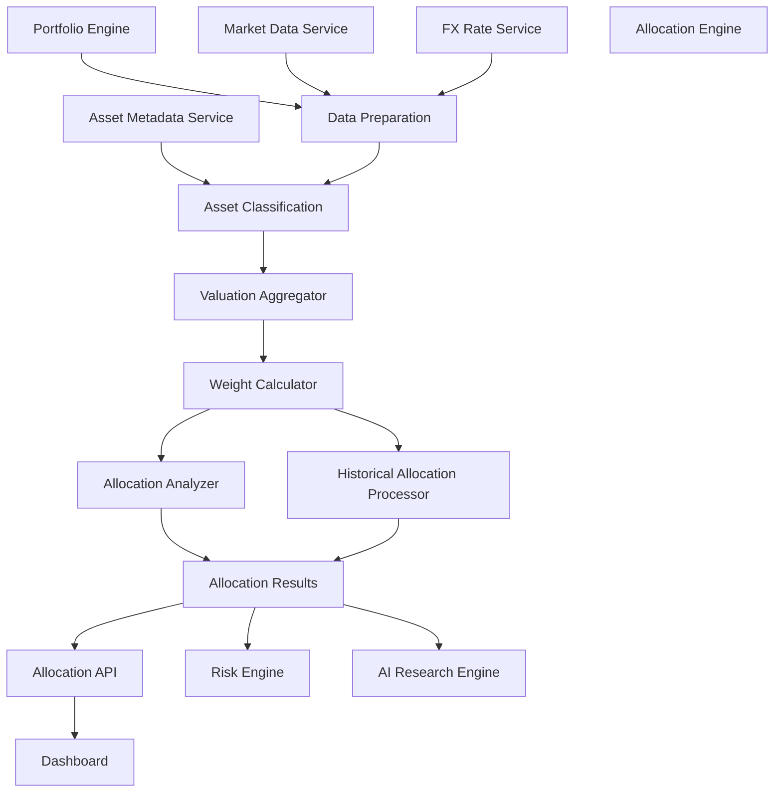

# Asset Allocation Engine Specification
## Personal Investment Management System (PIMS)

**Document Version:** 1.0  
**Project Status:** Planning  
**Document Type:** Engine Specification  
**Last Updated:** November 2026

---

# 1. Purpose

Dokumen ini mendefinisikan spesifikasi Asset Allocation Engine dalam Personal Investment Management System (PIMS).

Allocation Engine bertanggung jawab untuk menganalisis distribusi nilai aset dalam portfolio berdasarkan berbagai kategori dan klasifikasi.

Engine ini membantu pengguna memahami bagaimana modal tersebar di antara berbagai aset, kelas aset, sektor, pasar, dan mata uang.

Tujuan pengembangan:

- Menghitung asset allocation.
- Menganalisis distribusi berdasarkan asset class.
- Menganalisis distribusi berdasarkan market.
- Menganalisis distribusi berdasarkan sector.
- Menganalisis distribusi berdasarkan currency.
- Menghitung portfolio weights.
- Mengidentifikasi konsentrasi aset.
- Mendukung portfolio comparison.
- Menyediakan allocation history.
- Menyediakan data untuk Dashboard, Risk Engine, dan AI Research Engine.

Seluruh perhitungan allocation harus dilakukan secara deterministic oleh backend.

Allocation Engine hanya menganalisis distribusi aset. Engine ini tidak melakukan transaksi atau mengubah komposisi portfolio secara otomatis.

# 2. Engine Architecture

Allocation Engine merupakan independent analytical engine dalam backend Modular Monolith.

Engine menerima data holdings dan valuation dari Portfolio Engine, serta metadata klasifikasi aset dari Asset Management dan Market Data Service.

## 2.1 Architecture Diagram



## 2.2 Core Components

### A. Data Preparation

Mengambil holdings, asset valuations, currency information, dan portfolio metadata.

### B. Asset Classification

Mengelompokkan aset berdasarkan kategori yang telah ditentukan.

### C. Valuation Aggregator

Menghitung nilai total aset dalam reporting currency yang konsisten.

### D. Weight Calculator

Menghitung persentase kontribusi setiap aset atau kelompok aset terhadap portfolio.

### E. Allocation Analyzer

Menghasilkan analisis distribusi dan konsentrasi alokasi.

### F. Historical Allocation Processor

Merekonstruksi perubahan alokasi dari waktu ke waktu.

# 3. Required Input Data

Allocation Engine membutuhkan data dari beberapa internal services.

## 3.1 Portfolio Data

Dari Portfolio Engine:

- Portfolio ID.
- Portfolio holdings.
- Asset quantities.
- Asset market values.
- Cash balances.
- Portfolio base currency.
- Portfolio valuation timestamp.
- Valuation status.

## 3.2 Asset Metadata

Dari Asset Management dan Market Data Service:

- Asset ID.
- Asset symbol.
- Asset name.
- Asset class.
- Market.
- Sector.
- Industry.
- Currency.
- Instrument type.

## 3.3 FX Data

Dari FX Rate Service:

- Currency pair.
- Exchange rate.
- Rate timestamp.
- Data provider.
- Data freshness.

## 3.4 Input Validation

Sebelum melakukan calculation:

- Asset identifiers harus valid.
- Asset classifications harus diketahui atau ditandai unknown.
- Holdings harus valid.
- Market values harus tersedia.
- Currency harus diketahui.
- FX rates harus tersedia untuk conversion.
- Portfolio valuation status harus diperiksa.
- Data timestamps harus konsisten.

Missing metadata tidak boleh menyebabkan aset dikeluarkan secara diam-diam dari allocation report.

# 4. Allocation Categories

Allocation Engine harus mendukung beberapa dimensi klasifikasi.

| Category | Description |
|---|---|
| Asset Class | Distribution by asset class |
| Market | Distribution by market |
| Sector | Distribution by economic sector |
| Industry | Distribution by industry |
| Currency | Distribution by currency |
| Individual Asset | Distribution by instrument |
| Instrument Type | Distribution by instrument type |

Kategori dapat dikembangkan sesuai kebutuhan.

# 5. Asset Class Allocation

Asset Class Allocation mengelompokkan aset berdasarkan karakteristik kelas asetnya.

## 5.1 Initial Asset Classes

Initial classifications:

| Asset Class | Examples |
|---|---|
| Cryptocurrency | BTC, ETH, other supported crypto assets |
| Equity | US stocks and IDX stocks |
| Cash | USD, IDR, USDT balances |
| ETF | Exchange-traded funds |
| Other | Assets not covered by initial categories |
| Unknown | Unclassified assets |

Cash dan cryptocurrency harus dipisahkan berdasarkan klasifikasi internal yang jelas.

Stablecoins tidak boleh otomatis diklasifikasikan sebagai fiat cash tanpa aturan yang disetujui.

## 5.2 Allocation Calculation

\[
AssetClassValue =
\sum_{i=1}^{n} AssetValue_i
\]

\[
AssetClassWeight =
\frac{AssetClassValue}{PortfolioValue}
\times 100
\]

Seluruh values harus menggunakan reporting currency yang sama.

## 5.3 Output

- Asset class name.
- Total market value.
- Allocation percentage.
- Number of holdings.
- Valuation timestamp.
- Data quality status.

# 6. Market Allocation

Market Allocation mengelompokkan portfolio berdasarkan market atau geographic exposure.

Initial supported markets:

- Cryptocurrency markets.
- United States equity market.
- Indonesian equity market.
- Cash and cash equivalents.
- Other supported markets.

## 6.1 Calculation

\[
MarketWeight =
\frac{MarketValue}{PortfolioValue}
\times 100
\]

## 6.2 Requirements

- Market classification harus tersedia.
- Multi-market assets harus memiliki classification policy.
- Unknown market harus tetap ditampilkan.
- Currency conversion harus konsisten.

## 6.3 Example Output

| Market | Allocation |
|---|---:|
| Crypto | 35% |
| US Stocks | 40% |
| IDX Stocks | 15% |
| Cash | 10% |

Angka tersebut hanya contoh struktur hasil.

# 7. Sector and Industry Allocation

Sector Allocation mengukur distribusi portfolio berdasarkan sektor ekonomi.

Contoh sektor:

- Technology.
- Financial Services.
- Healthcare.
- Energy.
- Consumer Goods.
- Industrials.
- Communication Services.
- Other.
- Unknown.

## 7.1 Calculation

\[
SectorValue =
\sum AssetValues\ in\ Sector
\]

\[
SectorWeight =
\frac{SectorValue}{PortfolioValue}
\times 100
\]

## 7.2 Requirements

- Sector classification harus berasal dari metadata yang dapat ditelusuri.
- Classification source harus disimpan.
- Classification timestamp harus tersedia.
- Unclassified assets harus masuk kategori Unknown.
- Classification changes harus dapat ditelusuri.

## 7.3 Multiple Sector Exposure

Untuk instrumen yang memiliki exposure terhadap beberapa sektor, sistem harus menggunakan constituent-level look-through apabila data tersedia dan metodologinya disetujui.

Jika data look-through tidak tersedia, sistem harus menggunakan classification yang sesuai dan tidak mengarang distribusi sektor.

# 8. Currency Allocation

Currency Allocation mengukur distribusi portfolio berdasarkan denominasi atau exposure mata uang.

## 8.1 Currency Categories

Initial supported currencies:

- USD.
- IDR.
- USDT.
- Other supported currencies.
- Unknown.

## 8.2 Calculation

\[
CurrencyWeight =
\frac{CurrencyExposureValue}{PortfolioValue}
\times 100
\]

Currency exposure harus dibedakan dari portfolio reporting currency.

## 8.3 Stablecoin Handling

USDT dan stablecoins lainnya harus tetap memiliki identitas aset tersendiri.

Sistem tidak boleh menganggap stablecoin selalu bernilai tepat satu unit fiat currency.

## 8.4 Requirements

- Currency mapping harus valid.
- FX conversion harus menggunakan data yang sesuai.
- Missing FX rates harus ditandai.
- Currency exposure harus dapat dibedakan dari asset class exposure.

# 9. Individual Asset Allocation

Individual Asset Allocation menunjukkan kontribusi setiap aset terhadap total portfolio.

## 9.1 Calculation

\[
AssetWeight =
\frac{AssetMarketValue}{PortfolioValue}
\times 100
\]

## 9.2 Output

- Asset ID.
- Symbol.
- Asset name.
- Asset class.
- Market value.
- Portfolio weight.
- Quantity.
- Current price.
- Price timestamp.

## 9.3 Supported Views

- Largest holdings.
- Smallest holdings.
- Top 5 assets.
- Top 10 assets.
- Allocation by asset.
- Allocation by portfolio.

Sorting dan filtering harus dilakukan melalui backend jika dataset besar.

# 10. Cash Allocation

Cash Allocation mengukur jumlah dan persentase cash yang tersedia dalam portfolio.

## 10.1 Cash Categories

- USD cash.
- IDR cash.
- Other fiat currencies.
- Stablecoin balances.
- Other supported cash-equivalent categories.

Stablecoins harus tetap dibedakan dari fiat cash.

## 10.2 Cash Weight

\[
CashWeight =
\frac{CashValue}{PortfolioValue}
\times 100
\]

## 10.3 Requirements

- Cash balances harus berasal dari Cash Ledger.
- Currency harus diketahui.
- FX conversion harus dilakukan sebelum aggregation.
- Cash dan holdings harus tidak mengalami double counting.

# 11. Portfolio Weight Calculation

Portfolio weights merupakan dasar dari sebagian besar allocation metrics.

## 11.1 Standard Formula

\[
w_i = \frac{V_i}{V_p}
\]

Dengan:

- \(w_i\) = Asset weight.
- \(V_i\) = Asset value.
- \(V_p\) = Total portfolio value.

Percentage representation:

\[
WeightPercentage = w_i \times 100
\]

## 11.2 Weight Validation

- Total weights harus mendekati 100% apabila seluruh portfolio components tercakup.
- Rounding differences harus ditangani.
- Missing valuations harus menghasilkan partial status.
- Unknown classifications harus tetap masuk perhitungan.
- Negative or unsupported holdings harus ditangani sesuai Portfolio Engine rules.

## 11.3 Partial Allocation

Jika sebagian aset tidak dapat dinilai:

- Tampilkan allocation status PARTIAL.
- Tampilkan jumlah aset yang belum dapat dinilai.
- Jangan menganggap hasil sebagai complete.
- Jangan mengubah missing values menjadi nol.

# 12. Concentration Analysis

Allocation Engine menyediakan informasi distribusi untuk membantu memahami konsentrasi portfolio.

Perhitungan concentration risk yang lebih mendalam tetap menjadi tanggung jawab Risk Engine.

## 12.1 Largest Holding

Menentukan aset dengan portfolio weight terbesar.

## 12.2 Top Holdings Concentration

Menghitung akumulasi weight dari beberapa holdings terbesar.

\[
TopNWeight =
\sum_{i=1}^{N} w_i
\]

Initial supported views:

- Top 3.
- Top 5.
- Top 10.

## 12.3 Concentration Output

- Largest holding.
- Largest holding percentage.
- Top 5 holdings percentage.
- Top 10 holdings percentage.
- Largest sector.
- Largest market.
- Largest currency exposure.

Allocation Engine menyediakan distribution metrics, sedangkan Risk Engine bertanggung jawab atas penilaian dan interpretasi risiko konsentrasi.

# 13. Historical Allocation

Historical Allocation digunakan untuk melihat perubahan komposisi portfolio dari waktu ke waktu.

## 13.1 Historical Data Requirements

- Historical holdings.
- Historical asset prices.
- Historical FX rates.
- Historical transactions.
- Historical asset classifications where available.
- Portfolio valuation snapshots.

## 13.2 Historical Metrics

- Historical asset class weights.
- Historical market weights.
- Historical sector weights.
- Historical currency weights.
- Historical individual asset weights.

## 13.3 Historical Allocation Rules

- Gunakan historical prices sesuai timestamp.
- Gunakan historical FX rates yang sesuai.
- Perhatikan corporate actions jika tersedia.
- Jangan menggunakan current prices untuk historical allocation.
- Historical classification changes harus ditangani secara konsisten.

## 13.4 Allocation History

Historical results dapat digunakan untuk membuat stacked area charts dan allocation comparison charts.

# 14. Multi-Portfolio Allocation

Allocation Engine harus mendukung analisis portfolio secara terpisah maupun agregat.

## 14.1 Individual Portfolio

Setiap portfolio harus memiliki allocation report sendiri.

## 14.2 All Portfolios

All Portfolios view menggabungkan allocation berdasarkan reporting currency yang dipilih.

Requirements:

- Currency conversion harus tersedia.
- FX timestamp harus disertakan.
- Missing conversion rates harus ditandai.
- Portfolio weights harus dihitung terhadap aggregate portfolio value.
- Portfolio-specific allocation harus tetap dapat diakses.

Jangan menghitung aggregate weights dengan menjumlahkan persentase setiap portfolio secara langsung.

## 14.3 Portfolio Comparison

Pengguna dapat membandingkan:

- Asset class allocation.
- Market allocation.
- Sector allocation.
- Currency allocation.
- Individual asset concentration.

Perbandingan harus menggunakan reporting currency dan valuation timestamp yang kompatibel.

# 15. Asset Classification Management

Asset classification merupakan komponen penting untuk menjaga kualitas allocation results.

## 15.1 Classification Sources

Classification dapat berasal dari:

- Internal asset metadata.
- Market data provider.
- Financial instrument metadata provider.
- User-defined classification jika nantinya didukung.

## 15.2 Classification Fields

| Field | Description |
|---|---|
| asset_id | Asset identifier |
| asset_class | Asset classification |
| market | Market classification |
| sector | Economic sector |
| industry | Industry classification |
| currency | Asset currency |
| source | Classification provider |
| updated_at | Last update timestamp |

## 15.3 Classification Rules

- Classification harus memiliki source.
- Unknown classification harus diperbolehkan.
- Conflicting classifications harus dapat dideteksi.
- Classification updates harus dapat ditelusuri.
- User-defined classification tidak boleh menimpa provider data tanpa policy yang jelas.

# 16. Standardized Output Contract

Allocation Engine harus menghasilkan standardized output structure.

## 16.1 Output Fields

| Field | Description |
|---|---|
| allocation_run_id | Unique calculation ID |
| portfolio_id | Portfolio identifier |
| category | Allocation category |
| classification | Category name |
| market_value | Total market value |
| weight | Allocation weight |
| currency | Reporting currency |
| holdings_count | Number of holdings |
| valuation_timestamp | Valuation timestamp |
| data_status | Data quality status |
| calculated_at | Calculation timestamp |

## 16.2 Example Output

```json
{
  "allocation_run_id": "allocation-uuid",
  "portfolio_id": "portfolio-uuid",
  "reporting_currency": "USD",
  "categories": {
    "asset_class": [
      {
        "name": "Cryptocurrency",
        "market_value": "35000.00",
        "weight": "35.00"
      },
      {
        "name": "Equity",
        "market_value": "55000.00",
        "weight": "55.00"
      },
      {
        "name": "Cash",
        "market_value": "10000.00",
        "weight": "10.00"
      }
    ]
  },
  "data_status": "COMPLETE",
  "calculated_at": "2026-11-17T00:30:00Z"
}
```

Nilai tersebut hanya contoh struktur output, bukan hasil perhitungan portfolio aktual.

# 17. API Integration

Allocation Engine diakses melalui backend REST API.

Proposed endpoints:

```text
GET /api/v1/analytics/allocation/{portfolio_id}

GET /api/v1/analytics/allocation/{portfolio_id}/asset-class

GET /api/v1/analytics/allocation/{portfolio_id}/market

GET /api/v1/analytics/allocation/{portfolio_id}/sector

GET /api/v1/analytics/allocation/{portfolio_id}/currency

GET /api/v1/analytics/allocation/{portfolio_id}/holdings

GET /api/v1/analytics/allocation/{portfolio_id}/history

GET /api/v1/analytics/allocation/aggregate
```

Endpoint merupakan proposed contract dan harus diselaraskan dengan `api-spec.md`.

## 17.1 API Requirements

- Support allocation category filters.
- Support historical date ranges.
- Support reporting currency.
- Support pagination for holdings.
- Return calculation metadata.
- Return valuation timestamp.
- Return data quality status.
- Return explicit errors for unavailable data.

# 18. Dashboard Integration

Allocation Engine menyediakan data untuk Dashboard dan Analytics page.

## 18.1 Dashboard Allocation Overview

Dashboard dapat menampilkan:

- Asset class allocation.
- Market allocation.
- Currency allocation.
- Top holdings.
- Cash allocation.

## 18.2 Recommended Visualizations

| Visualization | Purpose |
|---|---|
| Donut Chart | Asset class distribution |
| Horizontal Bar Chart | Top holdings |
| Stacked Bar Chart | Market allocation |
| Treemap | Individual asset distribution |
| Stacked Area Chart | Historical allocation |
| Table | Detailed allocation data |

## 18.3 User Interactions

Pengguna dapat:

- Mengganti allocation category.
- Mengubah portfolio selection.
- Melihat detailed holdings.
- Mengubah historical period.
- Membandingkan beberapa portfolio.
- Melihat classification information.

Frontend hanya bertanggung jawab untuk menampilkan hasil dari Allocation Engine.

# 19. Integration with Other Engines

## 19.1 Portfolio Engine

Portfolio Engine menyediakan holdings, cash balances, valuation, dan portfolio metadata.

Allocation Engine tidak menghitung ulang transaction history.

## 19.2 Risk Engine

Allocation Engine menyediakan:

- Asset weights.
- Sector weights.
- Market weights.
- Currency exposure.
- Concentration distribution.

Risk Engine menggunakan data tersebut untuk analisis concentration risk dan exposure risk.

## 19.3 Correlation Engine

Allocation Engine menyediakan asset universe dan portfolio weights jika dibutuhkan.

Correlation Engine tetap bertanggung jawab atas statistical correlation calculations.

## 19.4 AI Research Engine

AI Research Engine dapat menggunakan allocation outputs untuk menjelaskan portfolio composition.

AI tidak boleh mengubah allocation calculations atau mengarang asset classifications.

# 20. Performance and Optimization

Allocation calculations umumnya lebih ringan dibandingkan historical simulation, tetapi harus tetap dirancang untuk menangani portfolio dengan banyak holdings.

## 20.1 Performance Requirements

- Batch asset valuation retrieval.
- Efficient grouping and aggregation.
- Reuse portfolio snapshots.
- Avoid repeated FX conversions.
- Support historical allocation queries.
- Cache reusable allocation results.
- Support pagination for detailed holdings.

## 20.2 Calculation Modes

- Request-driven calculations.
- Scheduled snapshots.
- Event-driven recalculations.

Recalculation dapat dipicu oleh:

- Transaction changes.
- Holdings changes.
- Market price updates.
- FX rate updates.
- Asset classification changes.

## 20.3 Caching

Cached results harus mempertimbangkan:

- Portfolio ID.
- Reporting currency.
- Allocation category.
- Valuation timestamp.
- Data version.
- Classification version.

Cache bukan source of truth.

Redis tetap deferred sesuai technical decisions.

# 21. Data Quality and Error Handling

Allocation Engine harus menangani:

- Missing asset metadata.
- Unknown classification.
- Missing market prices.
- Missing FX rates.
- Invalid holdings.
- Incomplete portfolio valuation.
- Conflicting classifications.
- Stale market data.
- Historical data gaps.

Setiap allocation report harus memiliki data quality status.

Invalid or incomplete inputs tidak boleh menghasilkan report yang diklaim complete.

# 22. Testing Requirements

## 22.1 Unit Tests

- Asset class grouping.
- Market grouping.
- Sector grouping.
- Currency grouping.
- Asset weights.
- Portfolio weights.
- Cash allocation.
- Top holdings.
- Top N concentration.
- Historical allocation.

## 22.2 Numerical Accuracy Tests

Test cases harus memastikan:

- Allocation percentages dihitung dengan benar.
- Total weights konsisten dengan coverage data.
- Currency conversion tidak mengalami double counting.
- Rounding tidak menyebabkan kesalahan material.
- Aggregate portfolio weights menggunakan total valuation yang benar.

## 22.3 Integration Tests

- Portfolio Engine integration.
- Market Data Service integration.
- Asset Metadata integration.
- FX Rate integration.
- Risk Engine integration.
- REST API integration.
- Dashboard integration.

## 22.4 Edge Case Tests

- Empty portfolio.
- Zero portfolio value.
- Missing classifications.
- Missing prices.
- Missing FX rates.
- Multiple currencies.
- Stablecoin exposure.
- Partial portfolio valuation.
- Duplicate asset mappings.

## 22.5 Deterministic Tests

Input data dan classification rules yang sama harus menghasilkan allocation results yang sama.

# 23. Implementation Roadmap

## Phase 1 — Allocation Foundation

- Input contracts.
- Holdings integration.
- Asset metadata integration.
- Valuation integration.
- Currency conversion integration.

## Phase 2 — Core Allocation

- Asset class allocation.
- Individual asset allocation.
- Market allocation.
- Cash allocation.
- Portfolio weight calculation.

## Phase 3 — Advanced Classification

- Sector allocation.
- Industry allocation.
- Currency allocation.
- Unknown classification handling.

## Phase 4 — Concentration Analysis

- Largest holding.
- Top 5 holdings.
- Top 10 holdings.
- Sector concentration.
- Market concentration.

## Phase 5 — Historical Allocation

- Historical allocation snapshots.
- Allocation trend analysis.
- Historical classification handling.
- Historical portfolio comparison.

## Phase 6 — Dashboard Integration

- Allocation overview.
- Donut charts.
- Holdings distribution.
- Market exposure visualization.
- Currency exposure visualization.

## Phase 7 — Advanced Features

- Multi-portfolio aggregation.
- Advanced portfolio comparison.
- Look-through allocation.
- Custom classification support.

# 24. Acceptance Criteria

Allocation Engine dinyatakan memenuhi spesifikasi apabila:

- Portfolio holdings dapat digunakan sebagai input.
- Asset metadata dapat digunakan untuk classification.
- Asset class allocation dapat dihitung.
- Market allocation dapat dihitung.
- Sector allocation dapat dihitung jika data tersedia.
- Currency allocation dapat dihitung.
- Individual asset weights dapat dihitung.
- Cash allocation dapat dihitung.
- Top holdings dapat diidentifikasi.
- Historical allocation dapat dianalisis jika data tersedia.
- Multi-portfolio aggregation mendukung currency conversion.
- Unknown classifications ditangani secara eksplisit.
- Missing valuation ditandai sebagai incomplete.
- REST API tersedia.
- Dashboard dapat menampilkan allocation results.
- Risk Engine dapat menggunakan allocation outputs.
- Automated tests tersedia.
- Perhitungan bersifat deterministic.

# 25. Decisions Requiring Approval

| Decision | Current Status |
|---|---|
| Asset classification taxonomy | Requires approval |
| Asset metadata providers | Requires verification |
| Reporting currency policy | Follows Portfolio Engine |
| Stablecoin classification | Requires approval |
| Sector classification provider | Requires approval |
| Look-through allocation | Deferred |
| User-defined classification | Deferred |
| Historical snapshot frequency | Requires approval |
| Multi-portfolio aggregation policy | Follows Portfolio Engine |

OpenCode tidak boleh menganggap proposed classifications atau data sources sebagai keputusan final.

# 26. Related Documents

- `AGENTS.md`
- `docs/architecture/application-architecture.md`
- `docs/architecture/data-flow.md`
- `docs/architecture/engine-architecture.md`
- `docs/database/database-design.md`
- `docs/decisions/technical-decisions.md`
- `specifications/project/project-scope.md`
- `specifications/project/development-roadmap.md`
- `specifications/engines/portfolio-engine-spec.md`
- `specifications/engines/risk-engine-spec.md`
- `specifications/engines/correlation-engine-spec.md`
- `specifications/data/market-data-spec.md`
- `specifications/data/normalization-spec.md`
- `specifications/backend/api-spec.md`
- `specifications/frontend/dashboard-spec.md`

---

# Final Principle

Allocation Engine harus memberikan gambaran yang akurat dan transparan mengenai distribusi aset dalam setiap portfolio.

Seluruh allocation calculations harus menggunakan valuation dan currency conversion yang konsisten, mempertahankan informasi klasifikasi, serta memberikan status yang jelas ketika data tidak lengkap.

Dengan demikian, PIMS dapat membantu pengguna memahami struktur portfolio dan menyediakan fondasi data yang kuat untuk analisis risiko serta portfolio research.