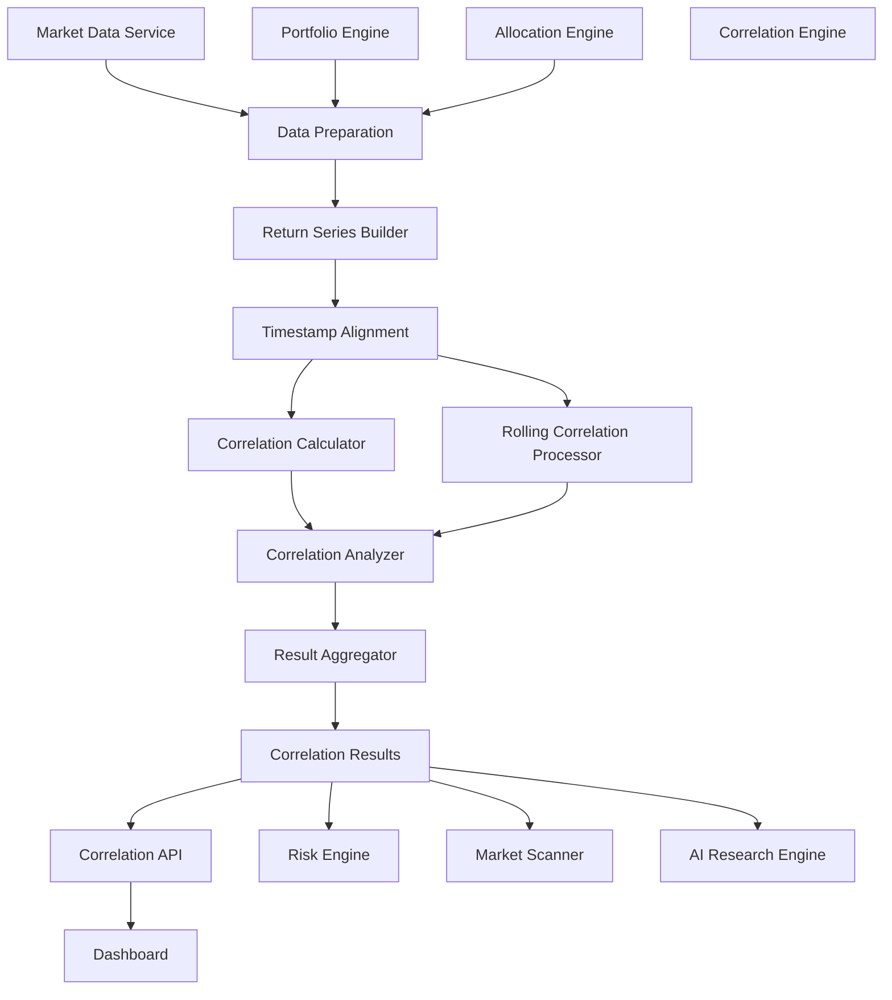

# Correlation Analysis Engine Specification
## Personal Investment Management System (PIMS)

**Document Version:** 1.0  
**Project Status:** Planning  
**Document Type:** Engine Specification  
**Last Updated:** November 2026

---

# 1. Purpose

Dokumen ini mendefinisikan spesifikasi Correlation Analysis Engine dalam Personal Investment Management System (PIMS).

Correlation Engine bertanggung jawab untuk menghitung dan menganalisis hubungan statistik antara pergerakan return dari berbagai aset.

Engine ini digunakan untuk memahami bagaimana aset bergerak satu sama lain, mengidentifikasi aset dengan korelasi tinggi, serta menyediakan informasi untuk analisis diversifikasi dan risiko portfolio.

Tujuan pengembangan:

- Menghitung korelasi antar-aset.
- Menghasilkan correlation matrix.
- Menghitung rolling correlation.
- Mengidentifikasi highly correlated assets.
- Menganalisis hubungan antar-market.
- Menganalisis korelasi antar-aset dalam portfolio.
- Mendukung analisis diversifikasi.
- Menyediakan historical correlation analysis.
- Menyediakan data untuk Risk Engine, Market Scanner, Dashboard, dan AI Research Engine.

Seluruh correlation calculations harus dilakukan secara deterministic oleh backend.

Correlation tidak menunjukkan hubungan sebab-akibat dan tidak menjamin bahwa hubungan antar-aset akan bertahan pada masa depan.

# 2. Engine Architecture

Correlation Engine merupakan independent analytical engine dalam backend Modular Monolith.

Engine menggunakan normalized historical market data dan portfolio information sebagai input.

Engine tidak boleh mengambil data langsung dari external providers.

## 2.1 Architecture Diagram



## 2.2 Core Components

### A. Data Preparation

Mengambil historical prices, portfolio holdings, dan asset metadata.

### B. Return Series Builder

Mengubah historical prices menjadi return series yang dapat digunakan untuk correlation calculations.

### C. Timestamp Alignment

Menyelaraskan observation timestamps antar-aset.

### D. Correlation Calculator

Menghitung correlation coefficients menggunakan metode statistik yang didukung.

### E. Rolling Correlation Processor

Menghitung perubahan korelasi menggunakan observation window yang bergerak.

### F. Correlation Analyzer

Mengidentifikasi hubungan korelasi yang relevan berdasarkan hasil perhitungan.

### G. Result Aggregator

Menghasilkan standardized correlation reports dan matrices.

# 3. Required Input Data

Correlation Engine membutuhkan data dari beberapa internal services.

## 3.1 Market Data

Dari Market Data Service:

- Asset ID.
- Asset symbol.
- Historical closing prices.
- Historical OHLCV.
- Observation timestamps.
- Market identifiers.
- Currency information.
- Data provider.
- Data freshness.

## 3.2 Portfolio Data

Dari Portfolio Engine:

- Portfolio ID.
- Portfolio holdings.
- Asset identifiers.
- Portfolio composition.
- Portfolio valuation timestamps.

## 3.3 Allocation Data

Dari Allocation Engine:

- Asset weights.
- Asset classifications.
- Market allocation.
- Sector allocation.
- Currency allocation.

Allocation data dapat digunakan sebagai konteks analisis, tetapi tidak menggantikan historical return series.

## 3.4 Input Validation

Sebelum melakukan perhitungan:

- Asset identifiers harus valid.
- Historical observations harus tersedia.
- Timestamp harus dapat diselaraskan.
- Price data harus valid.
- Return observations harus mencukupi.
- Missing observations harus dapat diidentifikasi.
- Data frequency harus konsisten.
- Currency dan adjustment policy harus diketahui.

# 4. Correlation Fundamentals

Correlation mengukur arah dan kekuatan hubungan statistik antara dua variabel.

Dalam PIMS, variabel yang digunakan umumnya adalah asset returns.

## 4.1 Pearson Correlation

Pearson correlation merupakan metode utama untuk mengukur hubungan linear antar-return.

Rentang hasil:

| Coefficient | Interpretation |
|---|---|
| +1.00 | Perfect positive correlation |
| +0.70 to +0.99 | Strong positive correlation |
| +0.30 to +0.69 | Moderate positive correlation |
| -0.29 to +0.29 | Weak linear correlation |
| -0.30 to -0.69 | Moderate negative correlation |
| -0.70 to -0.99 | Strong negative correlation |
| -1.00 | Perfect negative correlation |

Batas kategori di atas merupakan klasifikasi deskriptif awal dan dapat dikonfigurasi.

## 4.2 Correlation Formula

\[
\rho_{X,Y} =
\frac{Cov(X,Y)}{\sigma_X \sigma_Y}
\]

Dengan:

- \(X\) = Return series asset pertama.
- \(Y\) = Return series asset kedua.
- \(Cov(X,Y)\) = Covariance.
- \(\sigma_X\) = Standard deviation asset X.
- \(\sigma_Y\) = Standard deviation asset Y.

## 4.3 Interpretation

Positive correlation menunjukkan kecenderungan dua aset bergerak searah.

Negative correlation menunjukkan kecenderungan dua aset bergerak berlawanan arah.

Correlation mendekati nol menunjukkan hubungan linear yang lemah dalam observation window yang digunakan.

Correlation yang rendah tidak selalu berarti dua aset tidak memiliki hubungan non-linear.

# 5. Return Series Preparation

Correlation Engine harus menggunakan return series, bukan langsung menghitung korelasi dari nominal harga aset.

## 5.1 Simple Returns

\[
R_t = \frac{P_t-P_{t-1}}{P_{t-1}}
\]

## 5.2 Log Returns

\[
r_t = \ln\left(\frac{P_t}{P_{t-1}}\right)
\]

Metode return harus konsisten dalam satu calculation run.

## 5.3 Return Configuration

Initial configurations:

- SIMPLE.
- LOG.

Metode yang digunakan harus dicantumkan dalam calculation metadata.

## 5.4 Data Adjustment

Jika tersedia, sistem harus mempertimbangkan:

- Stock splits.
- Dividends.
- Corporate actions.
- Adjusted closing prices.

Untuk crypto, sistem menggunakan harga berdasarkan instrument dan quote currency yang telah dinormalisasi.

# 6. Timestamp Alignment

Timestamp alignment merupakan bagian penting karena aset dapat memiliki jadwal perdagangan berbeda.

Contohnya:

- Crypto diperdagangkan selama 24 jam setiap hari.
- US equities mengikuti jadwal perdagangan pasar Amerika Serikat.
- IDX equities mengikuti jadwal perdagangan Bursa Efek Indonesia.

Correlation Engine tidak boleh menganggap seluruh timestamp memiliki observation interval yang sama.

## 6.1 Alignment Policies

Initial supported policies:

### A. Exact Timestamp Alignment

Menggunakan observation yang memiliki timestamp sama.

### B. Common Observation Alignment

Menggunakan timestamp yang tersedia pada seluruh asset series yang dibandingkan.

### C. Calendar-Based Alignment

Menyelaraskan observations berdasarkan configured calendar dan frequency.

## 6.2 Requirements

- Timestamp harus menggunakan UTC secara internal.
- Market session harus diperhatikan.
- Missing observations tidak boleh otomatis diisi dengan nol.
- Forward-fill tidak boleh digunakan secara diam-diam.
- Alignment policy harus tercatat dalam calculation metadata.
- Perbandingan antar-market harus menggunakan observation frequency yang kompatibel.

## 6.3 Market Calendar

Untuk perbandingan lintas pasar:

- Gunakan market calendar yang relevan.
- Tentukan common observation periods.
- Tandai hari libur dan non-trading sessions.
- Hindari menganggap harga saham yang tidak berubah karena pasar tutup sebagai return aktual nol.

# 7. Correlation Matrix

Correlation Matrix merupakan output utama Correlation Engine.

Matrix menampilkan correlation coefficients untuk seluruh pasangan aset dalam selected universe.

## 7.1 Matrix Structure

Contoh:

| Asset | BTC | ETH | AAPL | MSFT |
|---|---:|---:|---:|---:|
| BTC | 1.00 | 0.82 | 0.18 | 0.15 |
| ETH | 0.82 | 1.00 | 0.21 | 0.19 |
| AAPL | 0.18 | 0.21 | 1.00 | 0.76 |
| MSFT | 0.15 | 0.19 | 0.76 | 1.00 |

Angka tersebut hanya contoh struktur output.

## 7.2 Matrix Requirements

- Diagonal harus bernilai 1 untuk series dengan variance positif.
- Matrix harus simetris.
- Coefficients harus berada pada rentang -1 sampai +1.
- Missing values harus direpresentasikan secara eksplisit.
- Observation count harus tersedia.
- Observation window harus dicantumkan.

Jika sebuah asset memiliki constant returns, correlation-nya tidak dapat dihitung menggunakan Pearson karena standard deviation bernilai nol. Sistem harus mengembalikan status yang sesuai, bukan memaksakan nilai korelasi.

## 7.3 Matrix Filters

Pengguna dapat melakukan filtering berdasarkan:

- Asset class.
- Market.
- Sector.
- Portfolio.
- Selected assets.
- Observation window.
- Timeframe.

# 8. Rolling Correlation

Rolling Correlation digunakan untuk melihat perubahan hubungan antar-aset dari waktu ke waktu.

## 8.1 Calculation

Rolling correlation menghitung correlation coefficient pada setiap observation window yang bergerak.

## 8.2 Initial Windows

- 20 observations.
- 30 observations.
- 60 observations.
- 90 observations.
- 252 observations.

Window dapat dikonfigurasi berdasarkan data frequency.

## 8.3 Rolling Correlation Outputs

- Asset pair.
- Correlation coefficient.
- Observation window.
- Timestamp.
- Observation count.
- Data quality status.

## 8.4 Visualization

Rolling correlation dapat ditampilkan sebagai line chart.

Dashboard dapat memperlihatkan apakah hubungan antar-aset:

- Meningkat.
- Menurun.
- Relatif stabil.
- Berubah arah.

Perubahan tersebut merupakan observasi historis, bukan prediksi hubungan berikutnya.

# 9. Alternative Correlation Methods

Pearson menjadi default initial method. Metode tambahan dapat digunakan untuk menangkap karakteristik hubungan yang berbeda.

## 9.1 Spearman Rank Correlation

Spearman mengukur hubungan monotonic berdasarkan ranking observations.

Penggunaan:

- Analisis hubungan yang tidak harus linear.
- Mengurangi ketergantungan pada skala nominal.
- Analisis hubungan berbasis ranking.

## 9.2 Kendall Tau

Kendall Tau mengukur hubungan berdasarkan concordant dan discordant observation pairs.

Penggunaan:

- Analisis rank association.
- Dataset tertentu dengan observation count terbatas.
- Alternative statistical analysis.

## 9.3 Method Selection

| Method | Initial Status |
|---|---|
| Pearson | MVP |
| Spearman | Post-MVP |
| Kendall Tau | Post-MVP |
| Dynamic Conditional Correlation | Future |
| Mutual Information | Future |

Metode alternatif tidak boleh digabungkan tanpa metadata yang jelas.

# 10. Cross-Asset Correlation

Correlation Engine harus mendukung analisis antar-instrument dan antar-market.

## 10.1 Supported Asset Groups

- Cryptocurrency.
- US equities.
- Indonesian equities.
- ETFs jika provider tersedia.
- Other supported instruments.

## 10.2 Cross-Market Analysis

Contoh analisis:

- BTC terhadap ETH.
- BTC terhadap US equities.
- US equities terhadap IDX equities.
- Technology stocks terhadap cryptocurrency.
- Equity indices terhadap individual stocks.

## 10.3 Requirements

- Asset identifiers harus valid.
- Return frequency harus kompatibel.
- Market calendars harus diperhatikan.
- Observation count harus memadai.
- Currency conversion policy harus konsisten.

Correlation dihitung berdasarkan return series, bukan nominal asset prices. Oleh karena itu, currency conversion untuk membandingkan return series harus mengikuti metodologi yang konsisten dan terdokumentasi.

# 11. Portfolio Correlation Analysis

Correlation Engine harus mendukung analisis berdasarkan holdings dari masing-masing portfolio.

## 11.1 Portfolio Asset Universe

Portfolio Engine menyediakan daftar holdings yang menjadi input analisis.

## 11.2 Portfolio Correlation Matrix

Pengguna dapat melihat hubungan korelasi antar-aset yang dimiliki dalam portfolio.

## 11.3 Diversification Context

Correlation dapat digunakan untuk memahami potensi diversifikasi antar-holdings.

Namun, korelasi rendah tidak secara otomatis berarti portfolio memiliki risiko rendah.

Analisis risiko keseluruhan tetap menjadi tanggung jawab Risk Engine.

## 11.4 Portfolio Comparison

Pengguna dapat membandingkan correlation structures antar-portfolio.

Comparison harus menggunakan:

- Consistent observation windows.
- Compatible frequencies.
- Comparable market data.
- Identical calculation methodologies.

# 12. Market-Wide Correlation Analysis

Selain holdings portfolio, Correlation Engine dapat menganalisis selected assets dari market universe.

Fitur ini mendukung analisis hubungan antar-instrument tanpa harus memasukkannya terlebih dahulu ke portfolio.

## 12.1 Asset Universe

Initial sources:

- Bybit supported spot instruments.
- Finnhub supported US stocks.
- Alpaca supported US stocks.
- Yahoo Finance supported IDX instruments, subject to data availability.

## 12.2 User Selection

Pengguna dapat memilih:

- Market.
- Asset class.
- Selected instruments.
- Custom watchlist.
- Custom comparison group.

## 12.3 Performance Constraints

Market-wide correlation calculations dapat memiliki computational cost yang besar.

Sistem harus mendukung:

- Maximum asset count per calculation.
- Configurable observation window.
- Batch processing.
- Result caching.
- Explicit execution status.

Tidak semua instrument harus dihitung secara bersamaan.

# 13. Correlation Screening

Correlation Engine dapat menyediakan hasil screening berdasarkan correlation coefficients.

## 13.1 Screening Categories

- Highly positively correlated.
- Highly negatively correlated.
- Weakly correlated.
- Increasing correlation.
- Decreasing correlation.
- Correlation regime changes.

## 13.2 Screening Filters

Contoh konfigurasi:

| Filter | Example |
|---|---|
| Minimum correlation | 0.70 |
| Maximum correlation | 1.00 |
| Observation window | 60 |
| Return method | SIMPLE |
| Frequency | DAILY |
| Minimum observations | Configurable |

Nilai tersebut merupakan contoh konfigurasi.

## 13.3 Scanner Integration

Market Scanner dapat menggunakan correlation outputs untuk:

- Menemukan aset dengan pergerakan serupa.
- Mengidentifikasi aset yang memiliki korelasi negatif.
- Menemukan perubahan hubungan antar-aset.
- Membuat correlation-based screening results.

Market Scanner tetap bertanggung jawab atas filter orchestration, ranking, dan scanner result management.

# 14. Standardized Output Contract

Seluruh correlation results harus menggunakan standardized output structure.

## 14.1 Correlation Pair Output

| Field | Description |
|---|---|
| correlation_run_id | Unique calculation ID |
| asset_a_id | First asset identifier |
| asset_b_id | Second asset identifier |
| coefficient | Correlation coefficient |
| method | Calculation method |
| observation_count | Number of observations |
| frequency | Observation frequency |
| window | Observation window |
| start_time | Observation start |
| end_time | Observation end |
| data_status | Data quality status |
| calculated_at | Calculation timestamp |

## 14.2 Example Output

```json
{
  "correlation_run_id": "correlation-uuid",
  "method": "PEARSON",
  "return_method": "SIMPLE",
  "frequency": "DAILY",
  "observation_window": 60,
  "pairs": [
    {
      "asset_a": "BTC",
      "asset_b": "ETH",
      "coefficient": "0.82",
      "observation_count": 60,
      "data_status": "VALID"
    },
    {
      "asset_a": "BTC",
      "asset_b": "AAPL",
      "coefficient": "0.18",
      "observation_count": 60,
      "data_status": "VALID"
    }
  ],
  "calculated_at": "2026-11-17T00:30:00Z"
}
```

Nilai di atas hanya contoh struktur output dan bukan hasil analisis pasar aktual.

# 15. API Integration

Correlation Engine diakses melalui backend REST API.

Proposed endpoints:

```text
GET /api/v1/analytics/correlation/{portfolio_id}

GET /api/v1/analytics/correlation/matrix

GET /api/v1/analytics/correlation/pair

GET /api/v1/analytics/correlation/rolling

GET /api/v1/analytics/correlation/screen

GET /api/v1/analytics/correlation/history
```

## 15.1 API Requirements

- Support selected assets.
- Support portfolio selection.
- Support market selection.
- Support correlation methods.
- Support return methods.
- Support observation windows.
- Support frequency selection.
- Return observation counts.
- Return calculation metadata.
- Return data quality status.
- Support bounded historical queries.

Endpoint merupakan proposed contract dan harus diselaraskan dengan `api-spec.md`.

# 16. Dashboard Integration

Correlation Engine menyediakan data untuk Analytics page dan Portfolio Analysis.

## 16.1 Correlation Matrix

Dashboard dapat menampilkan heatmap dengan:

- Asset labels.
- Correlation coefficients.
- Positive correlation indication.
- Negative correlation indication.
- Neutral correlation indication.
- Missing data indication.

## 16.2 Rolling Correlation Chart

Menampilkan perubahan correlation coefficient untuk selected asset pair.

## 16.3 Asset Pair Comparison

Pengguna dapat memilih dua aset untuk melihat:

- Correlation coefficient.
- Historical correlation.
- Return comparison.
- Observation window.
- Calculation method.

## 16.4 Portfolio Correlation View

Menampilkan hubungan antar-aset yang dimiliki dalam portfolio.

## 16.5 Interaction Requirements

Pengguna dapat:

- Mengganti observation window.
- Mengubah calculation method.
- Memilih market.
- Memilih asset universe.
- Memilih portfolio.
- Membuka detailed asset comparison.
- Melihat calculation metadata.

Frontend hanya bertanggung jawab untuk visualisasi dan interaksi.

# 17. Integration with Other Engines

## 17.1 Portfolio Engine

Portfolio Engine menyediakan portfolio holdings dan asset identifiers.

Correlation Engine tidak menghitung transaction history.

## 17.2 Allocation Engine

Allocation Engine menyediakan asset weights dan classification context jika diperlukan.

Correlation calculations tetap menggunakan return observations.

## 17.3 Risk Engine

Risk Engine dapat menggunakan correlation results sebagai input untuk:

- Portfolio risk analysis.
- Diversification analysis.
- Asset relationship analysis.
- Correlation-based risk interpretation.

Risk Engine tetap bertanggung jawab atas risk calculations.

## 17.4 Market Scanner

Market Scanner menggunakan correlation outputs untuk screening dan filtering.

Correlation Engine tidak mengatur scanner ranking atau execution schedule.

## 17.5 AI Research Engine

AI Research Engine dapat menjelaskan correlation patterns dan perubahan historical relationships.

AI tidak boleh mengubah statistical correlation results atau menyatakan correlation sebagai causation.

# 18. Performance and Optimization

Correlation calculations dapat menjadi computationally expensive ketika jumlah aset meningkat.

## 18.1 Performance Requirements

- Batch historical price retrieval.
- Reuse normalized return series.
- Efficient timestamp alignment.
- Vectorized numerical calculations.
- Avoid duplicate pair calculations.
- Support configurable asset limits.
- Support bounded historical windows.
- Cache reusable correlation matrices.

## 18.2 Calculation Modes

- Request-driven calculations.
- Scheduled calculations.
- Event-driven recalculations.

Scheduled calculations dapat digunakan untuk memperbarui historical correlation setelah candle close.

Event-driven recalculation tidak berarti setiap tick harus memicu full matrix recalculation.

## 18.3 Caching

Cache key harus mempertimbangkan:

- Asset universe.
- Calculation method.
- Return method.
- Observation frequency.
- Observation window.
- Alignment policy.
- Data version.

Cached results bukan source of truth.

Redis tetap deferred sesuai technical decisions.

# 19. Data Quality and Error Handling

Correlation Engine harus menangani:

- Insufficient observations.
- Missing historical prices.
- Misaligned timestamps.
- Constant return series.
- Zero variance.
- Invalid asset identifiers.
- Stale market data.
- Incompatible frequencies.
- Incomplete market calendars.
- Duplicate observations.

Setiap calculation harus memiliki status yang jelas.

Invalid results tidak boleh ditampilkan seolah-olah merupakan correlation coefficients yang valid.

# 20. Testing Requirements

## 20.1 Unit Tests

- Simple return generation.
- Log return generation.
- Pearson correlation.
- Spearman correlation.
- Kendall correlation.
- Timestamp alignment.
- Correlation matrix generation.
- Rolling correlation.
- Correlation screening.
- Missing observation handling.

## 20.2 Numerical Accuracy Tests

Calculation results harus dibandingkan dengan independently verified statistical reference datasets.

Test cases harus mencakup:

- Perfect positive correlation.
- Perfect negative correlation.
- Weak linear correlation.
- Constant returns.
- Zero variance.
- Different observation counts.

## 20.3 Integration Tests

- Market Data Service integration.
- Portfolio Engine integration.
- Allocation Engine integration.
- Risk Engine integration.
- Market Scanner integration.
- REST API integration.
- Dashboard integration.

## 20.4 Edge Case Tests

- Empty asset universe.
- Single asset.
- Insufficient observations.
- Missing timestamps.
- Non-trading days.
- Mixed market calendars.
- Stale data.
- Duplicate asset mappings.
- Constant price series.

## 20.5 Deterministic Tests

Dataset, alignment policy, calculation method, dan configuration yang sama harus menghasilkan correlation results yang sama.

# 21. Implementation Roadmap

## Phase 1 — Correlation Foundation

- Input contracts.
- Historical price retrieval.
- Return series preparation.
- Timestamp alignment.
- Data quality validation.

## Phase 2 — Core Correlation

- Pearson correlation.
- Pairwise correlation.
- Correlation matrix.
- Observation count validation.

## Phase 3 — Rolling Correlation

- Rolling correlation calculations.
- Configurable observation windows.
- Historical correlation storage.
- Rolling correlation outputs.

## Phase 4 — Portfolio Integration

- Portfolio asset selection.
- Portfolio correlation matrix.
- Asset pair comparison.
- Allocation context integration.

## Phase 5 — Cross-Market Analysis

- Crypto correlation.
- US stock correlation.
- IDX stock correlation.
- Cross-market correlation.
- Market calendar alignment.

## Phase 6 — Dashboard Integration

- Correlation heatmap.
- Rolling correlation chart.
- Asset pair comparison.
- Portfolio correlation view.

## Phase 7 — Advanced Analysis

- Spearman correlation.
- Kendall Tau.
- Correlation screening.
- Market Scanner integration.
- Advanced correlation analysis.

# 22. Acceptance Criteria

Correlation Engine dinyatakan memenuhi spesifikasi apabila:

- Historical market data dapat digunakan sebagai input.
- Return series dapat dibentuk.
- Timestamp alignment dapat dilakukan.
- Pearson correlation dapat dihitung.
- Correlation matrix dapat dihasilkan.
- Rolling correlation dapat dihitung.
- Portfolio-based correlation analysis tersedia.
- Cross-market correlation didukung jika data kompatibel.
- Missing observations ditangani secara eksplisit.
- Zero variance menghasilkan status yang benar.
- Observation count tersedia.
- Calculation methodology dapat ditelusuri.
- REST API tersedia.
- Dashboard dapat menampilkan correlation results.
- Risk Engine dapat menggunakan correlation outputs.
- Market Scanner dapat menggunakan correlation outputs.
- Automated tests tersedia.
- Perhitungan bersifat deterministic.

# 23. Decisions Requiring Approval

| Decision | Current Status |
|---|---|
| Default correlation method | Proposed: Pearson |
| Default return method | Requires approval |
| Default observation window | Proposed: 60 observations |
| Timestamp alignment policy | Requires approval |
| Minimum observation count | Requires approval |
| Cross-market calendar policy | Requires approval |
| Spearman implementation | Post-MVP |
| Kendall implementation | Post-MVP |
| Dynamic correlation models | Deferred |
| Maximum asset universe size | Requires approval |

OpenCode tidak boleh mengubah proposed decisions menjadi approved decisions tanpa persetujuan.

# 24. Related Documents

- `AGENTS.md`
- `docs/architecture/application-architecture.md`
- `docs/architecture/data-flow.md`
- `docs/architecture/engine-architecture.md`
- `docs/database/database-design.md`
- `docs/decisions/technical-decisions.md`
- `specifications/project/project-scope.md`
- `specifications/project/development-roadmap.md`
- `specifications/engines/portfolio-engine-spec.md`
- `specifications/engines/risk-engine-spec.md`
- `specifications/engines/allocation-engine-spec.md`
- `specifications/engines/market-regime-spec.md`
- `specifications/engines/market-scanner-spec.md`
- `specifications/data/market-data-spec.md`
- `specifications/data/normalization-spec.md`
- `specifications/backend/api-spec.md`
- `specifications/frontend/dashboard-spec.md`

---

# Final Principle

Correlation Engine harus menyediakan statistical analysis yang akurat, konsisten, dan dapat ditelusuri untuk memahami hubungan antar-aset.

Setiap correlation result harus memiliki calculation method, return method, observation window, timestamp alignment policy, observation count, dan data quality status.

Dengan pendekatan ini, PIMS dapat menyediakan analisis hubungan antar-aset yang menjadi fondasi untuk portfolio diversification analysis, risk assessment, dan market research.