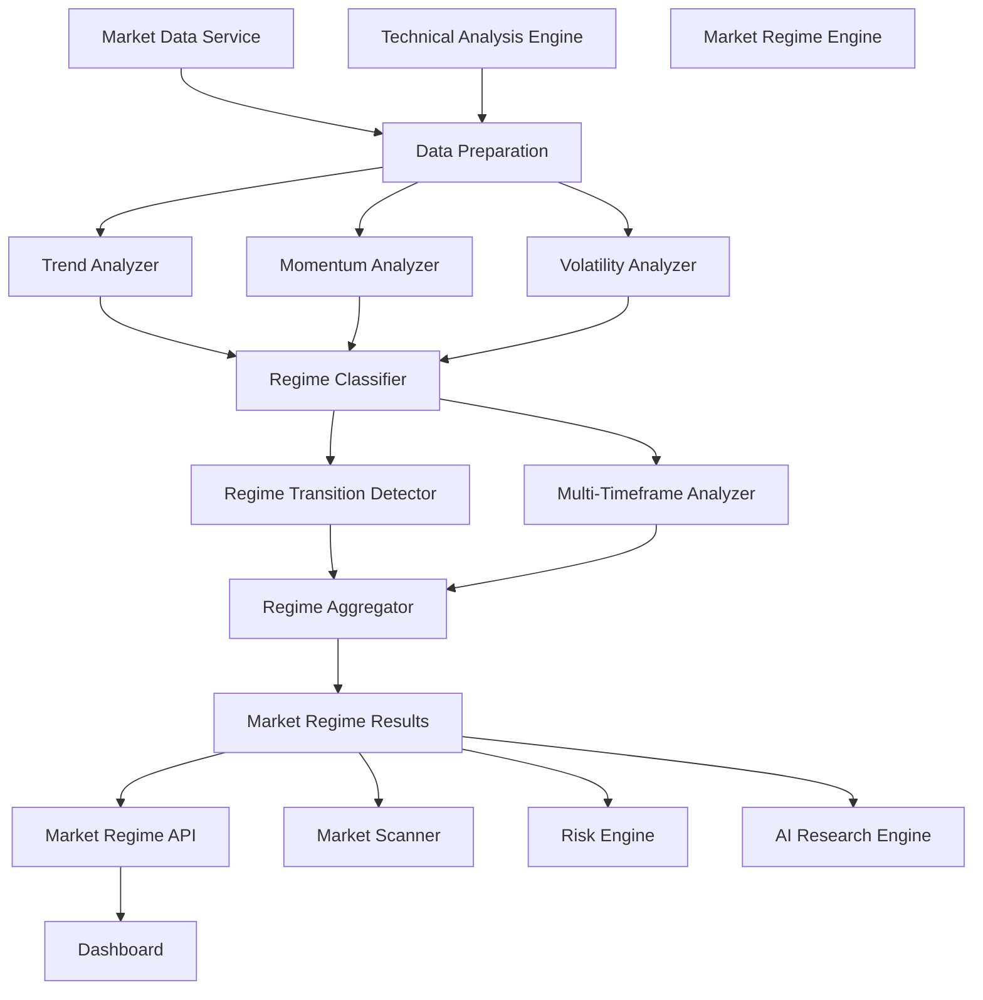

# Market Regime Engine Specification
## Personal Investment Management System (PIMS)

**Document Version:** 1.0  
**Project Status:** Planning  
**Document Type:** Engine Specification  
**Last Updated:** November 2026

---

# 1. Purpose

Dokumen ini mendefinisikan spesifikasi Market Regime Engine dalam Personal Investment Management System (PIMS).

Market Regime Engine bertanggung jawab untuk mengidentifikasi dan mengklasifikasikan kondisi pasar berdasarkan karakteristik pergerakan harga dan indikator kuantitatif.

Engine ini membantu pengguna memahami kondisi pasar saat ini, seperti bullish, bearish, sideways, high volatility, dan low volatility.

Tujuan pengembangan:

- Mengidentifikasi market trend.
- Mengklasifikasikan market regime.
- Menganalisis trend strength.
- Mengukur market volatility.
- Mengidentifikasi perubahan kondisi pasar.
- Mendukung multi-timeframe regime analysis.
- Menganalisis kondisi pasar berdasarkan individual assets dan market indices.
- Menyediakan regime history.
- Mendukung Market Scanner dan Risk Engine.
- Menyediakan market context untuk AI Research Engine.

Seluruh regime calculations harus dilakukan secara deterministic oleh backend.

Market Regime Engine menghasilkan klasifikasi berdasarkan data historis dan indikator terukur. Engine tidak menjamin arah pergerakan harga berikutnya.

# 2. Engine Architecture

Market Regime Engine merupakan independent analytical engine dalam backend Modular Monolith.

Engine menggunakan normalized OHLCV data dan technical indicators sebagai input.

Engine tidak mengambil market data secara langsung dari external providers.

## 2.1 Architecture Diagram



## 2.2 Core Components

### A. Data Preparation

Mengambil normalized OHLCV dan technical indicators yang diperlukan.

### B. Trend Analyzer

Menganalisis arah dan kekuatan tren berdasarkan price structure dan moving averages.

### C. Momentum Analyzer

Menganalisis kekuatan pergerakan harga menggunakan momentum indicators.

### D. Volatility Analyzer

Mengukur tingkat volatilitas pasar.

### E. Regime Classifier

Menggabungkan hasil analisis menjadi market regime classification.

### F. Regime Transition Detector

Mengidentifikasi perubahan dari satu regime ke regime lainnya.

### G. Multi-Timeframe Analyzer

Menganalisis kondisi pasar pada beberapa timeframe.

### H. Regime Aggregator

Menghasilkan standardized market regime reports.

# 3. Required Input Data

Market Regime Engine membutuhkan data dari beberapa internal services.

## 3.1 Market Data

Dari Market Data Service:

- Asset ID.
- Asset symbol.
- OHLCV.
- Historical closing prices.
- Volume.
- Observation timestamps.
- Market identifiers.
- Market session.
- Data freshness.
- Data provenance.

## 3.2 Technical Analysis Data

Dari Technical Analysis Engine:

- SMA.
- EMA.
- RSI.
- MACD.
- ATR.
- Bollinger Bands.
- Volume indicators.
- Other supported indicators.

Tidak semua indikator harus digunakan dalam setiap regime classification.

## 3.3 Input Validation

Sebelum melakukan classification:

- Historical data harus valid.
- Indicator warm-up harus selesai.
- Observation frequency harus diketahui.
- Missing observations harus ditandai.
- Data timestamps harus konsisten.
- Insufficient historical observations harus ditolak.
- Stale data harus memiliki status yang jelas.

# 4. Market Regime Categories

Market Regime Engine harus mendukung beberapa kondisi pasar.

## 4.1 Primary Regimes

| Regime | Description |
|---|---|
| BULLISH | Market menunjukkan kecenderungan tren naik |
| BEARISH | Market menunjukkan kecenderungan tren turun |
| SIDEWAYS | Market bergerak dalam rentang relatif terbatas |
| UNKNOWN | Data tidak cukup untuk classification |

## 4.2 Volatility Regimes

Volatility classification merupakan dimensi terpisah dari trend classification.

| Regime | Description |
|---|---|
| LOW_VOLATILITY | Volatility relatif rendah |
| NORMAL_VOLATILITY | Volatility berada di sekitar kondisi normal |
| HIGH_VOLATILITY | Volatility relatif tinggi |
| EXTREME_VOLATILITY | Volatility jauh di atas threshold configured |

Sebuah market dapat memiliki kombinasi seperti:

- BULLISH + LOW_VOLATILITY.
- BULLISH + HIGH_VOLATILITY.
- BEARISH + HIGH_VOLATILITY.
- SIDEWAYS + LOW_VOLATILITY.
- SIDEWAYS + HIGH_VOLATILITY.

Dengan memisahkan kedua dimensi, sistem tidak perlu memaksakan seluruh kondisi pasar ke satu label tunggal.

# 5. Trend Analysis

Trend Analysis digunakan untuk mengidentifikasi arah pergerakan harga.

## 5.1 Moving Average Analysis

Indikator awal:

- SMA 20.
- SMA 50.
- SMA 200.
- EMA 20.
- EMA 50.

Trend analysis dapat mempertimbangkan:

- Current price relative to moving averages.
- Short-term moving average relative to long-term moving average.
- Moving average slope.
- Moving average crossovers.

## 5.2 Price Structure

Engine dapat menggunakan historical price structure untuk mengidentifikasi:

- Higher highs.
- Higher lows.
- Lower highs.
- Lower lows.
- Consolidation ranges.

Price structure analysis harus menggunakan rules yang dapat diuji dan tidak bergantung pada interpretasi subjektif.

## 5.3 Trend Strength

Trend strength dapat dihitung menggunakan kombinasi:

- Moving average separation.
- Moving average slope.
- ADX jika tersedia.
- Momentum confirmation.

Trend direction dan trend strength harus disimpan sebagai informasi terpisah.

# 6. Momentum Analysis

Momentum Analysis digunakan untuk mengukur kekuatan pergerakan harga.

## 6.1 Supported Indicators

- RSI.
- MACD.
- Rate of Change.
- Stochastic Oscillator.

## 6.2 Momentum Classification

Initial categories:

- POSITIVE.
- NEGATIVE.
- NEUTRAL.
- UNKNOWN.

## 6.3 Momentum Requirements

- Indicator parameters harus configurable.
- Indicator timestamps harus aligned dengan OHLCV.
- Warm-up periods harus diperhatikan.
- Missing values tidak boleh dianggap netral secara otomatis.

Momentum merupakan salah satu input regime classification, bukan satu-satunya penentu arah tren.

# 7. Volatility Analysis

Volatility Analysis digunakan untuk mengukur besarnya perubahan harga atau return.

## 7.1 Supported Metrics

- ATR.
- ATR percentage.
- Historical volatility.
- Rolling volatility.
- Bollinger Band Width.

## 7.2 ATR Percentage

\[
ATRPercentage =
\frac{ATR}{ClosePrice}
\times 100
\]

ATR percentage membantu membandingkan volatility antar-aset dengan nominal harga yang berbeda.

## 7.3 Relative Volatility

Volatility dapat dibandingkan dengan historical baseline menggunakan rolling observations.

Contoh:

- Current volatility.
- Historical average volatility.
- Volatility percentile.
- Volatility expansion.
- Volatility contraction.

## 7.4 Volatility Classification

Threshold harus configurable dan dapat menggunakan relative historical measures.

Engine tidak boleh menggunakan satu fixed volatility threshold untuk seluruh asset classes tanpa mempertimbangkan perbedaan karakteristik instrumen.

# 8. Regime Classification

Regime Classifier menggabungkan trend, momentum, dan volatility analysis.

## 8.1 Classification Inputs

| Input | Purpose |
|---|---|
| Moving Averages | Trend direction |
| Price Structure | Market structure |
| RSI | Momentum |
| MACD | Momentum confirmation |
| ATR | Volatility |
| Historical Volatility | Relative volatility |
| ADX | Trend strength, if available |

## 8.2 Initial Classification Logic

Initial classification menggunakan deterministic rule-based methodology.

Contoh konsep:

**Bullish**
- Harga menunjukkan kecenderungan berada di atas long-term trend reference.
- Moving averages mendukung arah naik.
- Momentum memberikan konfirmasi yang memadai.

**Bearish**
- Harga menunjukkan kecenderungan berada di bawah long-term trend reference.
- Moving averages mendukung arah turun.
- Momentum memberikan konfirmasi yang memadai.

**Sideways**
- Trend direction relatif lemah.
- Harga bergerak dalam range.
- Moving average structure tidak menunjukkan arah dominan.

**Unknown**
- Data tidak mencukupi.
- Indicator values tidak valid.
- Market data terlalu stale.

Kondisi tersebut merupakan kerangka awal. Threshold dan kombinasi rules harus disimpan dalam konfigurasi yang dapat diuji.

## 8.3 Classification Configuration

Setiap classification run harus mencatat:

- Rule configuration version.
- Indicator parameters.
- Observation window.
- Timeframe.
- Classification timestamp.
- Input data version.

# 9. Regime Confidence

Market Regime Engine dapat menyediakan confidence score untuk menunjukkan seberapa konsisten input indicators mendukung suatu classification.

## 9.1 Confidence Inputs

- Trend agreement.
- Momentum agreement.
- Volatility context.
- Indicator completeness.
- Data quality.

## 9.2 Confidence Output

Confidence score dapat dinyatakan dalam rentang 0–100.

Score merupakan internal consistency measure, bukan probabilitas bahwa market akan bergerak sesuai regime berikutnya.

## 9.3 Confidence Categories

- LOW.
- MODERATE.
- HIGH.

Threshold harus configurable.

Jika data tidak lengkap atau invalid, confidence tidak boleh ditampilkan sebagai nilai valid tanpa keterangan.

# 10. Multi-Timeframe Analysis

Market Regime Engine harus mendukung analisis kondisi pasar pada beberapa timeframe.

## 10.1 Supported Timeframes

- 5m.
- 15m.
- 30m.
- 1h.
- 4h.
- 1D.
- 1W.

Timeframe 1m dapat ditambahkan jika data quality dan computational requirements mendukung.

## 10.2 Multi-Timeframe Outputs

Contoh:

| Timeframe | Regime |
|---|---|
| 1H | BULLISH |
| 4H | SIDEWAYS |
| 1D | BULLISH |
| 1W | BEARISH |

Angka tersebut hanya contoh struktur output.

## 10.3 Timeframe Consistency

- Setiap timeframe harus dihitung secara terpisah.
- Higher timeframe tidak boleh disimpulkan hanya dari lower timeframe.
- Candle yang belum selesai harus memiliki status OPEN.
- Historical regime harus menggunakan data yang tersedia pada timestamp terkait.

## 10.4 Aggregated Regime

Engine dapat menghasilkan overall regime summary berdasarkan selected timeframe weights.

Aggregation policy harus configurable.

Overall summary tidak boleh menghilangkan perbedaan antar-timeframe.

# 11. Regime Transition Detection

Regime Transition Detector mengidentifikasi perubahan classification dari waktu ke waktu.

## 11.1 Transition Examples

- BULLISH → SIDEWAYS.
- SIDEWAYS → BULLISH.
- BULLISH → BEARISH.
- LOW_VOLATILITY → HIGH_VOLATILITY.
- HIGH_VOLATILITY → NORMAL_VOLATILITY.

## 11.2 Transition Metadata

Setiap transition harus menyimpan:

- Previous regime.
- New regime.
- Transition timestamp.
- Timeframe.
- Asset ID.
- Previous confidence.
- New confidence.
- Rule configuration version.

## 11.3 Noise Reduction

Perubahan indikator jangka pendek dapat menyebabkan classification berubah terlalu sering.

Engine dapat menyediakan:

- Minimum confirmation observations.
- Hysteresis thresholds.
- Configurable confirmation rules.
- Closed-candle confirmation.

Tujuannya adalah mengurangi perubahan label akibat noise tanpa menyembunyikan perubahan kondisi pasar yang valid.

# 12. Market-Wide Regime Analysis

Market Regime Engine harus mendukung analisis individual assets dan market-level instruments.

## 12.1 Asset-Level Analysis

Menghasilkan regime classification untuk individual instruments.

## 12.2 Market-Level Analysis

Dapat menggunakan market indices atau representative instruments jika tersedia.

Contoh:

- US equity market index.
- IDX market index.
- Crypto market benchmark.

## 12.3 Market Breadth

Market breadth dapat digunakan sebagai tambahan market context apabila data constituent tersedia.

Potential metrics:

- Advancing assets.
- Declining assets.
- Unchanged assets.
- Percentage of assets above moving averages.

Market breadth merupakan komponen tambahan dan tidak wajib untuk MVP.

## 12.4 Universe Constraints

Market-wide calculations harus menggunakan supported instruments dan data yang memenuhi eligibility requirements.

Engine tidak boleh mengasumsikan seluruh market universe tersedia dari setiap provider.

# 13. Standardized Output Contract

Market Regime Engine harus menghasilkan standardized output structure.

## 13.1 Output Fields

| Field | Description |
|---|---|
| regime_run_id | Unique calculation ID |
| asset_id | Asset identifier |
| timeframe | Selected timeframe |
| trend_regime | Bullish, bearish, sideways, unknown |
| volatility_regime | Volatility classification |
| momentum_regime | Momentum classification |
| confidence_score | Internal confidence score |
| trend_strength | Trend strength metric |
| transition_status | Regime transition information |
| data_status | Data quality status |
| calculated_at | Calculation timestamp |

## 13.2 Example Output

```json
{
  "regime_run_id": "regime-uuid",
  "asset_id": "BTC-USD",
  "timeframe": "1D",
  "classification": {
    "trend": "BULLISH",
    "volatility": "NORMAL_VOLATILITY",
    "momentum": "POSITIVE"
  },
  "confidence": {
    "score": 78,
    "category": "HIGH"
  },
  "trend_strength": "0.72",
  "transition": {
    "changed": false,
    "previous_regime": "BULLISH"
  },
  "data_status": "VALID",
  "calculated_at": "2026-11-17T00:30:00Z"
}
```

Nilai di atas hanya contoh struktur output dan bukan hasil analisis pasar aktual.

# 14. API Integration

Market Regime Engine diakses melalui backend REST API.

Proposed endpoints:

```text
GET /api/v1/analytics/regime/{asset_id}

GET /api/v1/analytics/regime/{asset_id}/history

GET /api/v1/analytics/regime/{asset_id}/multi-timeframe

GET /api/v1/analytics/regime/market/{market_id}

GET /api/v1/analytics/regime/transitions
```

## 14.1 API Requirements

- Support asset selection.
- Support market selection.
- Support timeframe selection.
- Support historical date ranges.
- Return classification metadata.
- Return confidence information.
- Return data quality status.
- Return transition information.
- Support bounded historical queries.

Endpoint merupakan proposed contract dan harus diselaraskan dengan `api-spec.md`.

# 15. WebSocket Integration

Market Regime Engine dapat menerbitkan event ketika classification berubah.

Proposed event:

```text
analytics.regime
```

Example payload:

```json
{
  "event": "analytics.regime",
  "data": {
    "asset_id": "BTC-USD",
    "timeframe": "1D",
    "previous_regime": "SIDEWAYS",
    "new_regime": "BULLISH",
    "confidence_score": 78,
    "timestamp": "2026-11-17T00:30:00Z"
  }
}
```

Event hanya dikirim ketika terdapat perubahan yang memenuhi transition policy.

WebSocket protocol harus mengikuti `websocket-spec.md`.

# 16. Dashboard Integration

Market Regime Engine menyediakan data untuk Dashboard dan Market Analysis page.

## 16.1 Market Regime Overview

Dashboard dapat menampilkan:

- Current trend regime.
- Current volatility regime.
- Momentum classification.
- Confidence score.
- Regime transition.
- Last updated timestamp.

## 16.2 Recommended Visualizations

| Visualization | Purpose |
|---|---|
| Regime Indicator | Current classification |
| Regime Timeline | Historical regime changes |
| Multi-Timeframe Table | Compare timeframe conditions |
| Volatility Chart | Historical volatility |
| Market Breadth Chart | Market participation |
| Transition History | Classification changes |

## 16.3 User Interactions

Pengguna dapat:

- Memilih instrument.
- Mengubah timeframe.
- Melihat historical regime.
- Membandingkan beberapa timeframes.
- Membuka detailed indicators.
- Melihat classification methodology.
- Melihat data freshness.

Frontend hanya bertanggung jawab untuk visualisasi dan interaksi.

# 17. Integration with Other Engines

## 17.1 Technical Analysis Engine

Technical Analysis Engine menyediakan indicator values.

Market Regime Engine menggunakan indikator tersebut untuk classification.

Market Regime Engine tidak menghitung ulang indikator secara terpisah.

## 17.2 Market Scanner

Market Scanner dapat menggunakan regime classifications sebagai filter.

Contoh:

- Menampilkan aset dengan bullish regime.
- Menampilkan aset dengan bearish regime.
- Menyaring aset berdasarkan volatility regime.
- Mengidentifikasi regime transitions.

Market Scanner tetap bertanggung jawab atas screening orchestration dan ranking.

## 17.3 Risk Engine

Risk Engine dapat menggunakan regime outputs sebagai market context untuk analisis risiko.

Risk calculations tetap menjadi tanggung jawab Risk Engine.

## 17.4 AI Research Engine

AI Research Engine dapat menggunakan regime results untuk menjelaskan kondisi pasar.

AI tidak boleh mengubah classification atau memperlakukan confidence score sebagai probabilitas keuntungan.

# 18. Performance and Optimization

Market Regime Engine harus mendukung analisis banyak instruments dan timeframes tanpa melakukan recalculation yang tidak diperlukan.

## 18.1 Performance Requirements

- Reuse normalized OHLCV.
- Reuse Technical Analysis outputs.
- Support incremental calculations.
- Avoid unnecessary full-history recalculation.
- Batch market-wide analysis.
- Limit historical query windows.
- Cache reusable regime results.

## 18.2 Calculation Modes

- Request-driven calculations.
- Scheduled calculations.
- Event-driven calculations.

Regime updates umumnya dapat dilakukan setelah candle close.

Intrabar updates dapat didukung sebagai provisional results apabila diperlukan, tetapi harus dibedakan dari confirmed regime.

## 18.3 Caching

Cache key harus mempertimbangkan:

- Asset ID.
- Timeframe.
- Indicator parameters.
- Classification rules version.
- Observation window.
- Data version.

Cached results bukan source of truth.

Redis tetap deferred sesuai technical decisions.

# 19. Data Quality and Error Handling

Market Regime Engine harus menangani:

- Insufficient historical data.
- Missing OHLCV.
- Missing indicators.
- Indicator warm-up.
- Stale market data.
- Invalid timestamps.
- Unsupported timeframe.
- Incomplete market sessions.
- Conflicting classification inputs.

Setiap regime result harus memiliki data quality status.

Data yang tidak valid tidak boleh menghasilkan classification yang ditampilkan seolah-olah confirmed.

# 20. Testing Requirements

## 20.1 Unit Tests

- Trend classification.
- Moving average analysis.
- Momentum classification.
- Volatility classification.
- Regime aggregation.
- Confidence scoring.
- Transition detection.
- Multi-timeframe analysis.

## 20.2 Numerical Accuracy Tests

Indicator inputs dan expected classifications harus diuji menggunakan reference datasets yang telah diverifikasi.

## 20.3 Integration Tests

- Market Data Service integration.
- Technical Analysis Engine integration.
- Market Scanner integration.
- Risk Engine integration.
- REST API integration.
- WebSocket integration.
- Dashboard integration.

## 20.4 Edge Case Tests

- Insufficient observations.
- Missing indicators.
- Constant prices.
- Extreme volatility.
- Market gaps.
- Incomplete candles.
- Stale data.
- Regime boundary conditions.

## 20.5 Deterministic Tests

Dataset, indicator parameters, dan classification rules yang sama harus menghasilkan regime results yang sama.

# 21. Implementation Roadmap

## Phase 1 — Regime Foundation

- Input contracts.
- OHLCV integration.
- Technical Analysis integration.
- Data validation.
- Classification framework.

## Phase 2 — Basic Regime Classification

- Bullish classification.
- Bearish classification.
- Sideways classification.
- Unknown classification.

## Phase 3 — Volatility and Momentum

- Volatility classification.
- Momentum classification.
- Trend strength.
- Classification confidence.

## Phase 4 — Multi-Timeframe Analysis

- Multiple timeframe calculations.
- Multi-timeframe output.
- Aggregated regime summary.

## Phase 5 — Regime Transition

- Transition detection.
- Historical transition storage.
- Confirmation rules.
- Transition events.

## Phase 6 — Dashboard Integration

- Current regime overview.
- Regime timeline.
- Multi-timeframe table.
- Volatility visualization.

## Phase 7 — Advanced Market Analysis

- Market breadth.
- Market-wide regime analysis.
- Market Scanner integration.
- Advanced classification models.

# 22. Acceptance Criteria

Market Regime Engine dinyatakan memenuhi spesifikasi apabila:

- Normalized OHLCV dapat digunakan sebagai input.
- Technical indicators dapat digunakan sebagai input.
- Bullish regime dapat diidentifikasi.
- Bearish regime dapat diidentifikasi.
- Sideways regime dapat diidentifikasi.
- Volatility regime dapat diklasifikasikan secara terpisah.
- Momentum classification tersedia.
- Multi-timeframe analysis didukung.
- Regime transition dapat diidentifikasi.
- Historical regime dapat diakses.
- Classification methodology dapat ditelusuri.
- Confidence score memiliki definisi yang jelas.
- Data quality status tersedia.
- REST API tersedia.
- WebSocket event tersedia untuk confirmed transitions.
- Dashboard dapat menampilkan regime results.
- Market Scanner dapat menggunakan regime outputs.
- Automated tests tersedia.
- Perhitungan bersifat deterministic.

# 23. Decisions Requiring Approval

| Decision | Current Status |
|---|---|
| Default trend classification rules | Requires approval |
| Default indicator parameters | Follows Technical Analysis Engine |
| Volatility thresholds | Requires approval |
| Confidence scoring methodology | Requires approval |
| Multi-timeframe aggregation | Requires approval |
| Transition confirmation policy | Requires approval |
| Market breadth implementation | Deferred |
| Advanced statistical models | Deferred |
| Machine learning classification | Deferred |

OpenCode tidak boleh mengubah proposed decisions menjadi approved decisions tanpa persetujuan.

# 24. Related Documents

- `AGENTS.md`
- `docs/architecture/application-architecture.md`
- `docs/architecture/data-flow.md`
- `docs/architecture/engine-architecture.md`
- `docs/database/database-design.md`
- `docs/decisions/technical-decisions.md`
- `specifications/project/project-scope.md`
- `specifications/project/development-roadmap.md`
- `specifications/engines/technical-analysis-spec.md`
- `specifications/engines/market-scanner-spec.md`
- `specifications/engines/risk-engine-spec.md`
- `specifications/engines/correlation-engine-spec.md`
- `specifications/data/market-data-spec.md`
- `specifications/data/normalization-spec.md`
- `specifications/backend/api-spec.md`
- `specifications/backend/websocket-spec.md`
- `specifications/frontend/dashboard-spec.md`

---

# Final Principle

Market Regime Engine harus menyediakan klasifikasi kondisi pasar yang deterministic, transparan, dan dapat ditelusuri.

Setiap classification harus didukung oleh data historis, indikator yang terdefinisi, rule configuration, timeframe, dan data quality status.

Dengan pendekatan ini, PIMS dapat memahami perubahan kondisi pasar secara terstruktur dan menyediakan market context yang konsisten untuk seluruh analytical engines.