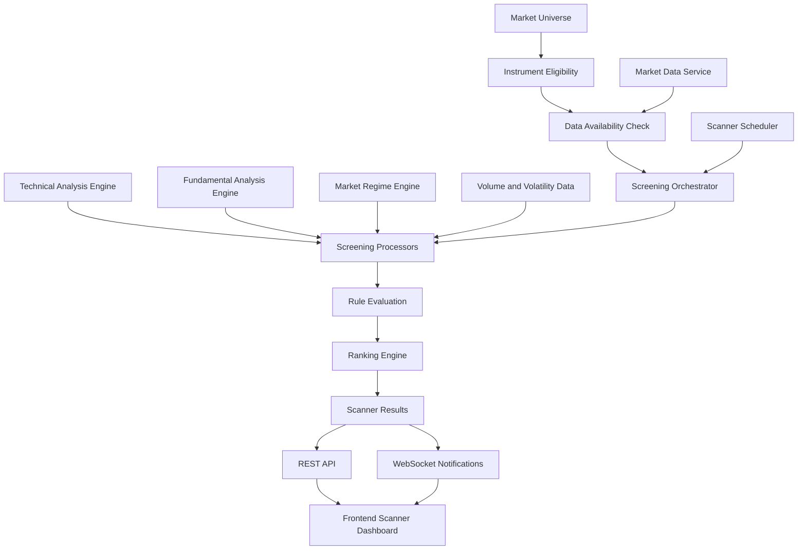

# Market Scanner Engine Specification
## Personal Investment Management System (PIMS)

**Document Version:** 1.0  
**Project Status:** Planning  
**Document Type:** Engine Specification  
**Last Updated:** November 2026

---

# 1. Purpose

Dokumen ini mendefinisikan spesifikasi Market Scanner Engine dalam Personal Investment Management System (PIMS).

Market Scanner merupakan engine yang bertanggung jawab untuk memindai market universe, mengevaluasi kondisi instrumen berdasarkan screening criteria, dan menghasilkan daftar instrumen yang memenuhi kondisi tertentu.

Market Scanner dirancang untuk membantu pengguna menemukan peluang analisis dari berbagai instrumen tanpa harus memeriksa setiap chart secara manual.

Scanner harus dapat bekerja pada instrumen yang dimiliki maupun yang tidak dimiliki dalam portfolio.

Tujuan utama:

- Memindai berbagai instrumen dalam market universe.
- Menyediakan configurable screening criteria.
- Mengidentifikasi kondisi teknikal dan market activity.
- Mendeteksi momentum dan perubahan volume.
- Mengidentifikasi kondisi volatilitas.
- Mendukung fundamental screening.
- Mengidentifikasi tren pasar.
- Mendeteksi anomali berdasarkan data yang tersedia.
- Menyediakan ranking dan filtering results.
- Mengintegrasikan hasil dengan Chart Engine dan Analytics Engines.

Market Scanner memberikan hasil screening untuk membantu proses penelitian. Scanner tidak memberikan jaminan bahwa instrumen tertentu akan mengalami kenaikan atau penurunan harga.

# 2. Engine Architecture

Market Scanner merupakan independent analytical engine dalam backend Modular Monolith.

Market Scanner menggunakan data dari Market Data Service dan output dari analytical engines lainnya.

Scanner tidak boleh mengakses external provider APIs secara langsung.

## 2.1 Architecture Diagram



## 2.2 Core Components

### A. Market Universe Manager

Mengelola daftar instrumen yang tersedia untuk dipindai.

### B. Instrument Eligibility Manager

Memeriksa apakah suatu instrumen memenuhi persyaratan minimum untuk proses scanning.

### C. Scanner Scheduler

Mengatur kapan scanner dijalankan.

### D. Screening Orchestrator

Mengatur proses screening dan menghubungkan berbagai screening processors.

### E. Screening Processors

Melakukan evaluasi berdasarkan kategori screening.

### F. Rule Evaluation Engine

Mengevaluasi apakah instrumen memenuhi screening conditions.

### G. Ranking Engine

Mengurutkan hasil berdasarkan configured ranking criteria.

### H. Result Manager

Menyimpan dan menyediakan scanner results.

# 3. Market Universe

Market Universe merupakan kumpulan instrumen yang tersedia untuk dipindai oleh Market Scanner.

Market Universe tidak boleh dibatasi pada portfolio holdings.

## 3.1 Initial Market Coverage

| Market | Provider | Initial Coverage |
|---|---|---|
| Crypto | Bybit | Supported spot instruments |
| US Stocks | Finnhub / Alpaca | Based on available provider coverage |
| Indonesia Stocks | Yahoo Finance | Based on verified instrument coverage |

Market coverage bergantung pada provider availability, data licensing, rate limits, dan instrument mapping.

## 3.2 Universe Selection

Scanner harus mendukung beberapa pendekatan universe selection:

**A. Provider Universe**

Menggunakan instrumen yang tersedia dari connected providers.

**B. User-Selected Universe**

Pengguna menentukan instrumen atau kelompok instrumen yang ingin dipindai.

**C. Market Category Universe**

Memindai berdasarkan kategori:

- Crypto.
- US Stocks.
- Indonesia Stocks.

**D. Custom Universe**

Pengguna membuat kelompok instrumen berdasarkan preferensi sendiri.

## 3.3 Universe Rules

- Setiap instrument harus memiliki internal asset ID.
- Provider symbol harus memiliki mapping yang valid.
- Instrument availability harus diperiksa.
- Unsupported instruments harus dikecualikan.
- Duplicate instruments harus dihindari.
- Universe membership harus dapat diperbarui.

# 4. Instrument Eligibility

Tidak seluruh instrumen layak diproses oleh setiap scanner.

Instrument Eligibility Manager memeriksa data availability dan minimum requirements.

## 4.1 Eligibility Conditions

Contoh persyaratan:

- Valid asset identity.
- Supported market category.
- Available historical candles.
- Sufficient historical observations.
- Valid OHLCV data.
- Supported timeframe.
- Valid provider mapping.

Untuk kategori fundamental, instrumen juga harus memiliki data fundamental yang memadai.

## 4.2 Eligibility Status

| Status | Description |
|---|---|
| ELIGIBLE | Can be processed |
| INSUFFICIENT_DATA | Historical data is insufficient |
| UNSUPPORTED | Instrument or feature unsupported |
| UNAVAILABLE | Required market data unavailable |
| INVALID | Data failed validation |

Instrumen yang tidak memenuhi eligibility requirements tidak boleh menghasilkan screening result seolah-olah valid.

# 5. Scanner Categories

Market Scanner menyediakan beberapa kategori screening.

## 5.1 Technical Scanner

Mengidentifikasi kondisi berdasarkan technical indicators.

Supported conditions:

- RSI above or below threshold.
- Price above or below moving average.
- SMA crossovers.
- EMA crossovers.
- MACD line and signal relationship.
- Bollinger Bands position.
- Stochastic conditions.
- ATR thresholds.

Contoh screening:

```text
RSI below 30
AND
Price above SMA 200
```

Hasil screening menunjukkan instrumen yang memenuhi kedua kondisi tersebut.

## 5.2 Momentum Scanner

Mendeteksi perubahan momentum berdasarkan price performance.

Possible metrics:

- Price change percentage.
- Relative strength.
- Multi-period returns.
- Momentum acceleration.
- Trend persistence.

Contoh:

```text
1D Return > Configured Threshold
AND
7D Return > Configured Threshold
```

Threshold harus configurable.

## 5.3 Volume Scanner

Mengidentifikasi perubahan aktivitas perdagangan.

Supported metrics:

- Current volume.
- Volume moving average.
- Relative volume.
- Volume change.
- Volume acceleration.

Contoh:

\[
RelativeVolume =
\frac{CurrentVolume}{AverageVolume}
\]

Volume comparisons harus menggunakan unit dan periode yang konsisten.

Untuk saham, session progress harus dipertimbangkan agar volume pada awal sesi tidak dibandingkan secara tidak tepat dengan volume satu sesi penuh.

## 5.4 Volatility Scanner

Mengidentifikasi instrumen berdasarkan tingkat volatilitas.

Supported metrics:

- ATR.
- ATR percentage.
- Historical volatility.
- Bollinger Band width.
- Volatility expansion.
- Volatility contraction.

Contoh:

\[
ATR\ Percentage =
\frac{ATR}{Close}\times100
\]

Scanner dapat mengidentifikasi instrumen dengan volatilitas relatif tinggi atau rendah.

## 5.5 Fundamental Scanner

Melakukan screening berdasarkan financial statements dan fundamental metrics.

Potential criteria:

- Revenue growth.
- Earnings growth.
- Gross margin.
- Operating margin.
- Net margin.
- Return on Equity.
- Return on Assets.
- Debt-to-Equity.
- Price-to-Earnings.
- Price-to-Book.
- Free Cash Flow.

Fundamental coverage bergantung pada provider yang tersedia.

Fundamental scanner tidak boleh menghasilkan nilai berdasarkan data yang tidak tersedia atau belum diverifikasi.

Crypto instruments tidak boleh diproses menggunakan stock financial ratios yang tidak relevan.

## 5.6 Market Trend Scanner

Mengidentifikasi kondisi tren berdasarkan price action dan technical indicators.

Possible conditions:

- Price above SMA 50.
- Price above SMA 200.
- SMA 50 above SMA 200.
- EMA alignment.
- Higher highs and higher lows.
- Lower highs and lower lows.

Trend classification harus memiliki explicit rules.

## 5.7 Anomaly Scanner

Mengidentifikasi kondisi yang berbeda dari pola historis instrumen.

Possible anomaly categories:

- Unusual volume.
- Abnormal price movement.
- Volatility spike.
- Price gap.
- Unusual trading activity.

Anomaly detection harus menggunakan historical baseline yang relevan.

Scanner harus membedakan anomaly dari data errors. Data invalid tidak boleh dianggap sebagai market anomaly.

## 5.8 Correlation Scanner

Mengidentifikasi hubungan pergerakan harga antar-instrumen.

Possible outputs:

- Highly correlated instruments.
- Negatively correlated instruments.
- Changing correlation.
- Correlation breakdown.
- Unusual correlation changes.

Correlation calculations harus menggunakan aligned historical observations.

# 6. Screening Configuration

Pengguna harus dapat membuat dan mengelola screening configurations.

## 6.1 Configuration Structure

Setiap scanner configuration memiliki:

| Field | Description |
|---|---|
| scanner_id | Unique configuration ID |
| name | Scanner name |
| category | Scanner category |
| market_universe | Selected instrument universe |
| timeframe | Calculation timeframe |
| conditions | Screening conditions |
| ranking_method | Result ranking method |
| schedule | Execution schedule |
| enabled | Configuration status |

## 6.2 Screening Conditions

Setiap condition terdiri dari:

- Field or indicator.
- Operator.
- Comparison value.
- Optional secondary field.
- Logical grouping.

Supported operators:

- GREATER_THAN.
- GREATER_THAN_OR_EQUAL.
- LESS_THAN.
- LESS_THAN_OR_EQUAL.
- EQUAL.
- NOT_EQUAL.
- CROSS_ABOVE.
- CROSS_BELOW.
- BETWEEN.
- IN.
- NOT_IN.

## 6.3 Logical Operators

Scanner harus mendukung:

- AND.
- OR.
- NOT.

Contoh:

```text
(
    RSI < 30
    AND
    Price > SMA_200
)
OR
(
    MACD > Signal
    AND
    RelativeVolume > 2
)
```

Condition groups harus dapat dikembangkan tanpa mengubah core scanner architecture.

# 7. Screening Execution Pipeline

Setiap scanning execution mengikuti proses yang terstandarisasi.

## 7.1 Execution Flow

1. Load scanner configuration.
2. Load selected market universe.
3. Validate instrument eligibility.
4. Retrieve required market data.
5. Request required indicator and analytics outputs.
6. Evaluate screening conditions.
7. Generate candidate results.
8. Apply ranking methodology.
9. Store scanner execution and results.
10. Publish updated results.

## 7.2 Execution Isolation

Setiap scanner execution harus memiliki execution ID.

Scanner configurations yang berbeda harus dapat dijalankan secara independen.

Kegagalan satu scanner tidak boleh menghentikan seluruh scanner system.

## 7.3 Execution Status

| Status | Description |
|---|---|
| PENDING | Waiting for execution |
| RUNNING | Currently processing |
| COMPLETED | Execution completed |
| PARTIAL | Some instruments could not be processed |
| FAILED | Execution failed |
| CANCELLED | Execution cancelled |

# 8. Scheduling and Execution Modes

Market Scanner harus mendukung beberapa execution modes.

## 8.1 Scheduled Scanning

Scanner dijalankan berdasarkan configured schedule.

Contoh:

- Every 5 minutes.
- Every 15 minutes.
- Every hour.
- Daily after market close.

Interval tersebut merupakan configurable examples, bukan persyaratan bahwa setiap scanner harus dijalankan sesering mungkin.

## 8.2 Candle-Based Scanning

Scanner dapat dijalankan setelah candle selesai.

Contoh:

- 1m scanner setelah candle 1m closed.
- 1h scanner setelah candle 1h closed.
- Daily scanner setelah daily session selesai.

## 8.3 Event-Driven Scanning

Scanner dapat dijalankan ketika terdapat event tertentu.

Contoh:

- Significant price movement.
- Unusual volume event.
- Market data update.
- Market status change.

Event-driven scanning harus menggunakan controlled triggers agar tidak menyebabkan excessive calculations.

## 8.4 Execution Rules

- Hindari duplicate executions.
- Hindari overlapping executions untuk konfigurasi yang sama.
- Gunakan execution locks jika diperlukan.
- Terapkan timeout.
- Catat execution duration.
- Simpan execution status.
- Tangani provider interruption.
- Jangan menganggap scheduler execution sebagai bukti bahwa data terbaru tersedia.

# 9. Ranking Engine

Ranking Engine mengurutkan instrumen yang memenuhi screening conditions.

Ranking harus menggunakan configurable scoring methodology.

## 9.1 Ranking Methods

Initial supported methods:

- Single metric ranking.
- Multi-metric ranking.
- Weighted scoring.
- Percentage-based ranking.

## 9.2 Weighted Scoring

Contoh conceptual scoring:

\[
Score = \sum_{i=1}^{n}w_i s_i
\]

Dengan:

- \(w_i\) = metric weight.
- \(s_i\) = normalized metric score.
- \(n\) = number of selected metrics.

Bobot harus dapat dikonfigurasi dan total bobot harus divalidasi sesuai scoring methodology.

## 9.3 Score Normalization

Metrics dengan skala berbeda harus dinormalisasi sebelum digabungkan.

Contoh:

- RSI memiliki rentang 0–100.
- Relative volume dapat memiliki rentang yang sangat luas.
- ATR percentage menggunakan percentage values.

Ranking Engine harus mendokumentasikan normalization methodology agar skor dapat ditafsirkan dengan benar.

## 9.4 Ranking Rules

- Ranking harus deterministic untuk input dan configuration yang sama.
- Missing metrics tidak boleh diperlakukan sebagai nilai nol tanpa policy.
- Tie-breaking harus konsisten.
- Ranking method harus disimpan pada execution record.
- Score tidak boleh dianggap sebagai probabilitas keuntungan.

# 10. Scanner Result Model

Setiap hasil screening harus memiliki standardized output.

## 10.1 Result Fields

| Field | Description |
|---|---|
| result_id | Unique result ID |
| execution_id | Related execution |
| scanner_id | Scanner configuration |
| asset_id | Internal asset ID |
| symbol | Instrument symbol |
| market | Market category |
| matched_conditions | Conditions satisfied |
| metrics | Relevant metric values |
| score | Optional ranking score |
| rank | Ranking position |
| provider | Data source |
| data_timestamp | Source data timestamp |
| freshness | Data freshness |
| generated_at | Result generation time |

## 10.2 Example Result

```json
{
  "result_id": "result-uuid",
  "execution_id": "execution-uuid",
  "scanner_id": "scanner-uuid",
  "asset_id": "asset-uuid",
  "symbol": "BTCUSDT",
  "market": "CRYPTO",
  "matched_conditions": [
    "RSI_BELOW_30",
    "PRICE_ABOVE_SMA_200"
  ],
  "metrics": {
    "rsi": "28.50",
    "price": "95000.00",
    "sma_200": "92000.00",
    "relative_volume": "1.80"
  },
  "score": "82.50",
  "rank": 1,
  "provider": "BYBIT",
  "data_timestamp": "2026-11-17T00:30:00Z",
  "freshness": "LIVE",
  "generated_at": "2026-11-17T00:30:02Z"
}
```

Nilai pada contoh hanya ilustrasi format, bukan market data aktual.

# 11. Data Quality and Freshness

Market Scanner sangat bergantung pada kualitas input data.

Scanner harus menggunakan freshness states dari Market Data Service:

- LIVE.
- DELAYED.
- STALE.
- HISTORICAL.
- UNAVAILABLE.
- UNKNOWN.

## 11.1 Data Quality Rules

- Reject invalid market data.
- Identify missing historical observations.
- Detect duplicate records.
- Preserve provider provenance.
- Validate timestamps.
- Validate instrument mappings.
- Identify incomplete fundamental data.

## 11.2 Freshness Policy

Setiap scanner harus memiliki freshness requirements.

Contoh:

- Realtime crypto scanner membutuhkan data yang memenuhi freshness threshold tertentu.
- Daily fundamental scanner dapat menggunakan financial data yang lebih lama selama period dan publication date jelas.
- Historical scanner menggunakan data historis yang memiliki timestamp dan provenance.

Scanner tidak boleh menampilkan hasil sebagai LIVE apabila input data tidak memenuhi policy.

# 12. Multi-Timeframe Scanning

Market Scanner harus mendukung penggunaan beberapa timeframes.

Contoh:

```text
1H Trend: Bullish
4H Trend: Bullish
1D Trend: Neutral
```

Pengguna dapat membuat conditions berdasarkan beberapa timeframe.

## 12.1 Multi-Timeframe Rules

- Setiap timeframe harus memiliki data source yang jelas.
- Candle alignment harus konsisten.
- Higher timeframe candles yang masih terbuka harus ditandai provisional.
- Missing timeframe data harus ditangani secara eksplisit.
- Tidak boleh menggunakan future data dalam historical evaluation.

# 13. Market Scanner Dashboard Integration

Frontend menyediakan dedicated Market Scanner page.

Scanner tidak boleh hanya menjadi widget kecil pada dashboard utama.

## 13.1 Main Scanner Layout

Komponen utama:

### A. Scanner Navigation

Menampilkan kategori:

- Technical.
- Momentum.
- Volume.
- Volatility.
- Fundamental.
- Market Trend.
- Anomaly.
- Correlation.

### B. Market Universe Selector

Memungkinkan pengguna memilih:

- Crypto.
- US Stocks.
- Indonesia Stocks.
- Custom Universe.

### C. Filter Builder

Memungkinkan pengguna membuat screening conditions.

### D. Scanner Results Table

Menampilkan:

- Symbol.
- Instrument name.
- Market.
- Last price.
- Price change.
- Selected indicators.
- Volume.
- Ranking score.
- Data freshness.
- Provider.

### E. Scanner Detail

Menampilkan detail hasil screening untuk instrumen yang dipilih.

### F. Scanner Configuration Manager

Mengelola saved scanners dan execution schedules.

## 13.2 User Interaction

Pengguna harus dapat:

- Membuat scanner.
- Mengedit scanner.
- Menyimpan scanner.
- Menjalankan scanner secara manual.
- Menghentikan execution jika didukung.
- Mengubah filters.
- Mengubah ranking.
- Mengurutkan results.
- Membuka instrument chart.
- Membuka technical analysis.
- Menambahkan instrument ke watchlist.

Scanner tidak boleh melakukan trading execution.

# 14. API Integration

Market Scanner harus diakses melalui REST API.

Proposed endpoints:

```text
GET    /api/v1/scanner
POST   /api/v1/scanner
GET    /api/v1/scanner/{scanner_id}
PUT    /api/v1/scanner/{scanner_id}
DELETE /api/v1/scanner/{scanner_id}

POST   /api/v1/scanner/{scanner_id}/run
GET    /api/v1/scanner/{scanner_id}/results

GET    /api/v1/scanner/executions/{execution_id}
GET    /api/v1/scanner/universes
```

## 14.1 API Requirements

- Support filtering.
- Support sorting.
- Support pagination.
- Validate scanner configuration.
- Return execution status.
- Return data freshness.
- Return result provenance.
- Support bounded result windows.
- Apply consistent API response envelope.

Endpoint details merupakan proposed contract dan harus diselaraskan dengan `api-spec.md` sebelum implementasi.

# 15. WebSocket Integration

WebSocket digunakan untuk mengirimkan scanner execution updates dan notifications.

Proposed event channels:

```text
scanner.status
scanner.result
scanner.alert
```

## 15.1 Scanner Status Event

Memberikan informasi mengenai:

- Execution ID.
- Scanner ID.
- Execution status.
- Progress information jika tersedia.
- Completion timestamp.

## 15.2 Scanner Result Event

Memberikan hasil terbaru jika scanner configuration mendukung streaming result updates.

## 15.3 Scanner Alert Event

Digunakan untuk memberitahukan pengguna ketika kondisi tertentu terpenuhi.

Notifications harus mengikuti user configuration dan tidak boleh dikirim secara berlebihan.

Seluruh event mengikuti message envelope pada `websocket-spec.md`.

# 16. Database Integration

Market Scanner menggunakan PostgreSQL sebagai primary persistence layer.

Conceptual entities:

- scanner_configurations.
- scanner_runs.
- scanner_results.
- scanner_universes atau universe membership records.
- scanner_alerts jika alert persistence diperlukan.

## 16.1 Persistence Requirements

- Scanner configurations harus dapat disimpan.
- Setiap execution harus memiliki execution ID.
- Execution status harus dicatat.
- Results harus terhubung ke execution.
- Ranking methodology harus dapat ditelusuri.
- Data provenance harus dipertahankan.
- Historical executions dapat ditinjau kembali sesuai retention policy.

Struktur tabel final mengikuti `database-design.md` dan `schema-spec.md`.

# 17. Performance and Scalability

Market Scanner harus mampu memproses banyak instrumen secara efisien.

## 17.1 Performance Principles

- Use centralized market data infrastructure.
- Reuse calculated indicators.
- Avoid duplicate historical calculations.
- Batch instrument processing where appropriate.
- Apply bounded execution windows.
- Separate expensive scanning jobs from interactive API requests.
- Limit unnecessary realtime recalculations.
- Use controlled concurrency.

## 17.2 Resource Management

Scanner harus memiliki:

- Execution timeout.
- Concurrency limits.
- Error isolation.
- Cancellation support where feasible.
- Execution logging.
- Resource usage monitoring.

## 17.3 Scaling Strategy

Initial implementation tetap berada dalam Modular Monolith.

Jika scanning workload meningkat, scheduler atau worker execution dapat dipisahkan secara operasional tanpa harus langsung memecah seluruh aplikasi menjadi microservices.

# 18. Error Handling

Scanner harus menangani:

- Invalid configurations.
- Unsupported instruments.
- Insufficient historical data.
- Missing indicator results.
- Provider interruptions.
- Stale market data.
- Calculation errors.
- Execution timeout.
- Duplicate executions.
- Partial processing failures.

Kegagalan pada satu instrumen sebaiknya tidak menggagalkan seluruh universe scan jika kegagalan dapat diisolasi.

Partial execution harus dilaporkan secara transparan.

# 19. Security and Access Control

Market Scanner harus mengikuti security rules PIMS.

- Validate all user-defined conditions.
- Restrict supported operators and fields.
- Prevent arbitrary code execution through filters.
- Apply request validation.
- Protect provider credentials.
- Avoid exposing internal provider credentials.
- Apply resource limits to custom scans.
- Record configuration changes.

Filter expressions harus diproses melalui structured rule definitions, bukan dieksekusi sebagai arbitrary code.

# 20. Testing Requirements

## 20.1 Unit Tests

- Rule evaluation.
- Logical operators.
- Indicator conditions.
- Ranking calculations.
- Score normalization.
- Eligibility checks.
- Freshness policy.

## 20.2 Integration Tests

- Market Data Service.
- Technical Analysis Engine.
- Fundamental Analysis Engine.
- Market Regime Engine.
- Database persistence.
- REST API.
- WebSocket events.

## 20.3 Execution Tests

- Scheduled scanning.
- Candle-based scanning.
- Event-driven scanning.
- Manual execution.
- Duplicate execution prevention.
- Partial failures.
- Timeout handling.
- Cancellation.

## 20.4 Deterministic Tests

Input dataset dan scanner configuration yang sama harus menghasilkan screening results dan ranking yang sama.

Historical testing juga harus mencegah look-ahead bias.

# 21. Implementation Roadmap

## Phase 1 — Scanner Foundation

- Market Universe Manager.
- Instrument Eligibility Manager.
- Scanner configuration model.
- Rule Evaluation Engine.
- Basic execution management.

## Phase 2 — Technical Scanner

- RSI conditions.
- SMA and EMA conditions.
- MACD conditions.
- Bollinger Bands conditions.
- Basic ranking.

## Phase 3 — Momentum and Volume Scanner

- Price change.
- Relative strength.
- Relative volume.
- Volume moving averages.
- Configurable thresholds.

## Phase 4 — Volatility and Trend Scanner

- ATR.
- ATR percentage.
- Historical volatility.
- Moving average alignment.
- Trend classification rules.

## Phase 5 — Dashboard Integration

- Scanner page.
- Filter builder.
- Results table.
- Ranking display.
- Chart navigation.
- Saved configurations.

## Phase 6 — Advanced Scanner

- Fundamental screening.
- Anomaly detection.
- Correlation screening.
- Multi-timeframe scanning.
- Advanced scoring.

## Phase 7 — Scheduling and Optimization

- Scheduled executions.
- Candle-based executions.
- Event-driven execution.
- Execution monitoring.
- Performance optimization.

# 22. Acceptance Criteria

Market Scanner dinyatakan memenuhi spesifikasi apabila:

- Market universe dapat dikelola.
- Scanner tidak terbatas pada portfolio holdings.
- Instrument eligibility dapat diperiksa.
- Scanner configurations dapat dibuat dan disimpan.
- AND dan OR conditions dapat digunakan.
- Technical screening berfungsi.
- Momentum dan volume screening didukung.
- Volatility dan trend screening didukung.
- Ranking dapat dilakukan secara deterministic.
- Results memiliki provenance dan freshness.
- Historical dan multi-timeframe scanning didukung sesuai roadmap.
- Partial failures ditangani.
- REST API tersedia.
- WebSocket updates tersedia sesuai kebutuhan.
- Scanner dashboard dapat menampilkan hasil.
- Pengguna dapat membuka chart dari scanner result.
- Automated tests tersedia.
- Scanner tidak melakukan trading execution.

# 23. Related Documents

- `AGENTS.md`
- `docs/architecture/engine-architecture.md`
- `docs/architecture/data-flow.md`
- `specifications/project/project-scope.md`
- `specifications/project/development-roadmap.md`
- `specifications/data/market-data-spec.md`
- `specifications/data/provider-integration-spec.md`
- `specifications/data/normalization-spec.md`
- `specifications/engines/technical-analysis-spec.md`
- `specifications/engines/market-regime-spec.md`
- `specifications/engines/portfolio-engine-spec.md`
- `specifications/engines/risk-engine-spec.md`
- `specifications/backend/backend-spec.md`
- `specifications/backend/api-spec.md`
- `specifications/backend/websocket-spec.md`
- `specifications/frontend/frontend-spec.md`
- `docs/database/database-design.md`
- `docs/decisions/technical-decisions.md`

---

# Final Principle

Market Scanner harus menjadi independent market-wide screening engine yang mampu memproses berbagai instrumen menggunakan normalized market data dan analytical outputs.

Engine harus memberikan hasil yang transparan, reproducible, dan dapat ditelusuri sumber datanya.

Market Scanner membantu menemukan instrumen yang memenuhi kondisi analisis tertentu, sedangkan keputusan dan evaluasi lebih lanjut tetap dilakukan melalui proses penelitian pengguna.