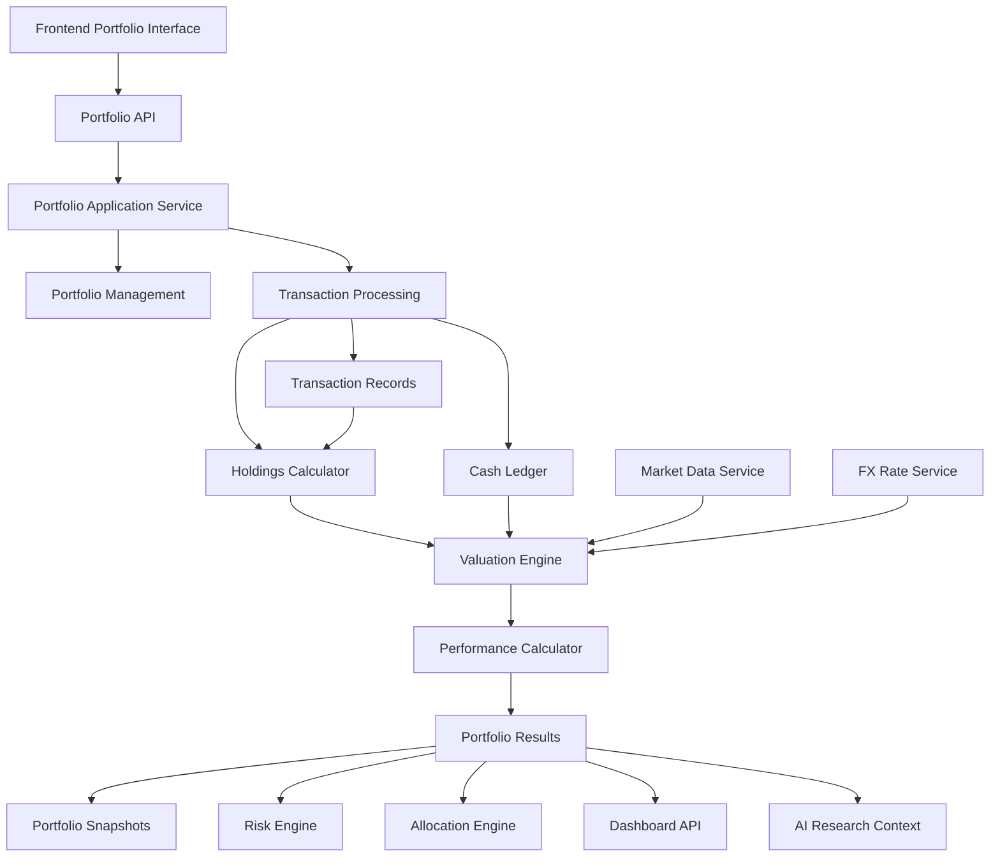

# Portfolio Engine Specification
## Personal Investment Management System (PIMS)

**Document Version:** 1.0  
**Project Status:** Planning  
**Document Type:** Engine Specification  
**Last Updated:** November 2026

---

# 1. Purpose

Dokumen ini mendefinisikan spesifikasi Portfolio Engine dalam Personal Investment Management System (PIMS).

Portfolio Engine bertanggung jawab untuk mengelola data portfolio, memproses transaksi, menghitung kepemilikan aset, melakukan valuasi, serta menghasilkan berbagai metrik kinerja portfolio.

Engine ini merupakan salah satu komponen utama PIMS karena menjadi pusat pengolahan informasi investasi yang dimiliki pengguna.

Tujuan pengembangan:

- Mendukung multiple portfolios.
- Mengelola transaksi pembelian dan penjualan aset.
- Menghitung asset holdings.
- Mengelola cash balance.
- Menghitung portfolio valuation.
- Menghitung realized dan unrealized P&L.
- Mengukur portfolio performance.
- Mendukung portfolio comparison.
- Menyediakan data untuk Risk Engine dan Allocation Engine.
- Menyediakan informasi portfolio untuk Dashboard dan AI Research Engine.

Seluruh perhitungan finansial harus dilakukan secara deterministic oleh backend.

# 2. Engine Architecture

Portfolio Engine merupakan bagian dari backend Modular Monolith.

Engine menggunakan data transaksi sebagai sumber utama untuk menghitung kondisi portfolio.

Market Data Service menyediakan harga aset untuk proses valuasi.

## 2.1 Architecture Diagram



## 2.2 Core Components

### A. Portfolio Management

Mengelola identitas, konfigurasi, dan metadata portfolio.

### B. Transaction Processing

Memproses aktivitas pembelian, penjualan, deposit, withdrawal, dan transaksi lainnya yang didukung.

### C. Cash Ledger

Mencatat perubahan cash balance berdasarkan transaksi dan cash movements.

### D. Holdings Calculator

Menghitung jumlah aset yang dimiliki berdasarkan riwayat transaksi.

### E. Valuation Engine

Menghitung nilai portfolio berdasarkan holdings, market prices, dan currency conversion.

### F. Performance Calculator

Menghitung return, P&L, dan metrik performa portfolio.

# 3. Multiple Portfolio Management

PIMS harus mendukung beberapa portfolio yang dapat dikelola secara terpisah.

Setiap portfolio memiliki identitas, transaksi, holdings, cash balance, dan performance metrics masing-masing.

## 3.1 Portfolio Properties

| Field | Description |
|---|---|
| portfolio_id | Unique portfolio identifier |
| name | Portfolio name |
| description | Optional description |
| base_currency | Portfolio reporting currency |
| status | Portfolio status |
| created_at | Creation timestamp |
| updated_at | Last update timestamp |

## 3.2 Portfolio Separation

Setiap portfolio harus memiliki data yang terisolasi secara logis.

Contoh:

| Portfolio | Base Currency | Purpose |
|---|---|---|
| Portfolio A | USD | US stocks |
| Portfolio B | IDR | Indonesia stocks |
| Portfolio C | USDT | Crypto |
| Portfolio D | USD | Mixed assets |

Contoh tersebut hanya menggambarkan konfigurasi yang memungkinkan.

Ketentuan:

- Transactions harus terhubung ke satu portfolio.
- Holdings harus dihitung per portfolio.
- Cash ledger harus terpisah.
- Portfolio performance harus dihitung secara independen.
- Perubahan pada satu portfolio tidak boleh mengubah portfolio lainnya.

## 3.3 Portfolio Aggregation

Dashboard dapat menyediakan tampilan All Portfolios.

Aggregation harus dilakukan melalui backend.

Ketentuan:

- Seluruh portfolio harus menggunakan reporting currency yang konsisten sebelum nilai dijumlahkan.
- FX rates harus tersedia dan memiliki timestamp.
- Portfolio dengan data FX tidak tersedia harus ditandai.
- Jangan menjumlahkan nominal USD, IDR, dan USDT secara langsung.
- Individual portfolio values tetap harus dapat dilihat secara terpisah.

# 4. Transaction Management

Transaction Processing merupakan bagian penting dari Portfolio Engine.

Setiap transaksi harus dicatat secara konsisten dan menjadi sumber utama perhitungan holdings serta cash balance.

## 4.1 Supported Transaction Types

Initial transaction types:

| Transaction Type | Description |
|---|---|
| BUY | Purchase of an asset |
| SELL | Sale of an asset |
| DEPOSIT | Cash deposit |
| WITHDRAWAL | Cash withdrawal |
| FEE | Transaction-related fee |
| DIVIDEND | Dividend income |
| INTEREST | Interest income |

Additional transaction types dapat ditambahkan ketika diperlukan.

Transfer antar-portfolio tidak boleh diperlakukan sebagai transaksi biasa tanpa memperhitungkan kedua sisi perpindahan.

## 4.2 Transaction Data Model

Setiap transaksi memiliki informasi:

| Field | Description |
|---|---|
| transaction_id | Unique transaction ID |
| portfolio_id | Related portfolio |
| asset_id | Related asset, if applicable |
| transaction_type | Transaction classification |
| quantity | Asset quantity |
| price | Execution price |
| gross_amount | Transaction amount before fees |
| fee | Transaction fee |
| currency | Transaction currency |
| transaction_time | Transaction timestamp |
| notes | Optional notes |
| created_at | Record creation timestamp |

Additional fields dapat diperlukan untuk exchange, external reference, settlement information, dan transaction status.

## 4.3 BUY Transaction

BUY transaction menambah jumlah aset yang dimiliki dan mengurangi cash balance.

Conceptual calculation:

\[
GrossAmount = Quantity \times Price
\]

\[
TotalCost = GrossAmount + Fees
\]

## 4.4 SELL Transaction

SELL transaction mengurangi jumlah aset yang dimiliki dan menambah cash balance.

\[
GrossProceeds = Quantity \times Price
\]

\[
NetProceeds = GrossProceeds - Fees
\]

Realized P&L dihitung menggunakan cost basis methodology yang telah ditentukan.

## 4.5 Transaction Validation

Sebelum transaksi disimpan:

- Portfolio harus valid.
- Asset harus valid jika diperlukan.
- Transaction type harus didukung.
- Quantity harus sesuai dengan transaction type.
- Price tidak boleh negatif.
- Currency harus diketahui.
- Timestamp harus valid.
- Fee harus memenuhi aturan validasi.
- SELL quantity tidak boleh melebihi available holdings kecuali short positions secara eksplisit didukung.

Short selling tidak termasuk asumsi MVP.

## 4.6 Transaction Integrity

- Setiap transaksi memiliki unique ID.
- Duplicate submission harus dicegah.
- Financial transactions harus mendukung idempotency.
- Transaction changes harus tercatat.
- Invalid transactions tidak boleh mengubah holdings.
- Transaction history harus dapat diaudit.

# 5. Cash Ledger

Cash Ledger mencatat perubahan cash balance pada setiap portfolio.

Ledger merupakan sumber utama untuk menghitung cash balance.

## 5.1 Cash Movements

Cash movements dapat berasal dari:

- Deposits.
- Withdrawals.
- Asset purchases.
- Asset sales.
- Transaction fees.
- Dividends.
- Interest.
- Other supported cash adjustments.

## 5.2 Cash Balance Calculation

Secara konseptual:

\[
EndingCash = OpeningCash + Inflows - Outflows
\]

Setiap movement harus memiliki currency context.

## 5.3 Ledger Requirements

- Ledger entries harus dapat ditelusuri ke transaksi sumber.
- Currency harus disimpan secara eksplisit.
- Perubahan saldo harus konsisten dengan transaction records.
- Ledger history tidak boleh diubah tanpa audit trail.
- Corrections harus menggunakan controlled adjustment atau reversal mechanism.

## 5.4 Multi-Currency Cash

Satu portfolio dapat memiliki beberapa cash balances dalam currency berbeda apabila konfigurasi mendukungnya.

Contoh:

| Currency | Balance |
|---|---:|
| USD | 1,500.00 |
| IDR | 5,000,000.00 |
| USDT | 800.00 |

Nilai tersebut tidak boleh dijumlahkan tanpa currency conversion.

# 6. Holdings Calculation

Holdings Calculator menghitung jumlah aset yang dimiliki berdasarkan transaksi yang telah tercatat.

Holdings merupakan derived data, bukan source of truth.

## 6.1 Holdings Model

| Field | Description |
|---|---|
| portfolio_id | Portfolio identifier |
| asset_id | Asset identifier |
| quantity | Current asset quantity |
| average_cost | Average cost, if supported |
| cost_basis | Total remaining cost basis |
| currency | Cost basis currency |
| updated_at | Calculation timestamp |

## 6.2 Quantity Calculation

Secara konseptual:

\[
EndingQuantity =
OpeningQuantity + BuyQuantity - SellQuantity
\]

Perhitungan harus mempertimbangkan seluruh transaction types yang memengaruhi quantity.

## 6.3 Holdings Rules

- Holdings dihitung per portfolio.
- Transaksi harus diproses sesuai urutan waktu dan aturan accounting.
- Duplicate transactions tidak boleh dihitung dua kali.
- Invalid transactions harus dikecualikan.
- Negative holdings harus ditolak jika short positions tidak didukung.
- Recalculation harus menghasilkan hasil yang konsisten.

## 6.4 Holdings Snapshots

Sistem dapat menyimpan holdings snapshots untuk mempercepat pembacaan.

Snapshots harus dapat dibangun ulang dari transaction history.

Jika snapshot tidak konsisten dengan source transactions, transaction history tetap menjadi sumber utama.

# 7. Cost Basis and Accounting Methodology

Cost basis digunakan untuk menghitung realized dan unrealized P&L.

Metodologi accounting harus ditentukan secara eksplisit sebelum perhitungan finansial dianggap final.

## 7.1 Supported Methodology Candidates

Metode yang dapat dievaluasi:

- FIFO (First In, First Out).
- Weighted Average Cost.
- Specific Identification.

Setiap metode memiliki implikasi berbeda terhadap cost basis dan realized P&L.

## 7.2 Methodology Requirements

- Methodology harus konsisten dalam satu portfolio.
- Cost basis harus dapat ditelusuri ke transaksi pembentuknya.
- Partial sales harus diproses dengan benar.
- Transaction fees harus mengikuti configured accounting treatment.
- Recalculation harus menghasilkan hasil yang reproducible.

## 7.3 Initial Decision Status

Cost basis methodology masih memerlukan keputusan teknis dan accounting.

OpenCode tidak boleh memilih atau mengimplementasikan methodology secara diam-diam.

Sebelum implementasi final, methodology harus disetujui dan dicatat dalam `technical-decisions.md`.

# 8. Portfolio Valuation

Valuation Engine menghitung nilai terkini portfolio berdasarkan holdings dan market prices.

## 8.1 Asset Valuation

\[
AssetValue = Quantity \times CurrentPrice
\]

## 8.2 Portfolio Valuation

Secara konseptual:

\[
PortfolioValue =
CashValue + \sum AssetValues
\]

Seluruh nilai harus dikonversi ke portfolio base currency sebelum dijumlahkan.

## 8.3 Valuation Inputs

- Current holdings.
- Latest available market prices.
- Currency information.
- FX rates.
- Data freshness.
- Valuation timestamp.

## 8.4 Missing Price Handling

Jika harga aset tidak tersedia:

- Jangan mengasumsikan harga terakhir sebagai harga terkini tanpa penanda.
- Jangan mengganti harga dengan nol.
- Gunakan last known price hanya jika policy mengizinkan.
- Tandai valuation sebagai partial atau stale.
- Tampilkan timestamp harga yang digunakan.

## 8.5 Valuation Status

| Status | Description |
|---|---|
| COMPLETE | All required values available |
| PARTIAL | Some assets could not be valued |
| STALE | One or more required prices exceed freshness policy |
| UNAVAILABLE | Valuation cannot be calculated reliably |

Portfolio valuation harus menyertakan status dan metadata sumber data.

# 9. Profit and Loss Calculation

Portfolio Engine harus menghitung realized dan unrealized P&L secara terpisah.

## 9.1 Unrealized P&L

Unrealized P&L menggambarkan perubahan nilai posisi yang masih dimiliki dibandingkan cost basis.

\[
UnrealizedPnL =
CurrentMarketValue - RemainingCostBasis
\]

## 9.2 Realized P&L

Realized P&L berasal dari posisi yang telah dijual atau ditutup.

Secara konseptual:

\[
RealizedPnL =
NetSaleProceeds - AllocatedCostBasis
\]

Perhitungan aktual mengikuti approved accounting methodology.

## 9.3 Total P&L

\[
TotalPnL =
RealizedPnL + UnrealizedPnL
\]

Dividend, interest, fees, dan cash adjustments harus diperlakukan secara konsisten agar tidak terjadi double counting.

## 9.4 P&L Requirements

- P&L harus dapat dilihat per asset.
- P&L harus dapat dilihat per portfolio.
- Currency harus jelas.
- Fee treatment harus konsisten.
- Historical P&L harus menggunakan methodology yang sama.
- Data yang tidak lengkap harus ditandai.

# 10. Portfolio Performance

Portfolio Performance Calculator menghitung perkembangan nilai portfolio dalam periode tertentu.

## 10.1 Performance Metrics

Initial supported metrics:

| Metric | Description |
|---|---|
| Total Return | Overall portfolio return |
| Daily Return | Return over a daily interval |
| Period Return | Return over selected period |
| Daily P&L | Daily profit or loss |
| Cumulative Return | Accumulated return |
| CAGR | Annualized compound growth rate |
| Realized P&L | Realized profit or loss |
| Unrealized P&L | Unrealized profit or loss |

## 10.2 Simple Return

Untuk kondisi tanpa external cash flows dalam periode:

\[
Return =
\frac{EndingValue-BeginningValue}{BeginningValue}
\times100
\]

Rumus ini tidak boleh digunakan begitu saja ketika terdapat deposit atau withdrawal yang memengaruhi portfolio value.

## 10.3 Time-Weighted Return

Time-Weighted Return (TWR) dapat digunakan untuk mengukur kinerja portfolio dengan mengurangi pengaruh external cash flows.

Periode performance dibagi pada waktu terjadinya external cash flows.

\[
TWR =
\left(\prod_{i=1}^{n}(1+r_i)\right)-1
\]

Dengan \(r_i\) sebagai return masing-masing subperiode.

## 10.4 Money-Weighted Return

Money-Weighted Return mempertimbangkan jumlah dan waktu external cash flows.

Internal Rate of Return (IRR) atau metode XIRR dapat digunakan sesuai cash flow timing.

TWR dan money-weighted return memiliki tujuan pengukuran yang berbeda dan tidak boleh dipertukarkan tanpa penjelasan.

## 10.5 CAGR

\[
CAGR =
\left(
\frac{EndingValue}{BeginningValue}
\right)^{1/Years}-1
\]

CAGR hanya boleh ditampilkan jika periode dan nilai awal memenuhi persyaratan perhitungan.

External cash flows harus dipertimbangkan melalui methodology performance yang sesuai.

## 10.6 Performance Methodology Decision

Metode utama performance reporting dan perlakuan terhadap external cash flows harus ditentukan sebelum implementasi final.

OpenCode tidak boleh menyamakan simple return, TWR, dan money-weighted return.

# 11. Historical Performance

Portfolio Engine harus mendukung historical portfolio performance.

Historical data dapat digunakan untuk:

- Performance charts.
- Daily return.
- Cumulative return.
- Historical valuation.
- Portfolio comparison.

## 11.1 Historical Data Requirements

Historical performance membutuhkan:

- Transaction history.
- Historical prices.
- FX rates.
- Portfolio cash flows.
- Historical holdings reconstruction.
- Consistent calculation methodology.

## 11.2 Historical Valuation

Historical valuation harus menggunakan harga dan FX rates yang sesuai dengan timestamp perhitungan.

Jangan menggunakan current market prices untuk menghitung historical portfolio value.

Jika historical data tidak tersedia, periode tersebut harus ditandai sebagai incomplete.

# 12. Portfolio Benchmark

Portfolio Engine dapat menyediakan integration point untuk benchmark comparison.

Potential benchmarks:

- Market index.
- Stock index.
- Crypto benchmark.
- Custom benchmark portfolio.

Benchmark selection belum menjadi keputusan final untuk MVP.

Benchmark harus memiliki currency, market, timestamp, dan methodology yang jelas.

Perbandingan tidak boleh dilakukan jika periode atau currency tidak kompatibel.

# 13. API Integration

Portfolio Engine diakses melalui backend REST API.

Proposed endpoints:

```text
GET    /api/v1/portfolios
POST   /api/v1/portfolios
GET    /api/v1/portfolios/{portfolio_id}
PUT    /api/v1/portfolios/{portfolio_id}
DELETE /api/v1/portfolios/{portfolio_id}

GET    /api/v1/portfolios/{portfolio_id}/holdings
GET    /api/v1/portfolios/{portfolio_id}/transactions
POST   /api/v1/portfolios/{portfolio_id}/transactions
PUT    /api/v1/transactions/{transaction_id}
DELETE /api/v1/transactions/{transaction_id}

GET    /api/v1/portfolios/{portfolio_id}/valuation
GET    /api/v1/portfolios/{portfolio_id}/performance
GET    /api/v1/portfolios/{portfolio_id}/pnl

GET    /api/v1/portfolios/aggregate
```

Endpoint merupakan proposed contract dan harus diselaraskan dengan `api-spec.md`.

## 13.1 API Requirements

- Consistent response envelope.
- Decimal-safe financial values.
- ISO 8601 timestamps.
- Pagination for transaction history.
- Idempotency for financial transaction creation.
- Input validation.
- Explicit error responses.
- Portfolio ownership validation.
- Data freshness metadata.

Financial values sebaiknya direpresentasikan sebagai numeric strings pada JSON API.

# 14. WebSocket Integration

Portfolio Engine dapat mengirimkan realtime portfolio valuation updates melalui WebSocket.

Proposed channel:

```text
portfolio.valuation
```

## 14.1 Valuation Update Events

Event dapat berisi:

- Portfolio ID.
- Current portfolio value.
- Daily P&L.
- Total P&L.
- Currency.
- Valuation timestamp.
- Valuation status.
- Data freshness.

## 14.2 Update Policy

- Updates harus menggunakan centralized market data events.
- Portfolio valuation tidak perlu dihitung ulang untuk setiap tick jika tidak diperlukan.
- Updates dapat di-batch atau di-throttle.
- Transaction events harus memicu recalculation yang relevan.
- Reconnection harus memungkinkan frontend mendapatkan current state melalui REST.

WebSocket protocol mengikuti `websocket-spec.md`.

# 15. Database Integration

Portfolio Engine menggunakan PostgreSQL sebagai primary persistence layer.

Conceptual entities:

- portfolios.
- transactions.
- cash_ledger.
- holdings.
- portfolio_snapshots.
- portfolio_performance_snapshots.

## 15.1 Persistence Rules

- Transactions merupakan source of truth.
- Cash ledger harus dapat ditelusuri.
- Holdings merupakan derived data.
- Snapshots dapat dibangun ulang.
- Transaction records harus memiliki audit trail.
- Financial values harus menggunakan appropriate NUMERIC precision.
- Timestamps harus timezone-aware.

Struktur tabel final mengikuti `database-design.md` dan `schema-spec.md`.

# 16. Integration with Other Engines

Portfolio Engine menyediakan data untuk analytical engines lainnya.

## 16.1 Risk Engine

Menyediakan:

- Historical portfolio values.
- Holdings.
- Portfolio returns.
- Asset weights.
- Portfolio cash flows.

Risk Engine bertanggung jawab atas volatility, drawdown, Sharpe, VaR, dan risk metrics lainnya.

## 16.2 Allocation Engine

Menyediakan:

- Asset quantities.
- Asset valuations.
- Asset classifications.
- Currency exposure.
- Portfolio weights.

Allocation Engine bertanggung jawab atas allocation calculations dan exposure analysis.

## 16.3 Correlation Engine

Menyediakan portfolio asset universe dan relevant holdings information.

Correlation Engine menghitung hubungan statistik antar-aset.

## 16.4 AI Research Engine

Menyediakan structured portfolio summaries dan analytical results.

AI Research Engine hanya menginterpretasikan data tersebut dan tidak menggantikan authoritative financial calculations.

# 17. Error Handling

Portfolio Engine harus menangani:

- Invalid transactions.
- Duplicate transactions.
- Insufficient holdings.
- Invalid asset mapping.
- Missing market prices.
- Missing FX rates.
- Inconsistent ledger entries.
- Calculation failures.
- Historical data gaps.
- Invalid portfolio configuration.

Setiap error harus memiliki context yang cukup untuk troubleshooting.

Financial calculation failures tidak boleh menghasilkan nilai yang ditampilkan sebagai valid.

# 18. Performance and Optimization

Portfolio Engine harus dirancang agar dapat menangani banyak transaksi dan holdings.

## 18.1 Performance Requirements

- Efficient transaction retrieval.
- Incremental holdings updates where safe.
- Rebuildable snapshots.
- Batched valuation calculations.
- Reuse of market data.
- Avoid unnecessary recalculations.
- Efficient historical performance queries.

## 18.2 Recalculation

Recalculation harus tersedia ketika:

- Transaction ditambahkan.
- Transaction diubah.
- Transaction dihapus.
- Historical market data dikoreksi.
- FX data diperbarui.
- Accounting methodology berubah.

Perubahan yang memengaruhi historical results harus dapat ditelusuri.

# 19. Security and Data Integrity

Portfolio data merupakan data penting yang harus dilindungi.

Requirements:

- Validate portfolio references.
- Prevent unauthorized portfolio access.
- Protect transaction integrity.
- Use database transactions for financial operations.
- Apply idempotency.
- Record audit logs.
- Avoid exposing sensitive data.
- Validate all financial inputs.
- Protect API endpoints according to the approved authentication model.

Authentication mechanism masih mengikuti keputusan security architecture dan tidak boleh diasumsikan sudah final.

# 20. Testing Requirements

## 20.1 Unit Tests

- Transaction calculations.
- Cash balance calculations.
- Holdings calculations.
- Cost basis calculations.
- Realized P&L.
- Unrealized P&L.
- Portfolio valuation.
- Simple return.
- TWR.
- Money-weighted return.

## 20.2 Integration Tests

- Transaction persistence.
- Cash ledger updates.
- Holdings reconstruction.
- Market Data Service integration.
- FX integration.
- REST API integration.
- WebSocket valuation updates.
- Database consistency.

## 20.3 Accounting Tests

Test cases harus mencakup:

- Multiple BUY transactions.
- Partial SELL transactions.
- Transaction fees.
- Deposits and withdrawals.
- Dividend income.
- Multiple currencies.
- Insufficient holdings.
- Transaction correction.
- Historical reconstruction.

## 20.4 Deterministic Tests

Dataset dan transaction history yang sama harus menghasilkan portfolio state dan calculation results yang sama dengan methodology yang sama.

# 21. Implementation Roadmap

## Phase 1 — Portfolio Foundation

- Portfolio CRUD.
- Portfolio configuration.
- Base currency.
- Portfolio isolation.
- Database integration.

## Phase 2 — Transaction Management

- BUY transactions.
- SELL transactions.
- DEPOSIT.
- WITHDRAWAL.
- Transaction validation.
- Idempotency.
- Cash ledger.

## Phase 3 — Holdings Calculation

- Quantity calculation.
- Holdings reconstruction.
- Average cost or approved cost basis methodology.
- Holdings snapshots.

## Phase 4 — Portfolio Valuation

- Market price integration.
- Asset valuation.
- Cash valuation.
- FX conversion.
- Valuation status.

## Phase 5 — Performance and P&L

- Realized P&L.
- Unrealized P&L.
- Total P&L.
- Daily performance.
- Historical performance.
- Approved return methodology.

## Phase 6 — Dashboard Integration

- Portfolio overview.
- Holdings table.
- Transaction history.
- Performance chart.
- Cash balance.
- Multi-portfolio aggregation.

## Phase 7 — Advanced Portfolio Features

- Benchmark comparison.
- Advanced historical analysis.
- Portfolio comparison.
- Additional transaction types.
- Corporate actions support.

# 22. Acceptance Criteria

Portfolio Engine dinyatakan memenuhi spesifikasi apabila:

- Multiple portfolios dapat dibuat dan dikelola.
- Setiap portfolio memiliki transaksi terpisah.
- BUY dan SELL transactions dapat diproses.
- Cash ledger berjalan konsisten.
- Holdings dapat dihitung dari transaction history.
- Holdings dapat direbuild.
- Portfolio valuation menggunakan market prices.
- FX conversion ditangani dengan benar.
- Realized dan unrealized P&L dapat dihitung.
- Performance methodology terdokumentasi.
- Historical performance dapat dihitung ketika data tersedia.
- Portfolio aggregation tidak menjumlahkan currency berbeda secara langsung.
- REST API tersedia.
- WebSocket valuation updates didukung sesuai kebutuhan.
- Risk dan Allocation Engines dapat menggunakan portfolio outputs.
- Financial calculations memiliki automated tests.
- Transaction integrity dan audit trail berjalan.

# 23. Decisions Requiring Approval

Beberapa keputusan masih harus ditentukan sebelum implementasi final:

| Decision | Current Status |
|---|---|
| Cost basis methodology | Requires approval |
| Primary performance methodology | Requires approval |
| Fee accounting treatment | Requires approval |
| Dividend and interest treatment | Requires approval |
| Short selling support | Out of initial scope |
| Corporate actions | Deferred |
| Benchmark selection | Deferred |
| Tax calculation | Deferred |
| Multi-currency accounting details | Requires refinement |

OpenCode harus mengidentifikasi keputusan yang belum disetujui dan tidak boleh mengasumsikan implementasi final.

# 24. Related Documents

- `AGENTS.md`
- `docs/architecture/application-architecture.md`
- `docs/architecture/data-flow.md`
- `docs/architecture/engine-architecture.md`
- `docs/database/database-design.md`
- `docs/decisions/technical-decisions.md`
- `specifications/project/project-scope.md`
- `specifications/project/development-roadmap.md`
- `specifications/backend/backend-spec.md`
- `specifications/backend/api-spec.md`
- `specifications/backend/websocket-spec.md`
- `specifications/data/market-data-spec.md`
- `specifications/data/normalization-spec.md`
- `specifications/engines/risk-engine-spec.md`
- `specifications/engines/allocation-engine-spec.md`
- `specifications/engines/correlation-engine-spec.md`
- `specifications/frontend/dashboard-spec.md`

---

# Final Principle

Portfolio Engine harus menjadi sumber perhitungan utama untuk seluruh informasi portfolio dalam PIMS.

Transaction records menjadi source of truth, sedangkan holdings, valuation, dan performance merupakan hasil perhitungan yang harus dapat diuji dan dibangun ulang.

Dengan pemisahan tanggung jawab ini, PIMS dapat mengelola beberapa portfolio secara konsisten serta menyediakan data yang dapat digunakan oleh berbagai analytical engines.