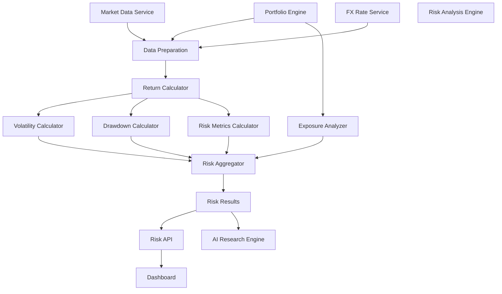

# Risk Analysis Engine Specification
## Personal Investment Management System (PIMS)

**Document Version:** 1.0  
**Project Status:** Planning  
**Document Type:** Engine Specification  
**Last Updated:** November 2026

---

# 1. Purpose

Dokumen ini mendefinisikan spesifikasi Risk Analysis Engine dalam Personal Investment Management System (PIMS).

Risk Engine bertanggung jawab untuk mengukur, menganalisis, dan menyajikan berbagai risiko yang berkaitan dengan portfolio maupun individual assets.

Engine menggunakan historical market data, portfolio holdings, portfolio returns, dan asset allocation untuk menghasilkan quantitative risk metrics.

Tujuan pengembangan:

- Mengukur portfolio volatility.
- Menghitung maximum drawdown.
- Menghitung Sharpe Ratio dan Sortino Ratio.
- Menghitung Value at Risk (VaR).
- Menghitung Conditional Value at Risk (CVaR).
- Mengukur asset concentration.
- Mengukur market exposure.
- Menghitung beta dan correlation-based risk.
- Mendukung historical risk analysis.
- Menyediakan risk metrics untuk Dashboard dan AI Research Engine.

Seluruh risk calculations harus dilakukan secara deterministic oleh backend.

Risk Engine merupakan alat pengukuran dan analisis, bukan sistem yang menjamin atau memprediksi kerugian secara pasti.

# 2. Engine Architecture

Risk Engine merupakan independent analytical engine dalam backend Modular Monolith.

Engine menggunakan portfolio data dari Portfolio Engine dan historical market data dari Market Data Service.

Risk Engine tidak boleh mengakses external market data providers secara langsung.

## 2.1 Architecture Diagram



## 2.2 Core Components

### A. Data Preparation

Mengumpulkan dan menyiapkan historical prices, portfolio returns, holdings, dan currency information.

### B. Return Calculator

Menghitung asset returns dan portfolio returns.

### C. Volatility Calculator

Menghitung historical volatility dan annualized volatility.

### D. Drawdown Calculator

Mengukur penurunan portfolio value dari historical peak.

### E. Risk Metrics Calculator

Menghitung Sharpe, Sortino, VaR, CVaR, dan beta.

### F. Exposure Analyzer

Mengukur konsentrasi aset, sektor, market, dan currency exposure.

### G. Risk Aggregator

Menggabungkan hasil analisis menjadi standardized risk report.

# 3. Required Input Data

Risk Engine membutuhkan data dari beberapa internal services.

## 3.1 Portfolio Data

Dari Portfolio Engine:

- Portfolio ID.
- Portfolio holdings.
- Asset quantities.
- Asset market values.
- Portfolio weights.
- Historical portfolio values.
- Historical portfolio returns.
- Portfolio base currency.
- Cash balances.
- External cash flow information.

## 3.2 Market Data

Dari Market Data Service:

- Historical OHLCV.
- Historical closing prices.
- Asset metadata.
- Market identifiers.
- Currency information.
- Historical FX rates.
- Data timestamps.
- Data provenance.

## 3.3 Input Validation

Sebelum melakukan perhitungan:

- Historical data harus valid.
- Asset mapping harus tersedia.
- Currency harus diketahui.
- Return observations harus memiliki timestamp.
- Missing observations harus dapat diidentifikasi.
- Portfolio valuation harus memiliki status.
- Data freshness dan provenance harus dipertahankan.

Insufficient historical observations tidak boleh menghasilkan risk metrics yang seolah-olah valid.

# 4. Risk Analysis Categories

Risk Engine membagi analisis menjadi beberapa kategori.

| Category | Purpose |
|---|---|
| Volatility Risk | Mengukur variasi return |
| Drawdown Risk | Mengukur penurunan nilai portfolio |
| Market Risk | Mengukur sensitivitas terhadap pergerakan pasar |
| Downside Risk | Mengukur risiko return negatif |
| Tail Risk | Mengukur potensi kerugian pada kondisi ekstrem |
| Concentration Risk | Mengukur ketergantungan pada aset tertentu |
| Currency Risk | Mengukur eksposur terhadap perubahan nilai tukar |
| Correlation Risk | Mengukur hubungan risiko antar-aset |

# 5. Return Calculation

Risk Engine menggunakan return series sebagai dasar sebagian besar perhitungan.

## 5.1 Simple Return

Simple return menghitung perubahan nilai antara dua periode.

\[
R_t = \frac{P_t-P_{t-1}}{P_{t-1}}
\]

Dengan:

- \(P_t\) = Current price.
- \(P_{t-1}\) = Previous price.

Untuk asset-level return, corporate actions dan data adjustments harus dipertimbangkan jika tersedia.

## 5.2 Log Return

Log return:

\[
r_t = \ln\left(\frac{P_t}{P_{t-1}}\right)
\]

Log returns dapat digunakan untuk beberapa statistical calculations.

Metode return yang digunakan harus konsisten dalam satu calculation workflow.

## 5.3 Portfolio Return

Portfolio return harus menggunakan portfolio valuation yang telah memperhitungkan external cash flows sesuai methodology yang ditentukan.

Untuk risk analysis, external deposits dan withdrawals tidak boleh dianggap sebagai keuntungan atau kerugian investasi.

Risk Engine harus menggunakan return series yang disediakan Portfolio Engine atau menghitungnya melalui approved internal methodology.

# 6. Volatility Analysis

Volatility mengukur tingkat variasi return dalam periode tertentu.

## 6.1 Historical Volatility

Historical volatility dihitung menggunakan standard deviation dari historical returns.

\[
\sigma =
\sqrt{
\frac{\sum_{i=1}^{n}(R_i-\bar R)^2}{n-1}
}
\]

Dengan:

- \(R_i\) = Individual return.
- \(\bar R\) = Average return.
- \(n\) = Number of observations.

## 6.2 Annualized Volatility

\[
AnnualizedVolatility =
\sigma_{period}\sqrt{N}
\]

Dengan \(N\) sebagai jumlah periode observasi dalam satu tahun.

Annualization factor harus disesuaikan dengan data frequency dan market calendar.

Contoh konfigurasi:

| Frequency | Annualization Convention |
|---|---:|
| Daily crypto | 365 |
| Daily US equities | 252 |
| Daily IDX equities | 252 |

Konvensi tersebut harus dapat dikonfigurasi dan didokumentasikan.

## 6.3 Volatility Outputs

- Daily volatility.
- Annualized volatility.
- Rolling volatility.
- Asset volatility.
- Portfolio volatility.

## 6.4 Rolling Volatility

Rolling volatility menghitung volatility menggunakan observation window yang bergerak.

Initial windows:

- 20 periods.
- 30 periods.
- 60 periods.
- 90 periods.

Window harus configurable.

# 7. Drawdown Analysis

Drawdown mengukur penurunan nilai portfolio dari historical peak.

## 7.1 Drawdown Formula

\[
Drawdown_t =
\frac{V_t-Peak_t}{Peak_t}
\]

Dengan:

\[
Peak_t = \max(V_1,\ldots,V_t)
\]

## 7.2 Maximum Drawdown

Maximum Drawdown merupakan nilai drawdown paling negatif dalam periode pengamatan.

\[
MDD = \min(Drawdown_t)
\]

## 7.3 Drawdown Metrics

Risk Engine harus menghasilkan:

- Current drawdown.
- Maximum drawdown.
- Peak value.
- Trough value.
- Drawdown start date.
- Recovery date jika tersedia.
- Recovery duration.

## 7.4 Drawdown Requirements

- Historical valuation harus tersedia.
- External cash flows harus diperlakukan sesuai methodology.
- Missing valuation periods harus ditandai.
- Drawdown tidak boleh dihitung menggunakan data yang tidak konsisten.

# 8. Sharpe Ratio

Sharpe Ratio mengukur excess return terhadap total volatility.

\[
SharpeRatio =
\frac{R_p-R_f}{\sigma_p}
\]

Dengan:

- \(R_p\) = Portfolio return.
- \(R_f\) = Risk-free rate.
- \(\sigma_p\) = Standard deviation of portfolio returns.

## 8.1 Requirements

- Risk-free rate harus memiliki currency dan period context.
- Return frequency harus konsisten.
- Annualization harus dilakukan secara benar.
- Missing risk-free data harus ditangani secara eksplisit.

## 8.2 Interpretation

Sharpe Ratio digunakan untuk mengevaluasi return relatif terhadap total volatility.

Nilai yang lebih tinggi menunjukkan excess return yang lebih besar relatif terhadap volatility berdasarkan periode dan asumsi yang digunakan.

Sharpe Ratio tidak boleh diinterpretasikan secara terpisah dari market conditions dan sample period.

# 9. Sortino Ratio

Sortino Ratio mengukur excess return relatif terhadap downside deviation.

\[
SortinoRatio =
\frac{R_p-R_f}{DownsideDeviation}
\]

Downside deviation hanya memperhitungkan return yang berada di bawah configured minimum acceptable return.

## 9.1 Requirements

- Target return harus configurable.
- Return frequency harus konsisten.
- Downside observation policy harus terdokumentasi.
- Insufficient downside observations harus ditangani.

Sortino Ratio membantu membedakan total volatility dan downside risk.

# 10. Value at Risk (VaR)

Value at Risk mengestimasi batas kerugian pada confidence level dan holding period tertentu berdasarkan methodology yang digunakan.

## 10.1 Supported Methods

Initial supported methods:

### A. Historical VaR

Menggunakan distribusi historical portfolio returns.

### B. Parametric VaR

Menggunakan asumsi distribusi statistik tertentu dan estimasi parameter return.

### C. Monte Carlo VaR

Menggunakan simulated return scenarios berdasarkan configured model.

Monte Carlo merupakan fitur lanjutan dan tidak wajib untuk MVP.

## 10.2 Confidence Levels

Initial configurations:

- 90%.
- 95%.
- 99%.

## 10.3 VaR Output

| Field | Description |
|---|---|
| portfolio_id | Portfolio identifier |
| confidence_level | Selected confidence level |
| holding_period | Risk measurement horizon |
| methodology | Calculation method |
| var_value | Estimated loss threshold |
| currency | Portfolio currency |
| calculated_at | Calculation timestamp |

## 10.4 Interpretation

VaR merupakan estimasi threshold kerugian berdasarkan confidence level dan model yang digunakan.

VaR tidak menunjukkan kerugian maksimum dan tidak menjelaskan besarnya kerugian ketika threshold terlampaui.

Hasil VaR harus selalu disertai methodology dan observation period.

# 11. Conditional Value at Risk (CVaR)

Conditional Value at Risk, juga dikenal sebagai Expected Shortfall, mengukur rata-rata kerugian pada bagian distribusi yang melewati VaR threshold.

CVaR memberikan informasi tambahan mengenai tail risk.

## 11.1 Calculation Requirements

- Menggunakan return distribution yang sama dengan VaR methodology terkait.
- Confidence level harus dicantumkan.
- Historical observation window harus disimpan.
- Currency harus jelas.
- Insufficient observations harus ditangani.

## 11.2 Output

- CVaR value.
- Confidence level.
- Holding period.
- Calculation methodology.
- Observation window.
- Calculation timestamp.

# 12. Beta Analysis

Beta mengukur sensitivitas return suatu asset atau portfolio terhadap benchmark returns.

\[
\beta =
\frac{Cov(R_p,R_b)}{Var(R_b)}
\]

Dengan:

- \(R_p\) = Portfolio returns.
- \(R_b\) = Benchmark returns.

## 12.1 Requirements

- Benchmark harus ditentukan.
- Return timestamps harus aligned.
- Return frequency harus konsisten.
- Benchmark currency harus kompatibel.
- Missing observations harus ditangani.

## 12.2 Beta Outputs

- Asset beta.
- Portfolio beta.
- Benchmark identifier.
- Observation window.
- Calculation timestamp.

Beta tidak dapat diinterpretasikan tanpa mengetahui benchmark yang digunakan.

# 13. Concentration Risk

Concentration Risk mengukur seberapa besar portfolio bergantung pada aset atau kelompok aset tertentu.

## 13.1 Asset Concentration

Portfolio weight:

\[
w_i = \frac{V_i}{V_p}
\]

Dengan:

- \(V_i\) = Asset market value.
- \(V_p\) = Total portfolio market value.

## 13.2 Concentration Metrics

- Largest holding weight.
- Top 5 holdings weight.
- Top 10 holdings weight.
- Asset concentration.
- Sector concentration.
- Market concentration.
- Currency concentration.

## 13.3 Herfindahl-Hirschman Index

HHI dapat digunakan untuk mengukur concentration.

\[
HHI = \sum_{i=1}^{n}w_i^2
\]

Perhitungan harus menggunakan weights dalam bentuk desimal.

## 13.4 Concentration Requirements

- Asset classification harus tersedia.
- Weights harus menggunakan valuation currency yang konsisten.
- Missing classifications harus ditandai.
- Cash exposure harus dapat dianalisis secara terpisah.

# 14. Currency Risk

Currency Risk mengukur eksposur portfolio terhadap perubahan nilai tukar.

## 14.1 Required Data

- Asset market value.
- Asset currency.
- Portfolio base currency.
- FX rates.
- Historical FX rates.

## 14.2 Currency Exposure

Portfolio value harus dikelompokkan berdasarkan currency.

Contoh output:

| Currency | Exposure |
|---|---:|
| USD | 45% |
| IDR | 30% |
| USDT | 25% |

Angka di atas hanya contoh struktur output.

## 14.3 Requirements

- FX rates harus memiliki timestamp.
- Currency conversion methodology harus konsisten.
- Missing FX rates harus ditandai.
- Stablecoins tidak boleh otomatis dianggap identik dengan fiat currencies.
- Currency exposure harus dibedakan dari asset market exposure.

# 15. Correlation-Based Risk

Correlation analysis digunakan untuk memahami hubungan pergerakan return antar-aset.

Risk Engine menggunakan Correlation Engine sebagai sumber correlation calculations jika tersedia.

Potential outputs:

- Portfolio asset correlation.
- Highly correlated holdings.
- Diversification indicators.
- Correlation changes.

Risk Engine tidak boleh membuat duplicate implementation dari Correlation Engine.

# 16. Historical and Rolling Risk Analysis

Risk Engine harus mendukung risk measurements pada berbagai observation windows.

## 16.1 Initial Windows

- 20 trading periods.
- 30 trading periods.
- 60 trading periods.
- 90 trading periods.
- 252 trading periods.

Untuk crypto, calendar-based periods harus dibedakan dari trading-day conventions pada saham.

## 16.2 Historical Analysis

Historical risk results dapat digunakan untuk:

- Risk trend charts.
- Rolling volatility charts.
- Historical drawdown charts.
- Historical VaR.
- Historical portfolio risk comparison.

## 16.3 Data Requirements

- Historical prices.
- Historical portfolio values.
- Historical FX rates.
- Consistent timestamps.
- Approved return methodology.

# 17. Risk Aggregation

Risk Aggregator menggabungkan seluruh metrics menjadi standardized risk report.

## 17.1 Risk Report Categories

### A. Portfolio Risk Summary

- Annualized volatility.
- Maximum drawdown.
- Sharpe Ratio.
- Sortino Ratio.
- VaR.
- CVaR.

### B. Exposure Summary

- Asset concentration.
- Sector exposure.
- Market exposure.
- Currency exposure.

### C. Market Sensitivity

- Beta.
- Benchmark sensitivity.
- Correlation-based risk.

### D. Historical Risk

- Rolling volatility.
- Drawdown history.
- Historical VaR.

## 17.2 Risk Status

PIMS dapat menyediakan descriptive risk classifications seperti:

- LOW.
- MODERATE.
- HIGH.
- VERY_HIGH.
- UNKNOWN.

Risk classification thresholds harus configurable dan didokumentasikan.

Status tersebut hanya merupakan kategori analitis internal, bukan penilaian universal atau jaminan tingkat keamanan portfolio.

# 18. Standardized Output Contract

Seluruh risk results harus menggunakan standardized output structure.

## 18.1 Output Fields

| Field | Description |
|---|---|
| risk_run_id | Unique calculation ID |
| portfolio_id | Portfolio identifier |
| metric | Risk metric name |
| value | Calculated value |
| currency | Currency if applicable |
| methodology | Calculation methodology |
| observation_window | Historical window |
| confidence_level | Applicable VaR/CVaR level |
| data_status | Input data quality status |
| calculated_at | Calculation timestamp |

## 18.2 Example Output

```json
{
  "risk_run_id": "risk-uuid",
  "portfolio_id": "portfolio-uuid",
  "metrics": {
    "annualized_volatility": "0.185",
    "maximum_drawdown": "-0.125",
    "sharpe_ratio": "1.25",
    "sortino_ratio": "1.65",
    "historical_var_95": "0.025",
    "historical_cvar_95": "0.038"
  },
  "methodology": {
    "return_type": "SIMPLE",
    "observation_window": 252,
    "frequency": "DAILY"
  },
  "data_status": "VALID",
  "calculated_at": "2026-11-17T00:30:00Z"
}
```

Nilai di atas hanya contoh format dan bukan hasil analisis portfolio aktual.

# 19. API Integration

Risk Engine diakses melalui backend REST API.

Proposed endpoints:

```text
GET /api/v1/analytics/risk/{portfolio_id}

GET /api/v1/analytics/risk/{portfolio_id}/volatility

GET /api/v1/analytics/risk/{portfolio_id}/drawdown

GET /api/v1/analytics/risk/{portfolio_id}/var

GET /api/v1/analytics/risk/{portfolio_id}/exposure

GET /api/v1/analytics/risk/{portfolio_id}/history
```

## 19.1 API Requirements

- Support observation window.
- Support selected metrics.
- Support calculation methodology.
- Support bounded historical results.
- Return calculation metadata.
- Return data quality status.
- Return explicit errors for insufficient data.
- Use consistent API response envelope.

Endpoint merupakan proposed contract dan harus diselaraskan dengan `api-spec.md`.

# 20. Dashboard Integration

Risk Engine menyediakan data untuk Risk Overview pada Dashboard dan dedicated Analytics page.

## 20.1 Risk Overview

Dashboard dapat menampilkan:

- Portfolio volatility.
- Maximum drawdown.
- Sharpe Ratio.
- Concentration.
- Currency exposure.
- Current risk status.

## 20.2 Risk Visualization

Recommended visualizations:

- Volatility line chart.
- Drawdown area chart.
- Asset concentration bar chart.
- Currency exposure chart.
- Risk metrics table.
- Historical VaR chart.

## 20.3 User Interaction

Pengguna dapat:

- Mengubah observation window.
- Membandingkan risk metrics antar-portfolio.
- Membuka detailed risk analysis.
- Melihat calculation methodology.
- Melihat input data freshness.
- Melihat historical risk trends.

Frontend hanya bertanggung jawab untuk visualisasi dan interaksi.

# 21. AI Research Integration

AI Research Engine dapat menggunakan Risk Engine outputs untuk menjelaskan kondisi risiko portfolio.

Contoh konteks:

- Historical volatility meningkat.
- Maximum drawdown berubah.
- Asset concentration meningkat.
- Currency exposure berubah.
- Correlation antar-holdings meningkat.

AI Research Engine tidak boleh mengubah nilai perhitungan Risk Engine.

AI hanya menginterpretasikan hasil yang telah dihitung dan menyertakan batasan data serta methodology.

# 22. Performance and Caching

Risk calculations dapat membutuhkan historical observations dalam jumlah besar.

## 22.1 Performance Requirements

- Reuse historical return series.
- Reuse portfolio snapshots.
- Avoid unnecessary repeated calculations.
- Support batch calculations.
- Support rolling calculations.
- Limit historical query windows.
- Isolate expensive calculations from interactive requests when necessary.

## 22.2 Calculation Modes

Risk Engine harus mendukung:

- Request-driven calculations.
- Scheduled calculations.
- Event-driven recalculations.

## 22.3 Caching

Historical risk results dapat di-cache.

Cache harus mempertimbangkan:

- Portfolio ID.
- Calculation methodology.
- Observation window.
- Data version.
- Benchmark.
- Calculation parameters.

Cache bukan source of truth.

Redis tetap deferred sesuai technical decisions.

# 23. Data Quality and Error Handling

Risk Engine harus menangani:

- Insufficient historical observations.
- Missing prices.
- Missing FX rates.
- Invalid portfolio valuation.
- Misaligned timestamps.
- Invalid benchmark data.
- Stale inputs.
- Calculation errors.
- Unsupported methodologies.

Setiap result harus memiliki data quality status.

Invalid inputs tidak boleh menghasilkan risk metrics yang ditampilkan sebagai valid.

# 24. Testing Requirements

## 24.1 Unit Tests

- Simple return.
- Log return.
- Historical volatility.
- Annualized volatility.
- Rolling volatility.
- Maximum drawdown.
- Sharpe Ratio.
- Sortino Ratio.
- Historical VaR.
- Parametric VaR.
- CVaR.
- Beta.
- Concentration metrics.
- HHI.
- Currency exposure.

## 24.2 Numerical Accuracy Tests

Setiap calculation harus dibandingkan dengan independently verified reference datasets.

Toleransi numerik harus ditentukan berdasarkan jenis metric.

## 24.3 Integration Tests

- Portfolio Engine integration.
- Market Data Service integration.
- FX Service integration.
- Correlation Engine integration.
- REST API integration.
- Dashboard integration.
- AI Research context integration.

## 24.4 Edge Case Tests

- Zero or insufficient observations.
- Constant returns.
- Missing observations.
- Negative returns.
- Large market movements.
- Zero benchmark variance.
- Missing FX rates.
- Incomplete portfolio valuation.

## 24.5 Deterministic Tests

Dataset, configuration, dan methodology yang sama harus menghasilkan risk metrics yang sama.

# 25. Implementation Roadmap

## Phase 1 — Risk Foundation

- Risk input contracts.
- Return series preparation.
- Data quality validation.
- Risk calculation framework.

## Phase 2 — Core Risk Metrics

- Historical volatility.
- Annualized volatility.
- Rolling volatility.
- Maximum drawdown.
- Concentration analysis.

## Phase 3 — Performance-Adjusted Risk

- Sharpe Ratio.
- Sortino Ratio.
- Benchmark integration.
- Beta.

## Phase 4 — Tail Risk

- Historical VaR.
- Parametric VaR.
- CVaR.
- Confidence-level configurations.

## Phase 5 — Currency and Correlation Risk

- Currency exposure.
- FX sensitivity inputs.
- Correlation-based risk.
- Multi-asset risk aggregation.

## Phase 6 — Dashboard Integration

- Risk overview.
- Risk charts.
- Historical analysis.
- Portfolio comparison.

## Phase 7 — Advanced Risk Analysis

- Monte Carlo VaR.
- Scenario-based risk.
- Stress testing integration.
- Advanced risk reporting.

# 26. Acceptance Criteria

Risk Engine dinyatakan memenuhi spesifikasi apabila:

- Portfolio data dapat digunakan sebagai input.
- Historical return series dapat dibentuk.
- Volatility dapat dihitung.
- Maximum drawdown dapat dihitung.
- Sharpe Ratio dapat dihitung.
- Sortino Ratio dapat dihitung.
- VaR dan CVaR didukung sesuai methodology.
- Beta dapat dihitung ketika benchmark tersedia.
- Concentration metrics dapat dihitung.
- Currency exposure dapat dianalisis.
- Correlation Engine dapat diintegrasikan.
- Historical risk analysis tersedia.
- Data quality status disertakan.
- Calculation methodology dapat ditelusuri.
- REST API tersedia.
- Dashboard dapat menampilkan risk results.
- Automated tests tersedia.
- Perhitungan bersifat deterministic.

# 27. Decisions Requiring Approval

Beberapa keputusan masih memerlukan persetujuan:

| Decision | Current Status |
|---|---|
| Primary return methodology | Follows Portfolio Engine decision |
| Risk-free rate provider | Requires approval |
| Benchmark selection | Deferred |
| VaR default methodology | Requires approval |
| Default confidence level | Proposed: 95% |
| Annualization conventions | Requires validation |
| Risk classification thresholds | Requires approval |
| Monte Carlo methodology | Deferred |
| Stress testing methodology | Deferred |

OpenCode tidak boleh mengubah proposed decisions menjadi approved decisions tanpa persetujuan.

# 28. Related Documents

- `AGENTS.md`
- `docs/architecture/engine-architecture.md`
- `docs/architecture/data-flow.md`
- `docs/database/database-design.md`
- `docs/decisions/technical-decisions.md`
- `specifications/project/project-scope.md`
- `specifications/project/development-roadmap.md`
- `specifications/engines/portfolio-engine-spec.md`
- `specifications/engines/allocation-engine-spec.md`
- `specifications/engines/correlation-engine-spec.md`
- `specifications/engines/market-regime-spec.md`
- `specifications/engines/technical-analysis-spec.md`
- `specifications/data/market-data-spec.md`
- `specifications/data/normalization-spec.md`
- `specifications/backend/api-spec.md`
- `specifications/frontend/dashboard-spec.md`

---

# Final Principle

Risk Engine harus menjadi quantitative risk analysis component yang menghasilkan perhitungan secara deterministic, transparan, dan reproducible.

Setiap risk metric harus memiliki methodology, observation window, data quality status, serta informasi sumber data yang jelas.

Dengan pendekatan ini, PIMS dapat memberikan gambaran risiko portfolio secara lebih terukur tanpa menganggap hasil analisis sebagai jaminan kondisi pasar di masa depan.