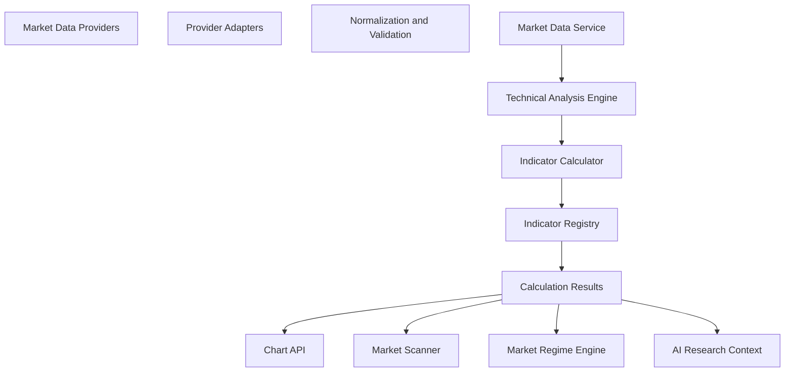

# Technical Analysis Engine Specification
## Personal Investment Management System (PIMS)

**Document Version:** 1.0  
**Project Status:** Planning  
**Document Type:** Engine Specification  
**Last Updated:** November 2026

---

# 1. Purpose

Dokumen ini mendefinisikan spesifikasi Technical Analysis Engine dalam Personal Investment Management System (PIMS).

Technical Analysis Engine bertanggung jawab untuk mengolah historical dan realtime market data menjadi indikator teknikal yang dapat digunakan untuk menganalisis pergerakan harga instrumen keuangan.

Engine ini menjadi salah satu komponen utama dalam Market Analysis System dan terintegrasi dengan:

- Market Data Service.
- Market Data Normalization.
- Chart Engine.
- Market Scanner.
- Market Regime Engine.
- AI Research Engine.

Tujuan pengembangan engine:

- Menghitung indikator teknikal secara konsisten.
- Mendukung berbagai financial instruments.
- Mendukung berbagai timeframes.
- Menghasilkan indikator untuk chart visualization.
- Menyediakan data bagi Market Scanner.
- Mendukung historical dan realtime calculations.
- Menyediakan hasil analisis yang dapat digunakan oleh AI Research Engine.

Seluruh perhitungan teknikal harus dilakukan secara deterministic oleh backend.

# 2. Engine Architecture

Technical Analysis Engine merupakan bagian dari backend modular monolith.

Engine tidak boleh bergantung langsung pada external market data providers.

Seluruh data harus diperoleh melalui internal Market Data Service.

## 2.1 Architecture Flow



## 2.2 Core Components

### A. Market Data Input

Menerima normalized OHLCV data dari Market Data Service.

### B. Indicator Calculator

Melakukan perhitungan indikator berdasarkan parameter yang ditentukan.

### C. Indicator Registry

Menyimpan definisi indikator yang didukung, termasuk:

- Indicator name.
- Parameters.
- Required input data.
- Calculation requirements.
- Output format.

### D. Calculation Manager

Mengatur permintaan kalkulasi, caching, dan pembaruan hasil indikator.

### E. Result Provider

Menyediakan hasil perhitungan kepada API, Chart Engine, Scanner, dan engine lainnya.

# 3. Supported Market Data

Technical Analysis Engine menggunakan normalized market data.

## 3.1 Required Input

| Input | Description |
|---|---|
| asset_id | Internal asset identifier |
| timeframe | Candle timeframe |
| timestamp | Candle timestamp |
| open | Opening price |
| high | Highest price |
| low | Lowest price |
| close | Closing price |
| volume | Trading volume |
| currency | Quote currency |
| is_closed | Candle completion status |

## 3.2 Supported Timeframes

Initial supported timeframes:

- 1m
- 5m
- 15m
- 30m
- 1h
- 4h
- 1D
- 1W
- 1M

Timeframe availability bergantung pada historical data dan capabilities masing-masing provider.

## 3.3 Input Validation

Sebelum kalkulasi:

- OHLCV data harus melewati normalization pipeline.
- Candle harus memiliki timestamp yang valid.
- Candle tidak boleh duplicate.
- Price values harus memenuhi OHLC constraints.
- Data harus memiliki currency context.
- Missing candles harus dapat diidentifikasi.
- Data source dan freshness harus tersedia.

Engine tidak boleh menganggap missing candles sebagai candle dengan volume nol atau harga yang tidak berubah.

# 4. Indicator Categories

Indikator dibagi menjadi beberapa kategori.

| Category | Purpose |
|---|---|
| Trend | Mengidentifikasi arah pergerakan harga |
| Momentum | Mengukur kekuatan pergerakan harga |
| Volatility | Mengukur perubahan dan penyebaran harga |
| Volume | Menganalisis aktivitas transaksi |
| Price Structure | Menganalisis posisi harga terhadap level tertentu |

# 5. Trend Indicators

## 5.1 Simple Moving Average (SMA)

SMA menghitung rata-rata harga selama periode tertentu.

Formula:

\[
SMA_n = \frac{1}{n}\sum_{i=0}^{n-1}P_{t-i}
\]

Default configurations:

- SMA 20.
- SMA 50.
- SMA 100.
- SMA 200.

Input:
- Close prices.
- Period.

Output:
- Timestamp.
- SMA value.
- Indicator parameters.

## 5.2 Exponential Moving Average (EMA)

EMA memberikan bobot lebih besar terhadap data harga terbaru.

Formula:

\[
EMA_t = \alpha P_t + (1-\alpha)EMA_{t-1}
\]

Dengan:

\[
\alpha = \frac{2}{n+1}
\]

Default configurations:

- EMA 9.
- EMA 20.
- EMA 50.
- EMA 100.
- EMA 200.

Initial EMA sebaiknya menggunakan SMA sebagai seed agar perhitungan konsisten.

## 5.3 Moving Average Rules

- Period harus lebih besar dari nol.
- Output harus mengikuti timestamp input.
- Insufficient data menghasilkan null atau warm-up status.
- Missing data tidak boleh diperlakukan sebagai harga valid.
- Calculation method harus konsisten antara historical dan realtime.

# 6. Momentum Indicators

## 6.1 Relative Strength Index (RSI)

RSI mengukur momentum berdasarkan rata-rata kenaikan dan penurunan harga.

Formula:

\[
RSI = 100-\frac{100}{1+RS}
\]

Dengan:

\[
RS = \frac{Average\ Gain}{Average\ Loss}
\]

Default configuration:

- RSI 14.

Interpretation reference:

| RSI Range | General Interpretation |
|---|---|
| Above 70 | Potentially overbought |
| Below 30 | Potentially oversold |
| 30–70 | Intermediate range |

Level tersebut merupakan referensi analisis umum, bukan sinyal transaksi otomatis.

Perhitungan default menggunakan Wilder's smoothing dan harus konsisten pada seluruh timeframe.

## 6.2 Moving Average Convergence Divergence (MACD)

MACD mengukur hubungan antara dua exponential moving averages.

Default configuration:

- Fast EMA: 12.
- Slow EMA: 26.
- Signal EMA: 9.

Formula:

\[
MACD = EMA_{12}-EMA_{26}
\]

\[
Signal = EMA_9(MACD)
\]

\[
Histogram = MACD-Signal
\]

Output:

- MACD line.
- Signal line.
- Histogram.

## 6.3 Stochastic Oscillator

Stochastic membandingkan harga penutupan dengan rentang harga dalam periode tertentu.

Default configuration:

- %K: 14.
- %D: 3.
- Smoothing: 3.

Formula dasar:

\[
\%K = 100 \times
\frac{Close-Low_n}{High_n-Low_n}
\]

Output:

- %K.
- %D.

Jika high dan low pada periode perhitungan sama, engine harus menerapkan defined edge-case policy dan tidak menghasilkan pembagian tidak valid.

# 7. Volatility Indicators

## 7.1 Bollinger Bands

Bollinger Bands menggunakan moving average dan standard deviation.

Default configuration:

- Period: 20.
- Standard deviation multiplier: 2.

Formula:

\[
Middle = SMA_{20}
\]

\[
Upper = Middle + 2\sigma
\]

\[
Lower = Middle - 2\sigma
\]

Output:

- Middle band.
- Upper band.
- Lower band.

Standard deviation calculation method harus ditentukan secara konsisten dan didokumentasikan.

## 7.2 Average True Range (ATR)

ATR mengukur rata-rata true range dalam periode tertentu.

True Range:

\[
TR = \max
\begin{cases}
High-Low\\
|High-PreviousClose|\\
|Low-PreviousClose|
\end{cases}
\]

Default configuration:

- ATR 14.

ATR menggunakan Wilder's smoothing sebagai default calculation method.

Output:

- ATR value.
- Timestamp.
- Period.

ATR mengukur volatilitas, bukan arah pergerakan harga.

# 8. Volume Indicators

## 8.1 Volume Moving Average

Menghitung rata-rata volume dalam periode tertentu.

Default configuration:

- Volume SMA 20.
- Volume SMA 50.

Formula:

\[
VolumeSMA_n =
\frac{1}{n}\sum_{i=0}^{n-1}V_{t-i}
\]

## 8.2 Volume Weighted Average Price (VWAP)

VWAP menghitung rata-rata harga berdasarkan volume transaksi.

Formula:

\[
VWAP =
\frac{\sum (TypicalPrice \times Volume)}
{\sum Volume}
\]

Dengan:

\[
TypicalPrice = \frac{High+Low+Close}{3}
\]

VWAP umumnya menggunakan session-based calculation untuk saham dan session atau anchor policy yang ditentukan untuk crypto.

PIMS harus mendukung explicit VWAP anchor configuration.

Jangan menggunakan satu session policy yang sama untuk seluruh market tanpa mempertimbangkan perbedaan market structure.

## 8.3 Volume Rules

- Volume unit harus diketahui.
- Volume dari instrumen berbeda tidak boleh dibandingkan langsung tanpa konteks.
- Missing volume tidak boleh dianggap nol.
- VWAP tidak valid jika cumulative volume tidak mencukupi.
- Session reset harus mengikuti configured market calendar atau anchor.

# 9. Indicator Configuration

Setiap indikator harus memiliki configuration yang eksplisit.

## 9.1 Configuration Fields

| Field | Description |
|---|---|
| indicator_id | Internal indicator identifier |
| indicator_name | Indicator name |
| asset_id | Instrument identifier |
| timeframe | Calculation timeframe |
| parameters | Indicator parameters |
| input_field | Required price or volume input |
| calculation_method | Calculation method |
| anchor | Optional anchor configuration |
| enabled | Configuration status |

## 9.2 Default Parameters

| Indicator | Default Parameters |
|---|---|
| SMA | 20, 50, 100, 200 |
| EMA | 9, 20, 50, 100, 200 |
| RSI | 14 |
| MACD | 12, 26, 9 |
| Bollinger Bands | 20, 2 |
| ATR | 14 |
| Stochastic | 14, 3, 3 |
| Volume SMA | 20, 50 |
| VWAP | Session-based |

Default parameters dapat diubah melalui chart configuration.

Custom configurations tidak boleh mengubah hasil dari konfigurasi indikator lain.

# 10. Calculation Engine

## 10.1 Historical Calculation

Historical calculation digunakan ketika:

- Chart pertama kali dibuka.
- User mengganti timeframe.
- User mengganti indikator.
- Historical data diperbarui.
- Scanner membutuhkan historical indicator values.

Flow:

1. Receive calculation request.
2. Validate asset and timeframe.
3. Retrieve required historical candles.
4. Validate input dataset.
5. Calculate indicators.
6. Apply warm-up rules.
7. Return standardized results.

## 10.2 Realtime Calculation

Realtime calculation digunakan ketika terdapat market data updates.

Flow:

1. Receive normalized market data event.
2. Identify affected asset and timeframe.
3. Update current candle state.
4. Recalculate affected indicator values.
5. Update internal calculation cache.
6. Publish indicator update event when needed.

Historical calculations tidak perlu dijalankan ulang seluruhnya untuk setiap market update.

## 10.3 Closed and Open Candles

Engine harus membedakan:

- Open candle.
- Closed candle.

Open candle dapat menghasilkan provisional indicator values yang berubah selama candle berlangsung.

Closed candle menghasilkan final indicator values untuk periode tersebut berdasarkan data yang tersedia dan kebijakan koreksi data.

# 11. Warm-up and Missing Data Policy

Indikator membutuhkan jumlah historical observations tertentu sebelum menghasilkan output valid.

Contoh:

- SMA 20 membutuhkan minimal 20 observations.
- RSI 14 membutuhkan initial data dan proses smoothing.
- MACD membutuhkan historical data yang cukup untuk EMA dan signal line.
- Bollinger Bands 20 membutuhkan minimal 20 observations.

Output yang belum memenuhi persyaratan harus ditandai sebagai:

- `WARMING_UP`
- `INSUFFICIENT_DATA`
- `VALID`

Missing candles harus ditangani melalui data quality policy.

Engine tidak boleh mengisi missing candles dengan nilai buatan tanpa explicit methodology.

# 12. Indicator Output Contract

Seluruh indicator results harus memiliki standardized output structure.

## 12.1 Output Fields

| Field | Description |
|---|---|
| asset_id | Internal asset identifier |
| timeframe | Calculation timeframe |
| indicator | Indicator identifier |
| parameters | Applied parameters |
| timestamp | Candle timestamp |
| values | Calculated indicator values |
| status | Calculation status |
| source | Input data provenance |
| calculated_at | Calculation timestamp |

## 12.2 Example Output

```json
{
  "asset_id": "asset-uuid",
  "timeframe": "1h",
  "indicator": "RSI",
  "parameters": {
    "period": 14,
    "method": "WILDER"
  },
  "timestamp": "2026-11-17T00:00:00Z",
  "values": {
    "rsi": "62.45"
  },
  "status": "VALID",
  "source": {
    "provider": "BYBIT",
    "data_status": "LIVE"
  },
  "calculated_at": "2026-11-17T00:00:02Z"
}
```

# 13. Chart Integration

Technical Analysis Engine menyediakan indicator results kepada frontend melalui internal API dan WebSocket contracts.

Lightweight Charts bertanggung jawab untuk rendering, bukan perhitungan indikator authoritative.

## 13.1 Chart Integration Requirements

Frontend harus dapat:

- Menambahkan indikator.
- Menghapus indikator.
- Mengubah parameter.
- Mengubah indicator visibility.
- Menampilkan beberapa indikator sekaligus.
- Menampilkan indikator pada overlay atau separate panel.
- Memperbarui indikator ketika market data berubah.

## 13.2 Indicator Display Categories

| Indicator | Display |
|---|---|
| SMA | Price overlay |
| EMA | Price overlay |
| Bollinger Bands | Price overlay |
| VWAP | Price overlay |
| RSI | Separate panel |
| MACD | Separate panel |
| Stochastic | Separate panel |
| ATR | Separate panel |
| Volume | Histogram panel |

Frontend tidak boleh membuat hasil perhitungan yang berbeda dari backend.

# 14. Market Scanner Integration

Technical Analysis Engine harus menyediakan output yang dapat digunakan Market Scanner.

Contoh screening criteria:

- RSI above or below a configured threshold.
- Price above SMA 50.
- EMA 20 crossing EMA 50.
- MACD line above signal line.
- Price approaching Bollinger Bands.
- ATR relative to historical price.
- Volume above its moving average.

Scanner menggunakan hasil indikator dan rule evaluation untuk menghasilkan screening results.

Technical Analysis Engine tidak bertanggung jawab atas scanner ranking atau final screening result.

# 15. Market Regime Integration

Technical indicators dapat digunakan sebagai input untuk Market Regime Engine.

Contoh:

- Moving average relationships.
- Price relative to long-term moving averages.
- Momentum indicators.
- Volatility measurements.

Market Regime Engine memiliki tanggung jawab sendiri untuk menggabungkan berbagai inputs dan menentukan regime classification.

Technical Analysis Engine hanya menyediakan calculated indicator values.

# 16. API Integration

Technical Analysis Engine diakses melalui backend API.

Proposed endpoint:

```text
GET /api/v1/analytics/technical/{asset_id}
```

Query parameters:

- timeframe.
- indicators.
- start_time.
- end_time.
- limit.
- parameters.

Contoh:

```text
GET /api/v1/analytics/technical/{asset_id}?timeframe=1h&indicators=RSI,MACD,SMA
```

API harus mendukung:

- Multiple indicator requests.
- Custom parameters.
- Historical result retrieval.
- Pagination atau bounded result windows.
- Validation errors.
- Explicit calculation status.

Endpoint merupakan proposed contract dan harus diselaraskan dengan `api-spec.md` sebelum implementasi final.

# 17. WebSocket Integration

Realtime indicator updates dapat disediakan melalui WebSocket.

Proposed event:

```text
analytics.indicator
```

Contoh payload:

```json
{
  "event": "analytics.indicator",
  "timestamp": "2026-11-17T00:30:02Z",
  "data": {
    "asset_id": "asset-uuid",
    "timeframe": "1m",
    "indicator": "RSI",
    "values": {
      "rsi": "58.25"
    },
    "status": "VALID"
  }
}
```

WebSocket harus mengikuti message envelope pada `websocket-spec.md`.

Realtime indicator updates harus menggunakan centralized market data events.

Jangan membuat koneksi provider terpisah untuk setiap indikator atau chart.

# 18. Performance and Caching

Technical Analysis Engine harus dirancang untuk menghitung banyak instrumen dan timeframe secara efisien.

## 18.1 Performance Requirements

- Avoid recalculating unaffected historical observations.
- Reuse valid historical calculation results.
- Use incremental updates for realtime calculations.
- Limit requested historical windows.
- Support batched calculations where appropriate.
- Avoid unnecessary duplicate calculations.
- Isolate expensive calculations from API request handling when needed.

## 18.2 Caching

Caching dapat digunakan untuk:

- Historical indicator results.
- Repeated indicator configurations.
- Scanner input calculations.
- Realtime calculation state.

Cache tidak boleh menjadi satu-satunya source of truth.

Redis tetap deferred sesuai technical decisions.

Initial implementation dapat menggunakan in-memory calculation state dengan lifecycle dan invalidation rules yang jelas.

# 19. Error Handling

Engine harus menangani:

- Insufficient historical data.
- Invalid parameters.
- Missing candles.
- Invalid OHLCV.
- Unsupported timeframe.
- Unknown asset.
- Calculation failure.
- Provider data interruption.
- Stale input data.

Error harus dicatat dengan context yang cukup untuk troubleshooting.

Invalid input tidak boleh menghasilkan indicator values yang seolah-olah valid.

# 20. Testing Requirements

## 20.1 Unit Tests

Setiap indikator harus memiliki unit tests.

Test harus mencakup:

- Default parameters.
- Custom parameters.
- Normal market data.
- Edge cases.
- Insufficient data.
- Missing values.
- Invalid inputs.

## 20.2 Numerical Accuracy Tests

Hasil indikator harus dibandingkan dengan trusted reference calculations atau independently verified test fixtures.

Toleransi numerik harus ditentukan sesuai jenis indikator.

## 20.3 Realtime Tests

- Open candle updates.
- Closed candle updates.
- Repeated updates.
- Out-of-order events.
- Historical backfill.
- Reconnection recovery.

## 20.4 Integration Tests

- Market Data Service integration.
- REST API integration.
- WebSocket integration.
- Chart compatibility.
- Scanner integration.
- Market Regime integration.

# 21. Implementation Roadmap

## Phase 1 — Core Indicators

Implement:

- SMA.
- EMA.
- RSI.
- MACD.
- Bollinger Bands.
- ATR.

Deliverables:

- Indicator calculation modules.
- Standardized output contracts.
- Unit tests.
- Historical calculations.

## Phase 2 — Chart Integration

- Indicator API.
- Chart overlay integration.
- Separate indicator panels.
- Custom parameters.
- Historical indicator visualization.

## Phase 3 — Realtime Calculation

- Incremental calculations.
- Open candle updates.
- Closed candle updates.
- WebSocket indicator events.
- Calculation state management.

## Phase 4 — Additional Indicators

- Stochastic Oscillator.
- Volume SMA.
- VWAP.
- Additional configurable indicators.

## Phase 5 — Scanner Integration

- Indicator-based screening inputs.
- Multi-timeframe calculations.
- Scanner compatibility.
- Performance optimization.

# 22. Acceptance Criteria

Technical Analysis Engine dinyatakan memenuhi spesifikasi apabila:

- Historical OHLCV data dapat diproses.
- Indicator calculations deterministic.
- SMA dan EMA menghasilkan nilai yang valid.
- RSI dan MACD dapat dihitung.
- Bollinger Bands dan ATR dapat dihitung.
- Stochastic, Volume SMA, dan VWAP didukung sesuai roadmap.
- Custom parameters dapat digunakan.
- Warm-up conditions ditangani.
- Missing data tidak menghasilkan output palsu.
- Open dan closed candles dibedakan.
- Realtime updates didukung.
- Indicator output mengikuti standardized contract.
- Chart dapat menampilkan indicator results.
- Scanner dapat menggunakan indicator outputs.
- Automated tests tersedia.
- Numerical accuracy dapat diverifikasi.

# 23. Related Documents

- `AGENTS.md`
- `docs/architecture/engine-architecture.md`
- `docs/architecture/data-flow.md`
- `specifications/data/market-data-spec.md`
- `specifications/data/normalization-spec.md`
- `specifications/backend/backend-spec.md`
- `specifications/backend/api-spec.md`
- `specifications/backend/websocket-spec.md`
- `specifications/frontend/chart-engine-spec.md`
- `specifications/engines/market-scanner-spec.md`
- `specifications/engines/market-regime-spec.md`
- `docs/database/database-design.md`
- `docs/decisions/technical-decisions.md`

---

# Final Principle

Technical Analysis Engine harus menjadi calculation engine yang deterministic, provider-independent, dan dapat diuji.

Seluruh indikator dihitung di backend menggunakan normalized market data. Frontend hanya bertanggung jawab untuk menampilkan hasilnya.

Dengan pendekatan ini, indikator yang ditampilkan pada chart, digunakan oleh Market Scanner, dan dibaca oleh AI Research Engine akan berasal dari calculation logic yang konsisten.