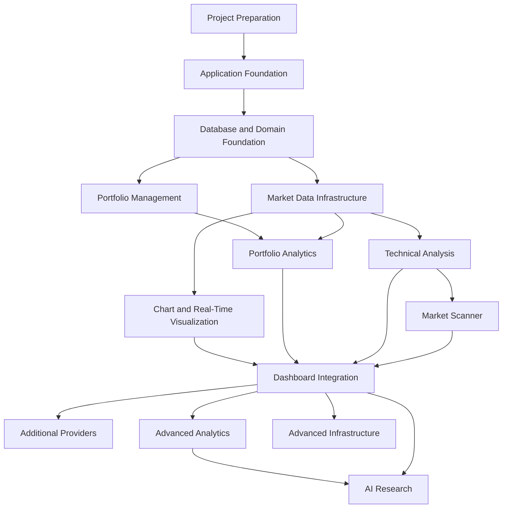

# Development Roadmap
## Personal Investment Management System (PIMS)

**Document Version:** 1.0  
**Project Status:** Planning  
**Document Type:** Development Roadmap  
**Last Updated:** November 2026

---

# 1. Purpose

Dokumen ini menjelaskan tahapan pengembangan Personal Investment Management System (PIMS) dari fondasi proyek hingga pengembangan fitur lanjutan.

Roadmap digunakan untuk:

- Menentukan urutan implementasi.
- Mengidentifikasi dependency antarfitur.
- Menentukan prioritas pengembangan.
- Mendefinisikan deliverables setiap fase.
- Menentukan completion criteria.
- Menghindari implementasi fitur yang terlalu luas sebelum fondasi siap.

Roadmap ini menjadi pedoman bagi OpenCode dalam menyusun implementation plan dan mengembangkan sistem secara bertahap.

# 2. Development Strategy

PIMS dikembangkan menggunakan pendekatan incremental development.

Setiap fase harus menghasilkan bagian sistem yang dapat diuji sebelum melanjutkan ke fase berikutnya.

Prinsip pengembangan:

1. Build foundation before features.
2. Prioritize core functionality.
3. Implement one integration at a time.
4. Validate data before building analytics.
5. Build deterministic engines before AI interpretation.
6. Test each module independently.
7. Integrate modules incrementally.
8. Avoid premature optimization.

Pengembangan menggunakan arsitektur Modular Monolith dan tidak memerlukan pemisahan menjadi microservices pada tahap awal.

# 3. Roadmap Overview

Pengembangan dibagi menjadi beberapa fase.

| Phase | Name | Priority |
|---|---|---|
| 0 | Project Preparation | Critical |
| 1 | Application Foundation | Critical |
| 2 | Database and Domain Foundation | Critical |
| 3 | Portfolio Management | Critical |
| 4 | Market Data Infrastructure | Critical |
| 5 | Chart and Real-Time Visualization | High |
| 6 | Portfolio Analytics | High |
| 7 | Technical Analysis | High |
| 8 | Market Scanner | High |
| 9 | Dashboard Integration and Stabilization | High |
| 10 | Additional Market Providers | Medium |
| 11 | Advanced Analytics | Medium |
| 12 | AI Research Assistant | Medium |
| 13 | Advanced Infrastructure | Future |

Fase dapat memiliki pekerjaan yang berjalan secara berurutan atau sebagian paralel apabila dependency-nya sudah terpenuhi.

# 4. Phase 0 — Project Preparation

**Objective:** Memastikan seluruh rancangan proyek siap dibaca dan digunakan sebagai pedoman implementasi.

## Tasks

- Review `AGENTS.md`.
- Review seluruh architecture documentation.
- Review database design.
- Review technical decisions.
- Review project overview.
- Review project scope.
- Review development roadmap.
- Memeriksa konsistensi antar-dokumen.
- Mengidentifikasi keputusan teknis yang belum disetujui.
- Menentukan initial implementation plan.

## Deliverables

- Dokumentasi proyek yang konsisten.
- Daftar keputusan teknis yang disetujui.
- Daftar keputusan yang masih tertunda.
- Initial implementation plan.
- Initial development checklist.

## Completion Criteria

- OpenCode memahami struktur dan batasan arsitektur.
- Tidak terdapat konflik arsitektur yang belum diselesaikan.
- Teknologi utama telah ditentukan.
- Scope MVP telah dipahami.
- Implementasi dapat dimulai tanpa menebak keputusan penting.

# 5. Phase 1 — Application Foundation

**Objective:** Membangun fondasi aplikasi frontend dan backend.

## Tasks

### Frontend

- Initialize Next.js.
- Configure React and TypeScript.
- Configure Tailwind CSS.
- Setup application routing.
- Setup global layout.
- Setup navigation structure.
- Setup reusable UI components.
- Setup frontend configuration.

### Backend

- Initialize Python project.
- Setup FastAPI.
- Setup Pydantic.
- Configure application settings.
- Setup API routing.
- Setup dependency injection approach.
- Setup logging.
- Setup exception handling.

### Infrastructure

- Configure Docker.
- Configure Docker Compose.
- Configure environment variables.
- Create `.env.example`.
- Setup PostgreSQL development environment.

## Deliverables

- Frontend application foundation.
- Backend application foundation.
- Working development environment.
- Basic REST API.
- Initial frontend-backend communication.

## Completion Criteria

- Frontend dapat dijalankan.
- Backend dapat dijalankan.
- Frontend dapat mengakses backend.
- Environment configuration berfungsi.
- Docker development environment berjalan.
- Basic health endpoint tersedia.

# 6. Phase 2 — Database and Domain Foundation

**Objective:** Membangun struktur database dan domain bisnis utama.

## Tasks

### Database

- Configure PostgreSQL.
- Implement database connection.
- Setup ORM sesuai keputusan teknis yang disetujui.
- Setup migration system.
- Implement initial database models.
- Implement repository foundation.

### Core Domain

- Asset domain.
- Market domain.
- Portfolio domain.
- Transaction domain.
- Cash domain.
- Holdings domain.

### Data Integrity

- Define primary keys.
- Define foreign keys.
- Define unique constraints.
- Define transaction validation.
- Define numeric precision.
- Define timestamp handling.

## Deliverables

- Initial database schema.
- Database migrations.
- Domain models.
- Repository foundation.
- Database integration tests.

## Completion Criteria

- Database dapat diakses oleh backend.
- Migration dapat dijalankan.
- Relasi utama berfungsi.
- Domain entities dapat dibuat dan dibaca.
- Data integrity rules telah diuji.

# 7. Phase 3 — Portfolio Management

**Objective:** Membangun fungsi pengelolaan portofolio sebagai fondasi utama PIMS.

## Tasks

### Portfolio Management

- Create portfolio.
- Update portfolio.
- Delete portfolio dengan aturan integritas.
- Retrieve portfolio list.
- Retrieve portfolio details.

### Transaction Management

- Record buy transaction.
- Record sell transaction.
- Record deposit.
- Record withdrawal.
- Retrieve transaction history.
- Validate transaction inputs.

### Holdings

- Calculate holdings from transactions.
- Calculate average acquisition cost sesuai metodologi yang ditetapkan.
- Track cash balance.
- Calculate basic asset quantity.
- Handle transaction corrections melalui aturan audit.

### API

- Portfolio endpoints.
- Transaction endpoints.
- Holdings endpoints.

## Deliverables

- Portfolio Management Module.
- Transaction Management Module.
- Holdings calculation.
- Portfolio REST API.
- Portfolio integration tests.

## Completion Criteria

- Pengguna dapat membuat beberapa portofolio.
- Setiap portofolio memiliki transaksi terpisah.
- Buy dan sell memengaruhi holdings dengan benar.
- Deposit dan withdrawal memengaruhi cash balance.
- Holdings dapat direkonstruksi dari transaksi.
- Validasi transaksi berjalan dengan benar.

# 8. Phase 4 — Market Data Infrastructure

**Objective:** Membangun infrastruktur pengambilan dan pengelolaan market data.

Bybit menjadi provider pertama pada fase ini.

## Tasks

### Provider Integration

- Implement Bybit provider adapter.
- Implement REST API integration.
- Implement WebSocket integration.
- Implement connection lifecycle management.
- Implement reconnect handling.
- Implement subscription management.

### Market Data Processing

- Implement market data ingestion.
- Implement normalization.
- Implement validation.
- Implement candle aggregation jika diperlukan.
- Implement historical data retrieval.
- Implement latest market state.

### Storage

- Implement market data repositories.
- Store historical candles.
- Track provider metadata.
- Track data freshness.
- Track ingestion errors.

## Deliverables

- Bybit provider adapter.
- Market Data Service.
- Historical market data pipeline.
- Real-time market data pipeline.
- Data validation system.
- Market data integration tests.

## Completion Criteria

- Backend dapat mengambil historical market data.
- Backend dapat menerima streaming updates.
- Data memiliki internal format yang konsisten.
- Invalid data dapat ditangani.
- Historical candles dapat disimpan.
- Data freshness dapat ditentukan.
- Provider disconnection dapat ditangani.

# 9. Phase 5 — Chart and Real-Time Visualization

**Objective:** Mengintegrasikan market data dengan frontend chart.

## Tasks

### Chart Foundation

- Install TradingView Lightweight Charts.
- Create chart component.
- Implement candlestick chart.
- Implement line chart.
- Implement volume histogram.
- Implement timeframe selection.
- Implement instrument selection.

### Historical Data

- Connect chart to historical market data API.
- Implement initial candle loading.
- Implement loading states.
- Implement empty states.
- Handle missing historical data.

### Real-Time Updates

- Implement WebSocket client.
- Implement market subscriptions.
- Implement candle updates.
- Implement latest price updates.
- Handle duplicate and out-of-order updates.
- Handle reconnection.
- Display connection and freshness status.

## Deliverables

- Functional chart component.
- Historical chart integration.
- Real-time chart updates.
- WebSocket frontend integration.
- Chart testing.

## Completion Criteria

- Chart dapat menampilkan historical candles.
- Chart dapat menampilkan volume.
- Timeframe dapat diganti.
- Streaming updates dapat memperbarui candle.
- Reconnection tidak menyebabkan data chart rusak.
- Status data ditampilkan secara benar.

# 10. Phase 6 — Portfolio Analytics

**Objective:** Membangun kemampuan evaluasi performa dan risiko portofolio.

## Tasks

### Portfolio Performance Engine

- Portfolio valuation.
- Daily P&L.
- Realized P&L.
- Unrealized P&L.
- Total return.
- Performance history.

### Risk Analysis Engine

- Historical volatility.
- Maximum drawdown.
- Basic Sharpe ratio.
- Portfolio concentration.
- Asset exposure.

### Allocation

- Asset allocation.
- Market allocation.
- Currency exposure jika data mendukung.

### Integration

- Connect engines to portfolio domain.
- Retrieve market prices.
- Implement calculation metadata.
- Store analytics results sesuai kebutuhan.
- Expose analytics through API.

## Deliverables

- Portfolio Performance Engine.
- Basic Risk Analysis Engine.
- Basic Allocation Engine.
- Portfolio analytics API.
- Calculation tests.

## Completion Criteria

- Portfolio value dapat dihitung berdasarkan holdings dan harga.
- P&L dapat diverifikasi menggunakan test cases.
- Risk metrics dapat dihitung dari return series yang valid.
- Allocation mencerminkan komposisi portofolio.
- Hasil memiliki periode dan metadata perhitungan.
- Insufficient data menghasilkan status yang jelas.

# 11. Phase 7 — Technical Analysis

**Objective:** Mengembangkan technical analysis engine untuk instrumen pasar.

## Tasks

- Implement SMA.
- Implement EMA.
- Implement RSI.
- Implement MACD.
- Implement Bollinger Bands.
- Implement ATR.
- Implement configurable parameters.
- Implement historical indicator calculation.
- Integrate indicator output with chart.
- Add indicator validation tests.

## Deliverables

- Technical Analysis Engine.
- Indicator calculation service.
- Technical analysis API.
- Chart indicator integration.
- Unit tests.

## Completion Criteria

- Indikator menghasilkan nilai yang sesuai dengan reference test cases.
- Parameter indikator dapat diubah.
- Historical indicator output tersedia.
- Warm-up period ditangani.
- Hasil dapat divisualisasikan pada chart.

# 12. Phase 8 — Market Scanner

**Objective:** Mengembangkan sistem screening untuk menemukan instrumen berdasarkan kriteria tertentu.

## Tasks

### Market Universe

- Retrieve supported instruments.
- Normalize instrument identity.
- Implement eligibility checks.

### Screening

- Implement technical filters.
- Implement momentum filters.
- Implement volume filters.
- Implement basic trend filters.

### Processing

- Implement metric processing.
- Implement ranking.
- Implement scanner execution.
- Implement scanner result storage.
- Implement execution history.

### Frontend

- Scanner interface.
- Filter configuration.
- Results table.
- Instrument selection.
- Result details.

## Deliverables

- Market Scanner Engine.
- Market universe module.
- Screening processor.
- Ranking module.
- Scanner API.
- Scanner interface.

## Completion Criteria

- Scanner dapat memproses supported market universe.
- Scanner tidak terbatas pada portfolio holdings.
- Filter menghasilkan hasil yang sesuai dengan kondisi.
- Ranking mengikuti aturan yang ditentukan.
- Scanner results memiliki timestamp.
- Kegagalan pemrosesan dapat dilacak.

# 13. Phase 9 — Dashboard Integration and Stabilization

**Objective:** Mengintegrasikan seluruh fitur MVP menjadi aplikasi yang utuh.

## Tasks

- Integrate portfolio overview.
- Integrate market overview.
- Integrate chart interface.
- Integrate analytics widgets.
- Integrate scanner results.
- Implement navigation.
- Implement global loading states.
- Implement error states.
- Improve responsive layout.
- Review UI consistency.
- Run end-to-end tests.
- Resolve integration defects.

## Deliverables

- Integrated PIMS dashboard.
- Functional MVP interface.
- End-to-end test suite.
- MVP stabilization report.

## Completion Criteria

- Pengguna dapat berpindah antar-modul.
- Portfolio data ditampilkan secara konsisten.
- Market data dapat ditampilkan pada dashboard.
- Chart dan analytics terintegrasi.
- Scanner dapat digunakan dari frontend.
- Error states dapat ditampilkan.
- Tidak ada critical integration defects yang belum diselesaikan.

# 14. Phase 10 — Additional Market Providers

**Objective:** Memperluas dukungan pasar.

## Tasks

- Evaluate Finnhub API.
- Evaluate Alpaca API.
- Evaluate Indonesian stock data providers.
- Verify data licensing.
- Verify real-time entitlements.
- Verify rate limits.
- Implement provider adapters.
- Normalize additional instruments.
- Test multi-provider data consistency.

## Deliverables

- Additional provider adapters.
- Expanded market universe.
- Multi-market data support.
- Provider integration documentation.

## Completion Criteria

- Provider dapat digunakan melalui internal provider interface.
- Data dapat dinormalisasi.
- Source metadata tersedia.
- Provider limitations diketahui.
- Data tidak tercampur tanpa aturan source selection yang jelas.

# 15. Phase 11 — Advanced Analytics

**Objective:** Memperluas kemampuan quantitative analytics.

## Tasks

### Correlation Analysis

- Pairwise correlation.
- Correlation matrix.
- Rolling correlation.
- Return alignment.

### Market Regime

- Trend classification.
- Volatility classification.
- Regime history.
- Regime visualization.

### Advanced Risk

- VaR.
- CVaR.
- Beta.
- Stress testing.
- Scenario analysis.

### Additional Engines

- Fundamental Analysis.
- Sentiment Analysis.
- Macro Analysis.
- Factor Analysis.
- Performance Attribution.

## Deliverables

- Advanced analytics engines.
- Additional analytics APIs.
- Analytics visualizations.
- Expanded test suite.

## Completion Criteria

- Setiap engine memiliki input dan output contract.
- Calculation methods terdokumentasi.
- Hasil dapat diuji.
- Data limitations disampaikan.
- Engine tidak memiliki dependency yang tidak diperlukan.

# 16. Phase 12 — AI Research Assistant

**Objective:** Mengintegrasikan AI untuk membantu interpretasi dan penyusunan laporan riset.

## Tasks

### Context Builder

- Retrieve market context.
- Retrieve portfolio context.
- Retrieve analytics results.
- Retrieve available research sources.
- Attach timestamps and provenance.

### AI Integration

- Implement AI provider abstraction.
- Implement request orchestration.
- Implement prompt versioning.
- Implement response validation.
- Implement error handling.

### Research Reports

- Generate structured reports.
- Store research history.
- Track model metadata.
- Display research sources.
- Integrate reports with frontend.

## Deliverables

- AI Research Engine.
- Context Builder.
- AI Provider Adapter.
- Research Report Generator.
- AI Research Interface.

## Completion Criteria

- AI menerima data melalui context yang terstruktur.
- Model provider dapat diganti melalui abstraction layer.
- AI tidak menghitung ulang angka finansial sebagai sumber kebenaran.
- Research reports memiliki metadata.
- Informasi yang tidak tersedia dinyatakan secara jelas.
- Error AI provider ditangani dengan baik.

# 17. Phase 13 — Advanced Infrastructure

**Objective:** Meningkatkan performa, keandalan, dan kesiapan sistem untuk pengembangan lebih lanjut.

## Tasks

- Evaluate Redis integration.
- Evaluate background job processing.
- Implement advanced monitoring.
- Improve database indexing.
- Implement backup automation.
- Improve recovery procedures.
- Evaluate TimescaleDB if time-series workload justifies it.
- Improve security controls.
- Evaluate deployment requirements.

## Deliverables

- Infrastructure improvements.
- Monitoring system.
- Backup and recovery procedures.
- Performance report.
- Deployment documentation.

## Completion Criteria

- Infrastructure improvements memiliki alasan teknis yang jelas.
- Tidak ada komponen tambahan yang dipasang tanpa kebutuhan.
- Backup dan recovery telah diuji.
- Monitoring memberikan informasi operasional yang relevan.
- Performa telah dievaluasi menggunakan workload yang representatif.

# 18. Critical Dependencies

Urutan pengembangan harus memperhatikan dependency berikut.

Beberapa pekerjaan dapat berjalan paralel setelah dependency utamanya terpenuhi.

Contohnya, Portfolio Management dan Market Data Infrastructure dapat dikembangkan secara paralel setelah fondasi database dan aplikasi siap.

# 19. Development Milestones

Roadmap menggunakan milestone berdasarkan hasil yang dapat diuji, bukan hanya jumlah file atau kode yang telah dibuat.

| Milestone | Expected Result |
|---|---|
| M0 | Project documentation ready |
| M1 | Application runs locally |
| M2 | Database and domain foundation ready |
| M3 | Portfolio management functional |
| M4 | Bybit market data integrated |
| M5 | Historical and real-time charts functional |
| M6 | Basic portfolio analytics functional |
| M7 | Technical indicators functional |
| M8 | Basic market scanner functional |
| M9 | MVP integrated and stabilized |
| M10 | Additional markets supported |
| M11 | Advanced analytics available |
| M12 | AI Research Assistant available |

Setiap milestone harus memiliki acceptance criteria dan hasil pengujian.

# 20. Testing Strategy Across Phases

Pengujian harus dilakukan sepanjang pengembangan.

| Test Type | Purpose |
|---|---|
| Unit Tests | Menguji fungsi dan business logic |
| Integration Tests | Menguji komunikasi antar-modul |
| API Tests | Menguji REST endpoints |
| WebSocket Tests | Menguji streaming communication |
| Data Validation Tests | Menguji kualitas data |
| Calculation Tests | Menguji hasil perhitungan |
| Database Tests | Menguji persistence dan integrity |
| End-to-End Tests | Menguji workflow aplikasi |

Pengujian perhitungan finansial harus menggunakan test cases dengan expected results yang dapat diverifikasi.

# 21. OpenCode Execution Rules

OpenCode harus mengikuti ketentuan berikut:

1. Baca dokumen arsitektur dan spesifikasi yang relevan sebelum implementasi.
2. Kerjakan satu fase atau subfase dalam satu waktu.
3. Buat implementation plan sebelum perubahan besar.
4. Jangan mengimplementasikan fitur Post-MVP tanpa persetujuan.
5. Jangan melewati dependency penting.
6. Jangan membuat folder atau modul masa depan hanya untuk terlihat lengkap.
7. Jangan mengubah keputusan teknologi tanpa persetujuan.
8. Jalankan pengujian setelah implementasi.
9. Perbarui dokumentasi jika terdapat perubahan yang disetujui.
10. Laporkan hasil pekerjaan dan pekerjaan yang belum selesai.

Setiap fase harus memiliki laporan:

- Completed tasks.
- Files created or modified.
- Tests executed.
- Test results.
- Known issues.
- Remaining tasks.
- Proposed architectural changes, if any.

# 22. Roadmap Change Management

Roadmap dapat berubah berdasarkan hasil implementasi dan evaluasi teknis.

Namun, setiap perubahan harus:

- Memiliki alasan yang jelas.
- Memperhatikan dependency.
- Mempertimbangkan dampak terhadap arsitektur.
- Mempertimbangkan kompleksitas pengembangan.
- Mendapatkan persetujuan Product Owner jika memengaruhi scope atau keputusan utama.

OpenCode tidak boleh menganggap roadmap sebagai izin untuk mengimplementasikan semua fase sekaligus.

---

# Final Principle

PIMS harus dikembangkan secara bertahap dengan memperhatikan dependency dan kesiapan setiap komponen.

Prioritas utama adalah menghasilkan MVP yang benar-benar berfungsi, memiliki data yang dapat dipercaya, perhitungan yang dapat diverifikasi, dan arsitektur yang dapat dikembangkan.

**Keberhasilan setiap fase ditentukan oleh hasil yang dapat diuji, bukan sekadar kode yang telah ditulis.**