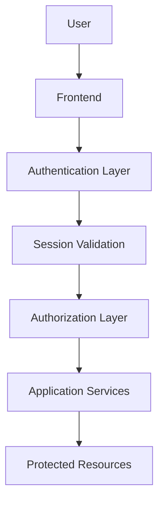

# Security Specification
## Personal Investment Management System (PIMS)

**Document Version:** 1.0  
**Project Status:** Planning  
**Document Type:** Security Specification  
**Last Updated:** November 2026

---

# 1. Purpose

Dokumen ini mendefinisikan security requirements dan security architecture untuk Personal Investment Management System (PIMS).

PIMS mengelola data portfolio, transaksi finansial, market data, analytical results, dan AI research information. Oleh karena itu, keamanan harus menjadi bagian dari keseluruhan system architecture.

Tujuan utama:

- Melindungi portfolio dan transaction data.
- Melindungi API credentials dan environment secrets.
- Mencegah unauthorized access.
- Mengamankan REST API dan WebSocket connections.
- Melindungi database dari akses tidak sah.
- Mengamankan external provider integrations.
- Mencegah kebocoran data melalui AI providers.
- Mencegah penyalahgunaan internal tools.
- Menyediakan auditability.
- Menjaga data integrity.
- Mengurangi risiko security vulnerabilities.

Dokumen ini menjadi acuan implementasi keamanan oleh OpenCode.

# 2. Security Principles

Security architecture PIMS harus mengikuti prinsip berikut.

## 2.1 Defense in Depth

Keamanan tidak boleh bergantung pada satu mekanisme.

Sistem harus memiliki beberapa lapisan perlindungan:

- Frontend security.
- API security.
- Application security.
- Database security.
- Infrastructure security.
- External integration security.
- AI security.

## 2.2 Least Privilege

Setiap komponen hanya boleh memperoleh akses yang diperlukan untuk menjalankan tugasnya.

Contoh:

- Frontend tidak boleh mengakses database secara langsung.
- Market data adapters tidak membutuhkan portfolio write permissions.
- AI Research Engine tidak membutuhkan unrestricted database access.
- Provider credentials hanya dapat diakses oleh backend components yang membutuhkannya.

## 2.3 Secure by Default

Default configuration harus mengutamakan keamanan.

Contoh:

- API tidak boleh terbuka tanpa alasan.
- Debug mode tidak boleh aktif pada production.
- Secrets tidak boleh disimpan dalam source code.
- Unnecessary network ports tidak boleh diekspos.
- Unauthenticated access harus ditolak untuk protected resources.

## 2.4 Fail Securely

Jika security validation gagal, sistem harus menolak operasi yang bersangkutan.

Kegagalan authentication, authorization, atau input validation tidak boleh menyebabkan akses otomatis diberikan.

## 2.5 Data Minimization

Sistem hanya boleh mengumpulkan, menyimpan, dan mengirim data yang diperlukan.

Data portfolio tidak boleh dikirim ke external services tanpa kebutuhan dan kebijakan yang jelas.

# 3. Security Scope

Security requirements mencakup seluruh komponen berikut.

| Component | Security Responsibility |
|---|---|
| Frontend | Secure session and data handling |
| REST API | Authentication, authorization, validation |
| WebSocket | Connection and subscription security |
| Backend | Business logic and access control |
| Database | Data integrity and access restrictions |
| Market Data Providers | Secure external integrations |
| AI Research | Prompt injection and data privacy |
| Infrastructure | Network and environment security |
| Logging | Sensitive information protection |

# 4. Threat Model

PIMS harus mempertimbangkan berbagai potensi ancaman.

## 4.1 Threat Categories

| Threat | Description |
|---|---|
| Unauthorized Access | Akses tanpa izin |
| Credential Leakage | Kebocoran API keys dan secrets |
| SQL Injection | Manipulasi database queries |
| Cross-Site Scripting | Penyisipan script berbahaya |
| CSRF | Pemalsuan request melalui browser |
| Broken Access Control | Akses resource yang tidak sesuai |
| WebSocket Abuse | Penyalahgunaan koneksi realtime |
| Data Exposure | Kebocoran informasi finansial |
| Prompt Injection | Manipulasi AI melalui external content |
| Dependency Vulnerability | Kerentanan third-party packages |
| Denial of Service | Gangguan ketersediaan sistem |
| Misconfiguration | Kesalahan konfigurasi keamanan |

## 4.2 Security Priorities

Prioritas utama:

1. Credential protection.
2. Portfolio and transaction data protection.
3. Authentication and authorization.
4. API and WebSocket security.
5. Database security.
6. External provider security.
7. AI Research security.
8. Logging and monitoring.

# 5. Authentication

Authentication digunakan untuk memverifikasi identitas pengguna sebelum mengakses protected resources.

## 5.1 Authentication Requirements

Jika authentication diaktifkan:

- Pengguna harus melalui authentication process.
- Protected API endpoints harus memerlukan valid session.
- Invalid credentials harus ditolak.
- Session expiration harus diterapkan.
- Logout harus mengakhiri session.
- Authentication failures harus dicatat tanpa menyimpan password atau token.

## 5.2 Authentication Architecture

Authentication architecture harus dapat dikembangkan tanpa mengubah seluruh business modules.

Conceptual flow:



## 5.3 Authentication Status

Authentication implementation masih memerlukan keputusan lebih lanjut.

OpenCode tidak boleh menganggap authentication provider atau identity management solution telah dipilih.

Jika MVP berjalan secara local-only tanpa authentication, akses jaringan harus dibatasi secara eksplisit dan tidak boleh diasumsikan aman hanya karena aplikasi memiliki frontend lokal.

# 6. Authorization and Access Control

Authorization menentukan resource dan operasi yang boleh diakses oleh pengguna atau komponen sistem.

## 6.1 Access Control Requirements

- Setiap protected operation harus melalui authorization checks.
- Backend menjadi sumber kebenaran untuk permission validation.
- Frontend visibility tidak boleh menjadi satu-satunya access control.
- Resource ownership harus divalidasi.
- API tidak boleh mempercayai resource identifiers dari frontend tanpa pemeriksaan.

## 6.2 Resource Isolation

Portfolio, transactions, research reports, dan private settings harus memiliki access boundaries yang jelas.

Untuk arsitektur multi-user di masa depan, data ownership harus dapat dikaitkan dengan user identity.

## 6.3 Internal Service Permissions

Internal modules harus menggunakan explicit service interfaces.

Contoh:

| Component | Allowed Access |
|---|---|
| Frontend | Approved REST and WebSocket APIs |
| Portfolio Service | Portfolio domain data |
| Market Data Service | Market data domain |
| Technical Engine | Normalized market data |
| Risk Engine | Approved portfolio and market data contracts |
| Scanner | Market data and analytical outputs |
| AI Research | Approved research tools and structured outputs |

AI tidak boleh memperoleh unrestricted access terhadap internal services.

# 7. API Security

REST API merupakan jalur utama komunikasi frontend dan backend.

## 7.1 Input Validation

Seluruh API inputs harus divalidasi menggunakan backend validation schemas.

Validasi meliputi:

- Data types.
- Required fields.
- String lengths.
- Numeric ranges.
- UUID formats.
- Timestamp formats.
- Supported enum values.
- Pagination limits.
- Query parameter constraints.

## 7.2 SQL Injection Prevention

- Gunakan parameterized database queries.
- Hindari raw SQL yang menggabungkan user input.
- Jangan menerima arbitrary SQL statements.
- Validasi sorting dan filtering parameters.
- Gunakan approved repository/data access patterns.

## 7.3 Request Limits

API harus memiliki configurable limits untuk:

- Request body size.
- Pagination size.
- Request frequency.
- Query execution duration.
- Concurrent requests.
- Expensive analytics operations.

## 7.4 Error Handling

API errors tidak boleh mengungkapkan:

- Database credentials.
- API keys.
- Internal stack traces.
- Sensitive filesystem paths.
- Private configuration.
- Internal infrastructure details.

Gunakan standardized error responses.

## 7.5 CORS

CORS harus membatasi origin yang diizinkan.

Production tidak boleh menggunakan unrestricted wildcard origins untuk credentialed requests.

Allowed origins harus dikonfigurasi melalui environment configuration.

## 7.6 CSRF Protection

Jika authentication menggunakan cookie-based sessions:

- Terapkan CSRF protections untuk state-changing requests.
- Gunakan appropriate SameSite cookie settings.
- Validasi request origin jika sesuai.

Jika menggunakan token-based authentication, mekanisme perlindungan harus disesuaikan dengan cara token disimpan dan dikirim.

# 8. WebSocket Security

WebSocket digunakan untuk market updates, portfolio valuation events, dan scanner notifications.

## 8.1 Connection Security

- Production harus menggunakan WSS.
- Connection origin harus divalidasi.
- Protected channels harus memerlukan authorization.
- Invalid connection requests harus ditolak.
- Connection limits harus diterapkan.

## 8.2 Subscription Security

Setiap subscription request harus divalidasi.

Backend harus memeriksa:

- Channel availability.
- Symbol validity.
- Subscription limits.
- User permissions.
- Resource ownership jika relevan.

## 8.3 WebSocket Abuse Prevention

- Batasi jumlah subscriptions.
- Batasi ukuran pesan.
- Terapkan heartbeat timeout.
- Terapkan connection throttling.
- Batasi command frequency.
- Tolak malformed messages.
- Hindari unrestricted broadcast.

## 8.4 Provider Credential Protection

Provider WebSocket connections harus dikelola backend.

Frontend tidak boleh menerima private provider credentials.

Public market data subscriptions dan private account subscriptions harus memiliki permission boundaries yang berbeda.

# 9. Secrets and Credential Management

Credential protection merupakan salah satu security requirements terpenting.

## 9.1 Sensitive Secrets

Contoh secrets:

- Bybit API credentials.
- Finnhub API key.
- Alpaca API credentials.
- LLM provider API keys.
- Database credentials.
- Authentication secrets.
- Session signing keys.

## 9.2 Environment Configuration

Secrets harus disimpan melalui secure environment configuration.

Contoh variable names:

```env
BYBIT_API_KEY=
BYBIT_API_SECRET=

FINNHUB_API_KEY=

ALPACA_API_KEY=
ALPACA_API_SECRET=

LLM_API_KEY=

DATABASE_URL=

APP_SECRET_KEY=
```

File `.env` tidak boleh masuk ke Git.

File `.env.example` hanya boleh berisi placeholder tanpa credentials asli.

## 9.3 Secret Handling Rules

- Jangan hardcode secrets.
- Jangan menampilkan secrets dalam logs.
- Jangan mengirim secrets ke frontend.
- Jangan memasukkan secrets ke AI prompts.
- Jangan menyimpan secrets sebagai plaintext database records.
- Jangan memasukkan secrets ke error responses.
- Batasi akses secrets berdasarkan komponen yang membutuhkan.

## 9.4 Credential Rotation

Sistem harus mendukung penggantian credentials tanpa mengharuskan perubahan source code.

Jika credential diduga bocor:

- Nonaktifkan credential terkait.
- Buat credential pengganti melalui provider resmi.
- Perbarui environment configuration.
- Periksa logs untuk aktivitas mencurigakan.
- Pastikan credential lama tidak lagi digunakan.

# 10. Database Security

Database menyimpan data portfolio dan financial history yang bersifat penting.

## 10.1 Database Access

- Database tidak boleh diakses langsung oleh frontend.
- Database harus berada di network boundary yang sesuai.
- Gunakan dedicated database credentials.
- Hindari penggunaan database superuser oleh aplikasi.
- Batasi database permissions.
- Gunakan TLS untuk koneksi yang memerlukan perlindungan jaringan.

## 10.2 Data Integrity

- Gunakan foreign keys.
- Gunakan unique constraints.
- Gunakan appropriate check constraints.
- Gunakan atomic database transactions.
- Terapkan idempotency pada financial write operations.
- Hindari destructive updates terhadap transaction history.

## 10.3 Backup Security

- Backup harus dilindungi.
- Backup access harus dibatasi.
- Backup harus mengikuti retention policy.
- Backup recovery harus diuji.
- Production backup tidak boleh disimpan pada public location.

## 10.4 Sensitive Data

Jangan menyimpan informasi sensitif yang tidak diperlukan.

Jika authentication ditambahkan, password harus disimpan menggunakan secure password hashing algorithm, bukan plaintext atau reversible encryption.

# 11. Frontend Security

Frontend harus diperlakukan sebagai untrusted environment.

## 11.1 Sensitive Information

Frontend tidak boleh menyimpan:

- Provider API secrets.
- Database credentials.
- LLM API keys.
- Private signing keys.
- Internal privileged configuration.

## 11.2 XSS Prevention

- Hindari rendering untrusted HTML.
- Sanitize external content jika HTML rendering benar-benar diperlukan.
- Gunakan safe rendering patterns.
- Hindari penggunaan dangerous HTML injection APIs.
- Jangan menganggap AI-generated content sebagai trusted HTML.

## 11.3 Browser Storage

Sensitive credentials tidak boleh disimpan dalam localStorage atau sessionStorage.

Session handling harus mengikuti authentication design yang telah disetujui.

## 11.4 Dependency Security

- Gunakan trusted packages.
- Hindari dependency yang tidak diperlukan.
- Periksa dependency vulnerabilities.
- Perbarui vulnerable packages.
- Review third-party package permissions dan behavior.

# 12. External Provider Security

PIMS berkomunikasi dengan external market data providers dan AI providers.

## 12.1 Provider Integration

- Gunakan official provider endpoints jika tersedia.
- Validasi provider responses.
- Terapkan request timeouts.
- Tangani provider errors.
- Terapkan rate limits.
- Jangan mempercayai external payload tanpa validation.
- Jangan mengirim private portfolio information tanpa kebutuhan yang disetujui.

## 12.2 Provider Credentials

Setiap provider credential harus:

- Disimpan secara backend-only.
- Memiliki akses minimum yang diperlukan.
- Dapat diganti.
- Tidak ditampilkan dalam logs.
- Tidak dikirim melalui frontend requests.

## 12.3 Bybit Integration

Untuk MVP:

- Prioritaskan public market data endpoints.
- Private account permissions tidak diperlukan.
- Trading permissions tidak diperlukan.
- Withdrawal permissions tidak boleh digunakan.

## 12.4 US Stock and IDX Providers

Finnhub, Alpaca, dan Yahoo Finance integrations harus mengikuti provider terms dan credential handling requirements.

Jangan menyimpan atau mendistribusikan data yang melanggar provider licensing terms.

# 13. AI Research Security

AI Research Engine membutuhkan perlindungan tambahan karena menggunakan LLM dan external information sources.

## 13.1 Prompt Injection

External sources harus diperlakukan sebagai untrusted data.

Contoh sumber:

- News articles.
- Websites.
- Research documents.
- Financial reports.
- User-provided text.

Sistem harus memisahkan trusted system instructions dari retrieved content.

## 13.2 Tool Access Control

AI tools harus menggunakan approved internal interfaces.

AI tidak boleh:

- Menjalankan arbitrary SQL.
- Mengakses unrestricted filesystem.
- Membaca environment secrets.
- Menjalankan arbitrary shell commands.
- Mengubah portfolio records tanpa explicit approved workflow.
- Melakukan financial transactions.

## 13.3 Data Minimization

Sebelum mengirim context ke external LLM:

- Ambil hanya data yang diperlukan.
- Hilangkan credentials.
- Hindari unnecessary personal identifiers.
- Batasi historical context.
- Evaluasi apakah portfolio information perlu dikirim.

## 13.4 Output Validation

LLM output harus divalidasi sebelum ditampilkan atau disimpan.

Validasi mencakup:

- Structured output schema.
- Citation metadata.
- Numeric consistency.
- Missing data disclosures.
- Unexpected tool requests.
- Unsafe or unsupported instructions.

## 13.5 External AI Provider Privacy

Pemilihan LLM provider harus mempertimbangkan:

- Data retention policies.
- Data usage policies.
- Privacy terms.
- API security.
- Regional processing requirements jika relevan.

Jangan mengasumsikan semua LLM providers memiliki kebijakan data handling yang sama.

# 14. Logging and Monitoring

Logging digunakan untuk membantu debugging, operational monitoring, dan security investigation.

## 14.1 Security Events

Sistem harus dapat mencatat:

- Authentication failures.
- Authorization failures.
- Invalid API requests.
- Provider authentication failures.
- Unusual WebSocket activity.
- Repeated request failures.
- Database errors.
- Suspicious tool access attempts.
- Configuration changes.
- Financial record modifications.

## 14.2 Sensitive Log Protection

Logs tidak boleh memuat:

- Passwords.
- API keys.
- Access tokens.
- Session secrets.
- Database credentials.
- Unnecessary private portfolio data.

## 14.3 Monitoring

Security monitoring dapat mencakup:

- Request error rates.
- Failed authentication counts.
- Unusual connection activity.
- Provider integration failures.
- Database connection anomalies.
- Resource consumption.
- Unexpected application restarts.

Alert thresholds dapat dikonfigurasi sesuai kebutuhan deployment.

# 15. Infrastructure and Deployment Security

## 15.1 Docker Security

- Gunakan trusted base images.
- Hindari menjalankan container sebagai root jika tidak diperlukan.
- Jangan memasukkan secrets ke image layers.
- Batasi exposed ports.
- Gunakan environment configuration.
- Hindari privileged containers tanpa kebutuhan yang jelas.
- Periksa dependency dan image vulnerabilities.

## 15.2 Network Security

- Database ports tidak boleh diekspos ke public internet.
- Backend ports harus dibatasi sesuai deployment topology.
- Gunakan HTTPS untuk production.
- Gunakan WSS untuk production WebSocket.
- Batasi network communication antar-komponen.

## 15.3 Production Configuration

Production harus memiliki:

- Debug mode disabled.
- Secure environment variables.
- Restricted CORS.
- Proper HTTPS configuration.
- Database access restrictions.
- Secure logs.
- Backup policy.
- Appropriate monitoring.

## 15.4 Development Environment

Development environment tetap harus mengikuti credential protection rules.

Local development bukan alasan untuk memasukkan secrets ke Git atau mengekspos database tanpa perlindungan.

# 16. Dependency and Supply Chain Security

PIMS menggunakan third-party libraries dan packages.

OpenCode harus:

- Menggunakan dependency yang relevan.
- Menghindari package yang tidak terpelihara jika terdapat alternatif yang lebih baik.
- Memeriksa known vulnerabilities.
- Mengunci dependency versions melalui lockfiles jika package manager mendukung.
- Memeriksa dependency updates.
- Menghindari menjalankan untrusted installation scripts.
- Memastikan package licenses sesuai kebutuhan proyek.

Dependency security checks harus menjadi bagian dari development workflow.

# 17. Data Protection and Recovery

## 17.1 Data Classification

Data harus dikelompokkan berdasarkan tingkat sensitivitas.

| Classification | Examples | Protection |
|---|---|---|
| Public | Public market data | Standard validation |
| Internal | Application configuration | Restricted access |
| Sensitive | Portfolio and transaction records | Access control and protected storage |
| Secret | API keys and database credentials | Secure secret storage |

## 17.2 Data Protection

- Gunakan transport encryption.
- Batasi database access.
- Lindungi backup files.
- Hindari unnecessary data duplication.
- Terapkan retention policies.
- Pastikan data deletion mengikuti kebijakan yang disetujui.

## 17.3 Recovery

Sistem harus memiliki prosedur untuk:

- Database backup.
- Database restore.
- Configuration recovery.
- Credential replacement.
- Application restart.
- Data integrity verification.

Backup dianggap valid hanya setelah recovery procedure diuji.

# 18. Security Testing Requirements

Security testing harus dilakukan selama development.

## 18.1 Authentication Tests

Jika authentication telah diimplementasikan:

- Valid login.
- Invalid login.
- Expired session.
- Logout.
- Unauthorized resource access.

## 18.2 API Security Tests

- Invalid input.
- SQL injection attempts.
- Oversized request.
- Invalid UUID.
- Unauthorized operations.
- CORS behavior.
- Rate limiting.

## 18.3 WebSocket Security Tests

- Invalid connection.
- Unauthorized subscription.
- Invalid message.
- Excessive subscriptions.
- Oversized message.
- Connection throttling.

## 18.4 Database Security Tests

- Permission restrictions.
- Referential integrity.
- Transaction atomicity.
- Idempotency.
- Backup restoration.

## 18.5 AI Security Tests

- Prompt injection.
- Untrusted external instructions.
- Unauthorized tool requests.
- Secret exposure attempts.
- Invalid structured output.
- Citation validation.

## 18.6 Dependency Security Tests

- Vulnerable package detection.
- Outdated dependency review.
- Lockfile consistency.
- Container image scanning where applicable.

# 19. Security Incident Response

Jika terjadi security incident, sistem dan pengembang harus mengikuti proses yang terstruktur.

## 19.1 Incident Categories

- Credential exposure.
- Unauthorized access.
- Sensitive data exposure.
- Database compromise.
- Malicious dependency.
- Provider credential abuse.
- AI data leakage.

## 19.2 Response Process

1. Identify the incident.
2. Determine affected components.
3. Restrict affected access.
4. Revoke compromised credentials if necessary.
5. Preserve relevant logs.
6. Assess potential data exposure.
7. Restore secure configuration.
8. Verify system integrity.
9. Document the incident.
10. Implement preventive improvements.

## 19.3 Recovery Requirements

Recovery harus memastikan:

- Compromised credentials tidak digunakan kembali.
- Unauthorized access telah dibatasi.
- Data integrity telah diperiksa.
- Application configuration telah diverifikasi.
- Relevant security tests telah dijalankan.

# 20. Security Implementation Roadmap

## Phase 1 — Foundation Security

- Environment secrets management.
- `.gitignore` configuration.
- Backend-only provider credentials.
- Input validation.
- Secure error handling.
- Database access restrictions.

## Phase 2 — API and WebSocket Security

- API validation.
- CORS configuration.
- Rate limiting.
- WebSocket origin validation.
- Subscription authorization.
- Connection limits.

## Phase 3 — Data Security

- Database permissions.
- Transaction integrity.
- Backup protection.
- Logging restrictions.
- Data retention policy.

## Phase 4 — AI Security

- Prompt injection protections.
- Tool access restrictions.
- Context minimization.
- Output validation.
- External provider privacy review.

## Phase 5 — Production Security

- HTTPS and WSS.
- Restricted network exposure.
- Container security.
- Dependency scanning.
- Monitoring.
- Recovery testing.

Authentication and multi-user authorization must be implemented according to separately approved requirements.

# 21. Decisions Requiring Approval

| Decision | Current Status |
|---|---|
| Authentication provider | Requires approval |
| Session management strategy | Requires approval |
| Single-user or multi-user access model | Requires approval |
| Password authentication | Deferred |
| OAuth integration | Deferred |
| Role-based access control | Deferred |
| API rate-limit thresholds | Requires approval |
| Database encryption at rest | Deployment-dependent |
| Secret management platform | Requires approval |
| Audit log retention | Requires approval |
| AI provider data-sharing policy | Requires approval |
| Backup retention policy | Requires approval |
| Production hosting security configuration | Deferred |

OpenCode tidak boleh menganggap seluruh keputusan di atas sudah ditetapkan.

# 22. Acceptance Criteria

Security implementation dinyatakan memenuhi spesifikasi apabila:

- Secrets tidak disimpan dalam source code.
- `.env` tidak masuk ke Git.
- `.env.example` tidak mengandung credentials asli.
- Provider credentials hanya digunakan backend.
- Frontend tidak memiliki direct database access.
- API inputs divalidasi.
- Database queries menggunakan safe parameterization.
- Protected operations memiliki authorization checks sesuai authentication model yang disetujui.
- WebSocket subscriptions divalidasi.
- Sensitive logs dihindari.
- Database integrity constraints diterapkan.
- External provider responses divalidasi.
- AI tools menggunakan controlled interfaces.
- Prompt injection protections tersedia.
- LLM context tidak mengandung unnecessary secrets atau personal information.
- Production configuration tidak menggunakan debug mode.
- Dependency security checks tersedia.
- Backup dan recovery procedures dapat diuji.
- Security tests tersedia dan dapat dijalankan.

# 23. Related Documents

- `AGENTS.md`
- `docs/architecture/system-architecture.md`
- `docs/architecture/application-architecture.md`
- `docs/architecture/data-flow.md`
- `docs/database/database-design.md`
- `docs/decisions/technical-decisions.md`
- `specifications/project/project-overview.md`
- `specifications/project/project-scope.md`
- `specifications/backend/backend-spec.md`
- `specifications/backend/api-spec.md`
- `specifications/backend/websocket-spec.md`
- `specifications/database/schema-spec.md`
- `specifications/data/provider-integration-spec.md`
- `specifications/engines/ai-research-spec.md`

---

# Final Principle

Security harus menjadi bagian dari seluruh PIMS architecture, bukan hanya fitur tambahan pada backend.

Prioritas utama adalah melindungi portfolio records, transaction history, provider credentials, dan external integrations.

Setiap komponen harus menggunakan akses minimum yang diperlukan, memvalidasi input, menjaga data integrity, dan menghindari kebocoran informasi sensitif.

OpenCode harus mengimplementasikan security requirements secara bertahap dan tidak boleh menganggap aplikasi aman hanya karena berjalan pada lingkungan lokal.