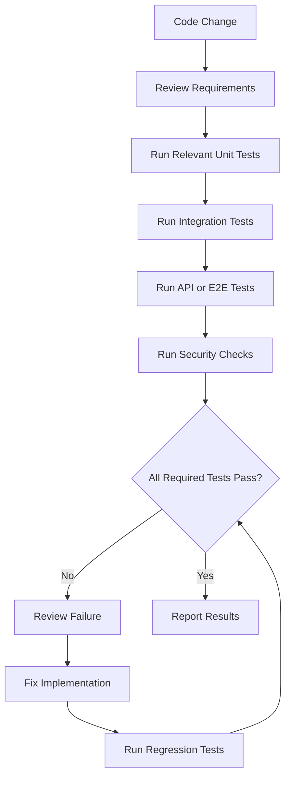

# Testing Requirements
## Personal Investment Management System (PIMS)

**Document Version:** 1.0  
**Project Status:** Planning  
**Document Type:** Testing Specification  
**Last Updated:** November 2026

---

# 1. Purpose

Dokumen ini mendefinisikan testing strategy dan quality assurance requirements untuk Personal Investment Management System (PIMS).

Testing merupakan bagian wajib dari development lifecycle untuk memastikan seluruh komponen sistem berjalan sesuai spesifikasi.

Tujuan utama:

- Memastikan application functionality berjalan dengan benar.
- Memastikan financial calculations memiliki hasil yang akurat.
- Memastikan market data diproses dengan benar.
- Memastikan provider integrations berfungsi sesuai kontrak.
- Memastikan REST API dan WebSocket berjalan sesuai spesifikasi.
- Memastikan portfolio transactions memiliki data integrity.
- Memastikan analytical engines menghasilkan output yang valid.
- Memastikan Market Scanner menghasilkan screening results yang konsisten.
- Memastikan AI Research Engine tidak menghasilkan output yang menyesatkan.
- Mengidentifikasi security vulnerabilities.
- Mencegah regression ketika fitur baru ditambahkan.

OpenCode wajib menjalankan pengujian yang relevan setelah implementasi atau perubahan kode.

# 2. Testing Principles

## 2.1 Test Before Completion

Implementasi tidak dianggap selesai hanya karena aplikasi dapat dijalankan.

Setiap fitur harus memiliki pengujian yang sesuai dengan fungsinya.

## 2.2 Correctness Over Coverage

Prioritas utama adalah kebenaran hasil, terutama pada:

- Portfolio valuation.
- Transaction processing.
- Financial calculations.
- Market data normalization.
- Technical indicators.
- Risk metrics.
- Allocation calculations.
- Correlation calculations.

High test coverage tidak menjamin hasil benar jika expected results atau test cases tidak tepat.

## 2.3 Automated Testing

Pengujian yang dapat diotomatisasi harus dibuat sebagai automated tests.

Manual testing tetap diperlukan untuk aspek visual, usability, dan workflow yang sulit diuji secara otomatis.

## 2.4 Deterministic Testing

Test cases harus menghasilkan hasil yang konsisten.

Hindari penggunaan live market data sebagai satu-satunya sumber dalam unit dan integration tests.

Gunakan fixtures dan controlled datasets untuk pengujian yang dapat direproduksi.

## 2.5 Independent Module Testing

Setiap engine harus dapat diuji secara terpisah tanpa harus menjalankan seluruh aplikasi.

## 2.6 Regression Prevention

Setiap perbaikan bug penting harus disertai regression test agar masalah yang sama tidak muncul kembali.

# 3. Testing Scope

Testing mencakup seluruh sistem.

| Component | Testing Focus |
|---|---|
| Frontend | UI, components, state, interactions |
| Backend | Business logic and application services |
| Database | Integrity, relationships, migrations |
| REST API | Contracts, validation, responses |
| WebSocket | Connections, subscriptions, events |
| Market Data | Provider integration and normalization |
| Portfolio Engine | Transactions, holdings, valuation |
| Technical Analysis | Indicator correctness |
| Risk Engine | Risk calculation correctness |
| Allocation Engine | Portfolio distribution |
| Correlation Engine | Statistical correctness |
| Market Regime | Classification consistency |
| Market Scanner | Screening and ranking |
| AI Research | Context, citations, output validation |
| Security | Access control and vulnerability checks |
| Infrastructure | Configuration and deployment |

# 4. Testing Levels

PIMS harus menggunakan beberapa tingkat pengujian.

## 4.1 Unit Testing

Unit tests digunakan untuk menguji fungsi atau class secara terisolasi.

Contoh:

- Transaction validation.
- Portfolio calculation functions.
- Market data normalization.
- Indicator calculations.
- Risk metric calculations.
- Scanner filter evaluation.
- AI output validation.

Unit tests harus cepat, deterministic, dan tidak bergantung pada external services.

## 4.2 Integration Testing

Integration tests digunakan untuk menguji interaksi antar-komponen.

Contoh:

- Provider Adapter dengan Normalization Layer.
- Market Data Service dengan PostgreSQL.
- Portfolio Service dengan transaction repository.
- Risk Engine dengan Portfolio data contracts.
- Scanner dengan Technical Analysis outputs.
- AI Research dengan internal analytical services.

Gunakan test database atau isolated environment.

## 4.3 API Testing

API tests memastikan REST endpoints memenuhi API specification.

Pengujian meliputi:

- HTTP methods.
- Request validation.
- Response structure.
- Status codes.
- Error responses.
- Pagination.
- Idempotency.
- Authorization jika telah diimplementasikan.

## 4.4 WebSocket Testing

WebSocket tests memastikan realtime communication berjalan sesuai protokol.

Pengujian meliputi:

- Connection lifecycle.
- Subscription.
- Unsubscription.
- Event payload validation.
- Heartbeat.
- Reconnection.
- Invalid message handling.
- Connection limits.
- Authorization jika diterapkan.

## 4.5 End-to-End Testing

End-to-end tests menguji workflow dari frontend hingga backend.

Contoh:

1. Pengguna membuka dashboard.
2. Sistem mengambil portfolio overview.
3. Market data ditampilkan.
4. Pengguna membuka asset chart.
5. Historical candles dimuat.
6. Realtime candle updates diterima.
7. Pengguna membuka analytics.
8. Sistem menampilkan hasil perhitungan backend.

E2E tests harus menggunakan test data yang terkontrol.

## 4.6 Performance Testing

Performance tests digunakan untuk mengukur kemampuan sistem menangani workload.

Contoh:

- Market data ingestion.
- Candle retrieval.
- WebSocket event distribution.
- Scanner execution.
- Portfolio valuation.
- Analytics calculation.
- Concurrent API requests.

## 4.7 Security Testing

Security tests digunakan untuk mengidentifikasi kelemahan keamanan.

Contoh:

- Invalid API inputs.
- SQL injection attempts.
- Unauthorized access.
- Credential exposure.
- WebSocket abuse.
- Prompt injection.
- Dependency vulnerabilities.

# 5. Testing Environment

Pengujian harus memiliki environment yang terpisah dari production.

## 5.1 Environment Categories

| Environment | Purpose |
|---|---|
| Local Development | Developer testing |
| Automated Test | Unit and integration tests |
| Staging | Pre-release validation |
| Production | Actual application environment |

Staging dapat diperkenalkan ketika deployment architecture telah ditentukan.

## 5.2 Test Database

Gunakan database terpisah untuk automated tests.

Requirements:

- Test data tidak boleh mengubah production data.
- Database harus dapat di-reset.
- Test fixtures harus konsisten.
- Test migrations harus diuji.
- Test execution harus membersihkan data sementara.

## 5.3 External Service Isolation

Unit tests tidak boleh bergantung pada live provider availability.

Gunakan:

- Mock providers.
- Stub responses.
- Recorded fixtures.
- Controlled test endpoints jika tersedia.

Live provider integration tests dapat dijalankan secara terpisah dan tidak harus menjadi bagian dari setiap test run.

# 6. Test Data and Fixtures

Test data harus mewakili berbagai kondisi yang dapat terjadi dalam sistem.

## 6.1 Market Data Fixtures

Sediakan fixtures untuk:

- Valid OHLCV candles.
- Missing candles.
- Duplicate candles.
- Out-of-order events.
- Invalid prices.
- Zero volume.
- High volatility periods.
- Flat market conditions.
- Historical data.
- Delayed data.
- Stale data.

## 6.2 Portfolio Fixtures

Sediakan fixtures untuk:

- Empty portfolio.
- Single-asset portfolio.
- Multiple-asset portfolio.
- Multiple-currency portfolio.
- Buy transactions.
- Sell transactions.
- Deposit.
- Withdrawal.
- Fees.
- Dividends.
- Partial transaction history.
- Missing price data.

## 6.3 Analytics Fixtures

Sediakan datasets untuk:

- Increasing prices.
- Decreasing prices.
- Sideways prices.
- High volatility.
- Low volatility.
- Highly correlated returns.
- Negatively correlated returns.
- Uncorrelated returns.
- Insufficient observations.
- Missing observations.

## 6.4 AI Research Fixtures

Sediakan test cases untuk:

- Complete internal analytical outputs.
- Missing engine outputs.
- Conflicting external sources.
- Invalid source metadata.
- Stale market data.
- Invalid LLM responses.
- Prompt injection content.
- Unsupported quantitative claims.

# 7. Frontend Testing Requirements

Frontend menggunakan Next.js, React, TypeScript, dan Tailwind.

## 7.1 Component Testing

Komponen yang memiliki logic atau interaksi harus diuji.

Contoh:

- Portfolio Summary.
- Portfolio Selector.
- Market Overview.
- Holdings Table.
- Chart Container.
- Scanner Results Table.
- Analytics Widgets.
- Research Report Viewer.

Pengujian harus memastikan:

- Component renders correctly.
- Props are handled correctly.
- Loading states work.
- Error states work.
- Empty states work.
- User interactions behave correctly.

## 7.2 State Testing

Pengujian state management harus mencakup:

- Initial state.
- Loading state.
- Success state.
- Error state.
- Partial data state.
- Stale data state.
- Realtime updates.
- State synchronization.

## 7.3 Chart Testing

Chart testing harus memastikan:

- Historical candles ditampilkan.
- Candle updates diterapkan dengan benar.
- Duplicate timestamps ditangani.
- Timeframe changes berfungsi.
- Symbol changes berfungsi.
- Loading state tersedia.
- Missing data ditangani.
- Chart subscriptions dibersihkan ketika component unmount.

Chart rendering harus diuji tanpa mengharuskan koneksi ke live provider.

## 7.4 Visual and Responsive Testing

Manual atau automated visual checks dapat digunakan untuk memeriksa:

- Desktop layout.
- Tablet layout.
- Mobile layout.
- Sidebar behavior.
- Dashboard grid.
- Table overflow.
- Chart sizing.
- Typography.
- Color contrast.

## 7.5 Frontend Data Integrity

Frontend hanya boleh menampilkan hasil financial calculations dari backend.

Testing harus memastikan frontend tidak membuat perhitungan finansial alternatif yang menghasilkan nilai berbeda dari backend.

# 8. Backend Testing Requirements

Backend menggunakan Python dan FastAPI.

## 8.1 Application Service Testing

Setiap application service harus memiliki tests untuk:

- Valid inputs.
- Invalid inputs.
- Business rules.
- Dependency failures.
- Database failures.
- Error propagation.

## 8.2 Domain Logic Testing

Domain logic harus diuji secara independen dari API dan database jika memungkinkan.

Contoh:

- Portfolio transaction rules.
- Holdings calculation.
- Cash ledger consistency.
- Asset identity rules.
- Portfolio isolation.

## 8.3 Repository Testing

Repository tests harus memastikan:

- Create operations.
- Read operations.
- Update operations.
- Delete restrictions.
- Query filtering.
- Pagination.
- Relationships.
- Transaction consistency.

# 9. Database Testing Requirements

Database testing memastikan schema dan data integrity berjalan sesuai spesifikasi.

## 9.1 Schema Tests

- Tables exist.
- Primary keys are valid.
- Foreign keys are valid.
- Unique constraints work.
- Check constraints work.
- Required fields reject null values.
- Indexes are present where required.

## 9.2 Migration Tests

- Fresh database migration succeeds.
- Existing database upgrade succeeds.
- Migration order is correct.
- Schema matches application models.
- Destructive changes are controlled.
- Rollback behavior is reviewed where supported.

## 9.3 Financial Data Integrity Tests

- Duplicate financial writes are prevented.
- Transaction and cash ledger writes are atomic.
- Holdings can be reconstructed from transactions.
- Portfolio records remain isolated.
- Decimal precision is preserved.
- Currency mismatches are detected.

# 10. Market Data Testing

Market Data Infrastructure harus memiliki pengujian yang menyeluruh karena menjadi input utama untuk chart, analytics, dan scanner.

## 10.1 Provider Adapter Tests

Setiap provider adapter harus diuji secara terpisah.

Test cases:

- Valid provider response.
- Invalid provider response.
- Empty response.
- Rate limit response.
- Authentication failure.
- Timeout.
- Connection interruption.
- Unexpected fields.
- Missing required fields.

## 10.2 Normalization Tests

Pengujian normalization harus mencakup:

- Symbol mapping.
- Timestamp conversion.
- Currency normalization.
- Numeric precision.
- OHLCV field mapping.
- Volume normalization.
- Provider metadata.
- Freshness classification.

## 10.3 Validation Tests

Pastikan sistem dapat mengidentifikasi:

- High lower than low.
- Negative volume.
- Invalid prices.
- Duplicate candles.
- Out-of-order data.
- Missing timestamps.
- Invalid symbol mappings.

## 10.4 Aggregation Tests

Jika provider mengirim trades atau ticks, aggregation tests harus memverifikasi:

- Open.
- High.
- Low.
- Close.
- Volume.
- Candle timestamps.
- Candle lifecycle.
- Late-arriving events.

Expected outputs harus dihitung dari controlled input fixtures.

## 10.5 Freshness Tests

Pastikan freshness classification membedakan:

- LIVE.
- DELAYED.
- STALE.
- HISTORICAL.
- UNAVAILABLE.
- UNKNOWN.

Connection status tidak boleh digunakan sebagai pengganti data freshness.

# 11. Portfolio Engine Testing

Portfolio Engine harus memiliki pengujian dengan prioritas tinggi karena mengelola financial records.

## 11.1 Transaction Tests

Test cases:

- Valid BUY.
- Valid SELL.
- Invalid transaction.
- Deposit.
- Withdrawal.
- Fee.
- Dividend.
- Duplicate request.
- Invalid asset reference.
- Invalid currency.
- Historical transaction.

## 11.2 Holdings Tests

Pastikan:

- Holdings berubah sesuai transaction history.
- BUY dan SELL diproses sesuai approved accounting methodology.
- Multiple assets dihitung secara terpisah.
- Zero holdings ditangani.
- Negative quantity mengikuti aturan bisnis yang disetujui.
- Holdings dapat direbuild.

Jangan membuat expected cost basis results sebelum methodology disetujui.

## 11.3 Valuation Tests

Test cases:

- Complete market prices.
- Missing asset price.
- Stale market price.
- Multiple currencies.
- Missing FX rate.
- Partial portfolio valuation.

Sistem tidak boleh menganggap missing price sebagai zero market value.

## 11.4 Performance Tests

Pengujian performance harus mencakup:

- Total return.
- Daily return.
- Realized P&L.
- Unrealized P&L.
- CAGR.
- External cash flow treatment.
- Historical performance.

Expected outputs harus mengikuti methodology yang telah disetujui.

# 12. Technical Analysis Engine Testing

Technical indicators harus memiliki deterministic test cases.

## 12.1 Indicator Tests

Minimal:

- SMA.
- EMA.
- RSI.
- MACD.
- Stochastic.
- Bollinger Bands.
- ATR.
- Volume SMA.
- VWAP.

## 12.2 Numerical Accuracy

Setiap indicator harus diuji menggunakan known datasets dan expected values yang telah diverifikasi.

Perhatikan:

- Warm-up periods.
- Initial values.
- Rounding.
- Missing candles.
- Zero variance.
- Insufficient observations.
- Open versus closed candles.

## 12.3 Incremental Calculation

Realtime calculation harus dibandingkan dengan full historical recalculation.

Untuk input dan calculation configuration yang sama, hasil akhir harus konsisten dalam toleransi numerik yang ditentukan.

# 13. Risk Engine Testing

Risk Engine harus diuji dengan historical return datasets yang terkontrol.

## 13.1 Risk Metrics

Test cases:

- Volatility.
- Maximum drawdown.
- Current drawdown.
- Sharpe ratio.
- Sortino ratio.
- VaR.
- CVaR.
- Beta.
- Concentration.

## 13.2 Statistical Edge Cases

- Insufficient observations.
- Constant returns.
- Zero variance.
- Missing benchmark data.
- Missing risk-free rate.
- Incomplete historical data.
- Different observation frequencies.

Undefined metrics harus menghasilkan explicit status, bukan angka yang dibuat-buat.

## 13.3 Methodology Consistency

Expected values harus mengikuti approved methodology.

Annualization, benchmark, risk-free rate, dan VaR methods tidak boleh diasumsikan tanpa keputusan yang disetujui.

# 14. Allocation Engine Testing

Allocation tests harus memastikan portfolio weights dan values konsisten.

Test cases:

- Single asset.
- Multiple assets.
- Multiple asset classes.
- Multiple currencies.
- Cash allocation.
- Unknown asset classification.
- Missing market prices.
- Missing FX rates.
- Multiple portfolios.

Important checks:

- Total allocation percentages harus konsisten ketika seluruh komponen tersedia.
- Missing valuation harus menghasilkan PARTIAL status.
- Stablecoins tidak boleh otomatis diklasifikasikan sebagai fiat cash.
- Multi-portfolio allocation harus dihitung berdasarkan aggregate values setelah currency conversion.

# 15. Correlation Engine Testing

Correlation tests harus menggunakan controlled return series.

Test cases:

- Perfect positive correlation.
- Perfect negative correlation.
- Uncorrelated series.
- Constant series.
- Missing observations.
- Insufficient observations.
- Different timestamps.
- Different market calendars.

Important checks:

- Perhitungan menggunakan returns, bukan nominal price levels.
- Correlation values berada dalam rentang -1 hingga +1.
- Matrix symmetry terjaga.
- Constant series menghasilkan invalid status jika correlation tidak terdefinisi.
- Alignment policy diterapkan secara konsisten.
- Missing values tidak diam-diam diubah menjadi zero returns.

# 16. Market Regime Engine Testing

Market Regime Engine harus diuji berdasarkan controlled market datasets.

Test cases:

- Bullish trend.
- Bearish trend.
- Sideways market.
- High volatility.
- Low volatility.
- Missing indicators.
- Insufficient historical data.
- Regime transition.
- Conflicting indicator signals.

Important checks:

- Trend dan volatility merupakan dimensi terpisah.
- Classification mengikuti approved rules.
- Confidence score bukan probability forecast.
- Closed candle dan provisional intrabar classifications dibedakan.
- Hasil harus konsisten untuk input dan configuration yang sama.

# 17. Market Scanner Testing

Market Scanner harus diuji terhadap berbagai universe dan filter configurations.

## 17.1 Universe Tests

- Valid market universe.
- Empty universe.
- Unsupported instruments.
- Inactive assets.
- Missing market data.
- Mixed provider coverage.

## 17.2 Filter Tests

- Single filter.
- Multiple AND filters.
- Multiple OR filters.
- NOT conditions.
- Invalid operators.
- Missing metrics.
- Invalid thresholds.

## 17.3 Ranking Tests

- Deterministic ranking.
- Equal scores.
- Missing ranking inputs.
- Score normalization.
- Tie handling.
- Ranking consistency.

## 17.4 Execution Tests

- Manual execution.
- Scheduled execution.
- Candle-close execution.
- Failed provider.
- Partial universe failure.
- Duplicate execution prevention.

Scanner tidak boleh menghasilkan results seolah-olah seluruh market universe berhasil diproses jika hanya sebagian data tersedia.

# 18. AI Research Engine Testing

AI Research Engine membutuhkan testing khusus karena output LLM tidak selalu deterministic.

## 18.1 Context Builder Tests

- Correct internal data retrieval.
- Relevant context selection.
- Missing data handling.
- Timestamp preservation.
- Source attribution.
- Context size limits.

## 18.2 Provider Adapter Tests

- Valid LLM response.
- Invalid response.
- Timeout.
- Rate limit.
- Provider unavailable.
- Token usage metadata.
- Fallback behavior jika dikonfigurasi.

## 18.3 Output Validation Tests

- Valid structured report.
- Missing report sections.
- Invalid citations.
- Unsupported claims.
- Incorrect quantitative interpretation.
- Missing data disclosure.
- Conflicting sources.

## 18.4 AI Safety Tests

- Prompt injection.
- Untrusted external content.
- Unauthorized tool requests.
- Attempts to retrieve secrets.
- Arbitrary code execution attempts.
- Unapproved financial actions.

## 18.5 Evaluation Strategy

AI output harus dinilai berdasarkan:

- Factual consistency.
- Source attribution accuracy.
- Quantitative consistency.
- Relevance.
- Completeness.
- Transparency of limitations.

Gunakan fixed evaluation datasets dan reference answers untuk mengurangi ketergantungan pada subjective judgment.

Jangan mensyaratkan exact text equality untuk jawaban LLM yang secara semantik benar tetapi menggunakan susunan kalimat berbeda.

# 19. API and WebSocket Testing

## 19.1 REST API Tests

Pastikan:

- Endpoint tersedia sesuai specification.
- Request schemas valid.
- Response envelopes konsisten.
- HTTP status codes sesuai.
- Error responses standardized.
- Pagination berfungsi.
- Financial writes mendukung idempotency.
- Unauthorized access ditolak sesuai security model.

## 19.2 WebSocket Tests

Pastikan:

- Connection dapat dibuat.
- Subscription berjalan.
- Unsubscription berjalan.
- Event payload sesuai schema.
- Heartbeat bekerja.
- Invalid commands ditolak.
- Reconnection dapat dilakukan.
- Duplicate events ditangani sesuai event contract.
- Resource subscriptions dibersihkan ketika tidak digunakan.

# 20. Security Testing

Security testing mengikuti `security-spec.md`.

Minimum tests:

- Input validation.
- SQL injection prevention.
- XSS prevention.
- CSRF protection jika cookie-based authentication digunakan.
- Authorization checks.
- Credential leakage checks.
- WebSocket authorization.
- Rate limiting.
- Prompt injection protections.
- Dependency vulnerability checks.
- Sensitive log exposure.

Security tests harus dijalankan sebelum release yang membawa perubahan signifikan pada access control atau external integrations.

# 21. Performance and Load Testing

Performance testing dilakukan pada workload yang relevan dengan PIMS.

## 21.1 Market Data Performance

Uji:

- Provider ingestion throughput.
- Normalization throughput.
- Candle processing latency.
- Historical candle retrieval.
- WebSocket distribution latency.

## 21.2 Analytics Performance

Uji:

- Portfolio valuation duration.
- Risk calculation duration.
- Technical indicator calculation duration.
- Correlation matrix calculation duration.
- Scanner execution duration.

## 21.3 API Performance

Uji:

- Dashboard overview requests.
- Portfolio queries.
- Market data queries.
- Analytics requests.
- Scanner result retrieval.

## 21.4 Performance Baselines

Performance targets harus ditetapkan berdasarkan hasil pengukuran awal.

Jangan menetapkan latency guarantees sebelum workload, hardware, dataset size, dan provider limitations diketahui.

# 22. Regression Testing

Regression tests harus dijalankan ketika:

- Financial calculation logic berubah.
- Database schema berubah.
- Provider adapters berubah.
- Normalization logic berubah.
- WebSocket protocol berubah.
- Scanner filters berubah.
- AI context construction berubah.
- Security configuration berubah.

Setiap bug penting harus memiliki regression test yang mereproduksi kondisi penyebabnya.

# 23. Test Automation and Tooling

OpenCode harus memilih testing tools yang sesuai dengan technology stack dan keputusan dependency yang telah disetujui.

Suggested tooling:

| Area | Suggested Tool |
|---|---|
| Python Unit Tests | pytest |
| Python Coverage | pytest-cov |
| API Testing | FastAPI TestClient / HTTPX |
| Frontend Unit Tests | Vitest |
| React Component Tests | React Testing Library |
| E2E Testing | Playwright |
| Load Testing | k6 |
| Static Type Checking | mypy or approved alternative |
| Python Linting | Ruff |
| Frontend Linting | ESLint |
| Dependency Scanning | Approved security scanner |

Tools pada tabel merupakan rekomendasi, bukan seluruhnya dependency yang sudah disetujui.

OpenCode harus memeriksa existing project configuration dan menghindari penambahan dependencies yang tidak diperlukan.

# 24. Test Execution Workflow

Setiap implementasi atau perubahan harus mengikuti workflow berikut.

## 24.1 OpenCode Testing Responsibilities

OpenCode harus:

1. Membaca relevant specifications.
2. Mengidentifikasi affected components.
3. Menentukan required tests.
4. Menjalankan existing tests sebelum perubahan besar jika memungkinkan.
5. Mengimplementasikan perubahan.
6. Menambahkan atau memperbarui tests.
7. Menjalankan relevant test suites.
8. Memperbaiki failures.
9. Menjalankan regression tests.
10. Melaporkan hasil testing.

## 24.2 Test Failure Policy

Jika test gagal:

- Jangan mengabaikan failure.
- Jangan menghapus test hanya agar test suite berhasil.
- Jangan menurunkan expected values tanpa validasi.
- Identifikasi apakah masalah berasal dari implementation, test, environment, atau external dependency.
- Dokumentasikan unresolved failures.

# 25. Test Coverage Requirements

Coverage digunakan sebagai indikator tambahan, bukan satu-satunya ukuran kualitas.

Initial suggested coverage targets:

| Component | Suggested Coverage |
|---|---:|
| Core Domain Logic | 90% |
| Portfolio Calculations | 90% |
| Market Data Normalization | 90% |
| Technical Analysis | 90% |
| Risk Calculations | 85% |
| Allocation Calculations | 85% |
| Correlation Calculations | 85% |
| Market Regime | 85% |
| Scanner Logic | 85% |
| API Services | 80% |
| Frontend Components | 70% |
| AI Orchestration | 75% |

Targets tersebut merupakan initial engineering goals dan harus dievaluasi berdasarkan test quality serta critical-path coverage.

Coverage tidak boleh dicapai dengan membuat tests yang tidak memeriksa behavior secara bermakna.

# 26. Release Acceptance Criteria

Sebuah feature atau development phase dapat dinyatakan selesai jika:

- Functional requirements telah diuji.
- Relevant unit tests pass.
- Relevant integration tests pass.
- API contracts tervalidasi.
- Financial calculations memiliki verified expected results.
- Regression tests pass.
- Security checks yang relevan pass.
- Tidak ada critical unresolved defects.
- Known limitations didokumentasikan.
- Test results dilaporkan.

Untuk production release, database migration, backup, recovery, dan deployment checks juga harus diverifikasi.

# 27. Bug Classification

Bug harus dikategorikan berdasarkan tingkat dampaknya.

| Severity | Description | Example |
|---|---|---|
| Critical | Kerusakan keamanan atau integritas finansial yang serius | Transaction corruption |
| High | Core feature tidak berfungsi | Incorrect portfolio valuation |
| Medium | Fitur terganggu tetapi memiliki workaround | Scanner filter failure |
| Low | Minor visual or usability issue | Incorrect spacing |

## 27.1 Bug Handling

Critical dan High severity bugs harus diselesaikan sebelum feature dianggap siap.

Medium dan Low severity bugs harus dicatat dan diprioritaskan berdasarkan dampak.

# 28. Implementation Priority

Testing harus dikembangkan secara bertahap mengikuti implementation roadmap.

## Phase 1 — Foundation Testing

- Project test configuration.
- Unit test structure.
- Test database.
- Basic CI-compatible commands.
- Core validation tests.

## Phase 2 — Database and Portfolio Testing

- Migration tests.
- Transaction integrity.
- Cash ledger tests.
- Holdings reconstruction.
- Portfolio valuation.

## Phase 3 — Market Data Testing

- Provider adapter tests.
- Normalization tests.
- Validation tests.
- Aggregation tests.
- Freshness tests.

## Phase 4 — Chart and Realtime Testing

- Historical data API tests.
- WebSocket tests.
- Candle update tests.
- Reconnection tests.

## Phase 5 — Analytics Testing

- Performance.
- Technical analysis.
- Risk.
- Allocation.
- Correlation.
- Market regime.

## Phase 6 — Market Scanner Testing

- Universe eligibility.
- Filters.
- Ranking.
- Execution.
- Result consistency.

## Phase 7 — AI Research Testing

- Context builder.
- Provider adapter.
- Output validation.
- Source attribution.
- Prompt injection protections.

## Phase 8 — Release and Performance Testing

- E2E.
- Security.
- Performance.
- Regression.
- Backup and recovery.

# 29. Decisions Requiring Approval

| Decision | Current Status |
|---|---|
| Python testing framework | Proposed: pytest |
| Frontend testing framework | Requires approval |
| E2E testing framework | Proposed: Playwright |
| Load testing tool | Proposed: k6 |
| Coverage thresholds | Initial targets proposed |
| CI/CD platform | Deferred |
| Performance SLOs | Requires baseline measurement |
| Staging environment | Deferred |
| AI evaluation methodology | Requires approval |

OpenCode tidak boleh menganggap seluruh testing tools telah disetujui sebagai dependencies wajib.

# 30. Related Documents

- `AGENTS.md`
- `docs/architecture/system-architecture.md`
- `docs/architecture/application-architecture.md`
- `docs/architecture/data-flow.md`
- `docs/architecture/engine-architecture.md`
- `docs/database/database-design.md`
- `docs/decisions/technical-decisions.md`
- `specifications/project/development-roadmap.md`
- `specifications/frontend/frontend-spec.md`
- `specifications/frontend/chart-engine-spec.md`
- `specifications/backend/backend-spec.md`
- `specifications/backend/api-spec.md`
- `specifications/backend/websocket-spec.md`
- `specifications/database/schema-spec.md`
- `specifications/security/security-spec.md`
- `specifications/data/market-data-spec.md`
- `specifications/data/provider-integration-spec.md`
- `specifications/data/normalization-spec.md`
- `specifications/engines/portfolio-engine-spec.md`
- `specifications/engines/technical-analysis-spec.md`
- `specifications/engines/risk-engine-spec.md`
- `specifications/engines/allocation-engine-spec.md`
- `specifications/engines/correlation-engine-spec.md`
- `specifications/engines/market-regime-spec.md`
- `specifications/engines/market-scanner-spec.md`
- `specifications/engines/ai-research-spec.md`

---

# Final Principle

Testing merupakan bagian dari proses development, bukan aktivitas tambahan setelah implementasi selesai.

PIMS harus memprioritaskan correctness, data integrity, deterministic calculations, dan reliability.

Setiap feature harus memiliki pengujian yang sesuai dengan tanggung jawabnya, dan setiap perubahan penting harus mempertahankan regression coverage.

OpenCode tidak boleh menyatakan sebuah fitur selesai hanya karena tidak terdapat error saat aplikasi dijalankan. Fitur harus memenuhi spesifikasi dan lulus pengujian yang relevan.